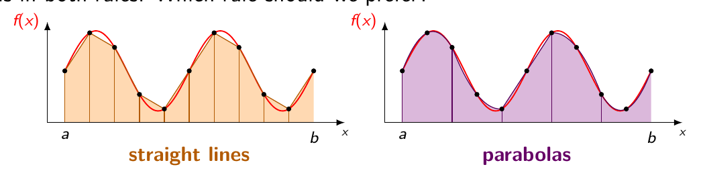
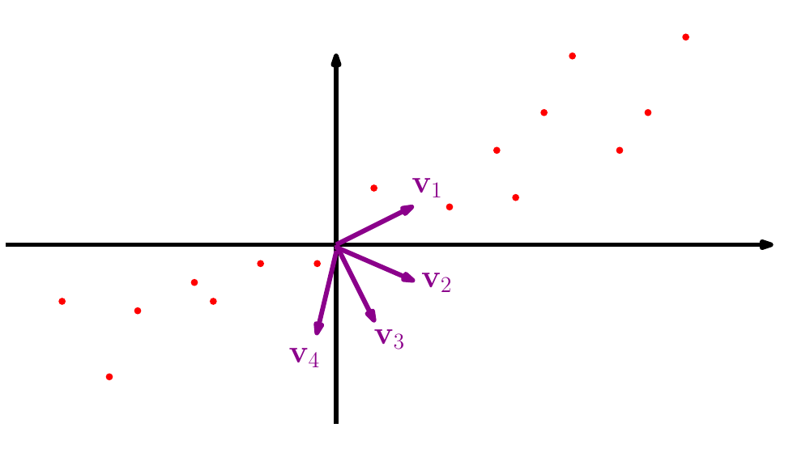
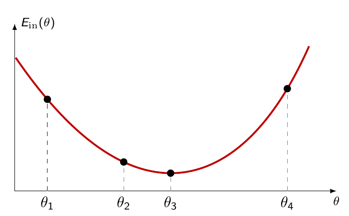
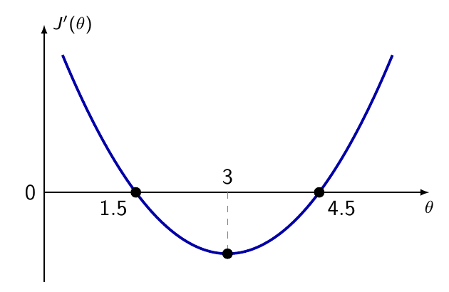

# COMP3670 Quizzes

按 Quiz 1–11 顺序整理原题、选项及答案。同一题的题目页与答案页已合并；图形题附原图，所有题目均附 PDF 页码链接。Quiz 9 的原文件有两组 Q1–Q3，按出现顺序保留。

## Quiz 01

### L1Q1

Which of the following correctly describes the relationship between inductive and deductive reasoning, as discussed in the lecture?

- **A.** They are mutually exclusive; a scientist must commit to one or the other.

- **B.** Induction is logically safe, while deduction can be overturned by a single counter-example.

- **C.** Deduction is logically safe, meaning true premises guarantee a true conclusion, but induction cannot logically guarantee a universal claim from finitely many observations.

- **D.** Inductive reasoning always precedes deductive reasoning in the history of science.

**答案：C。** [原题（第 3 页）](1.pdf#page=3) · [答案页（第 4 页）](1.pdf#page=4)

### L1Q2

The lecture draws an analogy between a hypothesis set that can perfectly fit any possible dataset and the “secret society” example. What is the shared problem?

- **A.** Both require too many parameters to be computationally tractable.

- **B.** Both are unfalsifiable since they accommodate every possible observation and therefore explain nothing.

- **C.** Both lead to slow convergence of the learning algorithm.

- **D.** Both violate the assumption that training data is representative.

**答案：B。** [原题（第 5 页）](1.pdf#page=5) · [答案页（第 6 页）](1.pdf#page=6)

### L1Q3

A company wants to compress gene-expression data (thousands of genes per patient) into a small number of variables that capture the main sources of variation. What ML type and task does this correspond to?

- **A.** Supervised learning—regression.

- **B.** Unsupervised learning—dimensionality reduction.

- **C.** Reinforcement learning—policy learning.

- **D.** Supervised learning—classification.

**答案：B。** [原题（第 8 页）](1.pdf#page=8) · [答案页（第 9 页）](1.pdf#page=9)

### L1Q4

The lecture states that all three types of ML share the same underlying inductive challenge. What is it?

- **A.** Defining a reward signal that correctly grades every possible action.

- **B.** Ensuring labels are collected without measurement noise.

- **C.** Generalising beyond what has been observed in the data.

- **D.** Choosing a hypothesis set that is neither too simple nor too complex.

**答案：C。** [原题（第 10 页）](1.pdf#page=10) · [答案页（第 11 页）](1.pdf#page=11)

### L1Q5

The in-sample error is defined as $E_{\mathrm{in}}(h)=\frac1N\sum_{i=1}^N\mathbf{1}\{h(x_i)\ne y_i\}$. If a hypothesis misclassifies exactly 3 out of 10 training examples, what is $E_{\mathrm{in}}(h)$?

- **A.** 3

- **B.** 7

- **C.** 0.7

- **D.** 0.3

**答案：D。** [原题（第 13 页）](1.pdf#page=13) · [答案页（第 14 页）](1.pdf#page=14)

### L1Q6

What is the risk of choosing a hypothesis set H that is too simple?

- **A.** The model becomes unfalsifiable and cannot be tested.

- **B.** The learning algorithm will overfit the training data.

- **C.** No hypothesis in H may be close to the true target f , regardless of how much data is collected; this is called the approximation error.

- **D.** The learning algorithm will never converge.

**答案：C。** [原题（第 15 页）](1.pdf#page=15) · [答案页（第 16 页）](1.pdf#page=16)

### L1Q7

What does the parameter w0 (the bias) control in the perceptron in the credit approval example?

- **A.** The orientation of the decision boundary.

- **B.** The scale of the feature weights.

- **C.** Where the approve/deny threshold is located, independently of the features.

- **D.** The learning rate of the PLA.

**答案：C。** [原题（第 18 页）](1.pdf#page=18) · [答案页（第 19 页）](1.pdf#page=19)

### L1Q8

What does the convergence theorem for the PLA guarantee, and under what condition?

- **A.** The PLA always finds the unique optimal linear boundary, regardless of the data.

- **B.** If the data is linearly separable, the PLA stops after finitely many updates with zero training error; if not, it loops forever.

- **C.** The PLA converges to a solution with minimum in-sample error even when the data is not linearly separable.

- **D.** The PLA guarantees good out-of-sample performance whenever it converges.

**答案：B。** [原题（第 20 页）](1.pdf#page=20) · [答案页（第 21 页）](1.pdf#page=21)

## Quiz 02

### L2Q1

In a large population of credit applicants, 30% have a low income, 25% have high outstanding debt, and 20% have a short employment history. An applicant is drawn at random. What can be concluded about the probability that they have at least one of the three risk factors?

- **A.** It equals 0.30 + 0.25 + 0.20 = 0.75.

- **B.** It is at least 0.75, since the probability of a union is never smaller than the sum of the individual probabilities.

- **C.** It is at most 0.75, and the exact value cannot be determined without knowing how the three groups overlap.

- **D.** Nothing can be concluded, because the union bound only applies when the three groups are disjoint.

**答案：C。** [原题（第 3 页）](2.pdf#page=3) · [答案页（第 4 页）](2.pdf#page=4)

### L2Q2

A server’s response time, in hours, is modelled as Uniform[0, 1/5]. A student computes f_X(0.1)=1/(1/5-0)=5 and objects: “a probability of 5 is absurd, so the model must be wrong”. What is the correct response?

- **A.** The value 5 is correct, but it is a density, not a probability: for example P(X = 0.1) = 0, and probabilities are areas, so P(0.1 ≤ X ≤ 0.15) = 0.05 × 5 = 0.25.

- **B.** The density has been computed incorrectly: for a Uniform[0, 1/5] it should equal 1/5 rather than 5, and with the correct value no absurdity arises.

- **C.** The value 5 is correct, but a density must be divided by the total area underneath it before it can be read as the probability of the corresponding value.

- **D.** The error is modelling a response time as a continuous quantity: it should be described by a probability mass function, and a mass function can never exceed 1.

**答案：A。** [原题（第 5 页）](2.pdf#page=5) · [答案页（第 6 页）](2.pdf#page=6)

### L2Q3

We must approximate the area under f between a and b, using the same 10 subintervals in both rules. Which rule should we prefer?

- **A.** The trapezoidal rule, because straight lines never overshoot the curve, whereas parabolas can.

- **B.** Simpson’s rule, because on this curve the straight lines cut visibly across every peak and trough, while the parabolas follow the curve almost exactly.

- **C.** Simpson’s rule, because for the same number of subintervals it evaluates f at twice as many points as the trapezoidal rule.

- **D.** Neither: both rules use the same 11 points, so they must give the same approximation.

**答案：B。** [原题（第 8 页）](2.pdf#page=8) · [答案页（第 9 页）](2.pdf#page=9)

### L2Q4

Two delivery services are compared. Service A always delivers in exactly 3 days. Service B delivers in 1 day or in 5 days, each with probability $1/2$. A manager notes that both have an expected delivery time of 3 days and concludes that the two services are equivalent. What is the best assessment?

- **A.** The manager is correct: the expectation is the average outcome, so two random variables with the same expectation behave the same on average, and that is all one can ask of them.

- **B.** The manager is wrong, because Service B’s expected delivery time is not 3: an expectation must be a value the random variable can actually take, and B never delivers in exactly 3 days.

- **C.** The manager is correct as long as the two services have the same variance, and that cannot be decided from the information given.

- **D.** The manager is wrong: both expectations really are 3, but the expectation says nothing about spread. Service B has a far larger variance, and its expected value is not even a possible delivery time.

**答案：D。** [原题（第 10 页）](2.pdf#page=10) · [答案页（第 11 页）](2.pdf#page=11)

### L2Q5

Features take three values, each with probability $1/3$, and η(x) = P(Y = 1 | X = x) satisfies η(x1) = 0.1, η(x2) = 0.6, η(x3) = 0.9 Recall that under the binary loss the error of a rule at a given x is the probability that its prediction differs from Y at that x, and the out-of-sample error is the average of these errors over the distribution of X. What is the target function f⋆ and its out-of-sample error?

- **A.** f⋆ outputs (0.1, 0.6, 0.9), since the target function is the conditional expectation η.

- **B.** f⋆ outputs (0,1,1) and Eout(f⋆ ) = 0, since f⋆ is optimal.

- **C.** f⋆ outputs (0,1,1) and Eout(f⋆) = (0.1 + 0.4 + 0.1)/3 = 0.2.

- **D.** f⋆ outputs (0,1,1) and Eout(f⋆) = 1/3, since it is wrong on one of the three feature values.

**答案：C。** [原题（第 13 页）](2.pdf#page=13) · [答案页（第 14 页）](2.pdf#page=14)

### L2Q6

A hospital predicts a disease from blood pressure. It has 1000 measurements, but they come from only 100 patients, 10 consecutive daily readings each, and the team treats this as a sample with N = 1000. What is the problem?

- **A.** The observations are not independent, since readings on the same patient are largely predictable from one another, so the effective sample size is far below 1000 and the i.i.d. guarantees do not apply.

- **B.** There is no problem: 1000 measurements are 1000 observations, and the i.i.d. assumption concerns only how the patients were selected, not how many readings each of them contributes.

- **C.** The observations are not identically distributed, since blood pressure drifts from one day to the next, but they remain independent, so the sample can be used exactly as it stands.

- **D.** The problem is the size of the sample: N = 1000 is simply too small for any generalisation guarantee to be useful, however the measurements happen to be collected.

**答案：A。** [原题（第 15 页）](2.pdf#page=15) · [答案页（第 16 页）](2.pdf#page=16)

### L2Q7

In Lecture 1 we assumed an ideal rule f mapping each input to its output. In Lecture 2 we saw that two applicants with identical recorded features may repay or default. How are these two statements reconciled?

- **A.** The Lecture 1 picture was simply wrong: once the same input can lead to different outcomes there is no ideal rule to be found, and the supervised framework has to be rebuilt without any notion of a target function.

- **B.** The randomness is only measurement noise: with precise enough instruments and enough recorded features the outcome would be completely determined by the input, so the ideal rule f of Lecture 1 is deterministic after all.

- **C.** The target function maps each x to the outcome actually observed for it in the data: since the dataset is finite each x occurs once, and the conflict only appears if we imagine drawing further applicants with the same features.

- **D.** The target function is defined through the conditional distribution of Y given X: under the binary loss it predicts the most probable label at each x. It is the best rule, not a rule that is always right, and in general its error is greater than zero.

**答案：D。** [原题（第 17 页）](2.pdf#page=17) · [答案页（第 18 页）](2.pdf#page=18)

### L2Q8

Two teams model the same phenomenon on the same 200-example dataset. Team A uses HA = all functions from X to {0,1}; Team B uses the perceptron. Both report Ein(ĥ) = 0. Whose zero is more informative?

- **A.** Team A, because a larger hypothesis set contains rules closer to the target function, so its approximation error is smaller and its fit is therefore more trustworthy.

- **B.** Team B: HA can fit any dataset whatsoever, so a zero Ein(ĥ) there is unfalsifiable and carries no information, whereas the same fit from a restricted hypothesis set is informative.

- **C.** Neither: both teams achieved Ein(ĥ) = 0, and Ein(ĥ) is the only quantity we can actually compute, so from the data alone the two situations are indistinguishable.

- **D.** Team A, because obtaining Ein(ĥ) = 0 from a much larger hypothesis set is a stronger achievement than obtaining it from a small one such as the perceptron.

**答案：B。** [原题（第 19 页）](2.pdf#page=19) · [答案页（第 20 页）](2.pdf#page=20)

## Quiz 03

### L3Q1

A laboratory screens 5,000 candidate genetic markers on a sample of patients and reports the one that predicts the disease best in that sample. A second laboratory had committed in advance to a single marker, suggested by earlier biological work, and tests it on the same patients, obtaining an equally good prediction. Both report the same in-sample error. Which report is entitled to a stronger probabilistic guarantee?

- **A.** Both equally: every one of the 5,000 markers was written down before the records were examined, so the requirement that a hypothesis be fixed in advance is met by the one reported.

- **B.** The first: screening 5,000 markers searches a far larger part of the hypothesis set, so the marker reported is much closer to the best one available, and such a wide search supports a stronger conclusion.

- **C.** The second: the first reports the smallest in-sample error among 5,000 hypotheses evaluated on the same sample, so it was chosen using the data, and its guarantee is weakened by a union bound over all 5,000 candidates.

- **D.** Neither: a guarantee requires the hypothesis to be fixed before the data is collected, and both laboratories worked on patients whose records already existed, so neither report is covered.

**答案：C。** [原题（第 3 页）](3.pdf#page=3) · [答案页（第 4 页）](3.pdf#page=4)

### L3Q2

A model has finite VC dimension, hence is PAC learnable. A team collects a sample of the size prescribed by the theory, runs ERM, and the rule it returns makes many errors, in sample and out of sample alike. Which statement is consistent with the theory?

- **A.** The guarantee has been violated: reaching the prescribed sample size is precisely what drives the in-sample error to zero, so a large in-sample error means that one of the assumptions has failed, most plausibly that the sample is i.i.d.

- **B.** The sample size prescribed by the theory depends on the distribution generating the data: it was computed here for the wrong one, and for the distribution actually at work it would have demanded far more examples.

- **C.** Nothing is inconsistent: finite VC dimension makes the two errors close to each other, which they are, and the theory then says that both of them will come down together once a larger sample is collected.

- **D.** Nothing is inconsistent: the guarantee is only that the rule is nearly as good as the best rule in the model, and if the model is a poor description of the phenomenon, that best rule already makes many errors, which no amount of data repairs.

**答案：D。** [原题（第 5 页）](3.pdf#page=5) · [答案页（第 6 页）](3.pdf#page=6)

### L3Q3

A team fits a very flexible model. Each time the experiment is repeated on a fresh sample, the training fit is perfect, but the rule that is learned looks completely different. What is the right assessment?

- **A.** The instability is a property of the sample size alone and not of the hypothesis set: the only legitimate response is to collect more data, since restricting the hypothesis set would introduce a bias, a price that is never worth paying.

- **B.** It is a large estimation error (variance): a smaller hypothesis set does reduce it, but an arbitrary one may sit far from the target and have a large bias instead; a remedy is to choose the set based on prior information, or via model selection.

- **C.** The model is too flexible and must be restricted; among the smaller candidate sets, the one to keep is the one whose fitted hypothesis attains the smallest in-sample error, since that is what measures how well a model describes the data.

- **D.** A perfect fit on every sample shows that the hypothesis set can fit any labelling whatsoever, so its VC dimension is infinite and nothing can be learned about this phenomenon, whatever the sample size.

**答案：B。** [原题（第 8 页）](3.pdf#page=8) · [答案页（第 9 页）](3.pdf#page=9)

### L3Q4

A team splits its data into training, validation and test. It selects a model using the validation set, refits, and measures Etest = 0.15. Disappointed, it tries three further models, each trained in the same way and evaluated on the same test set, and reports the best of the four, Etest = 0.09. Is the reported 0.09 an honest estimate of Eout?

- **A.** Yes: no model saw the test labels while it was being trained, and all that is required for the estimate to be honest is that the hypothesis be fixed before the test data is used, which holds for each of the four separately.

- **B.** Yes: each of the four test errors is an unbiased estimate of the out-of-sample error of its own rule, so reporting the smallest of four unbiased estimates is simply reporting the most accurate figure the team has obtained.

- **C.** No: with respect to the test sample the reported rule is not a fixed hypothesis but the winner of a comparison made on that sample, so 0.09 is optimistically biased. The test set has been spent as a second validation set, and an honest figure requires data untouched by all four decisions.

- **D.** No, but the remedy is simple: report the average of the four test errors instead of the smallest of them, since averaging cancels the advantage that the winner obtained by having been selected.

**答案：C。** [原题（第 10 页）](3.pdf#page=10) · [答案页（第 11 页）](3.pdf#page=11)

## Quiz 04

### L4Q1

A bank fits a logistic regression and denies credit when the estimated probability of default exceeds $1/2$. A student objects: “the perceptron of Lecture 1 can only draw a straight line, whereas logistic regression fits an S-shaped curve, so it is the strictly more powerful model”. What is the correct assessment?

- **A.** The student is wrong for this bank, but right in general: it is the threshold $1/2$ that makes the boundary a hyperplane. With a threshold reflecting what a default costs the bank, say 0.15, the S-shape is cut at another height and the boundary curves.

- **B.** The student is wrong at any threshold: the rule compares the score with a constant, so the boundary is a hyperplane and the set of classifiers considered is exactly the perceptron’s. What it supplies is a criterion for choosing among those hyperplanes, maximum likelihood, that is the cross-entropy loss, and a probability for each applicant. Moving the threshold to c only shifts the intercept: {η̂ > c} is a half-space for every c.

- **C.** The student is wrong, and more strongly than they realise: the two procedures share the hypothesis set and the answer, since both return the hyperplane with the smallest Ein.

- **D.** The student is right, though not for the reason given: the perceptron’s hypothesis set consists of classifiers, while the logistic model’s consists of functions η(· | θ) with values in [0,1], a far larger set, and its extra members produce decision boundaries no hyperplane can reproduce.

**答案：B。** [原题（第 2 页）](4.pdf#page=2) · [答案页（第 3 页）](4.pdf#page=3)

### L4Q4

The lecture states that fully-grown trees should never be used, and then defines a random forest as a large collection of fully-grown trees. A student sees a contradiction. What is the right reply?

- **A.** There is no contradiction: each tree is grown on a bootstrap sample, which contains only about two thirds of the distinct observations, so the trees are grown on less data than is available and none of them is fully grown in the sense the warning had in mind.

- **B.** There is no contradiction: at every split a tree may only consider a different random subset of the variables, so each tree can no longer isolate every observation in a leaf of its own, and restricting the model is precisely what the warning asked for.

- **C.** There is no contradiction: a fully-grown tree has low bias and very high variance, and it is the variance that the vote in a random forest removes. The bias is left where it was, while the disagreements between the trees, made possible by the bootstrap and by the random subset of variables considered, cancel out. Individually they overfit; collectively they do not. The price of the vote is the one thing a single tree was best at: interpretability.

- **D.** The student is right: a forest of fully-grown trees attains an in-sample error of essentially zero as well, and it overfits exactly as much as one such tree.

**答案：C。** [原题（第 4 页）](4.pdf#page=4) · [答案页（第 5 页）](4.pdf#page=5)

## Quiz 05

### Q1

Consider four vectors in $\mathbb{R}^2$: $x_1=(1,2)^T$, $x_2=(4,6)^T$, $x_3=(5,4)^T$, and $x_4=(-2,3)^T$. Which pair is closest in Euclidean distance?

- **A.** $x_1$ and $x_3$
- **B.** $x_1$ and $x_4$
- **C.** $x_2$ and $x_3$
- **D.** $x_3$ and $x_4$

**答案：C。** The squared distances are $d(x_1,x_2)^2=25$, $d(x_1,x_3)^2=20$, $d(x_1,x_4)^2=10$, $d(x_2,x_3)^2=5$, $d(x_2,x_4)^2=45$, and $d(x_3,x_4)^2=50$. Thus $x_2$ and $x_3$ are closest. [原题](5.pdf#page=1) · [答案页](5.pdf#page=2)

### Q2

During a K-Means assignment step, the centroids are $c_1=(1,1)^T$, $c_2=(5,4)^T$, $c_3=(8,1)^T$, and $c_4=(7,2)^T$. The point $x=(5,2)^T$ originally belongs to $C_4$. To which cluster is it assigned?

- **A.** $C_1$
- **B.** $C_2$
- **C.** $C_3$
- **D.** $C_4$

**答案：D。** The squared distances to the four centroids are $17,4,10,4$. Since $c_2$ and $c_4$ tie, the tie rule keeps $x$ in its original cluster $C_4$. [原题](5.pdf#page=3) · [答案页](5.pdf#page=4)

### Q3

Two runs of K-Means use the same dataset, the same value of $k$, and the same tie rule, but start from different nonempty initial partitions. Assuming neither run encounters an empty cluster, which statement is correct?

- **A.** They must end with the same clustering because SSE decreases in both runs.
- **B.** They can end with different clusterings.
- **C.** The run with smaller initial SSE must also have smaller final SSE.
- **D.** Both runs must reach the globally smallest possible SSE.

**答案：B。** SSE decreases and each run terminates, but different initial partitions can lead to different stable clusterings. [原题](5.pdf#page=5) · [答案页](5.pdf#page=6)

## Quiz 06

### Q1

A system with four unknowns has the reduced augmented matrix

$$\begin{pmatrix}1&0&-3&0&4\\0&1&2&0&-1\\0&0&0&1&5\\0&0&0&0&0\end{pmatrix}.$$

Which statement is correct?

- **A.** It has no solution.
- **B.** It has exactly one solution.
- **C.** It has infinitely many solutions.
- **D.** The matrix does not give enough information.

**答案：C。** Columns 1, 2, and 4 contain pivots, but column 3 does not. Thus $w_3$ is free and the system has infinitely many solutions. [原题](6.pdf#page=1) · [答案页](6.pdf#page=2)

### Q2

In Example 1, $c_3=c_1+c_2$. Which vector $z$ guarantees $X(w+z)=Xw$ for every weight vector $w$?

- **A.** $z=(-1,-1,1,0)^T$
- **B.** $z=(1,-1,0,0)^T$
- **C.** $z=(0,-1,1,0)^T$
- **D.** $z=(0,0,0,1)^T$

**答案：A。** For $z=(-1,-1,1,0)^T$, $Xz=-c_1-c_2+c_3=0$. Hence $z\in\operatorname{Nul}(X)$ and $X(w+z)=Xw$. [原题](6.pdf#page=3) · [答案页](6.pdf#page=4)

## Quiz 07

### Q1

In $\mathbb{R}^3$, let $v_1=(3,0,0)^T$, $v_2=(0,5,0)^T$, $v_3=(6,9,0)^T$, and $v_4=(0,0,7)^T$. Which list is a basis of $\mathbb{R}^3$?

- **A.** $v_1,v_2,v_3$
- **B.** $v_1,v_2,v_3,v_4$
- **C.** $v_1,v_3$
- **D.** $v_1,v_2,v_4$

**答案：D。** $v_1,v_2,v_4$ point in the three coordinate directions. Since $v_3=2v_1+1.8v_2$, A and B are dependent; C has only two vectors. [原题](7.pdf#page=1) · [答案页](7.pdf#page=2)

### Q2

A matrix $M\in\mathbb{R}^{5\times6}$ has the row-echelon form

$$M\sim\begin{pmatrix}3&-1&-2&0&-1&0\\0&0&0&1&-2&0\\0&0&0&0&0&1\\0&0&0&0&0&0\\0&0&0&0&0&0\end{pmatrix}.$$

What are the rank and nullity of $M$?

- **A.** Rank 3, nullity 3
- **B.** Rank 2, nullity 4
- **C.** Rank 3, nullity 2
- **D.** Rank 2, nullity 3

**答案：A。** There are three pivots, so the rank is 3. By rank-nullity, $6-3=3$ is the nullity. [原题](7.pdf#page=3) · [答案页](7.pdf#page=4)

## Quiz 08

### Q1

Let $w=(1,3)^T$, $b=10$, and $x=(4,-6)^T$. What is the Euclidean distance from $x$ to the decision boundary?

- **A.** $-2/5$
- **B.** $2/5$
- **C.** $-4/\sqrt{10}$
- **D.** $4/\sqrt{10}$

**答案：D。** The score is $w^Tx+b=4-18+10=-4$ and $\|w\|_2=\sqrt{10}$. Distance is $|{-4}|/\sqrt{10}$. [原题](8.pdf#page=1) · [答案页](8.pdf#page=2)

### Q2

In Example 3, the smallest functional margin is 1 and the geometric margin is 5. Multiply both $w$ and $b$ by 6. What are the new smallest functional margin and geometric margin, respectively?

- **A.** 6 and 30
- **B.** 6 and 5
- **C.** 1 and 5
- **D.** 1 and 30

**答案：B。** Functional margins and $\|w\|_2$ both scale by 6, so the geometric margin stays 5. [原题](8.pdf#page=3) · [答案页](8.pdf#page=4)

### Q3

Keep $w=(3,4)^T/25$ and $b=-2$. Give the datapoint $x=(8,9)^T$ label $y=-1$. What is its hinge loss?

- **A.** 0
- **B.** $3/5$
- **C.** $2/5$
- **D.** $7/5$

**答案：D。** The score is $(3\cdot8+4\cdot9)/25-2=2/5$. The functional margin is $-2/5$, so the hinge loss is $\max(0,1+2/5)=7/5$. [原题](8.pdf#page=5) · [答案页](8.pdf#page=6)

## Quiz 09

### Q1 — Eigenvectors

Let $A=\begin{pmatrix}9&-2\\-2&6\end{pmatrix}$, $v_1=(1,2)^T$, $v_2=(1,-3)^T$, $v_3=(-2,1)^T$, and $v_4=(0,0)^T$. Which option lists exactly the eigenvectors of $A$ among these four vectors?

- **A.** $v_1,v_4$
- **B.** $v_2,v_3$
- **C.** $v_1,v_3,v_4$
- **D.** $v_1,v_3$

**答案：D。** $Av_1=5v_1$ and $Av_3=10v_3$; $v_2$ is not an eigenvector, and the zero vector cannot be one. [原题](9.pdf#page=1) · [答案页](9.pdf#page=2)

### Q2 — Covariance matrices

Let $C_1=\begin{pmatrix}2&3\\3&2\end{pmatrix}$, $C_2=\begin{pmatrix}3&2\\2&3\end{pmatrix}$, and $C_3=\begin{pmatrix}3&-1\\1&2\end{pmatrix}$. Which option lists exactly the matrices that cannot be a dataset's covariance matrix?

- **A.** $C_1$
- **B.** $C_3$
- **C.** $C_1,C_3$
- **D.** $C_1,C_2,C_3$

**答案：C。** A covariance matrix must be symmetric and positive semidefinite. $C_1$ has eigenvalue $-1$; $C_3$ is not symmetric. $C_2$ is symmetric with eigenvalues 5 and 1. [原题](9.pdf#page=3) · [答案页](9.pdf#page=4)

### Q3 — Projection variance

Which direction gives the largest variance of the plotted datapoints' orthogonal projections onto its line?

- **A.** $v_1$
- **B.** $v_2$
- **C.** $v_3$
- **D.** $v_4$

**答案：A。** The cloud extends mainly along $v_1$, so projections onto that line have the largest spread. [原题](9.pdf#page=5) · [答案页](9.pdf#page=6)

### Q1 — PCA scores

PCA uses the directions $q_1=(1,1,1,1)^T/2$ and $q_2=(1,1,-1,-1)^T/2$. A new datapoint has $x-\mu=(12,8,-4,-4)^T$. What are its two retained PCA scores?

- **A.** $(12,8)^T$
- **B.** $(6,-14)^T$
- **C.** $(6,14)^T$
- **D.** $(3,7)^T$

**答案：C。** The inner products are $q_1^T(x-\mu)=6$ and $q_2^T(x-\mu)=14$. [原题](9.pdf#page=7) · [答案页](9.pdf#page=8)

### Q2 — Retained variance

A covariance matrix has ordered eigenvalues $35,31,25,3,2,1.5,1,1,0.5$, whose sum is 100. What are the smallest numbers of PCs needed to retain at least 90% and at least 95% of the variance, respectively?

- **A.** 4 and 6
- **B.** 3 and 5
- **C.** 3 and 6
- **D.** 5 and 7

**答案：B。** The first three PCs retain 91%; the first four retain 94%; the first five retain 96%. Thus the minima are 3 and 5. [原题](9.pdf#page=9) · [答案页](9.pdf#page=10)

### Q3 — PCA and labels

Consider eight datapoints $(\pm20,\pm10,\pm3)^T$ with all sign combinations. The label is $+1$ when the third feature is positive and $-1$ otherwise. Apply PCA without feature scaling and retain the first two PCs. Which statement is correct?

- **A.** Retaining more than 98% of variance guarantees that the labels remain distinguishable.
- **B.** Datapoints with opposite labels can overlap in the retained representation.
- **C.** The third feature has more variance than the first.
- **D.** PCA uses the labels to retain the third feature.

**答案：B。** The covariance is $\operatorname{diag}(400,100,9)$, so the leading PCs omit the label-defining third feature, despite retaining about 98.23% of variance. [原题](9.pdf#page=11) · [答案页](9.pdf#page=12)

## Quiz 10

### Q1

Interpret Example 2's $3\times2$ matrix $A$ as user-item data: three users and two items. Which statement correctly interprets $Av_i=\sigma_i u_i$?

- **A.** $A$ converts an item-space input vector into a user-space output vector.
- **B.** $A$ converts one user's latent embedding into one item's latent embedding.
- **C.** $A$ converts a user-space input vector into an item-space output vector.
- **D.** $A$ converts one item's latent embedding into one user's latent embedding.

**答案：A。** $v_i\in\mathbb{R}^2$ has one entry per item; $Av_i\in\mathbb{R}^3$ has one entry per user. [原题](10.pdf#page=1) · [答案页](10.pdf#page=2)

### Q2

The validation pairs have ratings $r_{12}=8$ and $r_{43}=10$. A fitted model predicts $\hat r_{12}=10$ and $\hat r_{43}=7$. It also predicts $\hat r_{13}=4$, but $r_{13}$ is unknown. What is the validation RMSE?

- **A.** $13/2$
- **B.** $\sqrt{13/2}$
- **C.** $\sqrt{29/3}$
- **D.** $\sqrt{13/3}$

**答案：B。** Only the two pairs with known ratings count: $\mathrm{RMSE}_{\mathrm{val}}=\sqrt{((8-10)^2+(10-7)^2)/2}=\sqrt{13/2}\approx2.55$. [原题](10.pdf#page=3) · [答案页](10.pdf#page=4)

## Quiz 11

### L11Q1

The plot shows the in-sample error Ein(θ) of a model with one parameter. One step of the update $\theta\leftarrow\theta-\alpha E_{\mathrm{in}}'(\theta)$ is taken from each of the four marked values, with the same small α > 0. From which value does the parameter move furthest to the right?

- **A.** From θ1

- **B.** From θ2

- **C.** From θ3

- **D.** From θ4

**答案：A。** The update moves right where the derivative is negative; θ1 has the steepest negative slope. At θ3 it does not move, while θ4 moves left. [原题（第 2 页）](11.pdf#page=2) · [答案页（第 3 页）](11.pdf#page=3)

### L11Q2

The plot shows the derivative J′(θ) of an error J(θ), and not the error itself. At which value of θ does the error J have a local minimum?

- **A.** At θ = 3, the lowest point of the plotted curve

- **B.** At θ = 1.5, where the derivative is zero and decreasing

- **C.** At θ = 4.5, where the derivative is zero and increasing

- **D.** At both θ = 1.5 and θ = 4.5, since the derivative is zero at both

**答案：C。** At θ = 4.5, $J′$ changes from negative to positive, so $J$ decreases then increases. [原题（第 4 页）](11.pdf#page=4) · [答案页（第 5 页）](11.pdf#page=5)
