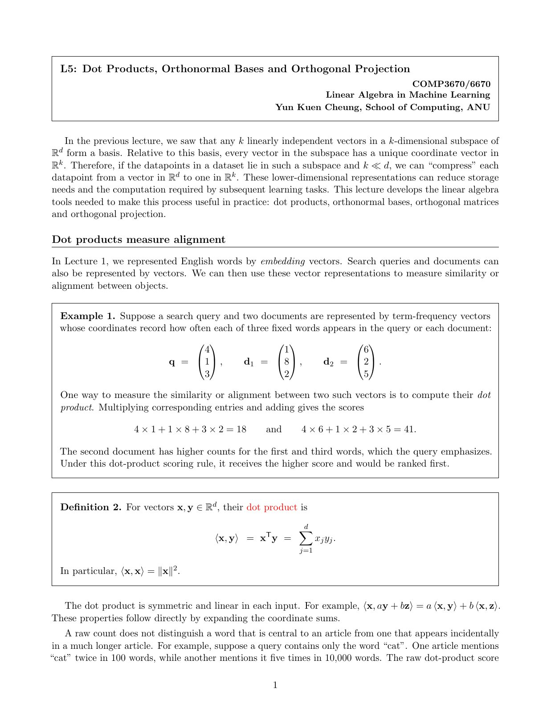
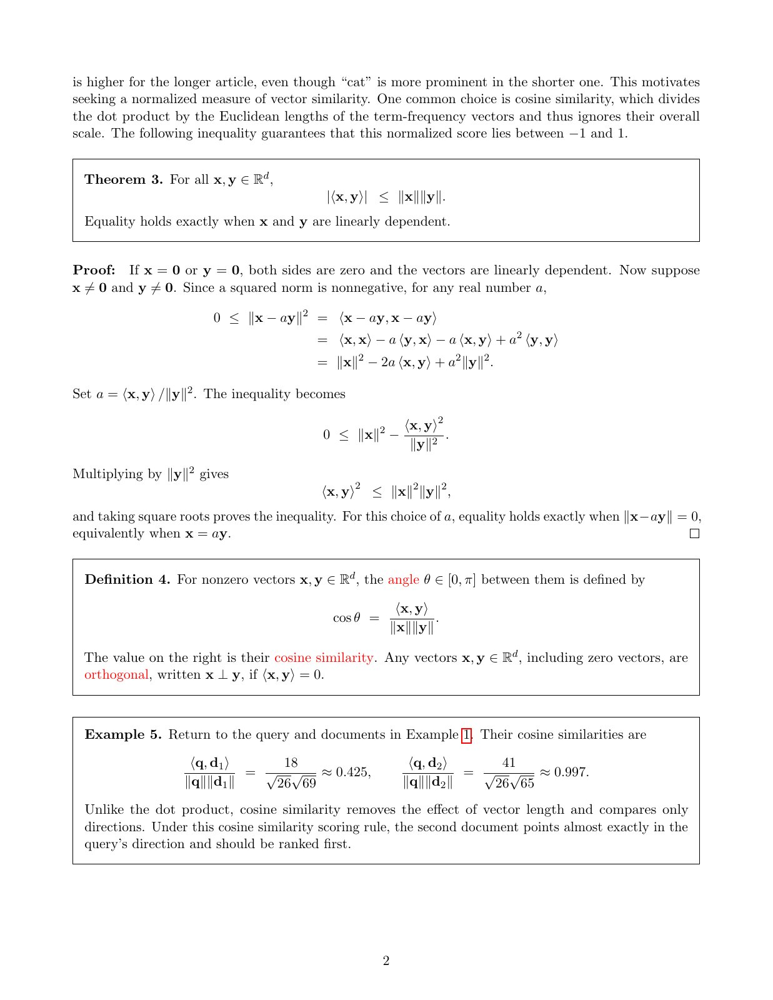
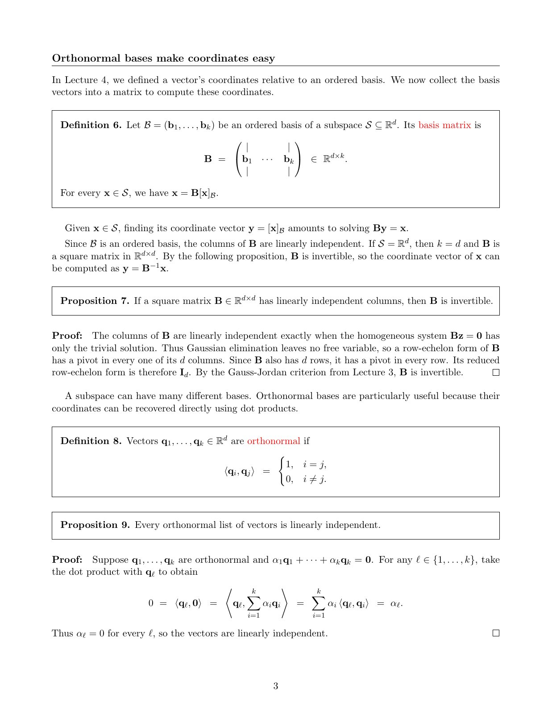
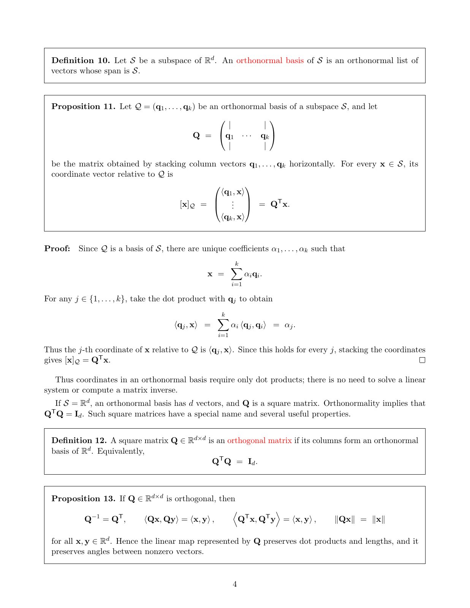
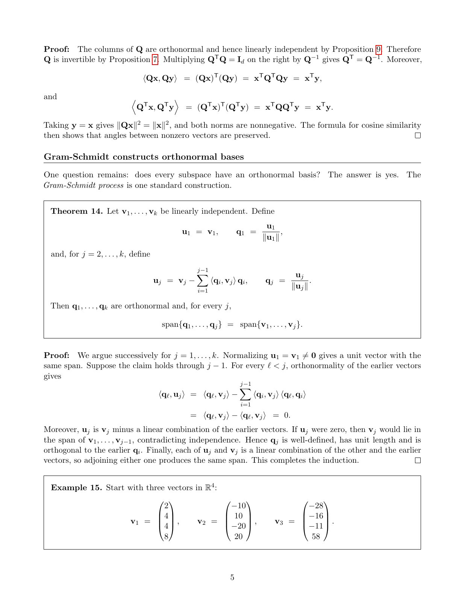
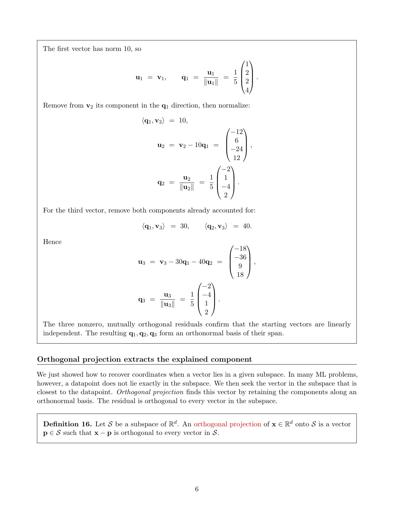
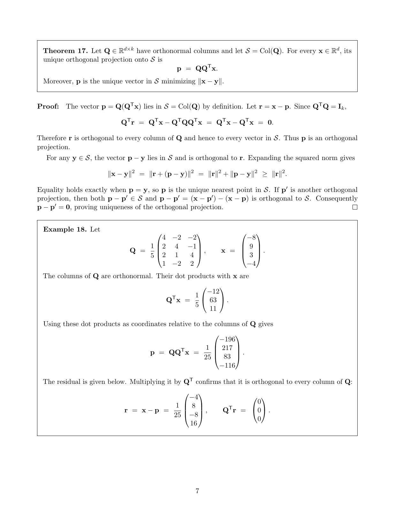

# LA Lecture 05：点积、标准正交基与正交投影，按 PDF 逐页复述

来源：[LA_lecture05.pdf](../../comp3670_lectures/LA_lecture05.pdf)，共 7 个 PDF 页面。严格按 PDF 页序组织，章节页、例题续页和参考文献页也单独保留。正文用中文讲解概念、公式和图表；原页未写出的解答、纠错或推导明确标为“理解补充”。每节末尾可展开完整原始讲义核对颜色、标注和排版。图片和 PDF 均使用仓库相对路径，适合本地预览与 GitHub。本文件的原稿是连续排版的讲义，因此页标题概括该 PDF 页包含的多个小节，不把一页拆成虚构的幻灯片。

## 第 1 页：从降维动机到点积：例 1、定义 2

本讲主题是点积、标准正交基和正交投影。若数据位于 $\mathbb R^d$ 的 $k$ 维子空间，可用 $k$ 个基坐标表示；当 $k\ll d$ 时可减少存储和后续计算。关键问题是怎样方便地求坐标，以及数据不恰好位于子空间时怎样近似。

**点积与搜索例子。**查询和文档词频向量为 $q=(4,1,3)^T$、$d_1=(1,8,2)^T$、$d_2=(6,2,5)^T$。逐项相乘再求和得到 $q^Td_1=18$、$q^Td_2=41$，所以原始点积评分更偏好文档 2。

**定义 2。**对 $x,y\in\mathbb R^d$，

$$
\langle x,y\rangle=x^Ty=\sum_{j=1}^dx_jy_j,\qquad\langle x,x\rangle=\|x\|_2^2.
$$

点积对称，并对每个输入线性，如 $\langle x,ay+bz\rangle=a\langle x,y\rangle+b\langle x,z\rangle$。本页末尾指出原始词频的局限：100 词文章提到 cat 两次，10,000 词文章提到五次，原始计数却偏好后者；此讨论在下一页继续。

展开第 1 页原始讲义，核对图表、标注和公式

## 第 2 页：Cauchy–Schwarz、夹角和余弦相似度：定理 3、定义 4、例 5

本页接续说明：余弦相似度除去向量整体尺度，使比较集中于方向。

**定理 3。**$|\langle x,y\rangle|\le\|x\|\|y\|$，等号当且仅当两向量线性相关。证明先单独处理零向量；对非零 $y$ 展开

$$
0\le\|x-ay\|^2=\|x\|^2-2a\langle x,y\rangle+a^2\|y\|^2.
$$

取 $a=\langle x,y\rangle/\|y\|^2$，得到 $\langle x,y\rangle^2\le\|x\|^2\|y\|^2$。等号要求 $x=ay$。

**定义 4。**非零向量的夹角由 $\cos\theta=\langle x,y\rangle/(\|x\|\|y\|)$ 定义，值在 $[-1,1]$ 内。正交只要求点积为 0，允许零向量；余弦相似度不允许零向量作分母。

**例 5。**前页三个向量的范数为 $\sqrt{26},\sqrt{69},\sqrt{65}$，故两项余弦相似度为 $18/\sqrt{26\cdot69}\approx0.425$ 与 $41/\sqrt{26\cdot65}\approx0.997$。文档 2 的方向几乎与查询一致。

展开第 2 页原始讲义，核对图表、标注和公式

## 第 3 页：一般基矩阵、可逆性与标准正交向量：定义 6、命题 7、定义 8、命题 9

**定义 6。**有序基 $\mathcal B=(b_1,\ldots,b_k)$ 的基矩阵 $B=[b_1\ \cdots\ b_k]\in\mathbb R^{d\times k}$，满足 $x=B[x]_{\mathcal B}$。一般坐标需解 $By=x$；若 $k=d$，则可用 $y=B^{-1}x$。

**命题 7 及证明。**方阵列线性无关则可逆。因为 $Bz=0$ 只有零解，所以消元后每列都有主元；方阵也因此每行有主元，简化行阶梯形为 $I_d$，由 Gauss–Jordan 判据可逆。

**定义 8。**标准正交列表满足 $\langle q_i,q_j\rangle=\delta_{ij}$：每个向量长度为 1，不同向量彼此正交。

**命题 9 及证明。**标准正交列表线性无关。若 $\sum_i\alpha_iq_i=0$，与 $q_\ell$ 点积后只剩 $\alpha_\ell=0$，对所有 $\ell$ 均成立。正交性使每个系数可以被独立“读出”。

展开第 3 页原始讲义，核对图表、标注和公式

## 第 4 页：标准正交坐标与正交矩阵：定义 10、命题 11、定义 12、命题 13

**定义 10 与命题 11。**若 $q_1,\ldots,q_k$ 标准正交且张成 $S$，就是 $S$ 的标准正交基。列矩阵 $Q\in\mathbb R^{d\times k}$ 对每个 $x\in S$ 给出

$$
[x]_{\mathcal Q}=Q^Tx,\qquad x=Q(Q^Tx).
$$

证明把 $x=\sum_i\alpha_iq_i$ 与各 $q_j$ 点积，得到 $\alpha_j=\langle q_j,x\rangle$。因此无需重新解线性方程组。

**定义 12。**正交矩阵特指方阵 $Q\in\mathbb R^{d\times d}$，满足 $Q^TQ=I_d$。命题 13 断言 $Q^{-1}=Q^T$，且 $Q$、$Q^T$ 都保持点积、长度以及非零向量的夹角；证明在下一页继续。

**理解补充：**矩形矩阵也可有标准正交列并满足 $Q^TQ=I_k$，但一般没有双侧逆，$QQ^T$ 通常也不是 $I_d$。只有 $x\in S$ 时，$Q^Tx$ 才是 $x$ 的精确基坐标；对空间外的点，它是投影的坐标。

展开第 4 页原始讲义，核对图表、标注和公式

## 第 5 页：正交矩阵证明、Gram–Schmidt 定理 14 与例 15 的输入

**命题 13 的证明。**正交列线性无关，方阵因而可逆，由 $Q^TQ=I$ 得 $Q^{-1}=Q^T$。进一步 $(Qx)^T(Qy)=x^Ty$，同理 $Q^T$ 保持点积；令 $y=x$ 得长度不变，再由余弦公式得夹角不变。

**定理 14：Gram–Schmidt。**对线性无关 $v_1,\ldots,v_k$，依次计算

$$
u_1=v_1,\ q_1=\frac{u_1}{\|u_1\|},\qquad u_j=v_j-\sum_{i<j}\langle q_i,v_j\rangle q_i,\ q_j=\frac{u_j}{\|u_j\|}.
$$

所得向量标准正交，并对每个前缀保持张成空间相同。证明用归纳：减去已有方向后与它们点积为零；若残差为零，原来的 $v_j$ 就依赖于之前向量，矛盾；归一化只改变长度，不改变新方向。

**例 15 起点。**原稿给出

$$
v_1=(2,4,4,8)^T,\quad v_2=(-10,10,-20,20)^T,\quad v_3=(-28,-16,-11,58)^T.
$$

具体正交化计算延续到下一页。

展开第 5 页原始讲义，核对图表、标注和公式

## 第 6 页：Gram–Schmidt 手算续例，以及投影定义 16

**例 15 计算。**$\|v_1\|=10$，故 $q_1=\frac15(1,2,2,4)^T$。第二个方向满足 $\langle q_1,v_2\rangle=10$，

$$
u_2=v_2-10q_1=(-12,6,-24,12)^T,\qquad q_2=\tfrac15(-2,1,-4,2)^T.
$$

第三个向量在已知方向的系数为 30 与 40，因此

$$
u_3=v_3-30q_1-40q_2=(-18,-36,9,18)^T,\qquad q_3=\tfrac15(-2,-4,1,2)^T.
$$

三个残差都非零，最终三个 $q_i$ 标准正交且与原向量张成相同空间。**理解补充：**残差长度依次为 10、30、45，可据此核对归一化系数。

**转入正交投影。**若数据点不位于子空间中，就寻找子空间内离它最近的点。定义 16 将 $p\in S$ 称为 $x$ 到 $S$ 的正交投影，条件是残差 $x-p$ 与 $S$ 中所有向量正交；具体存在性、唯一性与公式在下一页证明。

展开第 6 页原始讲义，核对图表、标注和公式

## 第 7 页：投影定理 17 的证明与例 18

**定理 17。**$Q\in\mathbb R^{d\times k}$ 列标准正交、$S=\operatorname{Col}(Q)$ 时，唯一正交投影为 $p=QQ^Tx$，同时唯一最小化 $\|x-y\|$（$y\in S$）。

证明先看 $p\in S$，再令 $r=x-p$，由 $Q^Tr=Q^Tx-Q^TQQ^Tx=0$ 得 $r\perp S$。对任意 $y\in S$，

$$
\|x-y\|^2=\|r\|^2+\|p-y\|^2\ge\|r\|^2,
$$

等号仅当 $y=p$。另一正交投影与 $p$ 的差既属于 $S$ 又正交于 $S$，故只能为零。

**例 18。**

$$
Q=\frac15\begin{pmatrix}4&-2&-2\\2&4&-1\\2&1&4\\1&-2&2\end{pmatrix},\qquad x=(-8,9,3,-4)^T.
$$

先压缩为 $Q^Tx=\frac15(-12,63,11)^T$，再重构

$$
p=\frac1{25}(-196,217,83,-116)^T,\qquad r=\frac1{25}(-4,8,-8,16)^T.
$$

直接检查 $Q^Tr=0$。坐标是三维向量，投影和残差仍为四维向量；不要把压缩坐标与原空间投影混为一谈。

展开第 7 页原始讲义，核对图表、标注和公式

