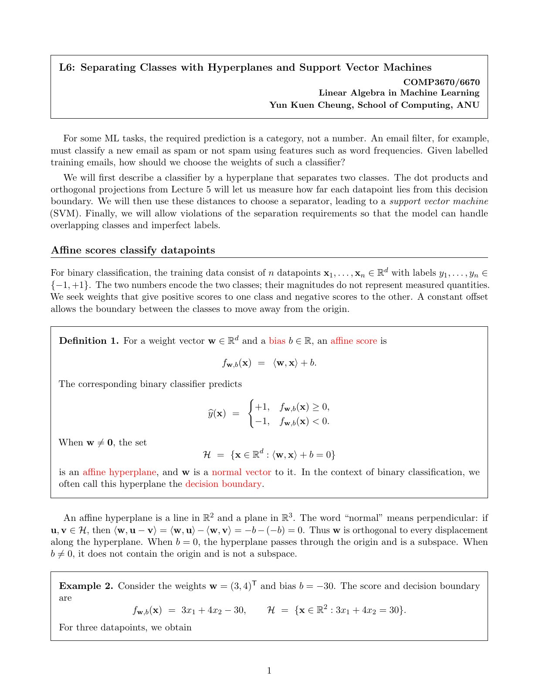
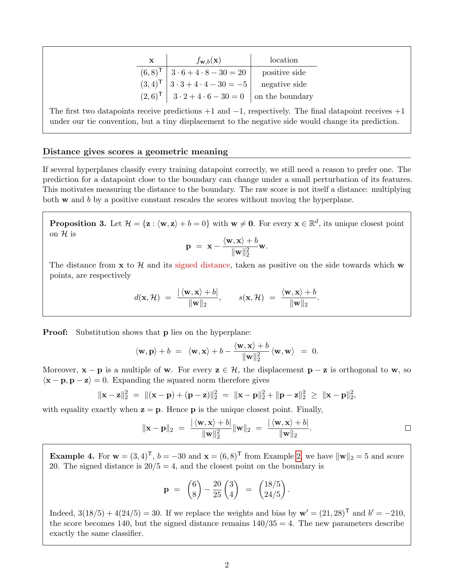
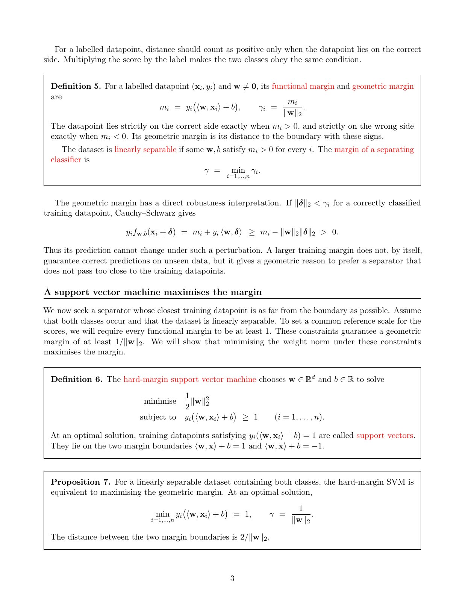
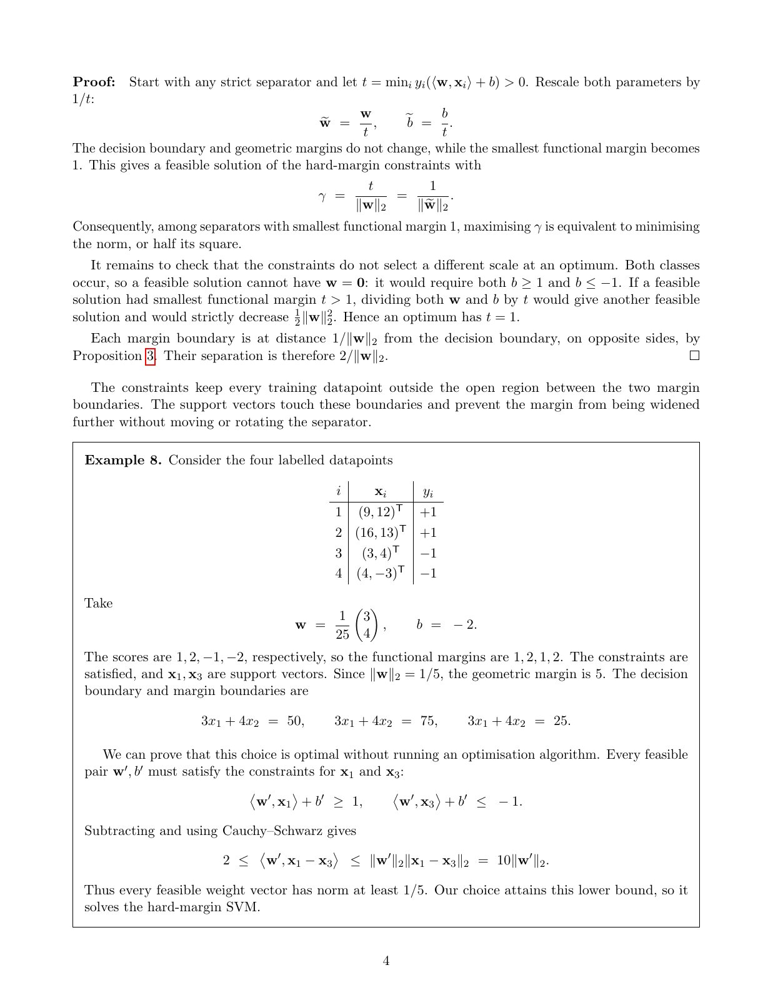
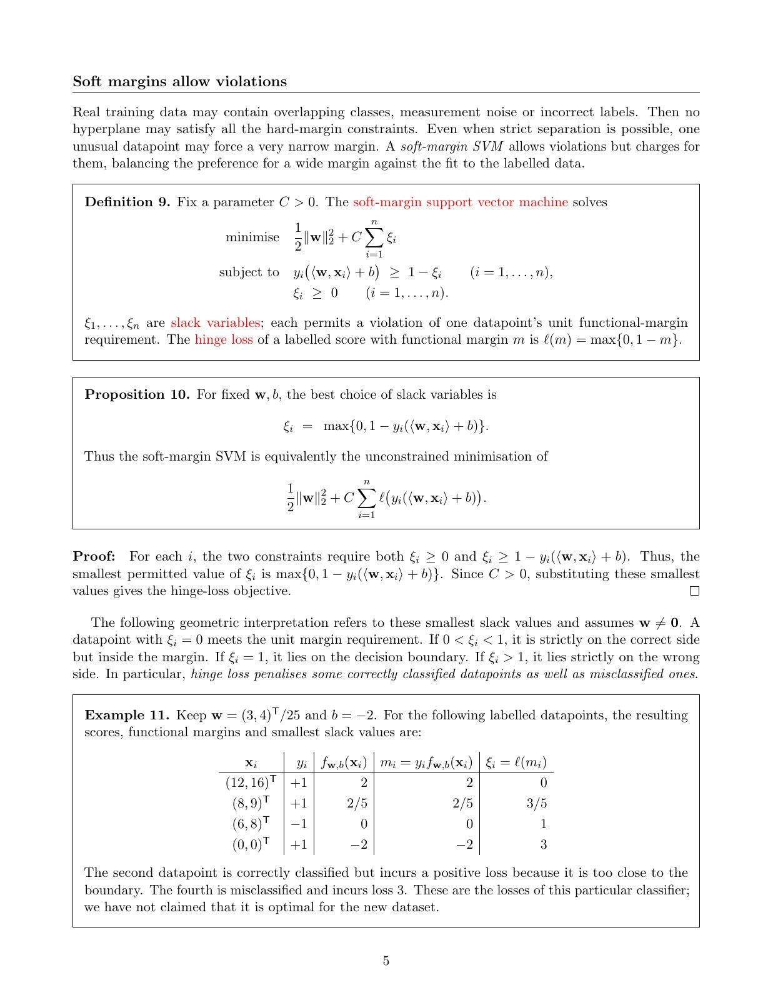
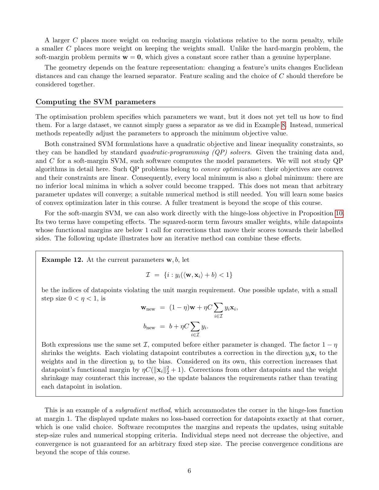

# LA Lecture 06：超平面分类、几何间隔与支持向量机，按 PDF 逐页复述

来源：[LA_lecture06.pdf](../../comp3670_lectures/LA_lecture06.pdf)，共 6 个 PDF 页面。严格按 PDF 页序组织，章节页、例题续页和参考文献页也单独保留。正文用中文讲解概念、公式和图表；原页未写出的解答、纠错或推导明确标为“理解补充”。每节末尾可展开完整原始讲义核对颜色、标注和排版。图片和 PDF 均使用仓库相对路径，适合本地预览与 GitHub。本文件的原稿是连续排版的讲义，因此页标题概括该 PDF 页包含的多个小节，不把一页拆成虚构的幻灯片。

## 第 1 页：仿射打分与超平面：定义 1、例 2 起点

本讲先用点积定义分类边界，再用几何距离比较不同分隔器，导出硬间隔和软间隔 SVM。训练点 $x_i\in\mathbb R^d$，标签 $y_i\in\{-1,+1\}$ 只编码类别，不表示数量大小。

**定义 1。**仿射分数为 $f_{w,b}(x)=\langle w,x\rangle+b$。本讲约定分数 **大于等于 0 预测 $+1$**，小于 0 预测 $-1$；这与普通 lecture 01 的零分约定不同。$w\ne0$ 时决策边界 $H=\{x:w^Tx+b=0\}$ 是超平面，$w$ 是法向量。

若 $u,v\in H$，则 $w^T(u-v)=0$，说明沿边界的所有位移均垂直于 $w$。$b=0$ 时边界经过原点，是线性子空间；$b\ne0$ 时是平移后的仿射集合，通常不是子空间。

**例 2 起点。**$w=(3,4)^T$、$b=-30$，分数为 $3x_1+4x_2-30$，边界是 $3x_1+4x_2=30$。具体三点的分类在下一页列出。

展开第 1 页原始讲义，核对图表、标注和公式

## 第 2 页：超平面投影与距离：例 2 续、命题 3、例 4

**例 2 续。**$(6,8)$ 分数 20，在正侧；$(3,4)$ 分数 $-5$，在负侧；$(2,6)$ 分数 0，在边界，按本讲约定预测正类，但微小扰动就可能改变分类。

**命题 3。**对 $w\ne0$，点 $x$ 在超平面上的最近点为

$$
p=x-\frac{w^Tx+b}{\|w\|^2}w,
$$

无符号距离和有符号距离分别为

$$
d(x,H)=\frac{|w^Tx+b|}{\|w\|},\qquad s(x,H)=\frac{w^Tx+b}{\|w\|}.
$$

证明先代入验证 $p\in H$，再用 $x-p$ 平行 $w$、$p-z\perp w$ 得 $\|x-z\|^2=\|x-p\|^2+\|p-z\|^2$，故最近点唯一。

**例 4。**$x=(6,8)$ 时 $\|w\|=5$，有符号距离 $20/5=4$，投影为 $(18/5,24/5)$。把 $w,b$ 同乘 7，分数变 140，范数变 35，距离仍为 4。原始分数随缩放变化，所以不能直接视为距离。

展开第 2 页原始讲义，核对图表、标注和公式

## 第 3 页：函数间隔、几何间隔与硬间隔 SVM：定义 5、6，命题 7

**定义 5。**带标签的函数间隔与几何间隔为

$$
m_i=y_i(w^Tx_i+b),\qquad\gamma_i=\frac{m_i}{\|w\|}.
$$

$m_i>0$ 表示严格位于正确侧，$m_i<0$ 表示错误侧；线性可分要求存在参数使全部 $m_i>0$。分隔器的训练间隔为 $\gamma=\min_i\gamma_i$。

若正确侧点受扰动 $\delta$ 且 $\|\delta\|<\gamma_i$，Cauchy–Schwarz 给出 $y_if(x_i+\delta)\ge m_i-\|w\|\|\delta\|>0$，分类不会翻转。这是训练点附近的鲁棒性，不等于保证所有未来点正确。

**定义 6。**数据严格可分且两类都出现时，硬间隔 SVM 为

$$
\min_{w,b}\frac12\|w\|^2\quad\text{s.t.}\quad y_i(w^Tx_i+b)\ge1.
$$

最优解中等号成立的训练点称支持向量，位于分数 $\pm1$ 的两条间隔边界上。

**命题 7。**最优解满足 $\min_i m_i=1$，几何间隔为 $1/\|w\|$，两条边界相距 $2/\|w\|$。证明在下一页继续。

展开第 3 页原始讲义，核对图表、标注和公式

## 第 4 页：最大间隔等价性证明与硬间隔手算例 8

**命题 7 的证明。**任意严格分隔器设 $t=\min_i m_i>0$，同时把 $w,b$ 除以 $t$，不改变几何边界，却把最小函数间隔规范为 1。此时最大化几何间隔等价于最小化权重范数。若可行解有 $t>1$，再除以 $t$ 可严格减小目标，所以最优点必须 $t=1$。两类同时存在排除了可行的 $w=0$。

**例 8。**正类 $(9,12),(16,13)$，负类 $(3,4),(4,-3)$。取

$$
w=\tfrac1{25}(3,4)^T,\qquad b=-2.
$$

四个分数为 $1,2,-1,-2$，函数间隔为 $1,2,1,2$。第一和第三点是支持向量，$\|w\|=1/5$，故几何间隔为 5，间隔带宽为 10。决策边界是 $3x_1+4x_2=50$，两条间隔边界为右侧 75 和 25。

**最优性证明。**任意可行 $w',b'$ 对第一和第三点有 $2\le\langle w',x_1-x_3\rangle\le10\|w'\|$，因此 $\|w'\|\ge1/5$。本例达到该下界，所以确实最优，而非仅仅找到一个可行分隔器。

展开第 4 页原始讲义，核对图表、标注和公式

## 第 5 页：软间隔、松弛变量与 hinge loss：定义 9、命题 10、例 11

为处理类别重叠、噪声或离群点，允许违反单位函数间隔：

$$
\min_{w,b,\xi}\frac12\|w\|^2+C\sum_i\xi_i,\quad y_i(w^Tx_i+b)\ge1-\xi_i,\quad\xi_i\ge0,\quad C>0.
$$

**命题 10。**固定 $w,b$ 后，最优松弛量为 $\xi_i=\max\{0,1-m_i\}$，因为约束同时要求 $\xi_i\ge0$ 和 $\xi_i\ge1-m_i$，而目标随它增加。因此等价于无约束最小化

$$
\frac12\|w\|^2+C\sum_i\ell(m_i),\qquad\ell(m)=\max(0,1-m).
$$

对这些最小松弛量：$\xi=0$ 满足间隔；$0<\xi<1$ 位于正确侧但太近；$\xi=1$ 在决策边界；$\xi>1$ 严格错侧。hinge loss 会惩罚部分分类正确的点。

**例 11。**仍用 $w=(3,4)^T/25,b=-2$，四个带标签点 $(12,16),+1$；$(8,9),+1$；$(6,8),-1$；$(0,0),+1$ 的函数间隔为 $2,2/5,0,-2$，最小松弛为 $0,3/5,1,3$。这只是固定分类器上的损失计算，不表示它对这组新数据最优。

展开第 5 页原始讲义，核对图表、标注和公式

## 第 6 页：C、特征缩放、二次规划与次梯度更新例 12

较大 $C$ 更重罚间隔违反，较小 $C$ 更偏好小权重。软间隔允许 $w=0$，此时是常数分数，不再有普通超平面距离解释。改变特征单位会改变欧氏几何，所以应结合特征缩放选择 $C$。

**怎样计算参数。**带松弛变量的形式是凸二次目标加线性约束，可用 QP 求解；任意局部极小也是全局极小，但不代表任意更新方法都会收敛。消去松弛后的目标含 hinge 折点，可用次梯度。

**例 12。**先用当前全部参数计算违反单位间隔的集合 $I=\{i:m_i<1\}$，再同时更新

$$
w_{\mathrm{new}}=(1-\eta)w+\eta C\sum_{i\in I}y_ix_i,\qquad b_{\mathrm{new}}=b+\eta C\sum_{i\in I}y_i.
$$

$1-\eta$ 是权重收缩；违反间隔的点推动参数改善自身打分。只看某一个点贡献，其函数间隔增加 $\eta C(\|x_i\|^2+1)$，但其他点的修正及收缩可能抵消。两式必须使用更新前同一个 $I$。在 $m_i=1$ 处选零 hinge 次梯度是允许的；单步不一定降目标，任意固定步长也不保证收敛。

展开第 6 页原始讲义，核对图表、标注和公式

