# LA Lecture 07：特征分解、协方差与主成分分析 PCA，按 PDF 逐页复述

来源：[LA_lecture07.pdf](../../comp3670_lectures/LA_lecture07.pdf)，共 15 个 PDF 页面。严格按 PDF 页序组织，章节页、例题续页和参考文献页也单独保留。正文用中文讲解概念、公式和图表；原页未写出的解答、纠错或推导明确标为“理解补充”。每节末尾可展开完整原始讲义核对颜色、标注和排版。图片和 PDF 均使用仓库相对路径，适合本地预览与 GitHub。本文件的原稿是连续排版的讲义，因此页标题概括该 PDF 页包含的多个小节，不把一页拆成虚构的幻灯片。

## 第 1 页：降维的动机、维数灾难与去噪：例 1、2

本讲接续“给定子空间如何投影”，进一步问“怎样从数据选择子空间”。PCA 选择保留训练方差最多的方向，并将证明这等价于最小化平均平方重构误差。为此先建立特征分解，再研究协方差。

数据矩阵 $X\in\mathbb R^{n\times d}$ 有 $n$ 个样本、每个 $d$ 个特征。增大 $n$ 是增加观察，增大 $d$ 是提高环境空间维度，不是同一件事。

**例 1。**20 个二元特征允许 $2^{20}=1,048,576$ 种组合，1000 个样本最多覆盖不到 0.1%。它说明无结构空间覆盖成本可能随维度指数增加，不是说所有学习任务都必须见过全部组合。

**例 2。**信号位于单位方向 $q=(3,4,0)^T/5$ 的直线上，干净点 $s=(15,20,0)^T$ 加噪声 $e=(0,0,3)^T$ 得 $x=(15,20,3)^T$。因噪声垂直于信号方向，投影 $\langle q,x\rangle q=25q=s$ 恢复信号。实际 PCA 并不知道干净信号所在子空间，而是按观测方差选择方向，去噪解释的限制在下一页继续。

展开第 1 页原始讲义，核对图表、标注和公式

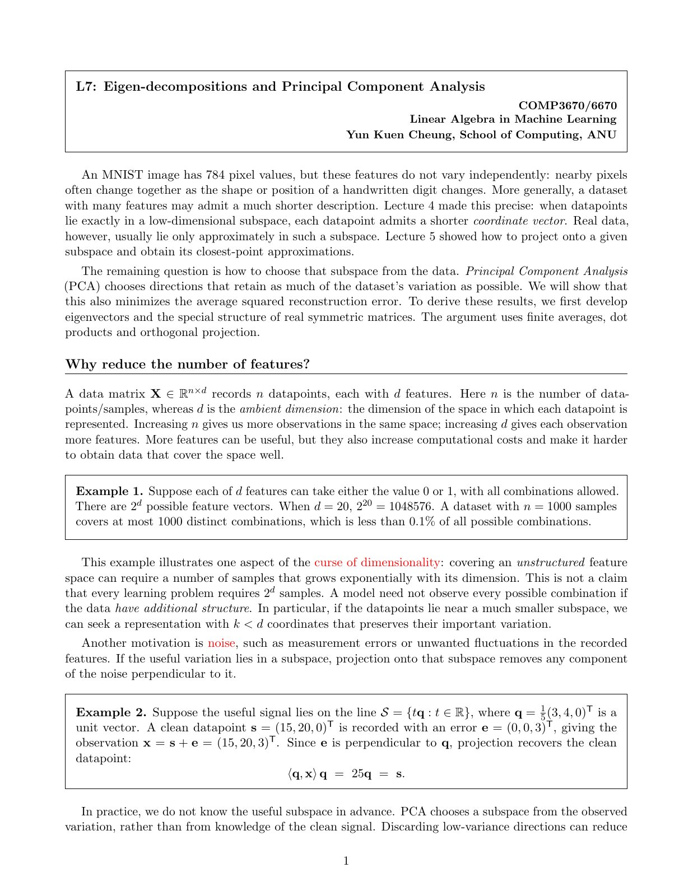

## 第 2 页：特征值与特征向量：定义 3、例 4，以及对称矩阵定义 5

本页先提醒：丢弃低方差方向只有在它主要含噪声时才有去噪效果，低方差信息也可能对预测很重要。

**定义 3。**非零 $v$ 满足 $Av=\lambda v$ 时称特征向量，$\lambda$ 是特征值。特征空间 $E_\lambda=\operatorname{Nul}(A-\lambda I)$ 包括零向量，是子空间；其中非零向量才叫特征向量。正、负、零特征值分别表示沿方向缩放、额外反向、映到零。

已知特征值后，可通过高斯消元求 $(A-\lambda I)v=0$。一般实方阵未必有实特征向量构成的基。

**例 4。**

$$
A=\begin{pmatrix}1&10&-3\\10&4&18\\-3&18&-15\end{pmatrix},\quad v_1=(-1,2,-3)^T,\ v_2=(1,2,1)^T,\ v_3=(-4,1,2)^T.
$$

直接相乘可验证特征值依次为 $-28,18,0$。

**定义 5。**$A^T=A$ 的实方阵称对称矩阵。接下来说明这类矩阵总能选择标准正交的实特征基，适合基于距离与投影的 PCA。

展开第 2 页原始讲义，核对图表、标注和公式

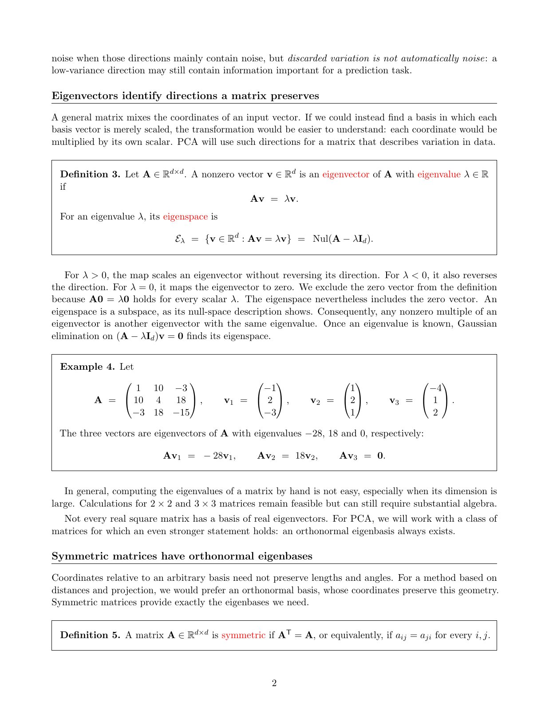

## 第 3 页：正交特征基与谱分解：命题 6、定理 7、例 8 起点

**命题 6。**实对称矩阵不同特征值的特征向量正交。若 $Au=\lambda u,Av=\mu v$，对称性给出 $\lambda\langle u,v\rangle=\langle Au,v\rangle=\langle u,Av\rangle=\mu\langle u,v\rangle$，$\lambda\ne\mu$ 时点积必为零。

**定理 7：谱定理。**实对称 $A$ 有标准正交实特征基 $q_1,\ldots,q_d$。令 $Q=[q_1\cdots q_d]$、$\Lambda=\operatorname{diag}(\lambda_1,\ldots,\lambda_d)$，则

$$
A=Q\Lambda Q^T=\sum_{j=1}^d\lambda_jq_jq_j^T.
$$

本页先验证矩阵恒等式：$AQ=Q\Lambda$，再乘 $Q^T$，利用 $QQ^T=I$。存在性证明留到第 14–15 页附录。作用可读为先用 $Q^T$ 转坐标、按 $\Lambda$ 缩放、再用 $Q$ 转回。

重特征值对应的特征空间内，标准正交基可不唯一，可以在该空间内做 Gram–Schmidt。例 8 将前页向量分别除以 $\sqrt{14},\sqrt6,\sqrt{21}$ 得到三个 $q_i$，完整分解在下一页继续。

展开第 3 页原始讲义，核对图表、标注和公式

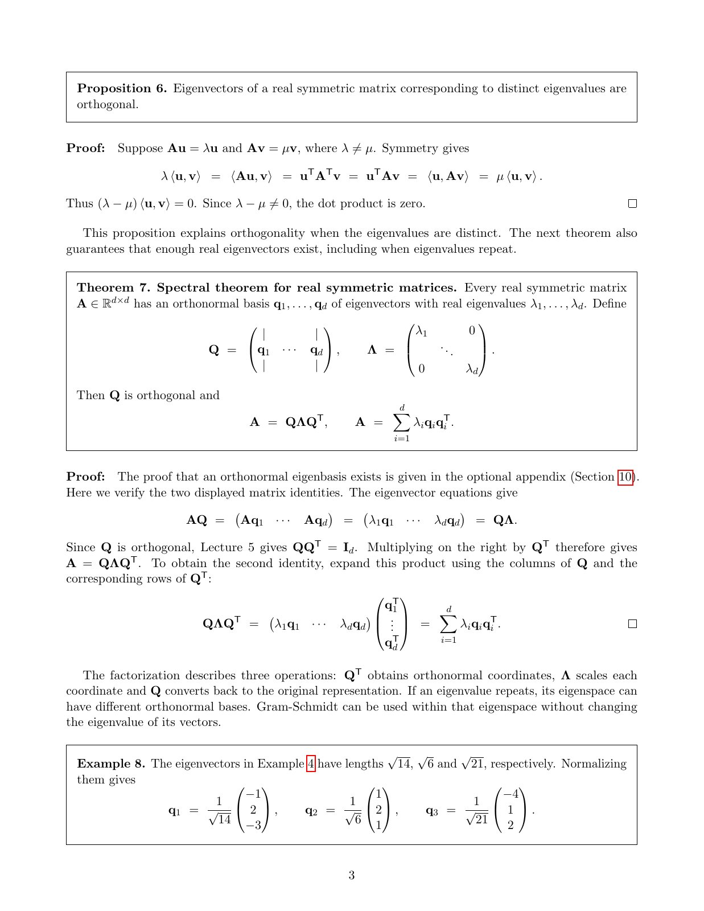

## 第 4 页：谱分解例 8 续、半正定性：定义 9、命题 10，以及中心化定义 11

**例 8 续。**归一化前页三个特征向量组成 $Q$，得到 $A=Q\operatorname{diag}(-28,18,0)Q^T$。若 $x=\sum_j\alpha_jq_j$，则 $Ax=-28\alpha_1q_1+18\alpha_2q_2$，每个特征坐标单独缩放，没有相互混合。

**定义 9 与命题 10。**对称矩阵的二次型为 $v^TAv$，对所有 $v$ 非负则称半正定。在正交特征基中，

$$
v=\sum_j\alpha_jq_j\quad\Longrightarrow\quad v^TAv=\sum_j\lambda_j\alpha_j^2.
$$

因此对称矩阵半正定当且仅当所有特征值非负：充分性由非负和得到；必要性取 $v=q_j$，直接得到 $\lambda_j\ge0$。

**定义 11。**分析数据变化应去掉共同位置：$\mu=n^{-1}\sum_i x_i$，$\tilde x_i=x_i-\mu$，$X_c=X-\mathbf1\mu^T\in\mathbb R^{n\times d}$。中心化使 PCA 研究点之间的变化，而非把整体偏移误当成新方向。

展开第 4 页原始讲义，核对图表、标注和公式

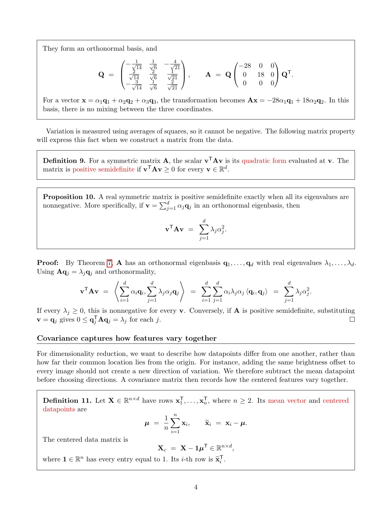

## 第 5 页：协方差定义 12、命题 13 与例 14 起点

中心化后 $\sum_i\tilde x_i=0$，每个特征列均值为零。

**定义 12。**本讲采用分母 $n$ 的经验方差及协方差：

$$
\operatorname{Var}(t_1,\ldots,t_n)=\frac1n\sum_i(t_i-\bar t)^2,\quad C=\frac1nX_c^TX_c,\quad C_{j\ell}=\frac1n\sum_i(x_{ij}-\mu_j)(x_{i\ell}-\mu_\ell).
$$

对角项是各特征方差，非对角项描述共同变化。若改用 $n-1$，所有特征值同乘正常数，主方向不变。

**命题 13。**$C$ 对称且半正定：转置乘积得 $C^T=C$；任意 $v$ 有 $v^TCv=\|X_cv\|^2/n\ge0$。

**例 14。**四个原始点为 $(16,24),(14,26),(4,16),(6,14)$，均值 $(10,20)$。中心化矩阵的行为 $(6,4),(4,6),(-6,-4),(-4,-6)$，协方差计算续下页。

展开第 5 页原始讲义，核对图表、标注和公式

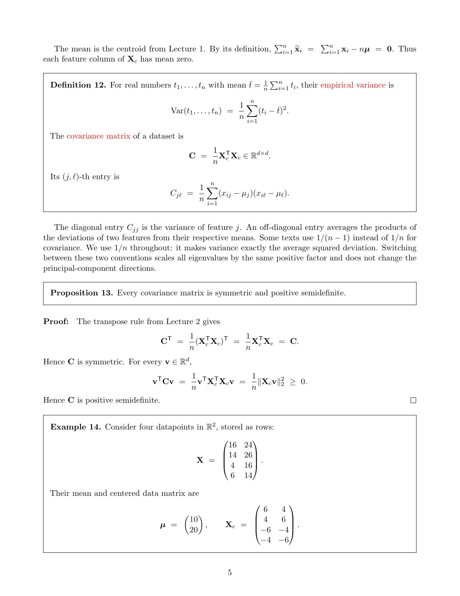

## 第 6 页：正负协方差例 14 续，以及投影方差命题 15

**例 14 续。**前页数据给出

$$
C=\begin{pmatrix}26&24\\24&26\end{pmatrix},
$$

两个特征方差均为 26，正协方差 24 表示共同上升或下降，方向 $(1,1)$、$(1,-1)$ 的特征值分别为 50、2。

第二组点 $(16,14),(14,16),(4,26),(6,24)$ 均值仍为 $(10,20)$，但两特征和恒为 30。中心化后的两列互为相反数，

$$
C'=\begin{pmatrix}26&-26\\-26&26\end{pmatrix}.
$$

同样的边缘方差可以对应完全不同的共同变化。

**命题 15。**选单位向量 $q$，每点的方向得分 $t_i=q^T\tilde x_i$ 均值为 0，方差为

$$
\frac1n\sum_i t_i^2=\frac1n\|X_cq\|^2=q^TCq.
$$

要求单位长度是为比较方向而非人为放大尺度；把 $q$ 乘 $a$ 会让得分方差乘 $a^2$。

展开第 6 页原始讲义，核对图表、标注和公式

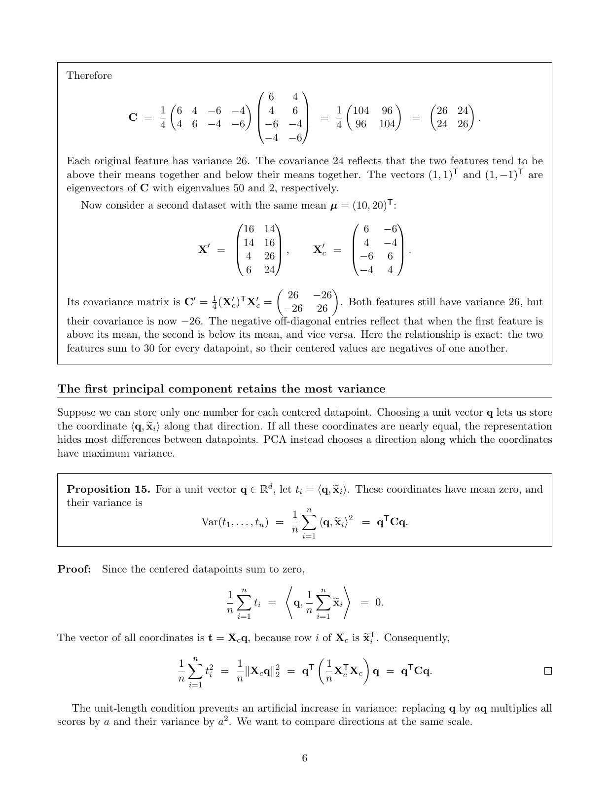

## 第 7 页：第一主成分的最优化：定义 16、定理 17、四维例 18

**定义 16 与定理 17。**第一主方向最大化单位球面上的 $q^TCq$。若协方差特征值 $\lambda_1\ge\cdots\ge\lambda_d\ge0$，则最大值为 $\lambda_1$，恰由最大特征空间中的单位向量达到。

证明把 $q=\sum_j\alpha_jq_j$ 且 $\sum_j\alpha_j^2=1$ 代入，得到 $q^TCq=\sum_j\lambda_j\alpha_j^2\le\lambda_1$。等号要求小于最大特征值的方向系数全为零。

**例 18。**六个四维点的均值为 $\mu=(20,30,40,50)^T$，中心化矩阵为

$$
X_c=\begin{pmatrix}18&13&1&0\\0&1&13&18\\6&10&10&6\\-1&0&-18&-13\\-13&-18&0&-1\\-10&-6&-6&-10\end{pmatrix}.
$$

其协方差为

$$
C=\begin{pmatrix}105&98&26&27\\98&105&27&26\\26&27&105&98\\27&26&98&105\end{pmatrix},
$$

特征值依次 $256,150,8,6$。第一方向 $q_1=(1,1,1,1)^T/2$，得分为 $(16,16,16,-16,-16,-16)^T$，经验方差为 256，高于任一原特征的 105。原始数据可由每行加均值恢复。

展开第 7 页原始讲义，核对图表、标注和公式

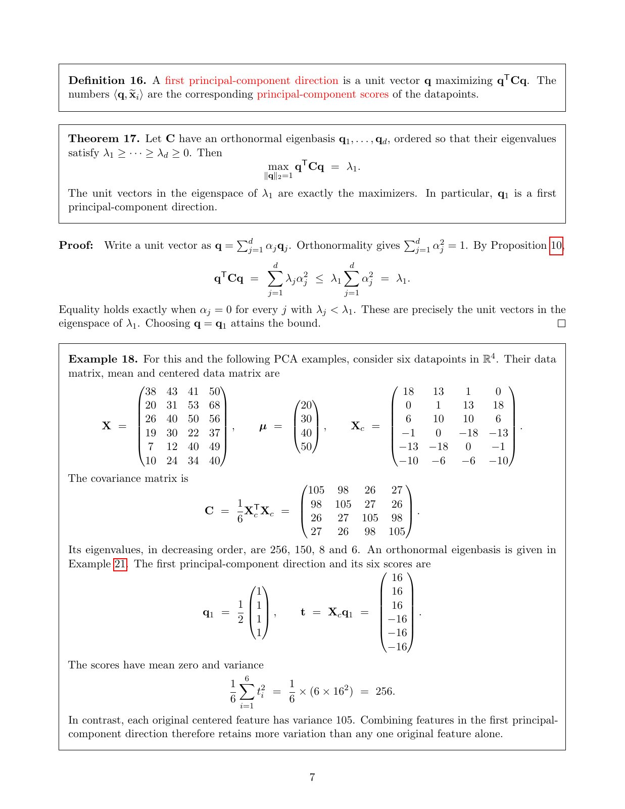

## 第 8 页：多个主成分：定义 19、命题 20

把 $q_1$ 换为 $-q_1$ 只会翻转分数，保留直线与重构距离不变；最大特征值重复时，方向还可能有更多非唯一性。

**定义 19。**按特征值从大到小取 $Q_k=[q_1\cdots q_k]\in\mathbb R^{d\times k}$，单点编码与批量编码为

$$
z_i=Q_k^T(x_i-\mu)\in\mathbb R^k,\qquad Z=X_cQ_k\in\mathbb R^{n\times k}.
$$

这些是投影到所选子空间后的坐标，一般不能精确表示整个原始点。

**命题 20。**第 $j$ 个特征向量在与之前方向正交的单位向量中最大化方差，最优值为 $\lambda_j$。证明只需在特征基的后续方向中展开并比较特征值。

得分均值为零，协方差为

$$
\frac1nZ^TZ=Q_k^TCQ_k=\operatorname{diag}(\lambda_1,\ldots,\lambda_k).
$$

非对角项为零来自 $q_j^TCq_\ell=\lambda_\ell q_j^Tq_\ell$。**理解补充：**得分不相关不代表统计独立，除非另有分布假设。

展开第 8 页原始讲义，核对图表、标注和公式

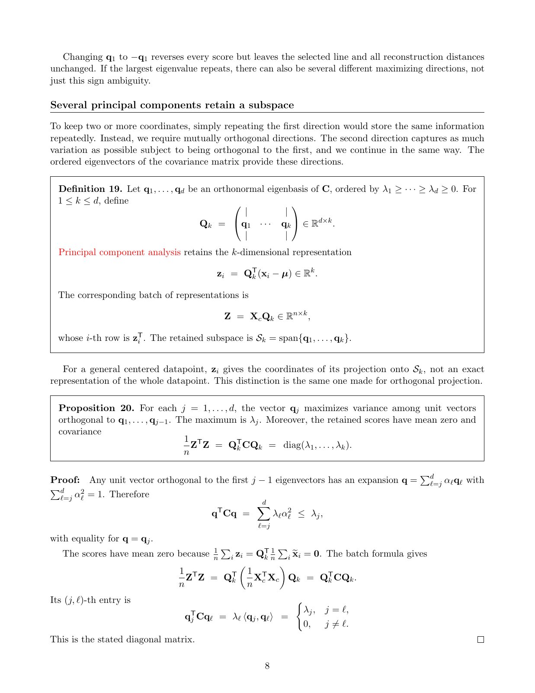

## 第 9 页：二维编码例 21、重构定义 22 与最优性定理 23

**例 21。**四维协方差的有序正交基为

$$
q_1=\tfrac12(1,1,1,1)^T,\quad q_2=\tfrac12(1,1,-1,-1)^T,
$$
$$
q_3=\tfrac12(1,-1,-1,1)^T,\quad q_4=\tfrac12(1,-1,1,-1)^T,
$$

对应特征值 $256,150,8,6$。保留前两列得到六个得分行 $(16,15),(16,-15),(16,0),(-16,15),(-16,-15),(-16,0)$。两个坐标方差为 256 与 150，被丢弃方向方差为 8 与 6。

**定义 22。**任意列标准正交的 $U\in\mathbb R^{d\times k}$，以 $\hat x_i=\mu+UU^T(x_i-\mu)$ 重构，平均误差 $E(U)=n^{-1}\sum_i\|x_i-\hat x_i\|^2$。

**定理 23。**

$$
E(U)=\sum_{\ell=1}^d\lambda_\ell-\sum_{j=1}^ku_j^TCu_j\ge\sum_{\ell=k+1}^d\lambda_\ell.
$$

$U=Q_k$ 达到等号。因此 PCA 同时最大化保留方差、最小化同维子空间的平均平方重构误差；证明在下一页。

展开第 9 页原始讲义，核对图表、标注和公式

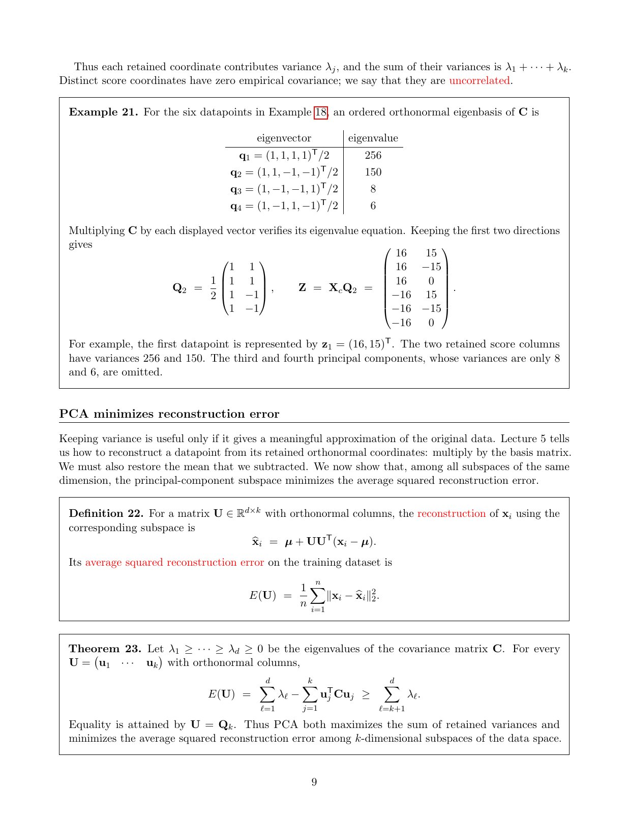

## 第 10 页：最小重构误差证明，以及最佳仿射偏移推论 24

**定理 23 的证明。**每个中心化点的投影与残差正交，所以原平方长度等于投影平方长度加残差平方长度。对全部点平均，总方差为 $\sum_\ell\lambda_\ell$，投影方差为 $\sum_j u_j^TCu_j$，得到前页误差恒等式。

为比较任意 $U$，定义 $a_\ell=\sum_{j=1}^k\langle q_\ell,u_j\rangle^2$。它是单位向量 $q_\ell$ 的投影长度平方，满足 $0\le a_\ell\le1$、$\sum_\ell a_\ell=k$。因此

$$
\sum_j u_j^TCu_j=\sum_\ell\lambda_\ell a_\ell\le\sum_{\ell=1}^k\lambda_\ell.
$$

把有限的总权重放到最大的 $k$ 个特征值上达到上界，$Q_k$ 恰好如此。

**推论 24。**固定方向投影 $P=UU^T$，若用任意偏移 $a$，平均误差等于

$$
E(U)+\|(I-P)(\mu-a)\|^2.
$$

证明展开残差，利用中心化点和为零消去交叉项。因此 $a=\mu$ 最优，PCA 也给原始数据的最佳 $k$ 维仿射子空间。**理解补充：**均值是可取的最佳偏移，并非唯一参数表示；沿保留子空间移动偏移不改变仿射平面。

展开第 10 页原始讲义，核对图表、标注和公式

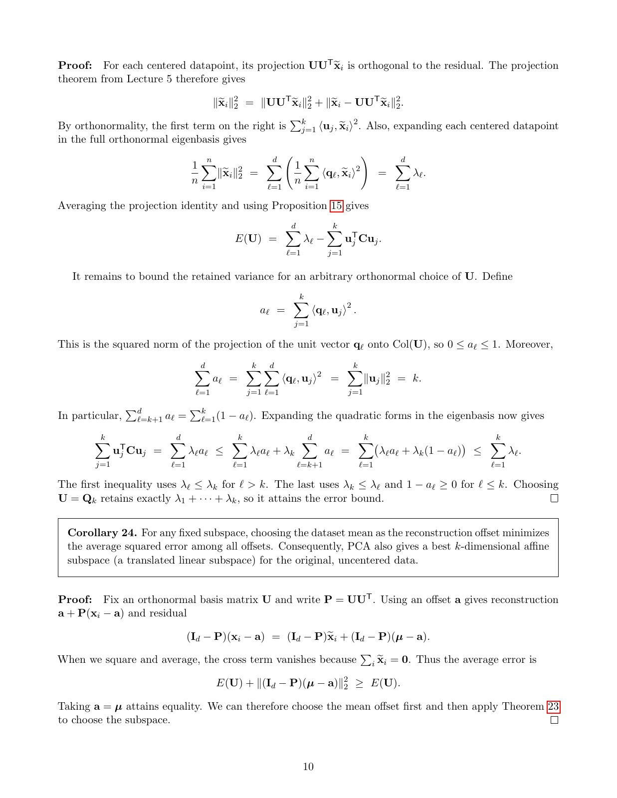

## 第 11 页：重构数值例 25 与协方差秩推论 26

**例 25。**首点的二维得分为 $(16,15)$，重构

$$
\hat x_1=\mu+16q_1+15q_2=\tfrac12(71,91,81,101)^T.
$$

其残差为 $\tfrac12(5,-5,1,-1)^T$。全部六个重构行依次为

$$
\hat X=\frac12\begin{pmatrix}71&91&81&101\\41&61&111&131\\56&76&96&116\\39&59&49&69\\9&29&79&99\\24&44&64&84\end{pmatrix}.
$$

各点误差平方为 $13,13,16,13,13,16$，平均为 14，恰等于 $\lambda_3+\lambda_4=8+6$；单点误差不必等于这个平均。若只留第一方向，平均误差为 164。

**推论 26。**$\operatorname{rank}(C)=\operatorname{rank}(X_c)=r\le\min(d,n-1)$，且恰有 $r$ 个正特征值。证明用 $v^TCv=\|X_cv\|^2/n$ 得二者零空间相同，再用秩零度；中心化列均与全一向量正交，因此秩至多 $n-1$。保留全部正特征值方向可精确重构训练数据；$r=0$ 时均值已足够。

展开第 11 页原始讲义，核对图表、标注和公式

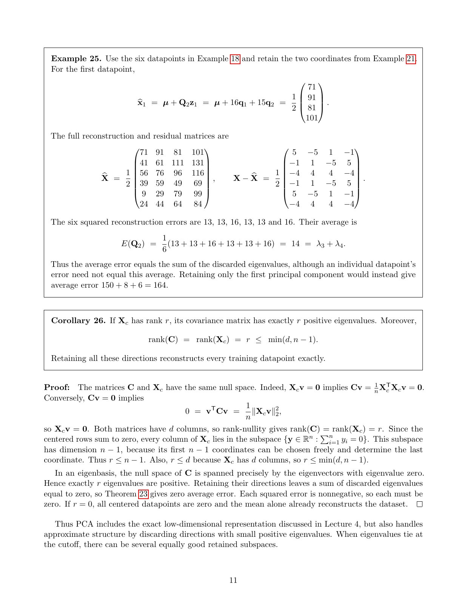

## 第 12 页：解释方差比例：定义 27、例 28 与完整 PCA 算法

即使数据完全是噪声，$d\ge n$ 时训练点也必定位于至多 $n-1$ 维中心化子空间。能用 $n-1$ 个方向精确重构，并不足以证明发现了有意义结构。

**定义 27。**总方差为正时，保留 $k$ 个方向的解释方差比例为

$$
\rho_k=\frac{\sum_{j=1}^k\lambda_j}{\sum_{j=1}^d\lambda_j}.
$$

可选达到指定比例的最小 $k$。**例 28：**前例 $\rho_2=(256+150)/420=406/420\approx96.67\%$，达到 95% 而未达到 99%；被丢弃比例 $1/30$ 对应平均平方误差 14。

**算法 1。**计算训练均值并中心化；按应用选择是否缩放特征；形成 $C=X_c^TX_c/n$；求正交特征向量并按特征值降序；取前 $k$ 列，计算 $Z=X_cQ_k$。保存均值、方向和缩放参数，用于新数据。若做缩放，此时的 $X_c$ 应理解为经过同样缩放后的中心化矩阵。

展开第 12 页原始讲义，核对图表、标注和公式

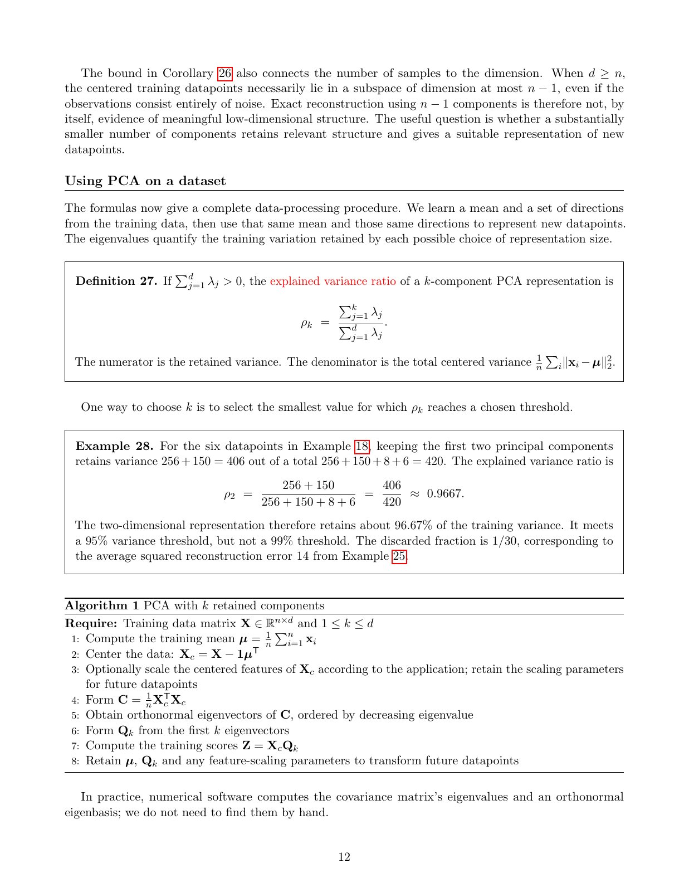

## 第 13 页：新数据编码、缩放与二维可视化例 29

未额外缩放时，新点使用训练拟合的参数：

$$
z=Q_k^T(x-\mu),\qquad\hat x=\mu+Q_kz,\qquad\hat X=\mathbf1\mu^T+ZQ_k^T.
$$

若用了特征缩放，编码前按训练尺度处理，重构后先撤销缩放再加均值。最优性结论此时针对缩放后的距离与方差，不自动等于原单位下的欧氏重构最优。

均值、缩放、方向都只能由训练数据拟合，不能在测试数据上重新估计。单位由米改毫米会使相应方差乘 $10^6$，可能主导 PCA，所以缩放选择影响结果。

PCA 不使用类别标签，高方差不必更有预测价值，低方差也不必是噪声。可视化以两个或三个主得分为坐标，坐标轴是原特征的线性组合。

**例 29。**六点在二维的位置是 $(16,15),(16,-15),(16,0),(-16,15),(-16,-15),(-16,0)$。图沿 PC1 分成两组，各组沿 PC2 变化；虽然保留约 96.67% 训练方差，另两方向的差异仍看不见。

展开第 13 页原始讲义，核对图表、标注和公式

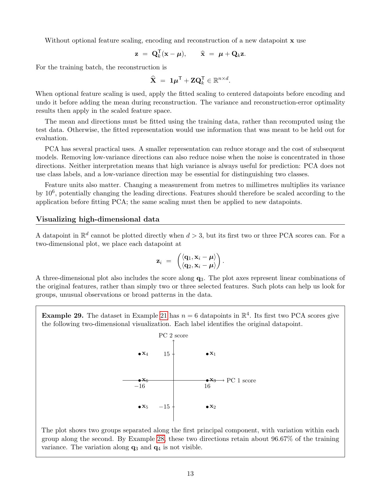

## 第 14 页：PCA 图的局限，以及可选谱定理证明的第一步

本页先强调降维图是部分视角：图上重叠的点可能在舍弃方向上相距很远，不保证保存全部距离或类别差异。下一讲将用 SVD 直接处理矩形数据矩阵。

**可选附录：谱定理存在性。**对维数归纳，一维显然。单位球面紧，连续函数 $x^TAx$ 在其上达到最大值，取最大点 $q_1$ 并设 $\lambda_1=q_1^TAq_1$。

对任意 $u\perp q_1$，令 $q(t)=(q_1+tu)/\sqrt{1+t^2\|u\|^2}$。最大性和对称性给出

$$
2t\langle u,Aq_1\rangle+t^2[u^TAu-\lambda_1\|u\|^2]\le0.
$$

分别令 $t$ 从正、负两侧趋于 0，推出 $\langle u,Aq_1\rangle=0$。残差 $r=Aq_1-\lambda_1q_1$ 也与 $q_1$ 正交，取 $u=r$ 得 $\|r\|^2=0$，故 $Aq_1=\lambda_1q_1$。

**第二步起点。**将 $q_1$ 扩成标准正交基，其余列组成 $U\in\mathbb R^{d\times(d-1)}$，满足 $U^TU=I$、$q_1^TU=0$。在垂直补空间上的归纳在下一页完成。

展开第 14 页原始讲义，核对图表、标注和公式

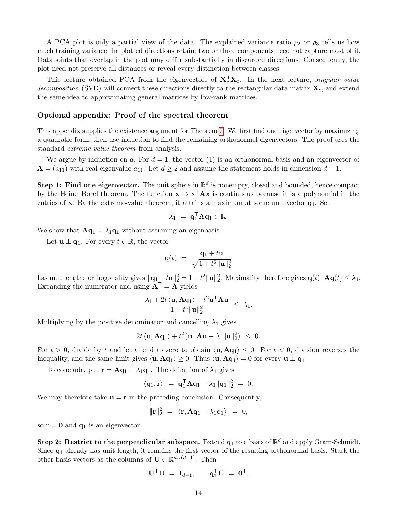

## 第 15 页：谱定理附录证明：垂直补空间与归纳完成

对 $x\perp q_1$，对称性使 $\langle q_1,Ax\rangle=\langle Aq_1,x\rangle=\lambda_1\langle q_1,x\rangle=0$，所以垂直补空间在 $A$ 作用下不变。

上一页的 $U$ 给出这个空间的标准正交坐标。令

$$
B=U^TAU\in\mathbb R^{(d-1)\times(d-1)},\qquad AU=UB.
$$

$B^T=B$，因此由归纳假设有标准正交特征基 $r_2,\ldots,r_d$ 及实特征值。定义 $q_j=Ur_j$，则

$$
Aq_j=AUr_j=UBr_j=\lambda_jq_j.
$$

同时 $\langle q_i,q_j\rangle=r_i^TU^TUr_j=\langle r_i,r_j\rangle$，这些向量彼此标准正交，也都垂直于 $q_1$。于是 $q_1,\ldots,q_d$ 是 $d$ 个标准正交实特征向量，线性无关并构成基。结合第 3 页已经验证的矩阵恒等式，谱定理完整得证。

展开第 15 页原始讲义，核对图表、标注和公式

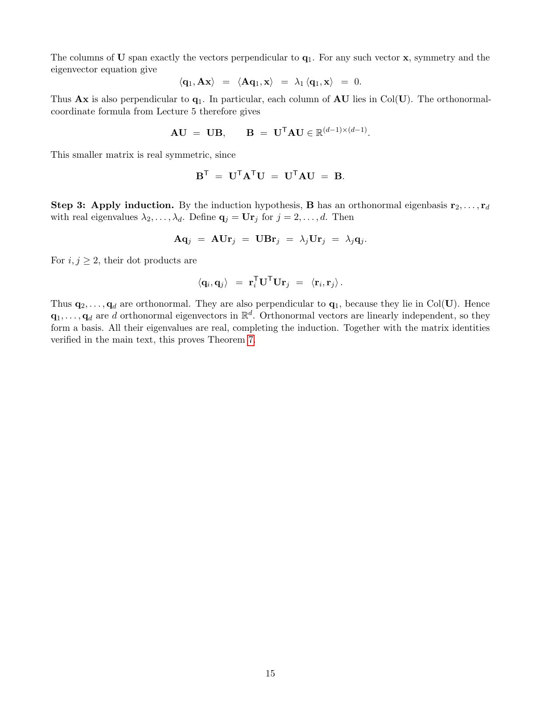

