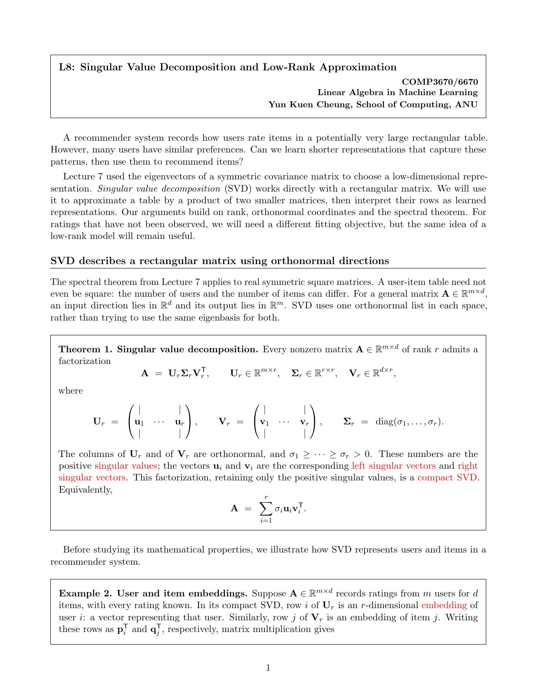
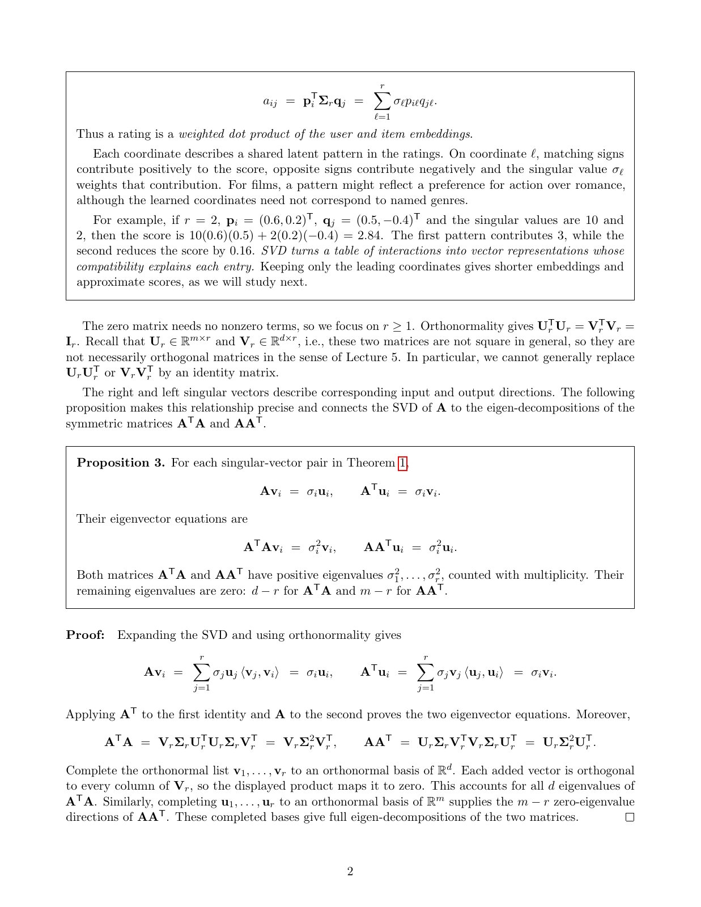
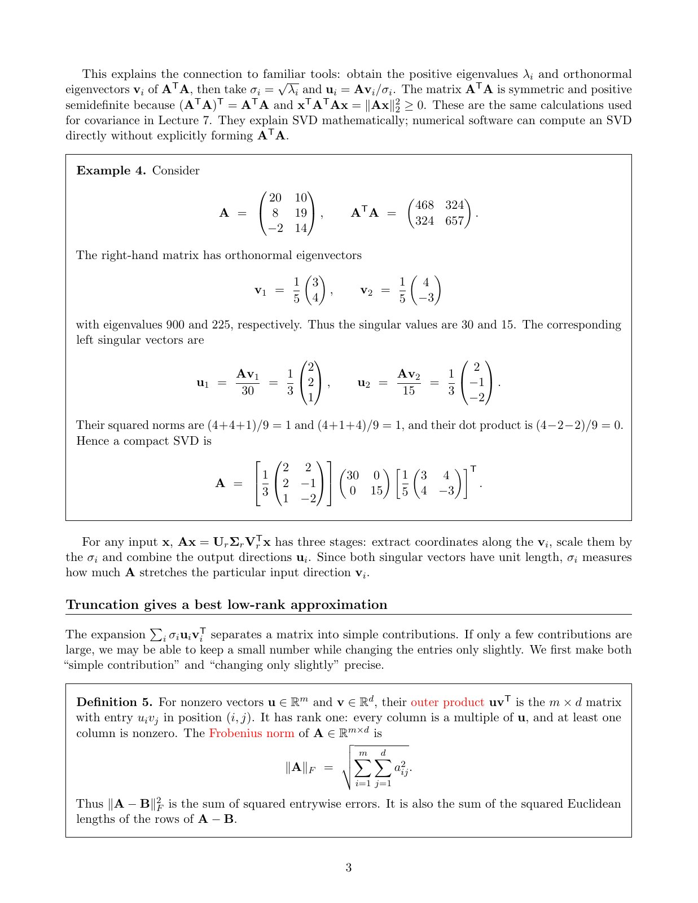
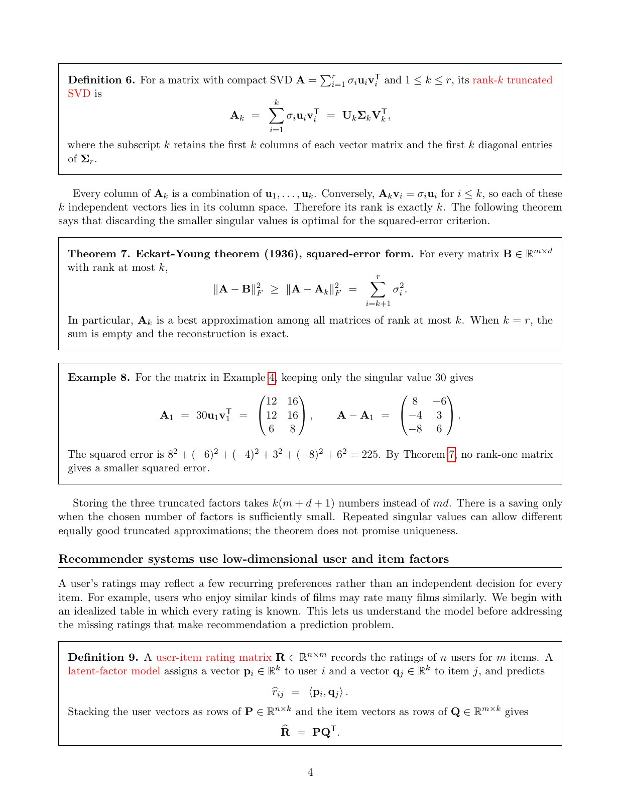
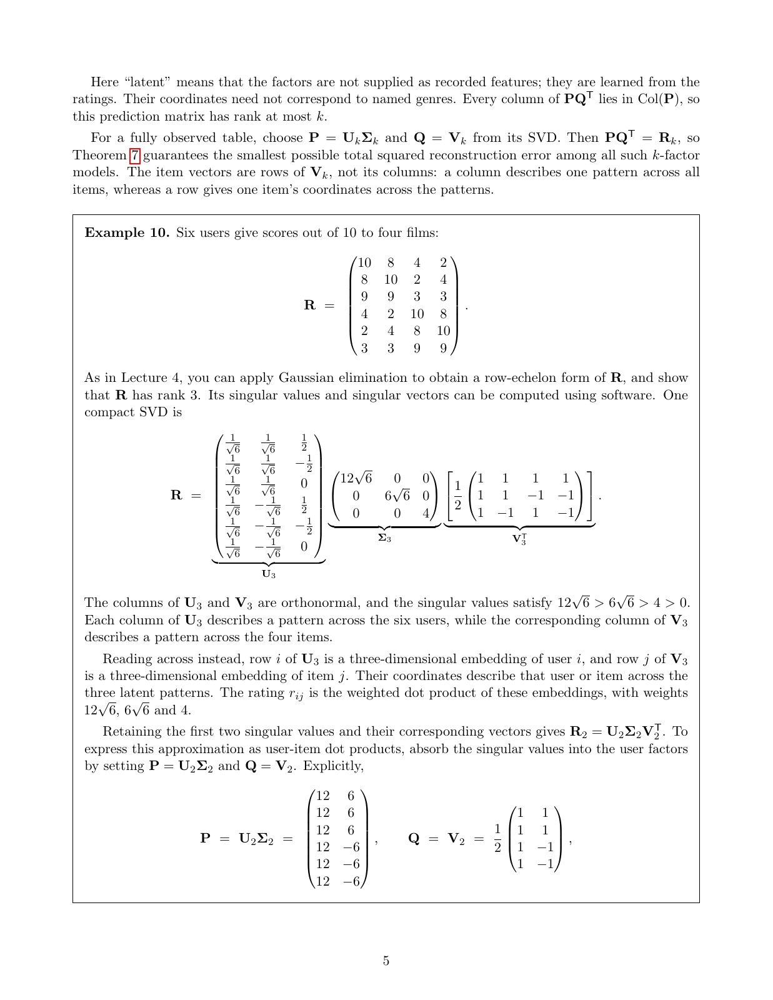
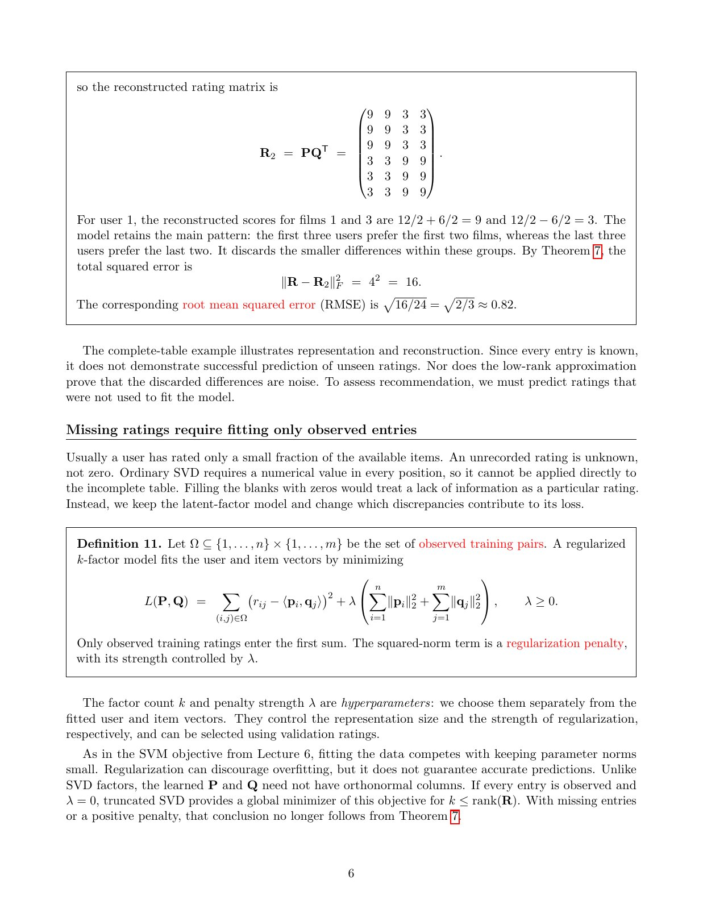
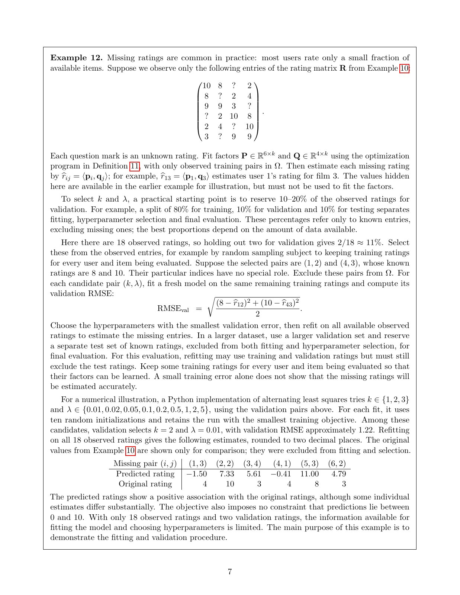
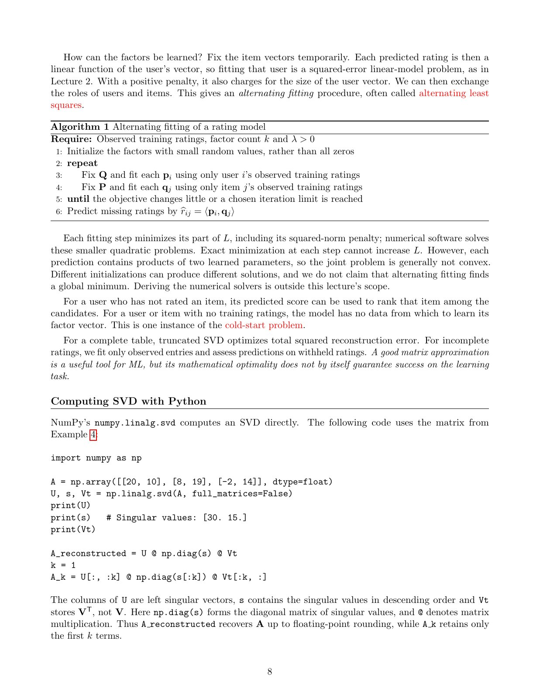
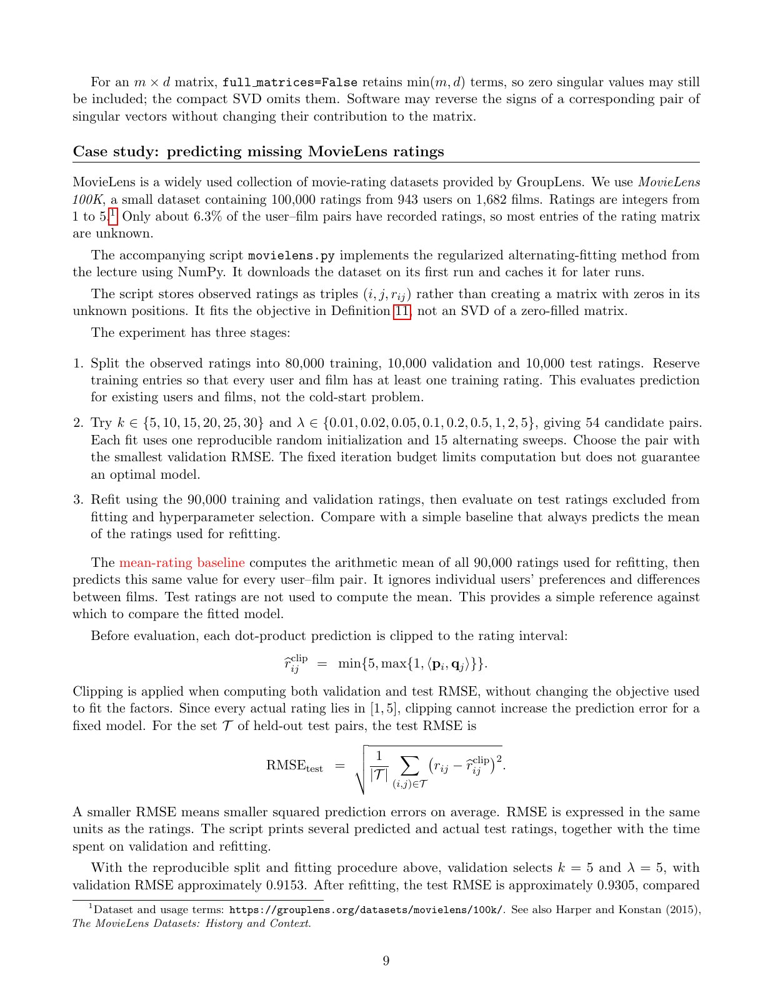
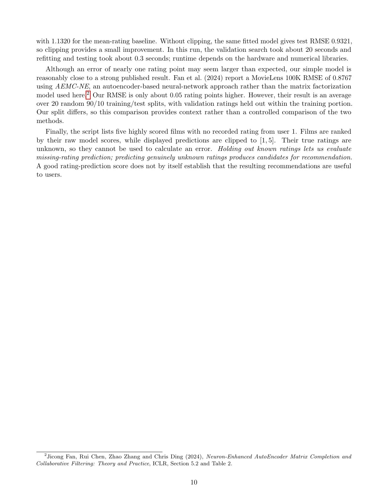

# LA Lecture 08：奇异值分解、低秩近似与推荐系统，按 PDF 逐页复述

来源：[LA_lecture08.pdf](../../comp3670_lectures/LA_lecture08.pdf)，共 10 个 PDF 页面。严格按 PDF 页序组织，章节页、例题续页和参考文献页也单独保留。正文用中文讲解概念、公式和图表；原页未写出的解答、纠错或推导明确标为“理解补充”。每节末尾可展开完整原始讲义核对颜色、标注和排版。图片和 PDF 均使用仓库相对路径，适合本地预览与 GitHub。本文件的原稿是连续排版的讲义，因此页标题概括该 PDF 页包含的多个小节，不把一页拆成虚构的幻灯片。

## 第 1 页：矩形矩阵的 SVD：定理 1、用户物品嵌入例 2 起点

本讲把上一讲的协方差特征分解推广到一般矩形矩阵，并用推荐系统解释低维表示。完整评分表用于理解重构，缺失评分则需要另外设计只在已知条目上计算的训练目标。

**定理 1。**非零 $A\in\mathbb R^{m\times d}$，秩为 $r$，存在紧 SVD：

$$
A=U_r\Sigma_rV_r^T=\sum_{i=1}^r\sigma_iu_iv_i^T,
$$

其中 $U_r\in\mathbb R^{m\times r}$、$V_r\in\mathbb R^{d\times r}$ 各列标准正交，$\Sigma_r=\operatorname{diag}(\sigma_1,\ldots,\sigma_r)$，$\sigma_1\ge\cdots\ge\sigma_r>0$。$u_i$ 为左奇异向量，$v_i$ 为右奇异向量。紧形式只保留正奇异值；零矩阵不需要任何非零项。

与对称特征分解不同，输入方向位于 $\mathbb R^d$，输出方向位于 $\mathbb R^m$，所以通常不能使用同一组基。

**例 2 起点。**完整用户物品表的 $U_r$ 第 $i$ 行可当作用户嵌入，$V_r$ 第 $j$ 行可当作物品嵌入。行向量给单个对象跨模式的坐标，列向量则给某种模式跨所有对象的分布。评分如何由嵌入组合，在下一页继续。

<details>
<summary>展开第 1 页原始讲义，核对图表、标注和公式</summary>



</details>

## 第 2 页：加权嵌入例 2 续与奇异向量关系命题 3

**例 2 续。**把用户和物品嵌入分别记为 $p_i,q_j$，则

$$
a_{ij}=p_i^T\Sigma_rq_j=\sum_{\ell=1}^r\sigma_\ell p_{i\ell}q_{j\ell}.
$$

同号坐标正向贡献、异号负向贡献；潜在模式不必对应可命名的电影类型。若 $p_i=(0.6,0.2)^T$、$q_j=(0.5,-0.4)^T$，奇异值为 10、2，则分数为 $3-0.16=2.84$。

矩形因子满足 $U_r^TU_r=V_r^TV_r=I_r$，但一般不满足 $U_rU_r^T=I_m$ 或 $V_rV_r^T=I_d$，不能把它们当作方形正交矩阵。

**命题 3。**

$$
Av_i=\sigma_iu_i,\qquad A^Tu_i=\sigma_iv_i,
$$
$$
A^TAv_i=\sigma_i^2v_i,\qquad AA^Tu_i=\sigma_i^2u_i.
$$

证明将 SVD 展开并利用标准正交性；进一步 $A^TA=V_r\Sigma_r^2V_r^T$、$AA^T=U_r\Sigma_r^2U_r^T$。补全两组正交基后，其余方向特征值为 0，分别有 $d-r$ 与 $m-r$ 个。因此两矩阵的正特征值相同，都是奇异值平方。

<details>
<summary>展开第 2 页原始讲义，核对图表、标注和公式</summary>



</details>

## 第 3 页：从特征分解求 SVD：例 4，以及外积和 Frobenius 范数定义 5

$A^TA$ 对称半正定。可先取其正特征对 $(\lambda_i,v_i)$，再令 $\sigma_i=\sqrt{\lambda_i}$、$u_i=Av_i/\sigma_i$。这说明数学联系；实际数值软件可直接求 SVD，不必显式形成 $A^TA$。

**例 4。**

$$
A=\begin{pmatrix}20&10\\8&19\\-2&14\end{pmatrix},\qquad A^TA=\begin{pmatrix}468&324\\324&657\end{pmatrix}.
$$

右奇异向量 $v_1=(3,4)^T/5$、$v_2=(4,-3)^T/5$，对应特征值 900、225，所以奇异值为 30、15。左奇异向量为 $u_1=(2,2,1)^T/3$、$u_2=(2,-1,-2)^T/3$。可检查长度为 1、点积为 0。

$Ax=U\Sigma V^Tx$ 的三阶段是提取输入正交坐标、分别伸缩、组合输出方向。奇异值度量沿相应右奇异方向的伸缩量。

**定义 5。**非零向量外积 $uv^T$ 每列都是 $u$ 的倍数，秩为 1；Frobenius 范数 $\|A\|_F=\sqrt{\sum_{ij}a_{ij}^2}$，所以 $\|A-B\|_F^2$ 是全部条目误差平方和，也等于所有行的欧氏误差平方和。

<details>
<summary>展开第 3 页原始讲义，核对图表、标注和公式</summary>



</details>

## 第 4 页：截断 SVD 定义 6、Eckart–Young 定理 7、例 8 与因子模型定义 9

**定义 6。**保留前 $k$ 项得到 $A_k=U_k\Sigma_kV_k^T=\sum_{i=1}^k\sigma_iu_iv_i^T$。其列空间包含且由前 $k$ 个独立 $u_i$ 张成，故秩恰为 $k$。

**定理 7。**对任意秩至多 $k$ 的矩阵 $B$，

$$
\|A-B\|_F^2\ge\|A-A_k\|_F^2=\sum_{i=k+1}^r\sigma_i^2.
$$

这是平方误差下的最佳低秩近似。$k=r$ 时精确重构；截断处奇异值重复时最优解未必唯一。本页陈述定理，未展开其完整证明。

**例 8。**前页矩阵保留奇异值 30 后，

$$
A_1=\begin{pmatrix}12&16\\12&16\\6&8\end{pmatrix},\qquad A-A_1=\begin{pmatrix}8&-6\\-4&3\\-8&6\end{pmatrix},
$$

平方误差 225，等于被舍弃的 $15^2$。因子需存 $k(m+d+1)$ 个数；只有它小于 $md$ 才节省存储。

**定义 9。**评分矩阵 $R\in\mathbb R^{n\times m}$ 的 $k$ 因子模型给用户 $p_i\in\mathbb R^k$、物品 $q_j\in\mathbb R^k$，预测 $\hat r_{ij}=p_i^Tq_j$；按行堆叠得到 $\hat R=PQ^T$，秩至多 $k$。

<details>
<summary>展开第 4 页原始讲义，核对图表、标注和公式</summary>



</details>

## 第 5 页：完整评分表的因子解释与六用户四电影例 10

对完整表，可取 $P=U_k\Sigma_k,Q=V_k$，得到截断 SVD 的最佳平方重构。奇异值也可分配到两侧；原页选择全部吸收入用户因子。物品向量是 $V_k$ 的行，不是列。

**例 10。**六用户对四电影的完整评分为

$$
R=\begin{pmatrix}10&8&4&2\\8&10&2&4\\9&9&3&3\\4&2&10&8\\2&4&8&10\\3&3&9&9\end{pmatrix}.
$$

秩为 3，奇异值 $12\sqrt6,6\sqrt6,4$。三个右奇异向量依次为 $\frac12(1,1,1,1)^T$、$\frac12(1,1,-1,-1)^T$、$\frac12(1,-1,1,-1)^T$。左向量前两列分别为全一向量除以 $\sqrt6$，以及 $(1,1,1,-1,-1,-1)^T/\sqrt6$；第三列为 $(1,-1,0,1,-1,0)^T/2$。

保留前两项，得到

$$
P=\begin{pmatrix}12&6\\12&6\\12&6\\12&-6\\12&-6\\12&-6\end{pmatrix},\qquad Q=\frac12\begin{pmatrix}1&1\\1&1\\1&-1\\1&-1\end{pmatrix}.
$$

第一模式概括共同评分水平，第二模式区分两组用户与两组电影。潜在坐标来自评分学习，不要求事先提供类型标签；重构结果在下一页。

<details>
<summary>展开第 5 页原始讲义，核对图表、标注和公式</summary>



</details>

## 第 6 页：完整表重构误差，以及缺失评分的正则化目标定义 11

**例 10 续。**$R_2=PQ^T$ 的前三行为 $(9,9,3,3)$，后三行为 $(3,3,9,9)$。第一用户对第一、第三电影的预测分别为 9、3。它保留两群相反偏好，丢弃群内小差异，总平方误差为 $4^2=16$，RMSE 为 $\sqrt{16/24}=\sqrt{2/3}\approx0.82$。

完整表重构没有展示预测未知评分的能力，也不能证明被舍弃差异就是噪声。

**缺失值不是零。**普通 SVD 需要所有数值，不能把未知评分随意填零后宣称等价于真实推荐训练。记已观测训练对为 $\Omega$，定义 11 用

$$
L(P,Q)=\sum_{(i,j)\in\Omega}(r_{ij}-p_i^Tq_j)^2+\lambda\left(\sum_i\|p_i\|^2+\sum_j\|q_j\|^2\right).
$$

只有已知训练条目贡献拟合误差；$k$、$\lambda$ 分别控制维数和正则化强度，用验证选择。一般学习得到的因子无需标准正交。只有完整表且 $\lambda=0$ 时，前述截断 SVD 的无正则重构最优性可直接应用；缺失条目或正则化会改变问题。

<details>
<summary>展开第 6 页原始讲义，核对图表、标注和公式</summary>



</details>

## 第 7 页：缺失评分的训练、验证与数值例 12

从完整六乘四表隐藏 $(1,3),(2,2),(3,4),(4,1),(5,3),(6,2)$ 六项，剩 18 个已观察值；问号不进入训练目标。预测未知项使用学习后的内积，例如 $\hat r_{13}=p_1^Tq_3$。

验证只能从已知评分中留出。原页取 $(1,2)$ 的 8 和 $(4,3)$ 的 10 两项作验证，训练时排除，计算

$$
\mathrm{RMSE}_{\mathrm{val}}=\sqrt{\frac{(8-\hat r_{12})^2+(10-\hat r_{43})^2}{2}}.
$$

每个候选重新拟合，选 $k,\lambda$ 后可用全部 18 项重拟合以预测真正缺失项；若另有最终测试集，重拟合仍须排除测试条目。需要给每个待评价用户、物品保留训练记录，避免混入冷启动。

原稿的数值实现尝试 $k\in\{1,2,3\}$ 和 $\lambda\in\{0.01,0.02,0.05,0.1,0.2,0.5,1,2,5\}$，每组十次随机初值按最小训练目标保留一次。验证选 $k=2,\lambda=0.01$，RMSE 约 1.22。重拟合后六个缺失项估计依次为 $-1.50,7.33,5.61,-0.41,11.00,4.79$，原值依次为 $4,10,3,4,8,3$。

这些结果只是原课件报告，未在此重新运行。输出可超出 0–10，因为目标未加范围约束；样本和验证仅有少量条目，也不足以证明推荐可靠。

<details>
<summary>展开第 7 页原始讲义，核对图表、标注和公式</summary>



</details>

## 第 8 页：交替最小二乘算法 1、冷启动，以及 NumPy SVD

固定物品因子 $Q$ 后，每个用户预测对 $p_i$ 线性，可单独求带平方范数惩罚的最小二乘；再固定 $P$ 更新物品，交替进行。

**算法 1。**用小随机数初始化；固定 $Q$，只用该用户的训练评分拟合各 $p_i$；固定新 $P$，只用该物品的训练评分拟合各 $q_j$；重复到目标变化小或达到轮数上限；最后以内积预测。全零初值可能使交替更新停在无信息状态。

精确求解每个子问题不会增加目标，但联合问题通常非凸，初值不同可能到不同解，不保证全局最优。完全没有训练评分的用户或物品缺少可学习的因子信息，称冷启动。

**原页 SVD 代码的等价整理：**

```python
import numpy as np

A = np.array([[20, 10], [8, 19], [-2, 14]], dtype=float)
U, s, Vt = np.linalg.svd(A, full_matrices=False)
A_reconstructed = U @ np.diag(s) @ Vt
k = 1
A_k = U[:, :k] @ np.diag(s[:k]) @ Vt[:k, :]
```

$s$ 依降序给奇异值，本例为 30、15；$U$ 的列为左向量，`Vt` 存的是 $V^T$，应按行截取右侧因子。`@` 是矩阵乘法，完整乘积允许浮点舍入差异。

<details>
<summary>展开第 8 页原始讲义，核对图表、标注和公式</summary>



</details>

## 第 9 页：缩减与紧 SVD 的区别，以及 MovieLens 实验设置

`full_matrices=False` 保留 $\min(m,d)$ 项，可能仍含零奇异值；数学上的紧 SVD 只保留正奇异值。成对翻转左右奇异向量符号不会改变对应外积。

**原稿案例。**MovieLens 100K 含 943 用户、1682 电影、100,000 条 1–5 分评分，只有约 6.3% 用户电影对已知。讲义描述的 `movielens.py` 用观测三元组存储评分，拟合缺失值目标，而非对补零表做 SVD。本笔记复述原实验，没有下载数据或执行该脚本。

实验先分 80,000 训练、10,000 验证、10,000 测试，保证评价对象在训练中出现；再比较六个 $k\in\{5,10,15,20,25,30\}$ 和九个 $\lambda\in\{0.01,0.02,0.05,0.1,0.2,0.5,1,2,5\}$，共 54 组，每组可复现初值、15 轮交替；按验证 RMSE 选择，再用 90,000 开发评分重拟合。固定轮数不保证最优。

基线只预测这 90,000 项的均值，不能用测试评分估均值。评价前把预测截到 $[1,5]$，不改变训练目标；已知真实值在该区间内时，裁剪不会增大逐项平方误差。测试 RMSE 是留出条目误差平方平均后开根号。

原稿报告验证选 $k=5,\lambda=5$，验证 RMSE 约 0.9153，重拟合后测试约 0.9305，基线对比续下一页。

<details>
<summary>展开第 9 页原始讲义，核对图表、标注和公式</summary>



</details>

## 第 10 页：MovieLens 结果解读、外部比较与真实推荐的评价边界

接续上一页，原稿均值基线测试 RMSE 为 1.1320；同一因子模型不裁剪时为 0.9321，裁剪后为 0.9305。原实验称验证搜索约 20 秒、重拟合和测试约 0.3 秒，运行时间依赖硬件和数值库，不是本次执行耗时。

讲义引用 Fan 等 2024 年 AEMC-NE 的 MovieLens 100K RMSE 0.8767。该论文结果采用 20 次随机 90/10 划分等不同实验流程；因此课件模型与其约 0.05 的差距仅作背景，不能视为受控的同条件性能比较。本笔记未独立核验或复现外部论文数值。

最后，脚本给用户 1 列出五部从未评分电影：按原始内积分数排序，展示时裁剪到 $[1,5]$。真实未知评分没有标签，不能直接算误差；留出已知条目才可评价评分预测。较好的 RMSE 也不自动说明推荐列表真正有用，用户效用与排序质量还涉及不同评价问题。

本讲的界限是：完整表低秩重构有明确数学最优性；缺失表需只用观测项拟合，并用独立留出项检验预测；这两类结论不能互相替代。

<details>
<summary>展开第 10 页原始讲义，核对图表、标注和公式</summary>



</details>
