# Lecture 01：从数据中学习、感知机与泛化问题，按 PDF 逐页复述

来源：[lecture01.pdf](../../comp3670_lectures/lecture01.pdf)，共 69 个 PDF 页面。严格按 PDF 页序组织，章节页、例题续页和参考文献页也单独保留。正文用中文讲解概念、公式和图表；原页未写出的解答、纠错或推导明确标为“理解补充”。每节末尾可展开完整原始 slide核对颜色、标注和排版。图片和 PDF 均使用仓库相对路径，适合本地预览与 GitHub。

## 第 1 页：课程与主题：从数据中学习

这是 COMP3670/6670《Introduction to Machine Learning》第 1 讲，讲师 Diego Marcondes，课件标注 2026 年第二学期。本讲从科学归纳推理出发，建立监督学习框架，以感知机展示如何训练，再提出“训练表现能否说明未来表现”的泛化问题。

展开第 1 页原始 slide，核对图表、标注和公式

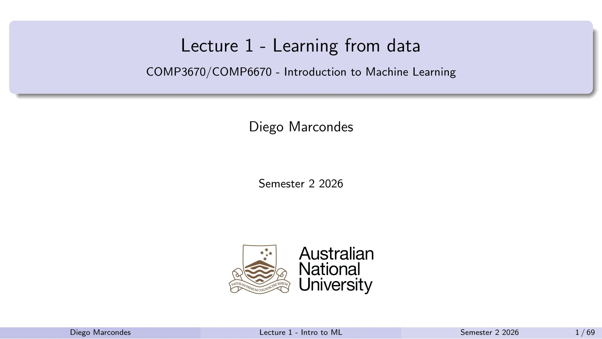

## 第 2 页：章节页：课程实用信息

本节介绍课堂测验、教学安排、评分方式、沟通渠道和学术诚信。以下行政信息是原课件的记录；这里逐页保留，便于与原稿核对。

展开第 2 页原始 slide，核对图表、标注和公式

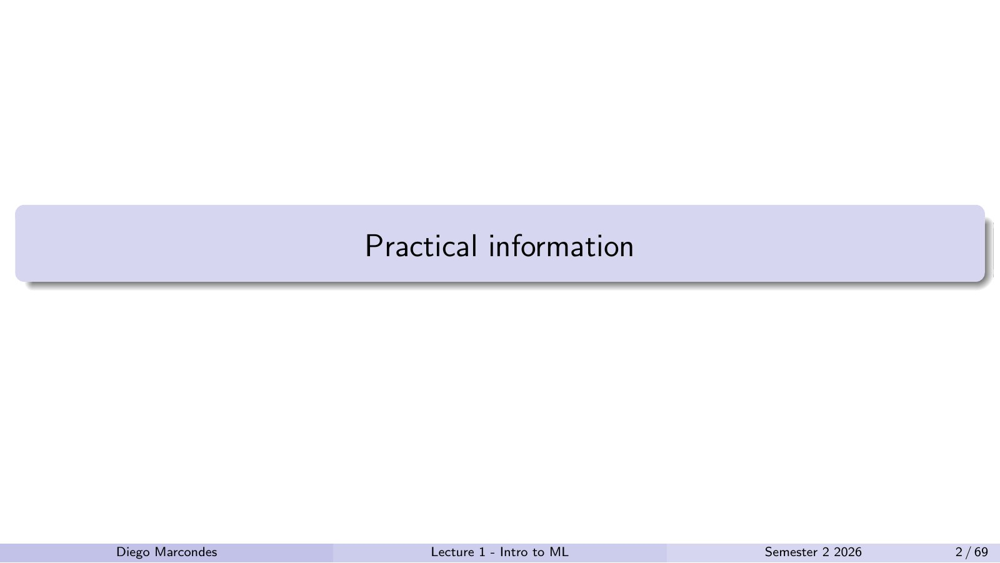

## 第 3 页：Poll Everywhere 课堂测验

课前使用 ANU 邮箱登录 Poll Everywhere，支持 ANU SSO；课件给出入口 https://pollev.com/anuiml2026 。保持网页打开，教师宣布题目时页面会更新。这一页解释参与方式，不是机器学习算法内容。

展开第 3 页原始 slide，核对图表、标注和公式

## 第 4 页：课程定位

课程把应用机器学习需要的基本数据统计分析、数学基础以及学习与适应概念整合起来。它既为后续深入课程作准备，也作为独立的机器学习基础课程。

展开第 4 页原始 slide，核对图表、标注和公式

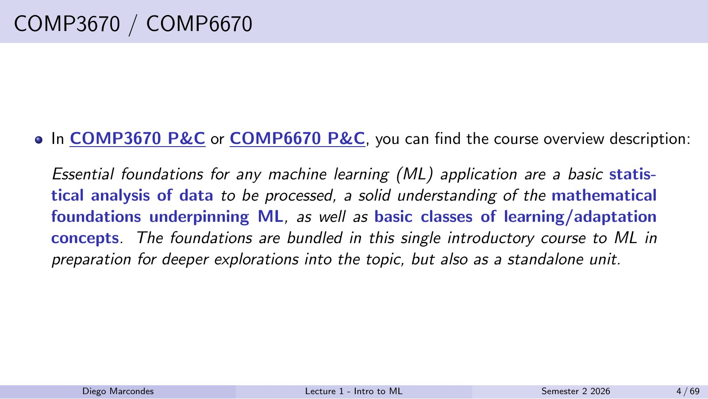

## 第 5 页：三类数学基础

课程穿插讲解微积分与优化、概率与统计、线性代数。数学与模型及算法一起出现：概率描述数据和泛化，优化完成训练，线性代数组织数据和表示变换。

展开第 5 页原始 slide，核对图表、标注和公式

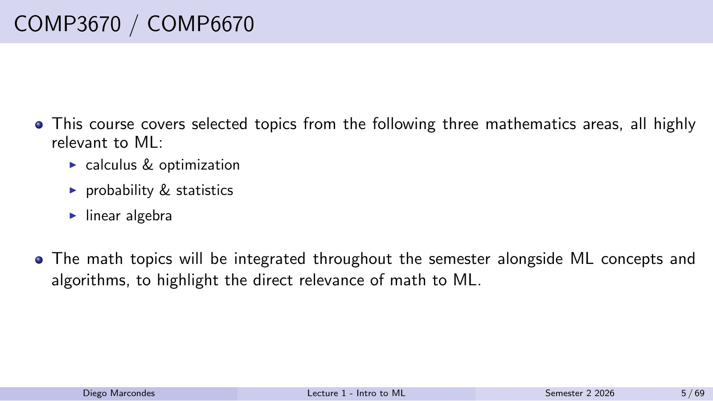

## 第 6 页：先修基础

课件强调高中代数、坐标几何、函数和集合论。如果这些基础不扎实，后面的数学表示和推导会较难理解。本页是先修要求说明，没有引入新公式。

展开第 6 页原始 slide，核对图表、标注和公式

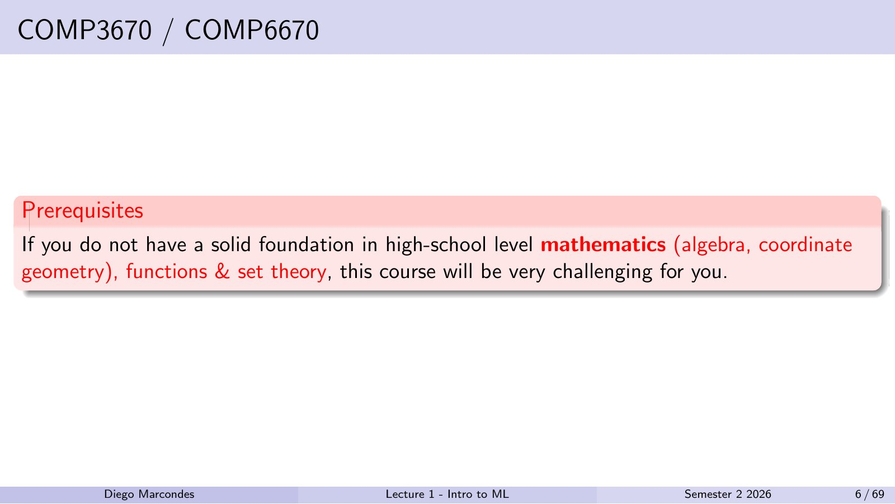

## 第 7 页：教学团队

Diego Marcondes 负责第 1–5.5 周和第 10.5–12 周，Yun Kuen（Marco）Cheung 负责第 5.5–10.5 周。辅导教师包括 Sunaina Ajmal、Oliver Bao、Subhransu Bhattacharjee、Ryan Guo、Isaac Leong、Saswat Panda、Geun Yun、Jinghan Zhang。

展开第 7 页原始 slide，核对图表、标注和公式

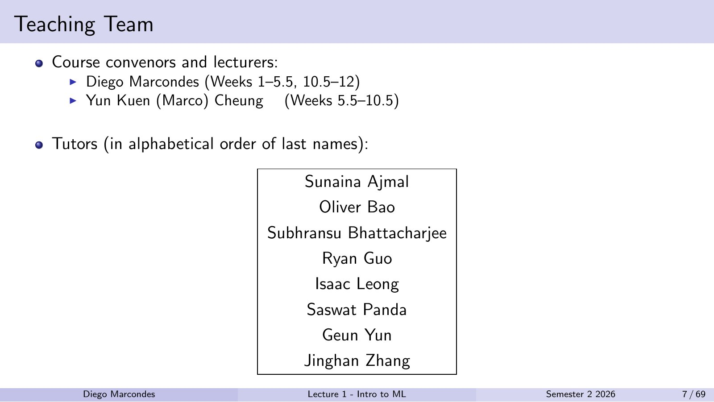

## 第 8 页：五类考核

三次作业各 7%，课堂测验 4%，实验练习 4%；这三类名义合计 29%，实际对总评贡献上限为 22%。期中考试占 23%，期末占 55%。测验从第 2 周开始计分，取最好 14 次；实验取最好 8 次，均要求到场且不设补做或延期。

展开第 8 页原始 slide，核对图表、标注和公式

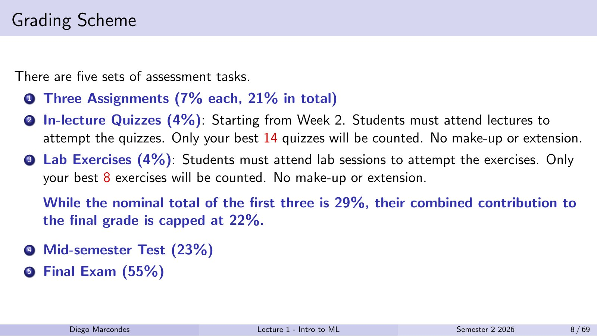

## 第 9 页：总评计算公式

课件规定

$$
FG=\min(7A_1+7A_2+7A_3+4Q+4L,22)+23M+55E.
$$

各变量都是 $[0,1]$ 内的得分比例，例如期中 89% 代入 $M=0.89$。先计算平时分再与 22 取较小值，最后加上考试贡献。

展开第 9 页原始 slide，核对图表、标注和公式

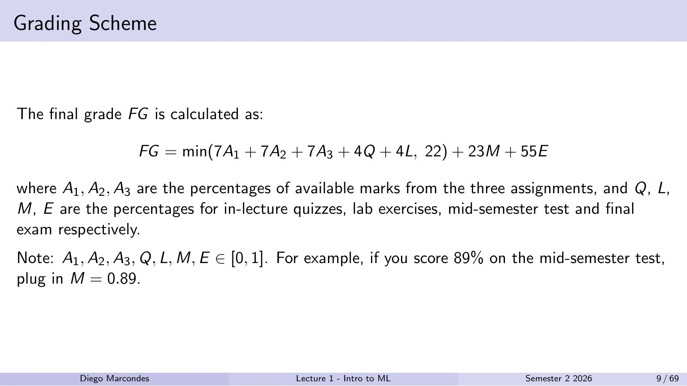

## 第 10 页：讲座与实验安排

原课件列出周四、周五早上 8:30–10:00 的讲座，以及第 2–11 周的实验。实验每次含 1.5 小时教学和 0.5 小时咨询。第 1 周测验用于熟悉系统；第 2 周起常规讲座中的测验计分，题目可能在任意时刻出现。

展开第 10 页原始 slide，核对图表、标注和公式

## 第 11 页：Canvas 与 Ed 论坛

课程材料放在 Canvas，一般问题通过支持数学排版的 Ed Forum 提问，入口为 https://edstem.org/au/courses/37302/discussion 。非保密的个人安排问题使用 Private 帖；医疗等保密事项联系课程邮箱 comp3670@anu.edu.au。

展开第 11 页原始 slide，核对图表、标注和公式

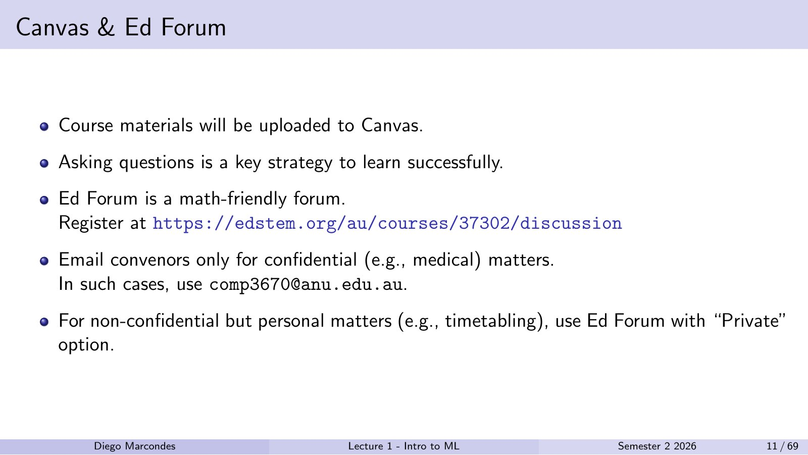

## 第 12 页：学生代表的职责

学生代表是学生与课程负责人之间的正式沟通渠道，收集影响全班或部分学生的问题，提出建设性反馈，并参加学院与学校安排的反馈会议。

展开第 12 页原始 slide，核对图表、标注和公式

## 第 13 页：担任学生代表的益处

原页列出表达学生意见、训练沟通与领导能力、处理争议、参与教育决策，以及了解学校和高等教育议题等益处。这是课程参与方式的说明。

展开第 13 页原始 slide，核对图表、标注和公式

## 第 14 页：招募学生代表

原课件计划招募 3–5 人，希望覆盖不同性别、本地与国际学生、本科与硕士群体。申请要求附简历，说明背景与适任理由，原定截止时间是第 2 周周一。此处保留的是课件发布时的招募信息。

展开第 14 页原始 slide，核对图表、标注和公式

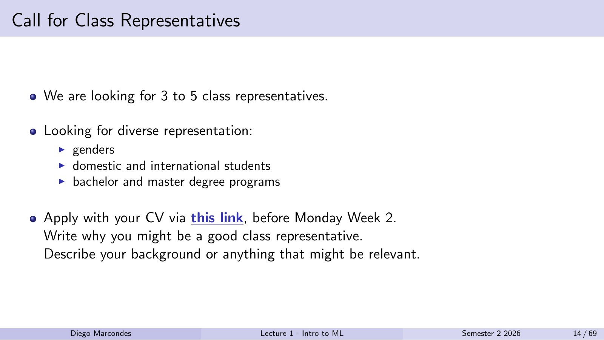

## 第 15 页：学术诚信与生成式 AI

原页明确课程不接受抄袭、串通和代写，并规定计分考核不得使用生成式 AI。课件强调作业和测验服务于考试准备，提醒期末考试另有门槛要求。本笔记仅复述原页规定，不据此推断未列出的细则。

展开第 15 页原始 slide，核对图表、标注和公式

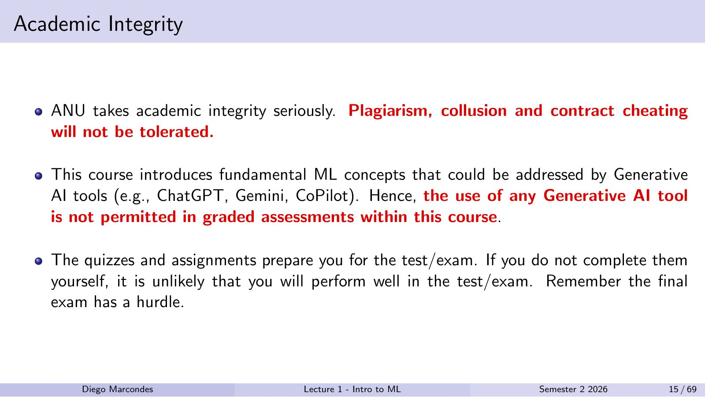

## 第 16 页：抄袭的例子

原页包括：答案高度接近他人或网页；引用了外部想法却不注明出处；与同学讨论后未标明贡献；重复提交自己在其他课程或上次修课中的代码与作业。最后一种称自我抄袭；仅改变措辞不自动消除来源标注责任。

展开第 16 页原始 slide，核对图表、标注和公式

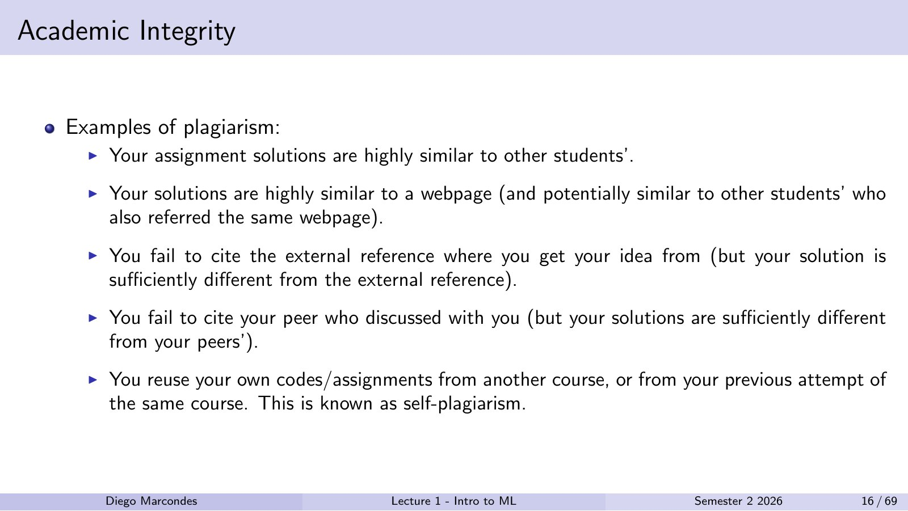

## 第 17 页：串通与代写的例子

课件把个人作业中的违规协作列为串通风险，即使注明朋友贡献也不当然获准。代写例子包括使用培训机构提供的解法、付费请他人完成作业。原页另提供 ANU 学术诚信网页供查阅。

展开第 17 页原始 slide，核对图表、标注和公式

## 第 18 页：章节页：科学与归纳推理

从课程事务转入概念基础。接下来讨论科学怎样通过证据检验假说，以及从有限观察推向一般规律为什么存在逻辑局限。

展开第 18 页原始 slide，核对图表、标注和公式

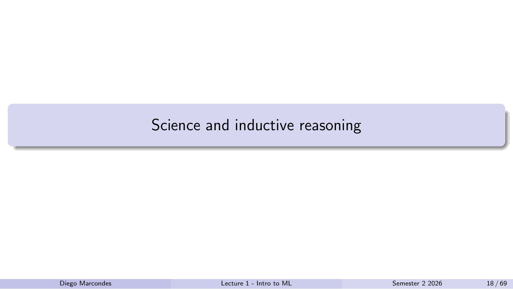

## 第 19 页：科学：提出假说并接受检验

图中的循环是提出假说、与经验数据对照：失败则证伪并丢弃，未失败则暂时保留，等待新数据继续检验。科学假说不会因有限次成功检验就被最终证明为真，“尚未证伪”强调结论的暂时性。

展开第 19 页原始 slide，核对图表、标注和公式

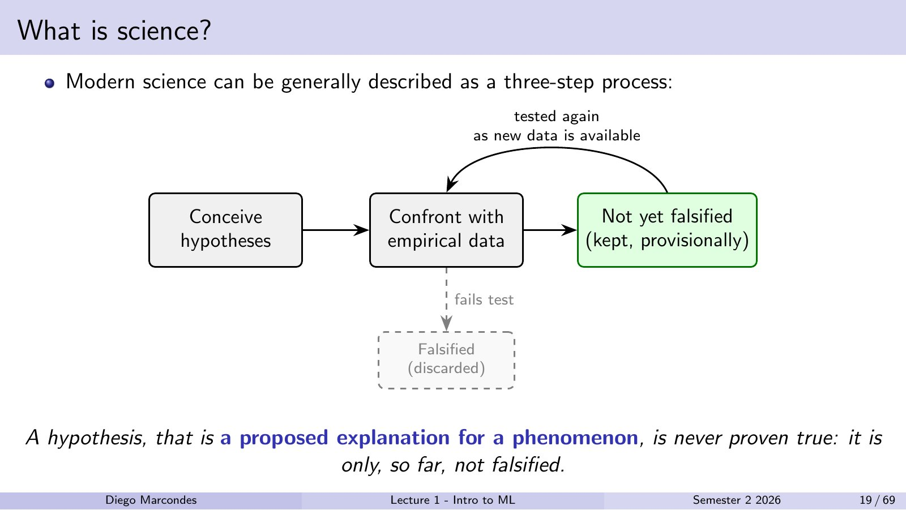

## 第 20 页：演绎与归纳两条路线

假说演绎从理论推出可检验预测，再面对数据；归纳从经验数据发现规律，形成假说并尝试推广为理论。图中回路表示新证据可以更新或淘汰解释。机器学习对应数据到假说再到泛化的归纳路线。

展开第 20 页原始 slide，核对图表、标注和公式

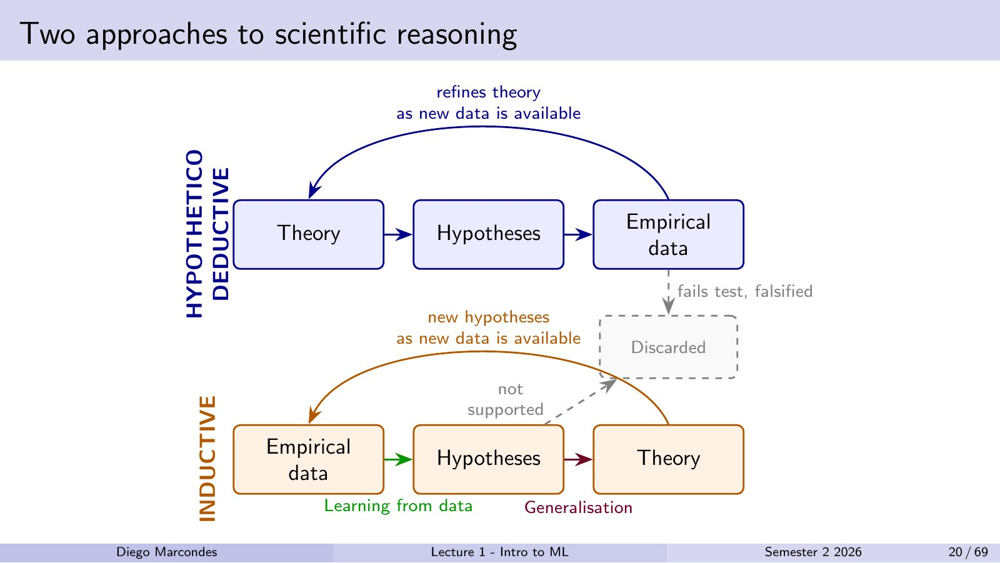

## 第 21 页：假说演绎：广义相对论例子

从爱因斯坦的理论推出“恒星光线经过太阳附近会弯曲”，再用 1919 年日食观测检验。观测支持预测，因此该假说当时未被证伪；这不同于宣称整个理论已被最终证明。

展开第 21 页原始 slide，核对图表、标注和公式

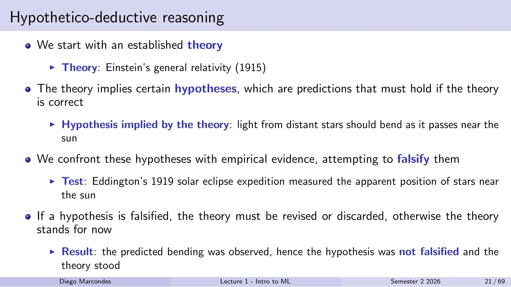

## 第 22 页：假说演绎的图示续页

本页用太阳附近光线偏折示意图、日食照片和历史报纸版面延续上一页。示意图区分恒星实际位置与因光线弯曲产生的表观位置，说明观测怎样检验理论预言；报纸展示当时对结果的报道。它是观测例子的视觉续页，没有新增定理。

展开第 22 页原始 slide，核对图表、标注和公式

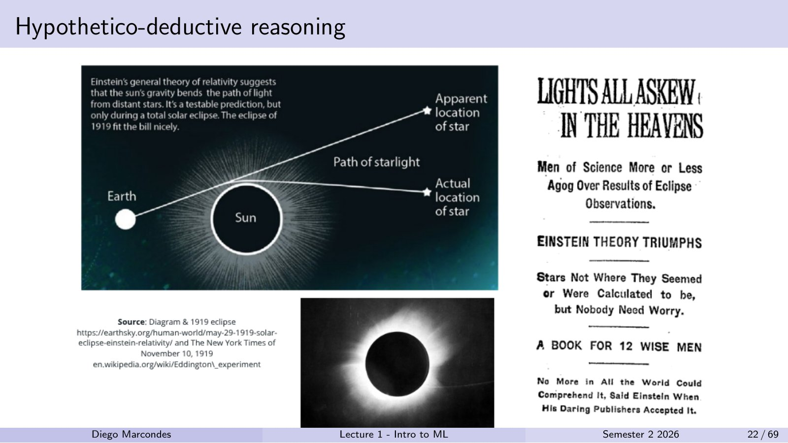

## 第 23 页：归纳：从行星记录到椭圆轨道

第谷长期记录行星位置，开普勒从记录中识别出椭圆轨道规律。规律先从数据中产生，当时尚没有正确解释其成因的理论。随后继续与新观测比较，逐渐建立经验定律。

展开第 23 页原始 slide，核对图表、标注和公式

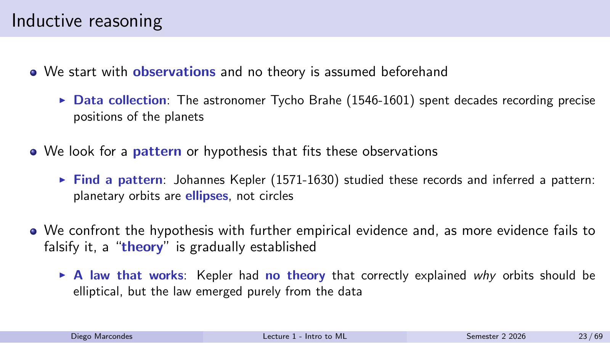

## 第 24 页：归纳可靠吗

牛顿理论后来解释了轨道规律，说明归纳和演绎可以互补。演绎在前提成立时保证结论成立；归纳无法由有限观察逻辑保证普遍命题。这就是休谟的归纳问题，也是机器学习泛化问题的出发点。

展开第 24 页原始 slide，核对图表、标注和公式

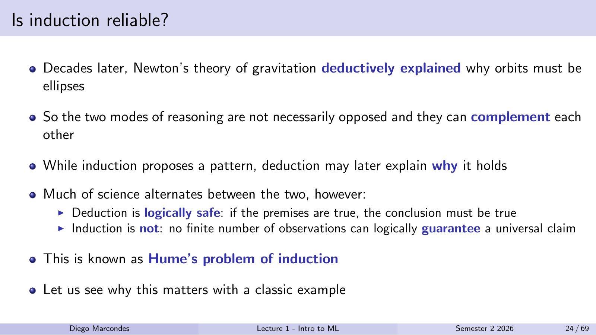

## 第 25 页：白天鹅与黑天鹅

只见到白天鹅，不能证明所有天鹅都白；找到一只黑天鹅就足以反驳该普遍命题。原页以欧洲观察与澳大利亚黑天鹅说明：支持例子再多，也不等于排除了所有反例。

展开第 25 页原始 slide，核对图表、标注和公式

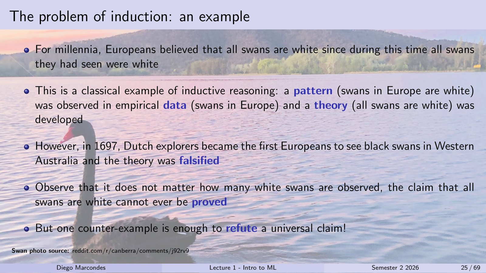

## 第 26 页：波普尔：可证伪性

原页用可证伪性讨论科学与非科学的分界：科学主张应允许某种可能观察推翻它。如果一个解释能兼容所有结果，就没有排除任何世界状态。这个思想随后用来理解过于灵活的模型为何难以给出可信推广。

展开第 26 页原始 slide，核对图表、标注和公式

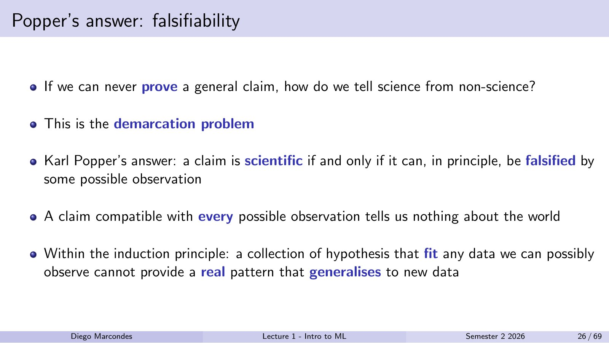

## 第 27 页：不可证伪的例子

“秘密组织控制一切并隐藏所有证据”可以把有证据和无证据都解释为支持自己，因而没有可能的观察能反驳它。原页借此强调：解释必须承担被数据否定的风险，才具有可检验内容。

展开第 27 页原始 slide，核对图表、标注和公式

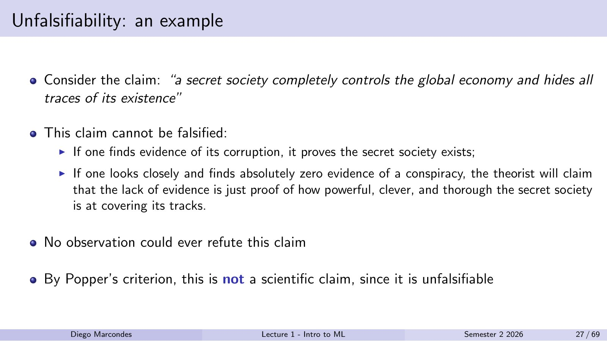

## 第 28 页：机器学习是计算化的归纳

机器学习从数据中学习模式，再用于预测新的未见数据。它用有限样本形成假说，期望规律能推广到同一现象产生的其他数据；因此无法回避归纳推理的基本难题。

展开第 28 页原始 slide，核对图表、标注和公式

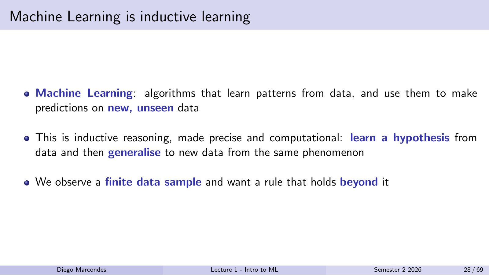

## 第 29 页：机器学习中的可证伪性与过拟合

若模型能够完美拟合任何数据，包括随机噪声，单看训练拟合就难以判断它发现了什么规律。课件把这种灵活性与不可证伪性、过拟合联系起来。**理解补充：**这是一种引导性的类比，后续将用模型复杂度和泛化界作精确定量。

展开第 29 页原始 slide，核对图表、标注和公式

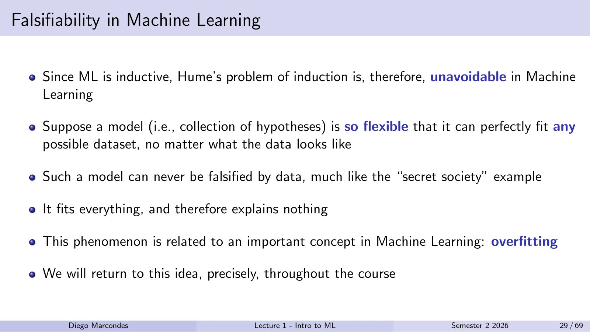

## 第 30 页：机器学习课程路线

课程覆盖学习类型、监督与无监督方法、泛化的概率统计描述、训练的优化方法，以及所需线性代数和微积分。核心观点是：机器学习建立在统计模型和归纳推理之上，算法是拟合模型的工具。

展开第 30 页原始 slide，核对图表、标注和公式

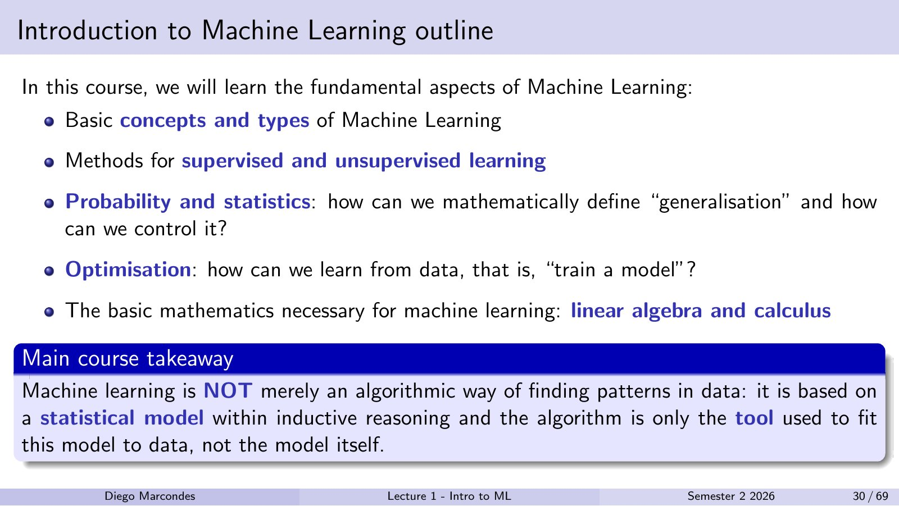

## 第 31 页：从数据中学习的流程图

原图对比两条路线。经典路线从领域知识提取关于目标的先验，再建立假说空间；算法导向路线则从算法池经经验测试选出“最佳”算法，并间接确定假说表示。两者最后都把学习写成数据驱动的优化问题。图中的问号和虚线标出：只按算法成绩选择，可能失去与领域先验及假说空间的明确联系。

展开第 31 页原始 slide，核对图表、标注和公式

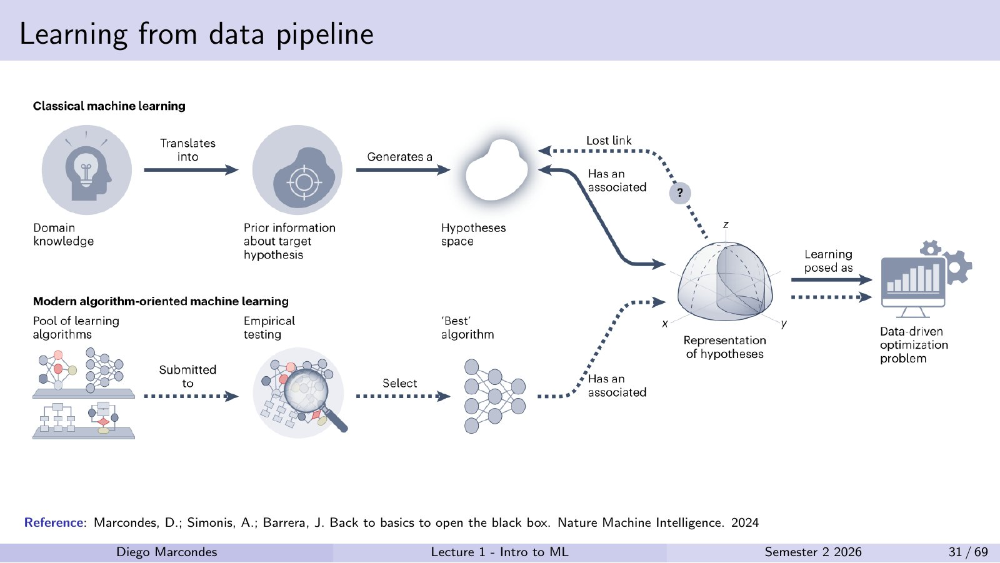

## 第 32 页：章节页：机器学习的类型

下面依据可获得的信息区分监督学习、无监督学习和强化学习，而不是仅凭算法名字分类。

展开第 32 页原始 slide，核对图表、标注和公式

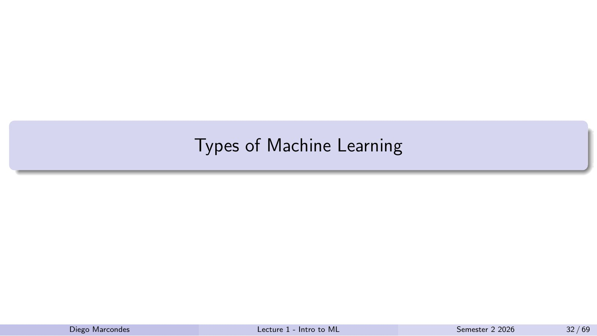

## 第 33 页：输入信息与反馈形式

房屋面积、患者指标、图像像素、词频、收入等都是输入特征。关键区别是：每个输入是否有已知标签，或者是否只有交互后的奖励信号。这两点决定三类学习问题的基本形式。

展开第 33 页原始 slide，核对图表、标注和公式

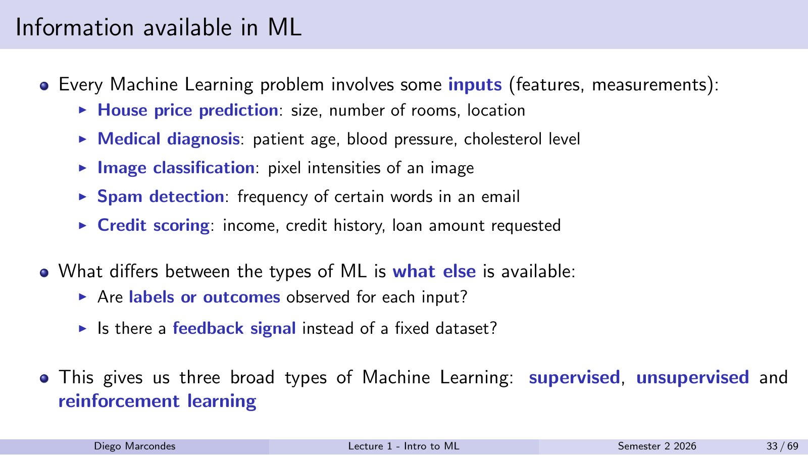

## 第 34 页：监督学习的数据和目标

给定带标签样本

$$
D=\{(x_1,y_1),\ldots,(x_N,y_N)\},\qquad x_i\in\mathcal X,\ y_i\in\mathcal Y,
$$

学习规则 $h:\mathcal X\to\mathcal Y$。它既应解释训练对，也应对新输入有效。$x_i$ 可为向量，其各坐标是不同特征；样本下标与特征下标应区分。

展开第 34 页原始 slide，核对图表、标注和公式

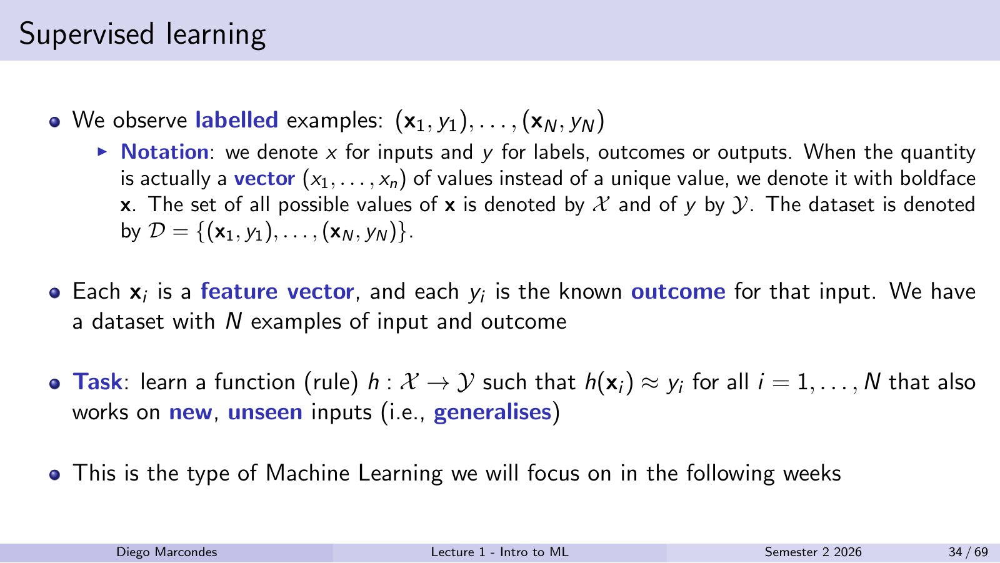

## 第 35 页：分类与回归

分类输出属于有限类别集合，例如 $\{0,1\}$、$\{-1,+1\}$ 或多个类别编号；回归输出是连续数量，例如房价或温度，可取实数、正实数或某个区间。二者都使用已观察到的输入与标签。

展开第 35 页原始 slide，核对图表、标注和公式

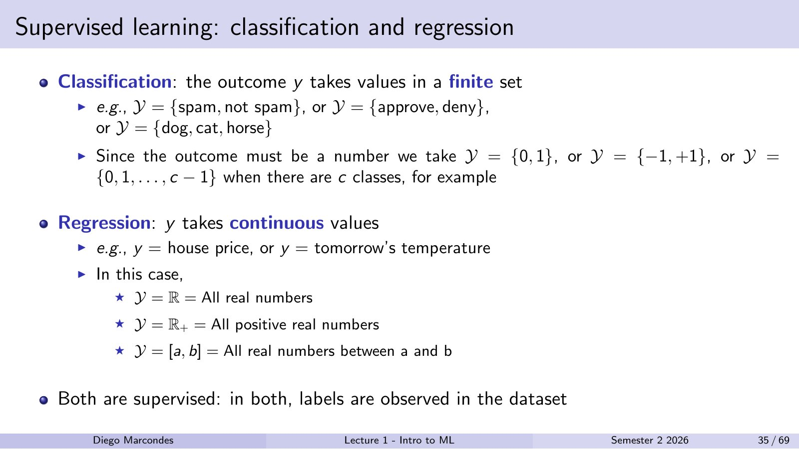

## 第 36 页：分类与回归的任务例子

分类包括垃圾邮件检测、疾病有无判断、图像类别识别；回归包括房价、次日气温、预期寿命预测。判断任务类型要看输出的含义和取值集合，而不是输入是否包含数字。

展开第 36 页原始 slide，核对图表、标注和公式

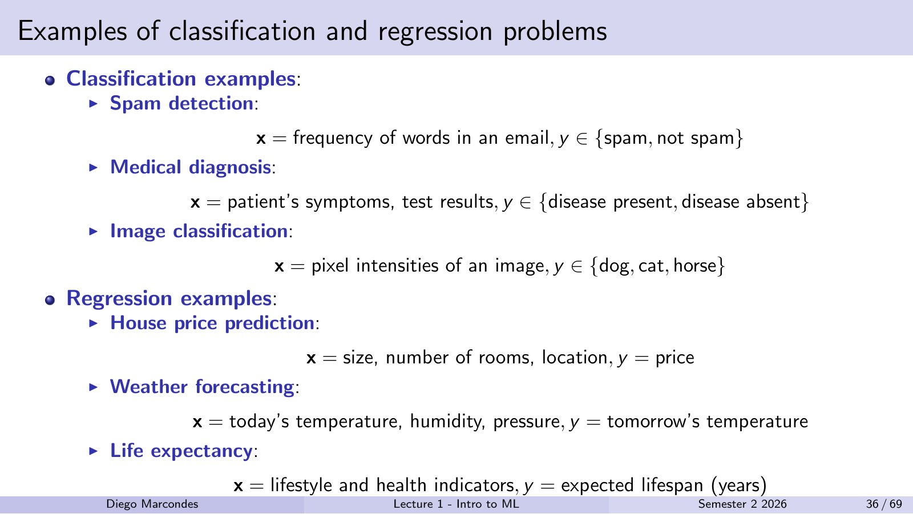

## 第 37 页：无监督学习

只观察 $x_1,\ldots,x_N$，没有标签。任务包括聚类、降维和密度估计，对应客户分群、基因表达压缩、寻找低概率异常交易等。缺少标签后，“什么算好结果”本身也成为建模的一部分。

展开第 37 页原始 slide，核对图表、标注和公式

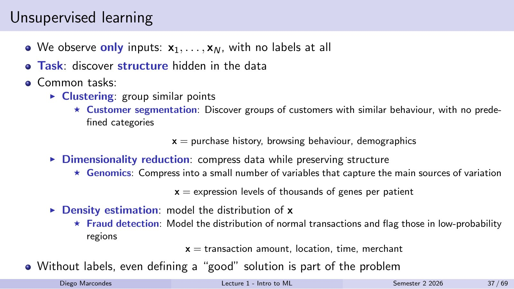

## 第 38 页：强化学习

智能体观察状态、采取动作、收到奖励；奖励评价动作好坏，却不直接给出正确动作。目标是学习策略 $h:\mathcal X\to\mathcal A$，最大化累积奖励。数据由交互过程产生，并可能有延迟反馈。

展开第 38 页原始 slide，核对图表、标注和公式

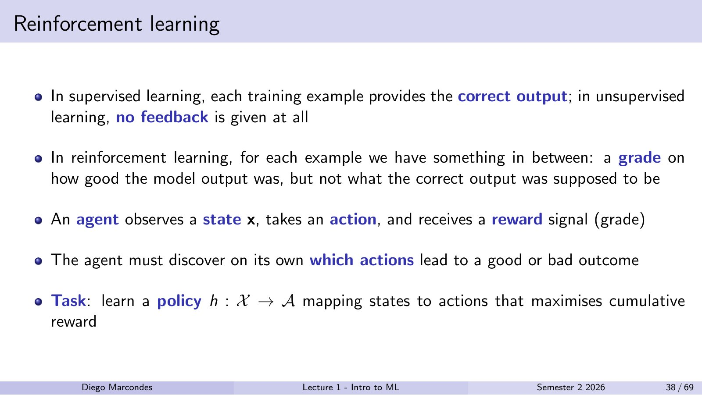

## 第 39 页：强化学习例子

棋类中的状态是棋盘、动作是落子、胜负奖励常到终局才出现，所以需要分配各步的贡献。推荐系统中的状态可含用户历史，动作是推荐内容，奖励可用点击、观看时间或购买反馈表示。

展开第 39 页原始 slide，核对图表、标注和公式

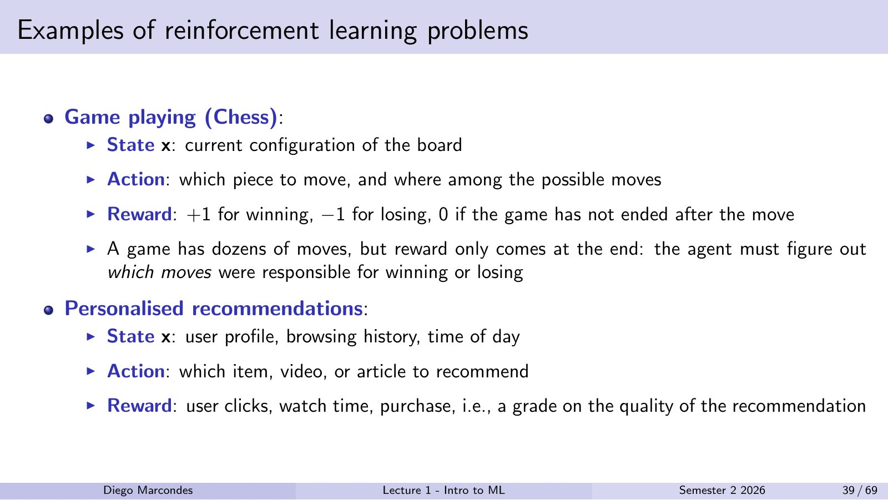

## 第 40 页：三类学习对照

监督学习使用输入与标签，重点是预测；无监督学习只有输入，重点是发现结构；强化学习依赖行动与反馈生成经验。它们共同面对从已有观察推广到未见情形的归纳挑战。本课程主要关注前两类。

展开第 40 页原始 slide，核对图表、标注和公式

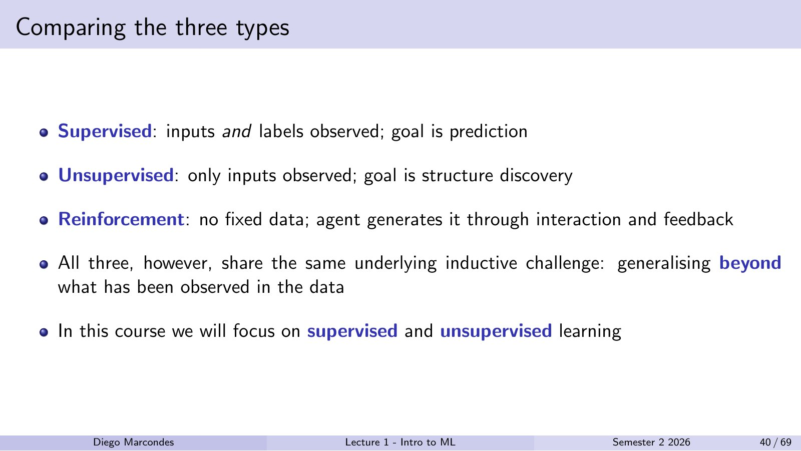

## 第 41 页：章节页：监督学习框架

本节将目标函数、训练数据、假说集合、学习算法和学到的假说放进同一框架，并用信用审批贯穿解释。

展开第 41 页原始 slide，核对图表、标注和公式

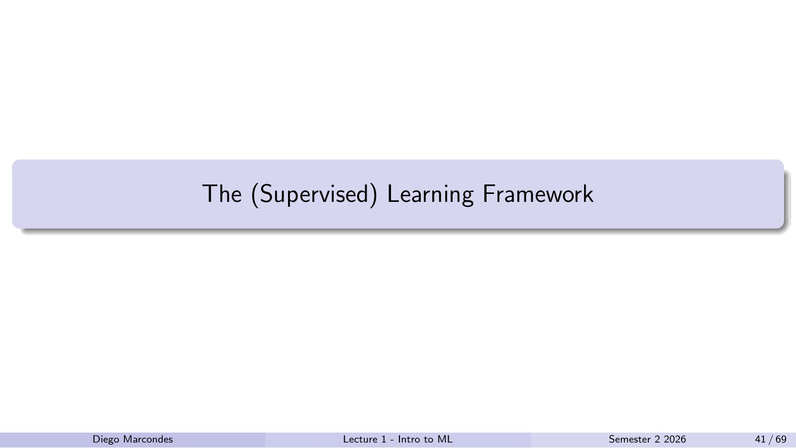

## 第 42 页：信用审批的具体问题

用年收入、工作年数、未偿债务等组成 $x=(x_1,\ldots,x_n)$，输出还款 $+1$ 或违约 $-1$。例表两人的收入为 52,000 与 28,000，工作 5 年与 1 年，债务 3,200 与 15,400。目标是从历史申请人预测未来申请人的结果。

展开第 42 页原始 slide，核对图表、标注和公式

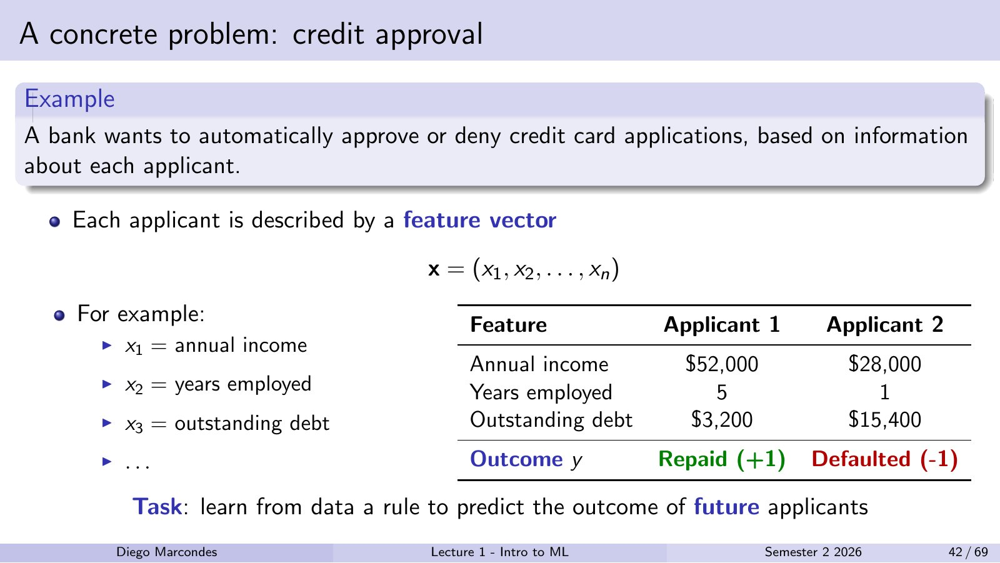

## 第 43 页：未知目标函数

设理想规则 $f:\mathcal X\to\mathcal Y$ 表示利用现有特征能达到的最佳预测。它未知，只能通过可能带噪声的有限输入输出对学习。目标是得到能泛化的 $h\approx f$；下一讲将用条件分布和损失明确“最佳”的含义。

展开第 43 页原始 slide，核对图表、标注和公式

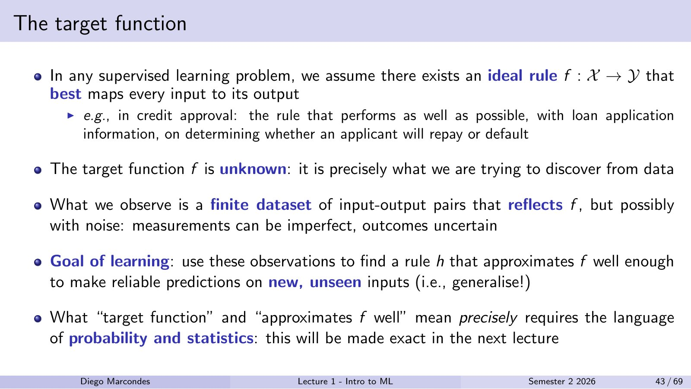

## 第 44 页：假说集合

一个假说 $h$ 是候选预测规则；$\mathcal H$ 是学习前允许考虑的规则集合。收入阈值、收入债务组合条件、加权打分阈值等对应不同候选规则。即使实现中没有显式枚举，监督学习仍隐含一个假说集合。

展开第 44 页原始 slide，核对图表、标注和公式

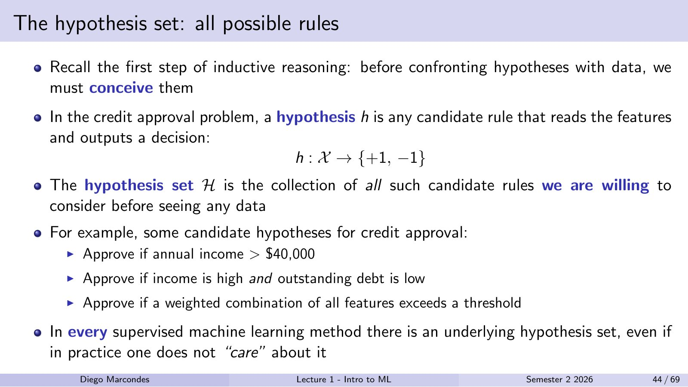

## 第 45 页：学习算法选择假说

固定 $\mathcal H$ 后，算法根据训练错误寻找一个好假说 $\hat h$。训练错误可以计算，但真正关心未来数据上的错误。二者是否相关、何时接近，是统计学习理论要回答的问题。

展开第 45 页原始 slide，核对图表、标注和公式

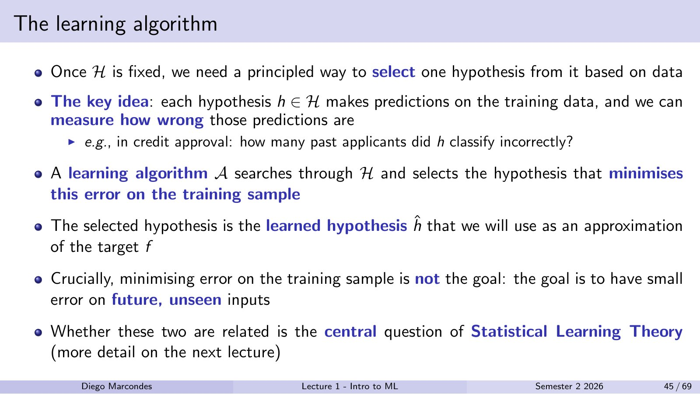

## 第 46 页：经验错误与最优化表示

分类的样本内错误为

$$
E_{\mathrm{in}}(h)=\frac1N\sum_{i=1}^N\mathbf1\{h(x_i)\ne y_i\},\qquad
\hat h\in\operatorname*{argmin}_{h\in\mathcal H}E_{\mathrm{in}}(h).
$$

指示函数在预测错误时取 1，其余取 0；平均后就是训练误分类比例。用 $\in$ 表示最小化解可能不唯一。

展开第 46 页原始 slide，核对图表、标注和公式

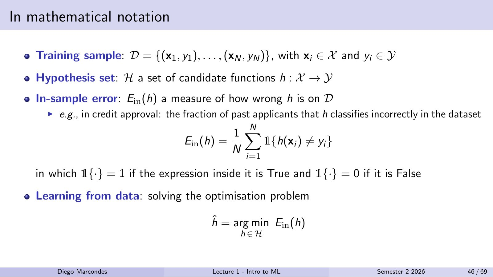

## 第 47 页：学习框架图

图把未知目标、输入数据、假说集合、学习算法和最终假说连起来。训练数据提供可观测证据，算法在预先允许的集合中选规则；未知目标并不是训练时可直接调用的答案表。原图引自《Learning from Data》。

展开第 47 页原始 slide，核对图表、标注和公式

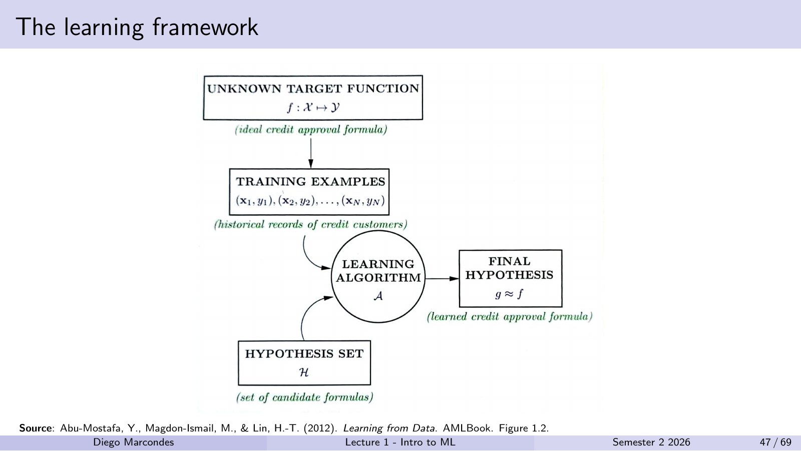

## 第 48 页：选择假说集合的代价

集合太简单，最好的候选也可能离目标很远，形成逼近误差；集合太复杂，容易拟合训练噪声，引起过拟合。原页以此引出偏差与方差的权衡：拟合能力增强不自动带来更好的泛化。

展开第 48 页原始 slide，核对图表、标注和公式

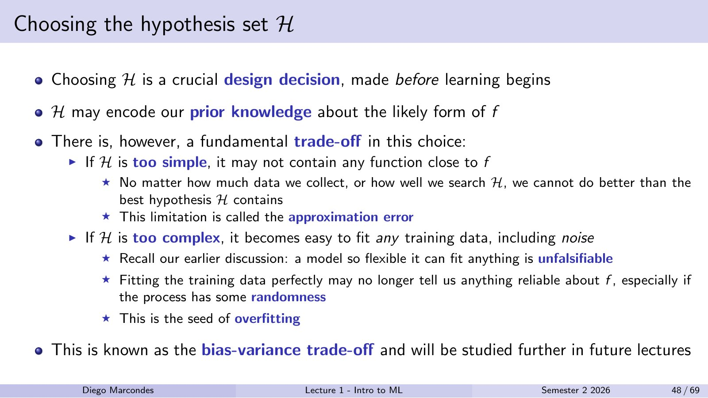

## 第 49 页：章节页：感知机

下面把抽象框架落实为线性阈值分类器，并说明一个简单的错误驱动训练算法。

展开第 49 页原始 slide，核对图表、标注和公式

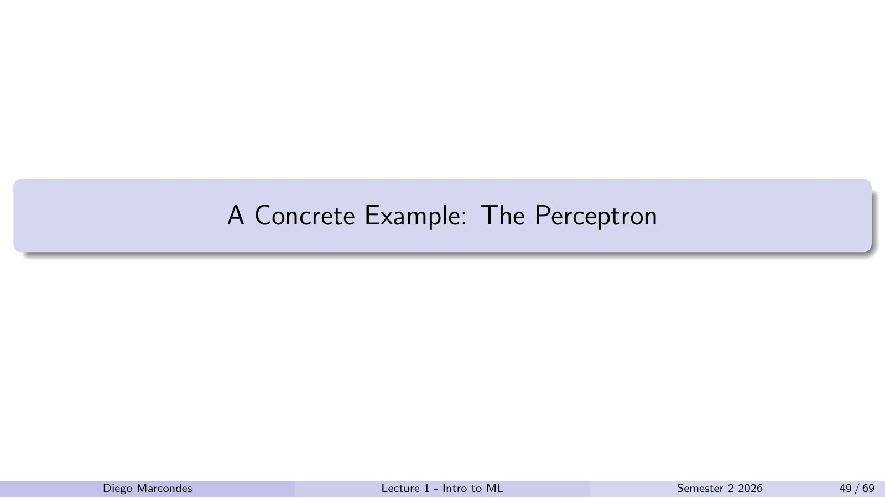

## 第 50 页：线性阈值假说集合

固定 $\mathcal H$ 为所有线性阈值函数，得到感知机问题。模型限定可使用的规则形状；随后学习算法负责选择具体的权重和偏置。这是模型与算法的区别。

展开第 50 页原始 slide，核对图表、标注和公式

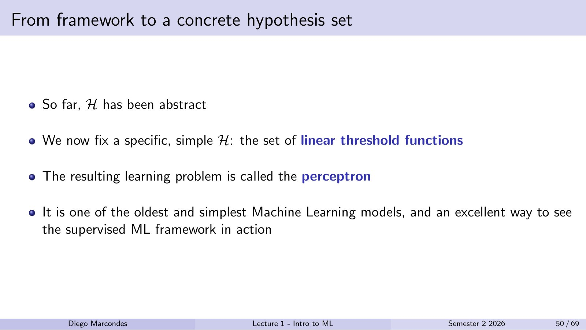

## 第 51 页：感知机的定义与零分约定

对 $x\in\mathbb R^n$，

$$
h_w(x)=\begin{cases}+1,&\sum_{j=1}^nw_jx_j+w_0>0,\\-1,&\sum_{j=1}^nw_jx_j+w_0\le0.\end{cases}
$$

$w_1,\ldots,w_n$ 是权重，$w_0$ 是偏置；改变这些实数得到不同假说。本讲约定打分为 0 时输出 $-1$，后面的手算例依赖这个约定。

展开第 51 页原始 slide，核对图表、标注和公式

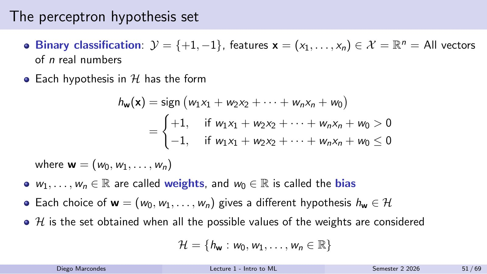

## 第 52 页：打分的含义

信用审批打分可写为收入、工作年数、债务的加权和再加偏置。若前两项权重为正、债务权重为负，则收入和工作年数提高分数，债务降低分数；偏置控制阈值。**理解补充：**原始分数不是校准概率，绝对值也受权重缩放影响。

展开第 52 页原始 slide，核对图表、标注和公式

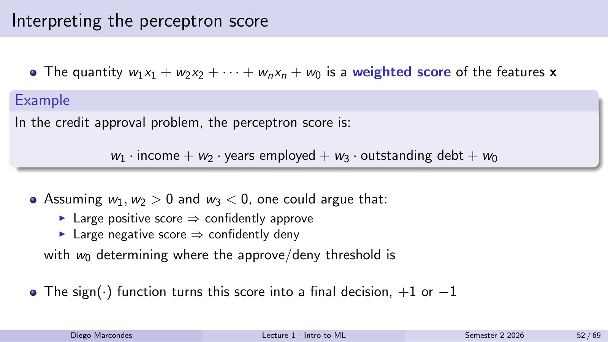

## 第 53 页：几何解释

二维边界为 $w_1x_1+w_2x_2+w_0=0$，是一条直线，把平面分成正负两区。高维中相应边界称超平面。图用两种类别的点展示如何用一条边界分类。

展开第 53 页原始 slide，核对图表、标注和公式

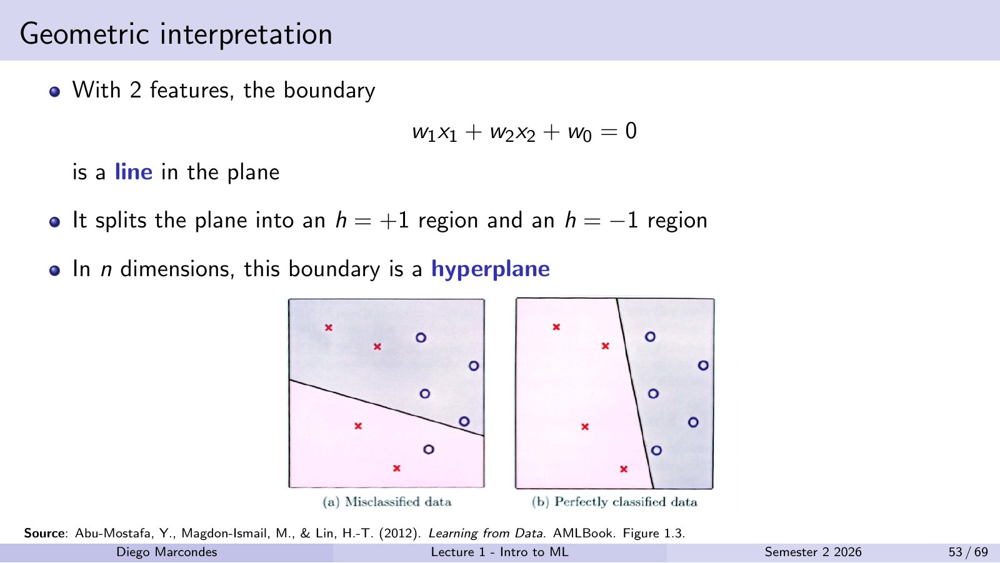

## 第 54 页：感知机训练问题

希望找到对所有训练点正确分类的参数。算法从任意初值开始，反复寻找错分点并修正，直到没有错误。一次修正未必永久保持先前点的分类，所以需要迭代检查整个数据集。

展开第 54 页原始 slide，核对图表、标注和公式

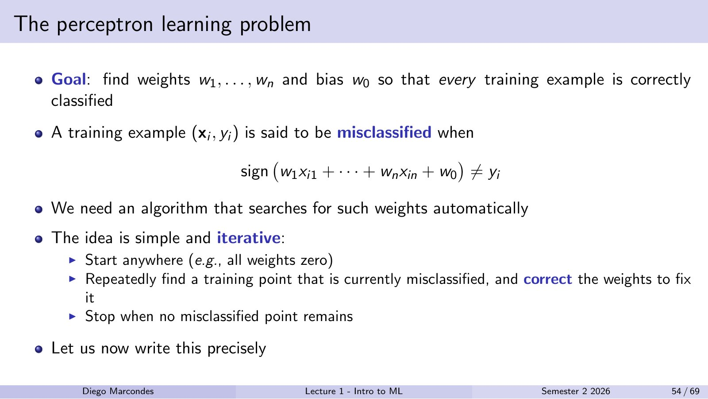

## 第 55 页：感知机学习算法 PLA

在线性可分前提下，从全零参数出发，取任意错分点 $(x_i,y_i)$，更新

$$
w_j\leftarrow w_j+y_ix_{ij}\quad(j=1,\ldots,n),\qquad
w_0\leftarrow w_0+y_i.
$$

反复执行，直到没有错分点。若把输入增加常数坐标 1，权重与偏置可合并为一个向量更新。

展开第 55 页原始 slide，核对图表、标注和公式

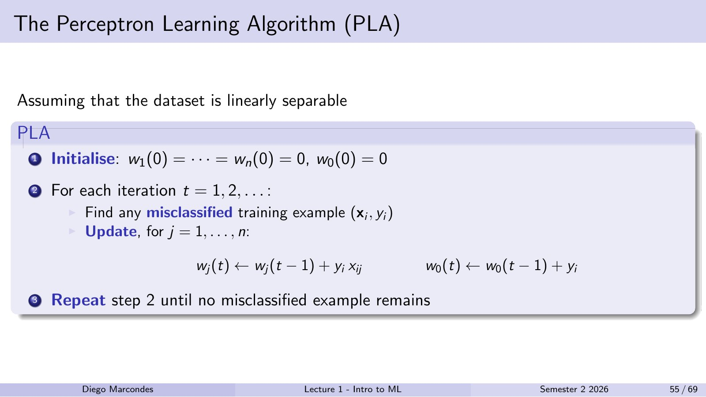

## 第 56 页：手算例：全零初始参数

训练点为 $x_1=(1,1),y_1=+1$ 与 $x_2=(-1,-1),y_2=-1$。起点 $w_1=w_2=w_0=0$，第一个点打分为 0，按本讲约定预测 $-1$，因此错分，需要更新。

展开第 56 页原始 slide，核对图表、标注和公式

## 第 57 页：手算例：一次更新完成

使用第一个点更新后 $w_1=w_2=w_0=1$。第二个点分数 $-1-1+1=-1$，预测正确；第一个点分数 $1+1+1=3$，也正确。因此本例只需一次更新即可停止。

展开第 57 页原始 slide，核对图表、标注和公式

## 第 58 页：PLA 的几何直觉

修正权重与偏置会移动或旋转决策边界，使所选错分点更倾向于落在正确一侧。图展示连续修正过程；某一步可能破坏之前的分类，不能把每次更新理解为训练错误必然单调减少。

展开第 58 页原始 slide，核对图表、标注和公式

## 第 59 页：PLA 的收敛条件

若存在一条线性边界正确分类全部训练点，则 PLA 保证有限次更新后停止并给出零训练错误。若数据不可线性分离，原始算法无法达到这一停止条件，可能无限循环；处理不可分数据需要其他方法。

展开第 59 页原始 slide，核对图表、标注和公式

## 第 60 页：零训练错误是否解决问题

即使信用审批的训练样本全部分对，银行实际面对的是未来申请人。因此 $E_{\mathrm{in}}(\hat h)=0$ 仍没有直接回答未来错误大小。这里重新出现归纳问题：样本上的成功能否推广？

展开第 60 页原始 slide，核对图表、标注和公式

## 第 61 页：章节页：泛化与概率

下面用有限布尔输入说明纯逻辑推断的限制，再转向概率化的学习保证。

展开第 61 页原始 slide，核对图表、标注和公式

## 第 62 页：样本内错误

学到规则后的训练误分类比例是

$$
E_{\mathrm{in}}(\hat h)=\frac1N\sum_{i=1}^N\mathbf1\{\hat h(x_i)\ne y_i\}.
$$

它可由已有标签精确计算，PLA 试图把它降到 0；未见数据没有现成标签，因此不能直接用同样方式计算总体表现。

展开第 62 页原始 slide，核对图表、标注和公式

## 第 63 页：五个已知输入与三个未知输入

输入集合 $\mathcal X=\{0,1\}^3$ 共有 8 点，训练集只给其中 5 点。图表中前三位是输入，圆点颜色表示二元输出，剩余 3 点标为问号。算法即使完全匹配 5 个训练点，也尚未确定 3 个未见标签。

展开第 63 页原始 slide，核对图表、标注和公式

## 第 64 页：与训练数据相容的目标函数

每个未见点都有两种可能输出，3 个点合计 $2^3=8$ 种标签组合，因此至少有 8 个目标函数与全部已知样本一致。图把它们并列，说明训练一致性不能唯一确定整个目标函数。

展开第 64 页原始 slide，核对图表、标注和公式

## 第 65 页：纯逻辑下学习似乎不可能

无论对某个未知点预测哪一类，8 个相容目标中恰有 4 个同意、4 个反对。若没有任何额外结构，样本不能排除样本外的任意标签模式。原页因此提出：要讨论可行学习，必须改变为概率视角。

展开第 65 页原始 slide，核对图表、标注和公式

## 第 66 页：在学习框架中加入概率

图在原学习框架中加入数据生成分布。关键变化是训练点和新输入由一个共同机制抽取，而不是只列举逻辑上可能的目标函数。这样才能用抽样概率讨论经验错误与总体错误之间的关系。

展开第 66 页原始 slide，核对图表、标注和公式

## 第 67 页：概率意义下的归纳

不能保证每次抽样都使 $E_{\mathrm{in}}\approx E_{\mathrm{out}}$，但可研究二者相差很大的概率。统计学习理论将量化泛化间隔、所需样本数，以及假说复杂度的影响；训练算法本身并不提供这些保证。

展开第 67 页原始 slide，核对图表、标注和公式

## 第 68 页：本讲要点

科学以可检验假说面对证据；机器学习把归纳过程计算化。三种学习类型由标签与反馈区分。监督框架包含未知目标、训练集、假说集合、算法与学到规则；感知机展示了可分数据上的训练过程。下一步要借助概率统计回答泛化问题。

展开第 68 页原始 slide，核对图表、标注和公式

## 第 69 页：参考文献

原页列出 Abu-Mostafa 等《Learning from Data》第 1 章；Marcondes 等关于先验信息与计算能力的论文、2024 年《Back to basics to open the black box》；Braga-Neto 与 Dougherty 的《Machine Learning Requires Probability and Statistics》；以及 Popper 的《The Logic of Scientific Discovery》。这些是本讲背景来源，未在本笔记中额外查阅或延伸。

展开第 69 页原始 slide，核对图表、标注和公式

