# Lecture 02：概率、条件期望、统计学习框架与经验风险，按 PDF 逐页复述

来源：[lecture02.pdf](../../comp3670_lectures/lecture02.pdf)，共 89 个 PDF 页面。严格按 PDF 页序组织，章节页、例题续页和参考文献页也单独保留。正文用中文讲解概念、公式和图表；原页未写出的解答、纠错或推导明确标为“理解补充”。每节末尾可展开完整原始 slide核对颜色、标注和排版。图片和 PDF 均使用仓库相对路径，适合本地预览与 GitHub。

## 第 1 页：课程与主题：概率和统计学习理论

本讲由 Diego Marcondes 讲授，用概率空间、随机变量、期望、条件分布、损失和抽样，把上一讲的监督学习框架精确化，最后提出需要控制的泛化间隔。

展开第 1 页原始 slide，核对图表、标注和公式

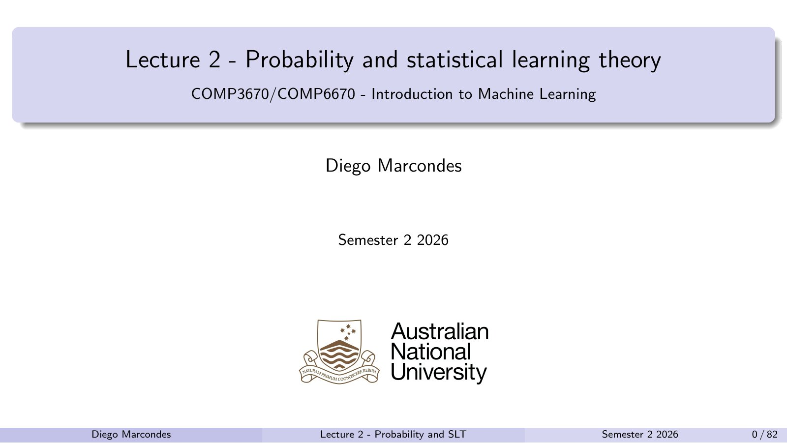

## 第 2 页：回顾上一讲的未解问题

已知目标函数、数据、假说集合和学习算法的角色，也见过 PLA 把训练错误降到 0。但未见输入上的标签不能由有限样本在逻辑上唯一确定。问题是：小 $E_{\mathrm{in}}(\hat h)$ 究竟能说明多少 $E_{\mathrm{out}}(\hat h)$ 的信息？

展开第 2 页原始 slide，核对图表、标注和公式

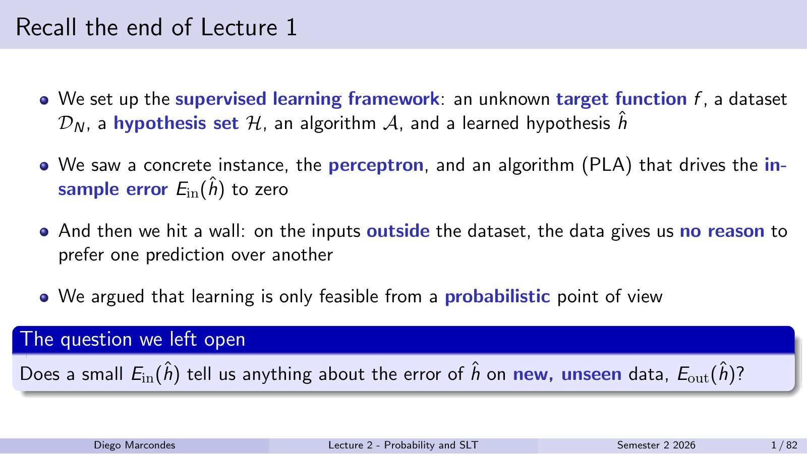

## 第 3 页：为什么需要概率语言

“新数据”需要数据生成分布 $P$，“最佳规则”需要输出给定输入的条件分布，“可靠推广”需要概率界。接下来把这些直觉替换为可计算、可证明的数学对象。

展开第 3 页原始 slide，核对图表、标注和公式

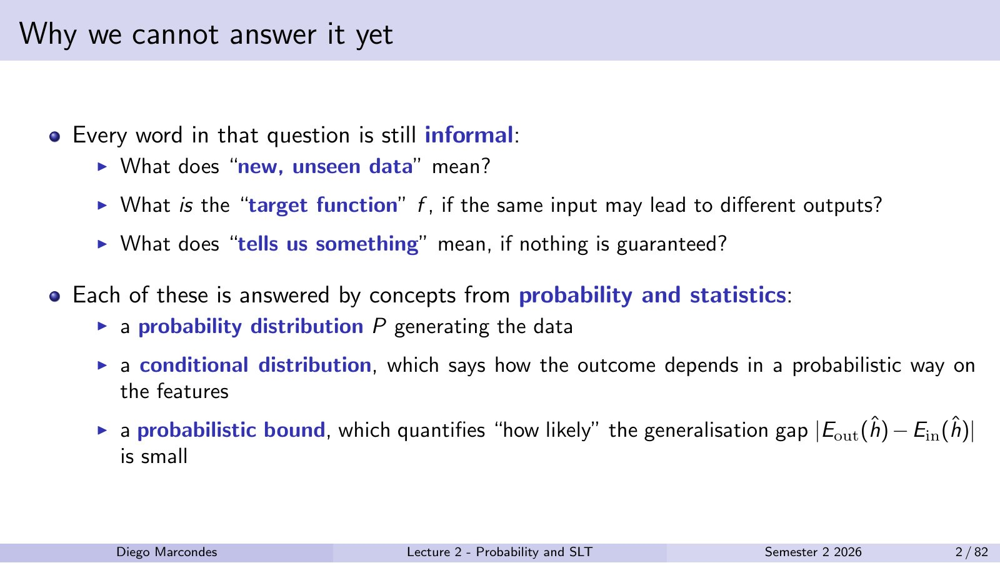

## 第 4 页：章节页：概率空间与随机变量

先描述随机现象和事件，再把现实对象映射成机器学习使用的数值特征与标签。

展开第 4 页原始 slide，核对图表、标注和公式

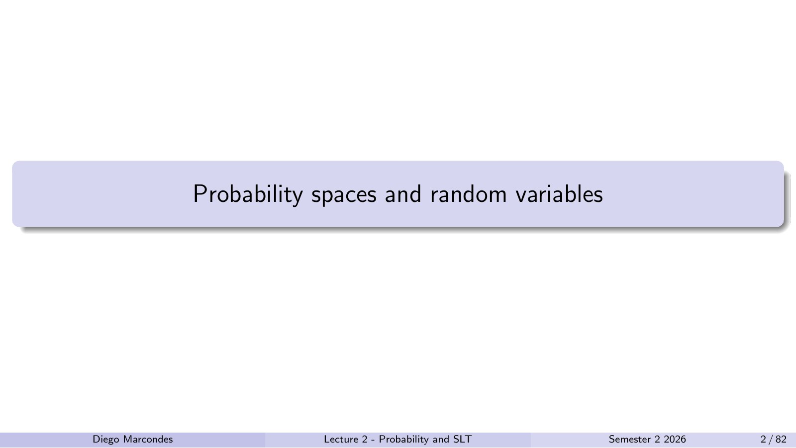

## 第 5 页：为什么输出具有随机性

相同记录特征的申请人可能还款也可能违约，相同检查指标的患者也可能有不同结果。原因是特征没有包含决定结果的全部信息。因此使用样本空间、事件集合和概率测度描述数据产生过程。

展开第 5 页原始 slide，核对图表、标注和公式

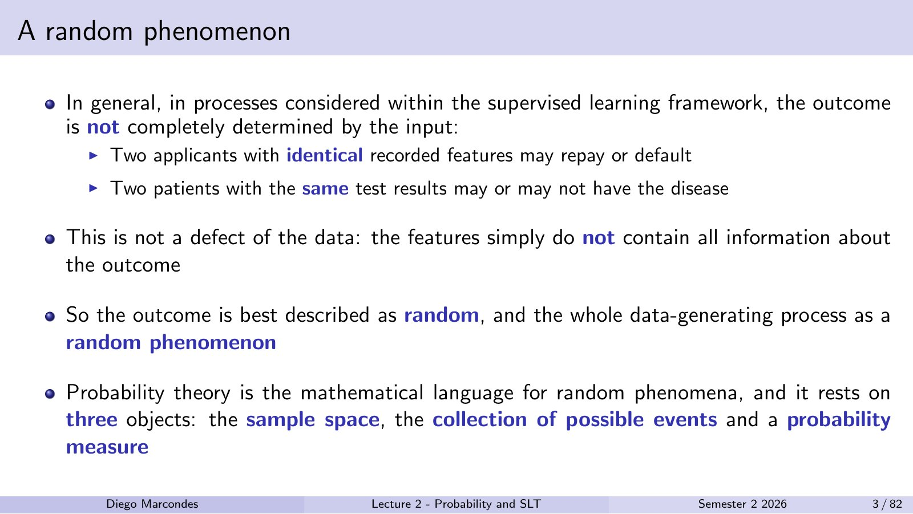

## 第 6 页：样本空间与事件

样本空间 $\Omega$ 是所有可能结果的集合，$\omega\in\Omega$ 是一次实现。事件 $A\subseteq\Omega$ 在 $\omega\in A$ 时发生。例子包括硬币正反面、骰子点数、两次抛硬币序列，以及申请人总体。

展开第 6 页原始 slide，核对图表、标注和公式

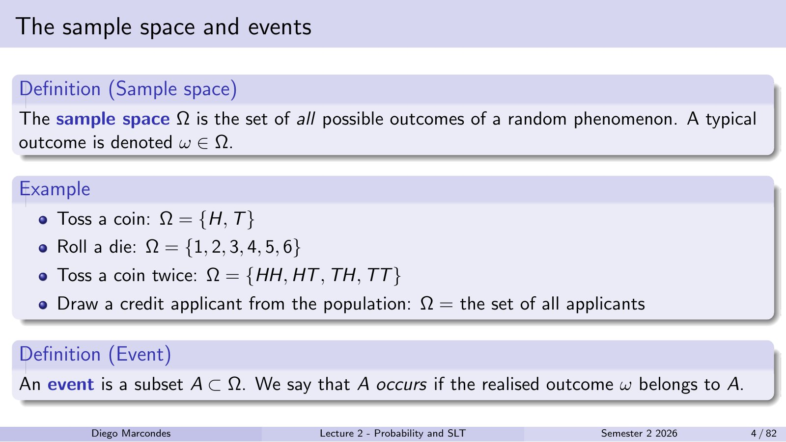

## 第 7 页：事件的集合运算

骰子例中 $A=\{2,4,6\}$、$B=\{5,6\}$，并集表示“或”，交集表示“且”，补集表示“不”。$A\cap B=\{6\}$；互斥则交集为空。$\mathcal S$ 记录允许讨论的事件，有限样本空间可取所有子集。

展开第 7 页原始 slide，核对图表、标注和公式

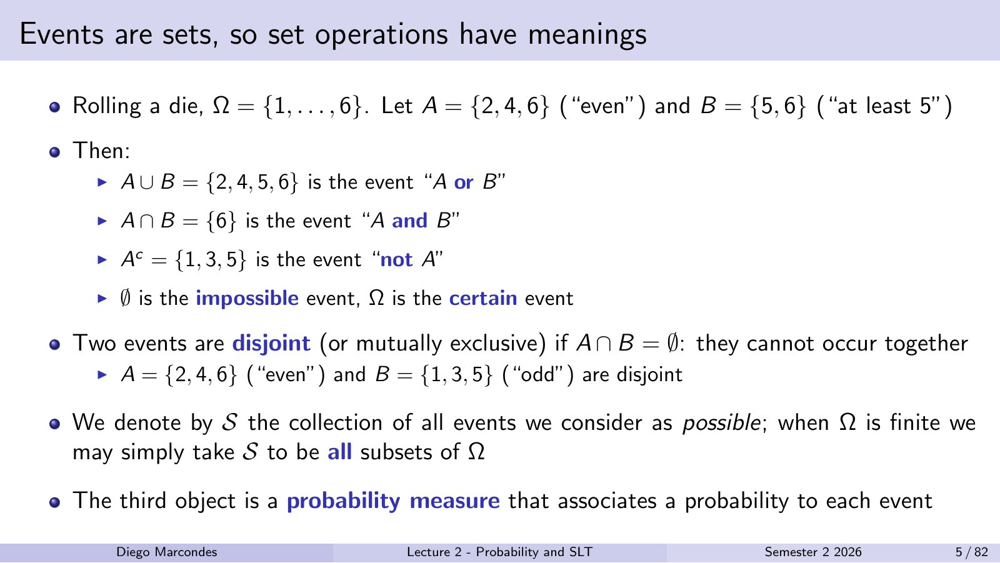

## 第 8 页：概率测度与概率空间

概率测度 $P$ 满足非负性、$P(\Omega)=1$，以及对两两不交事件的可列可加性：

$$
P\left(\bigcup_iA_i\right)=\sum_iP(A_i).
$$

三元组 $(\Omega,\mathcal S,P)$ 称概率空间。其余概率规则由这些公理推出。

展开第 8 页原始 slide，核对图表、标注和公式

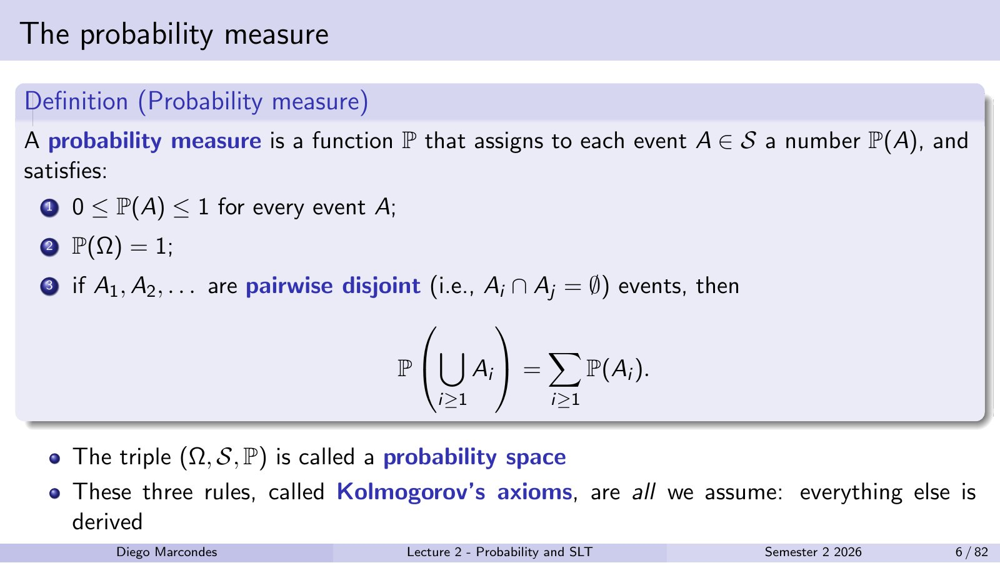

## 第 9 页：概率公理的直觉

概率落在 0 与 1 之间，必然事件概率为 1。互斥事件不可能同时出现，因此它们的并集概率直接相加。例如公平骰子掷出 2 或 4 的概率是 $1/6+1/6=1/3$。

展开第 9 页原始 slide，核对图表、标注和公式

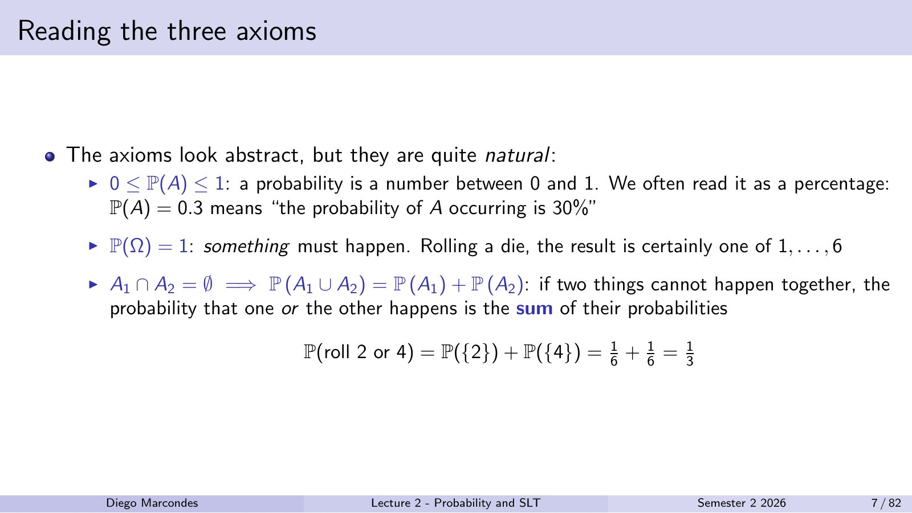

## 第 10 页：加法公式与重复计数

对任意两个事件，

$$
P(A\cup B)=P(A)+P(B)-P(A\cap B)\le P(A)+P(B).
$$

Venn 图把交集标成被重复计算的区域。只有互斥时才不需要减掉交集。

展开第 10 页原始 slide，核对图表、标注和公式

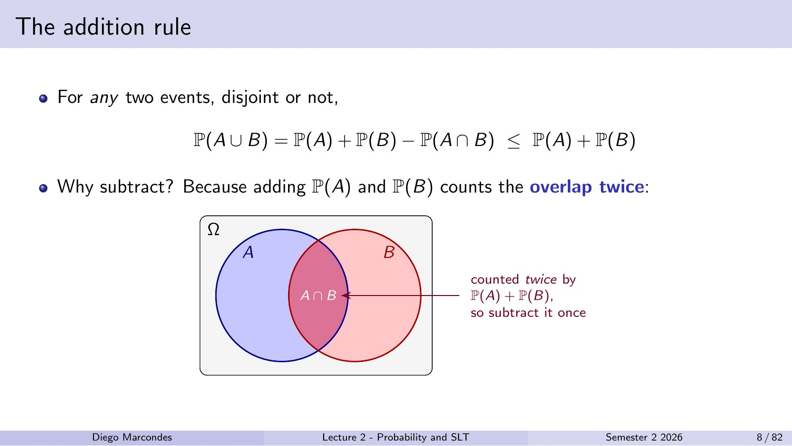

## 第 11 页：选课概率例子

设 60% 学微积分，50% 学线性代数，30% 两者都学，则至少学一门的概率是 $0.6+0.5-0.3=0.8$。直接加得到 1.1，错误来自重复计算同时选两门的人。

展开第 11 页原始 slide，核对图表、标注和公式

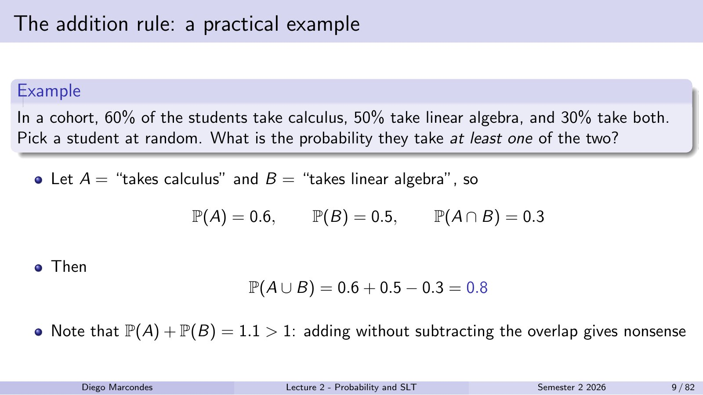

## 第 12 页：并集界

任意事件都满足

$$
P\left(\bigcup_{i=1}^mA_i\right)\le\sum_{i=1}^mP(A_i).
$$

不要求事件独立。100 个部件各有每日 $0.0001$ 失效概率，则至少一个失效的概率不超过 0.01。后面用它从单个假说的保证推广到多个假说。

展开第 12 页原始 slide，核对图表、标注和公式

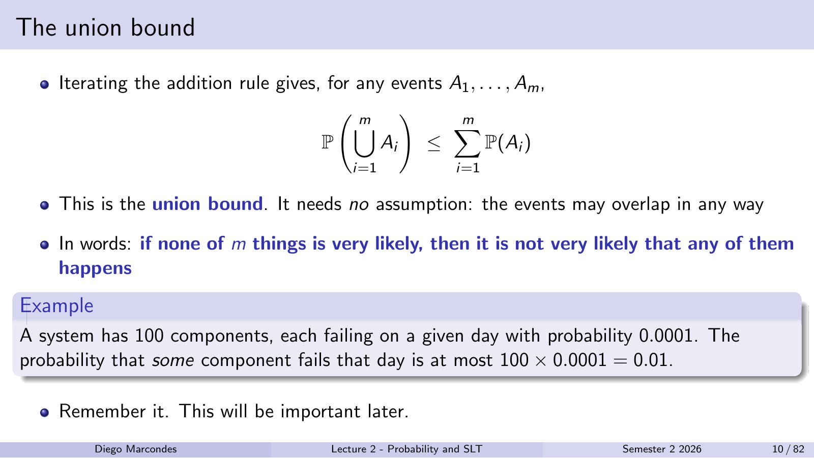

## 第 13 页：从现实结果到数值

真实结果 $\omega$ 可以是一名患者或申请人，数据记录的是其年龄、收入等测量。测量是从 $\Omega$ 到 $\mathbb R$ 的函数，这引出随机变量。

展开第 13 页原始 slide，核对图表、标注和公式

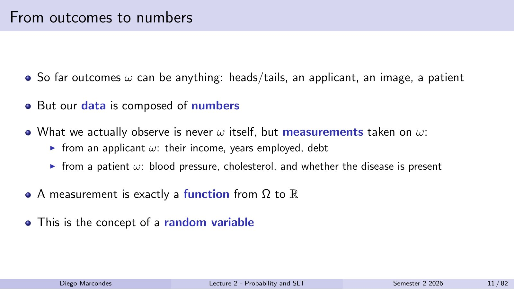

## 第 14 页：随机变量的定义

随机变量 $X:\Omega\to\mathbb R$ 要满足 $\{\omega:X(\omega)\le x\}\in\mathcal S$，以保证相关概率有定义。函数本身确定，随机性来自抽到哪个 $\omega$。通常简写 $P(X\le x)$，省去原像集合的记号。

展开第 14 页原始 slide，核对图表、标注和公式

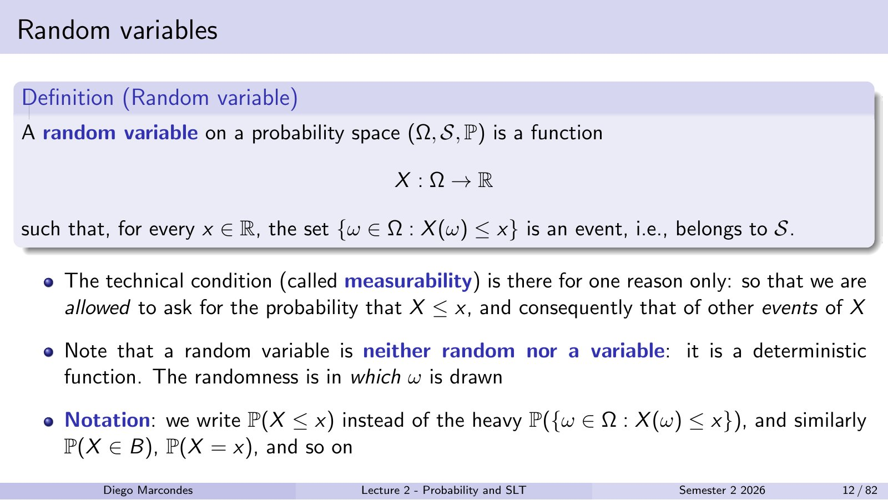

## 第 15 页：两次抛硬币的例子

取 $X$ 为正面个数：$HH\mapsto2$、$HT,TH\mapsto1$、$TT\mapsto0$。公平独立抛掷时四种序列各占 $1/4$，故 $P(X\le1)=3/4$，$P(X=1)=1/2$。不同原始结果可映射成同一个数值。

展开第 15 页原始 slide，核对图表、标注和公式

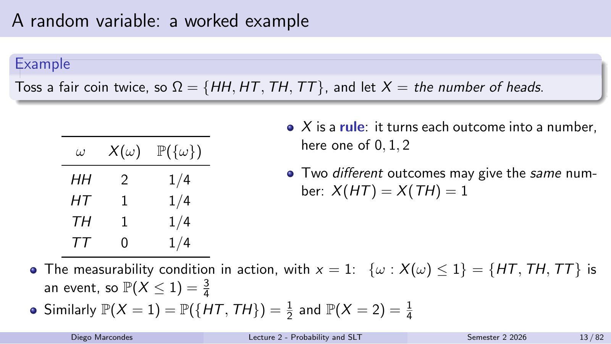

## 第 16 页：随机变量的映射图

图中 $X$ 把样本空间中的对象映到数轴。概率原本定义在 $\Omega$ 上，通过原像给数轴上的区间赋予概率。以后可以主要在数值空间中计算，而不必逐一描述现实对象。

展开第 16 页原始 slide，核对图表、标注和公式

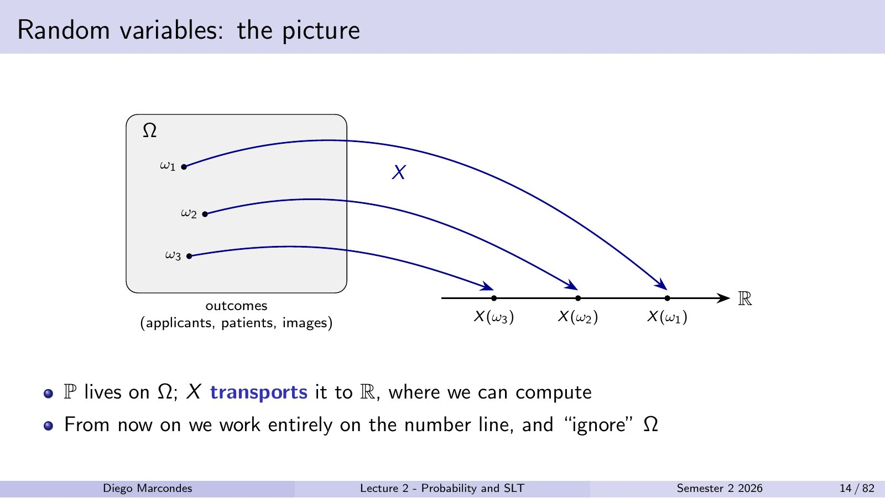

## 第 17 页：患者总体中的随机变量

六名患者的年龄、血压、疾病标签形成表格。每一行是同一患者的多项测量，每一列是一种随机变量。疾病列为 $0,1,1,0,1,0$；这些测量之间可能相关。

展开第 17 页原始 slide，核对图表、标注和公式

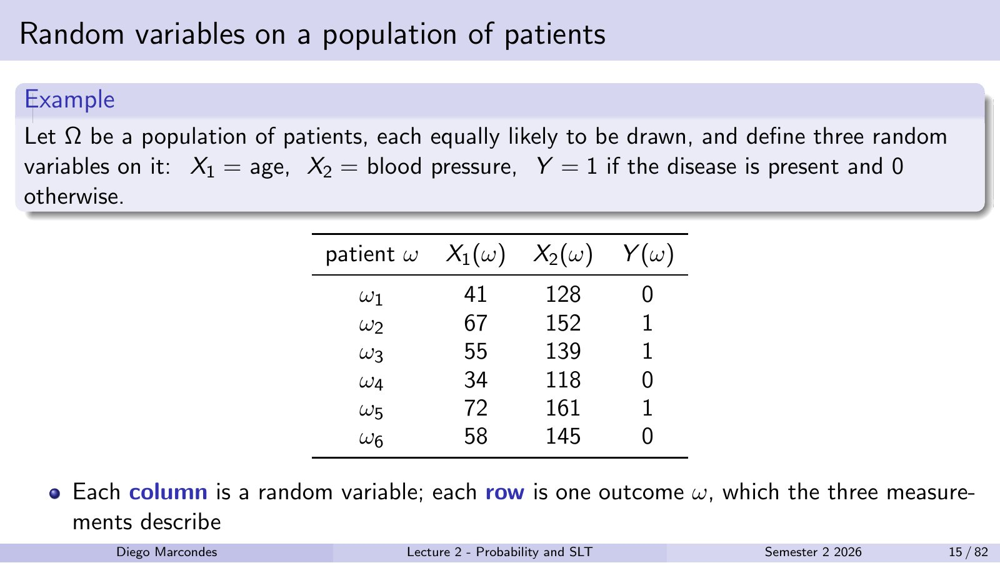

## 第 18 页：离散与连续变量

离散变量取有限或可数值，用概率质量函数和求和描述；有密度的连续变量单点概率为 0，用密度和面积描述。分类输出通常离散，回归输出通常连续；输入向量可混合两种特征。

展开第 18 页原始 slide，核对图表、标注和公式

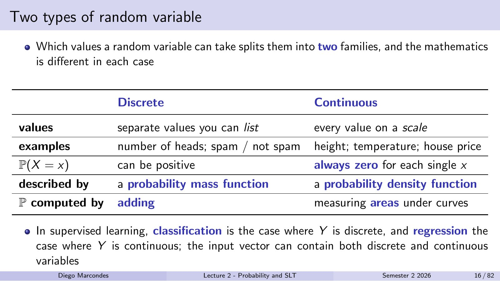

## 第 19 页：离散随机变量与 PMF

若取值可列举，定义 $p_X(x)=P(X=x)$，满足非负且所有取值的质量总和为 1。对集合 $B$，

$$
P(X\in B)=\sum_{x_i\in B}p_X(x_i).
$$

分类标签就是常见的离散变量。

展开第 19 页原始 slide，核对图表、标注和公式

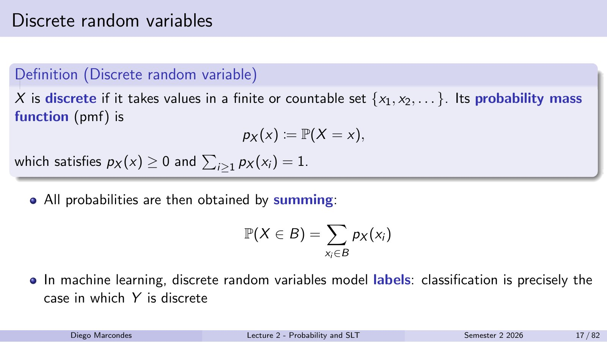

## 第 20 页：逾期还款次数的分布

例中 $X=0,1,2,3,4$ 的概率为 $0.55,0.22,0.13,0.07,0.03$。柱状图显示各点概率，至少两次逾期的概率为 $0.13+0.07+0.03=0.23$。输入特征也有概率分布，不只是标签随机。

展开第 20 页原始 slide，核对图表、标注和公式

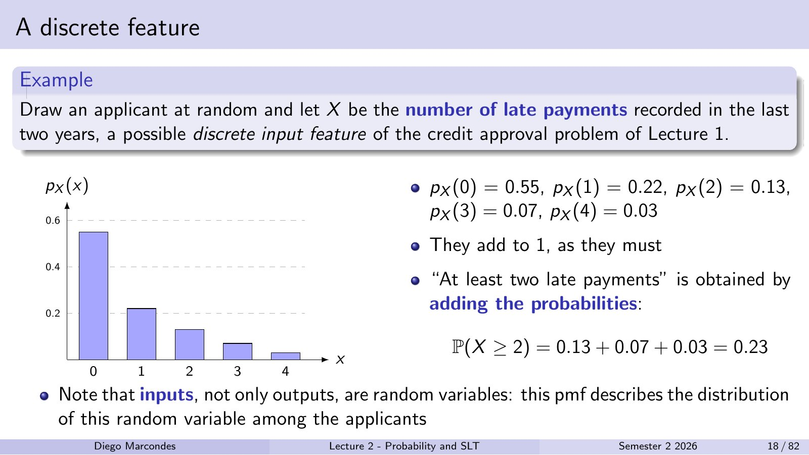

## 第 21 页：连续变量看区间概率

精确身高恰好等于某一个实数的概率为 0，但落在身高区间的概率可以为正。逐点列概率只会得到 0，不能表达分布，因此改用区间面积。单点概率为 0 不表示相应取值“不可能出现”。

展开第 21 页原始 slide，核对图表、标注和公式

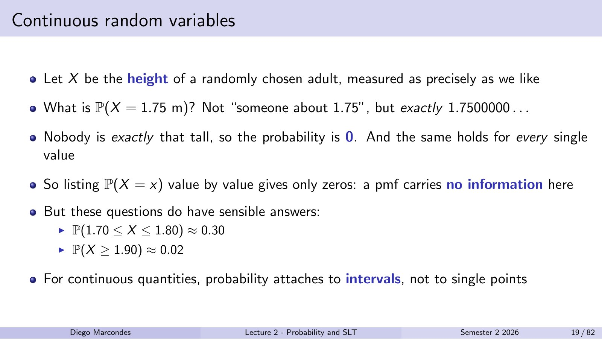

## 第 22 页：从直方图到密度曲线

直方图每根柱子的面积表示该区间的样本比例，所以高度等于比例除以组宽。组宽逐渐缩小时，轮廓趋向密度曲线 $f_X$。组宽变化时不能只比较柱高。

展开第 22 页原始 slide，核对图表、标注和公式

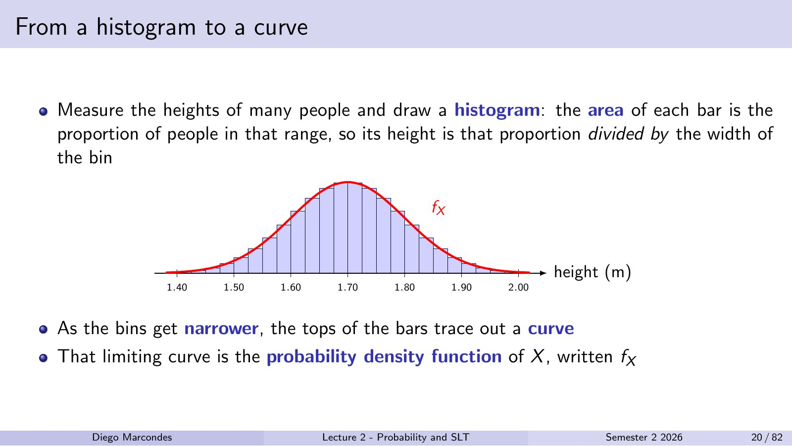

## 第 23 页：密度的面积才是概率

曲线在 $[a,b]$ 上的面积是 $P(a\le X\le b)$，总面积为 1，单点面积为 0。$f_X(x)$ 本身不是概率，可以超过 1；只有积分后的区域概率受 1 约束。

展开第 23 页原始 slide，核对图表、标注和公式

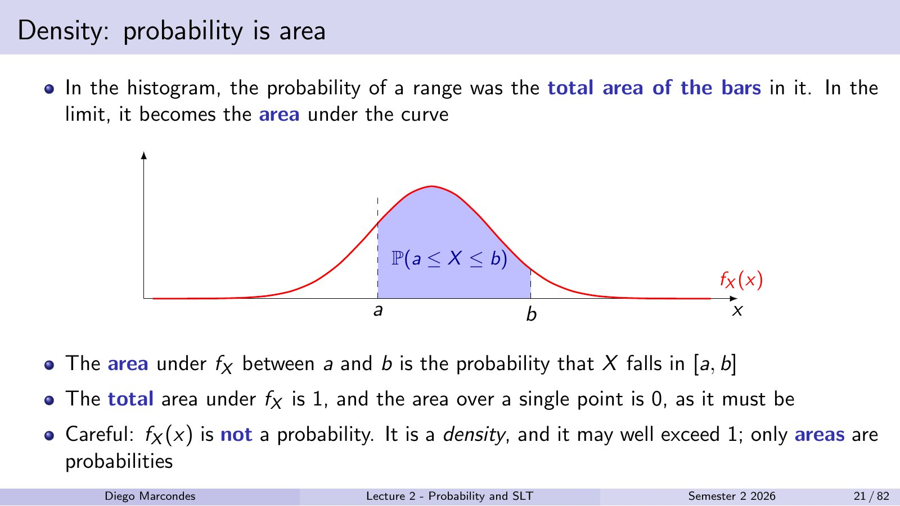

## 第 24 页：连续密度的定义

若存在非负函数 $f_X$ 满足

$$
P(a\le X\le b)=\int_a^b f_X(x)\,dx,\qquad\int_{-\infty}^{\infty}f_X(x)\,dx=1,
$$

则可用它描述该连续分布。这里先将积分理解为曲线下面积，下一节再定义计算方式。

展开第 24 页原始 slide，核对图表、标注和公式

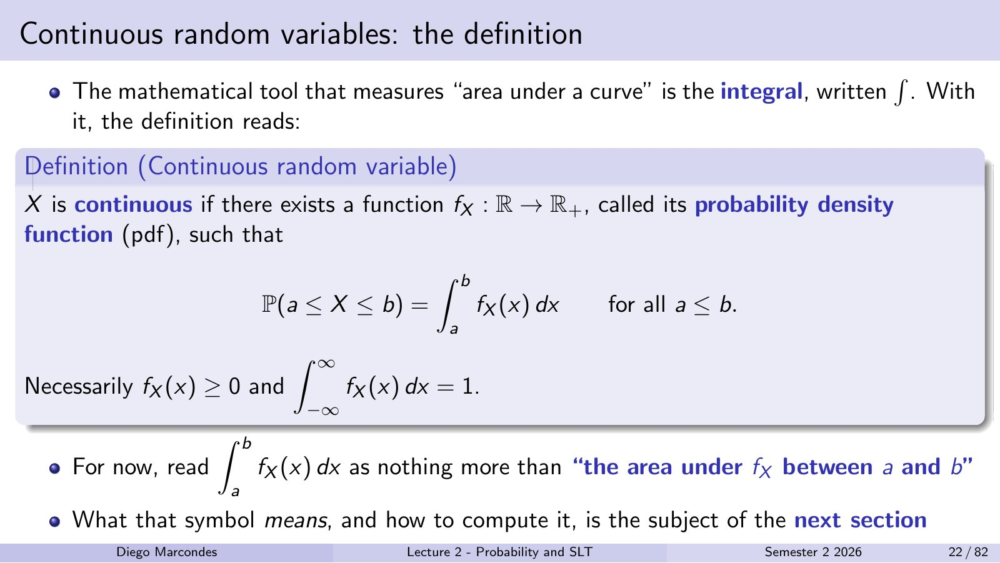

## 第 25 页：均匀分布

$X\sim U[a,b]$ 在区间内密度为 $1/(b-a)$，区间外为 0。矩形面积为 1；区间内的累积分布为 $P(X\le x)=(x-a)/(b-a)$。等长子区间拥有相同概率。

展开第 25 页原始 slide，核对图表、标注和公式

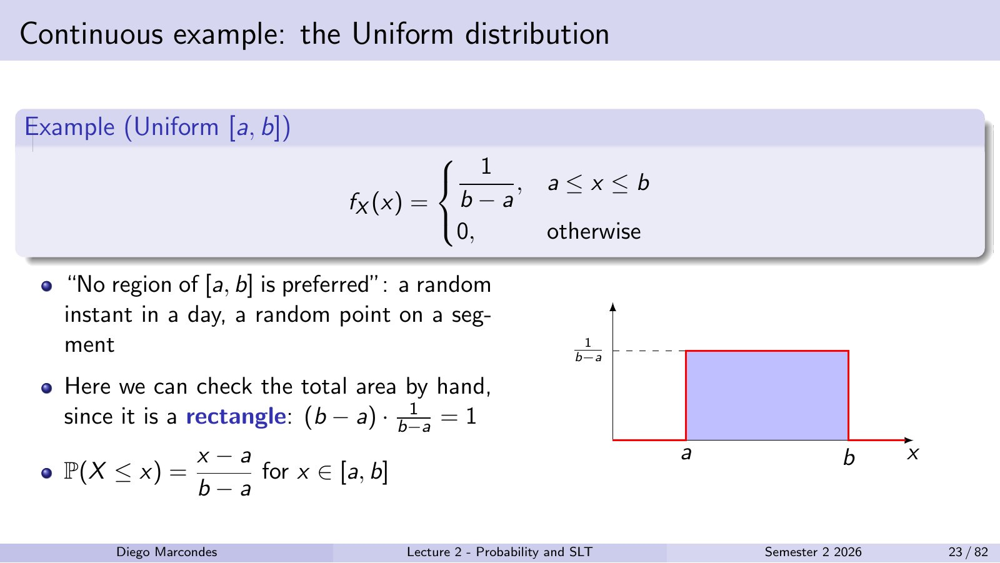

## 第 26 页：正态分布

$X\sim\mathcal N(\mu,\sigma^2)$ 的密度为

$$
f_X(x)=\frac1{\sqrt{2\pi\sigma^2}}\exp\left[-\frac{(x-\mu)^2}{2\sigma^2}\right],\quad\sigma>0.
$$

图中的钟形曲线关于 $\mu$ 对称；$\sigma$ 越小越窄高，越大越宽平，总面积仍为 1。

展开第 26 页原始 slide，核对图表、标注和公式

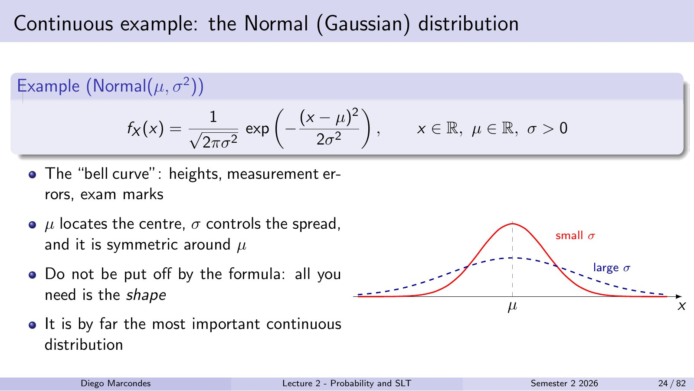

## 第 27 页：随机向量与联合分布

$X=(X_1,\ldots,X_n):\Omega\to\mathbb R^n$ 把多项特征合在一起。全离散时用联合 PMF，全连续时用联合密度；概率相应通过多重求和或多重积分计算。坐标必须来自同一个观察对象。

展开第 27 页原始 slide，核对图表、标注和公式

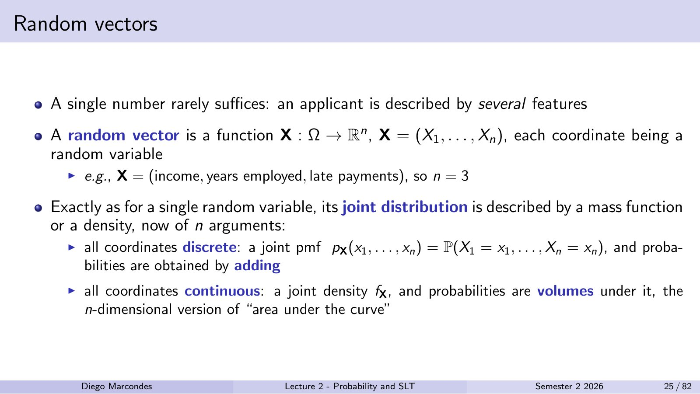

## 第 28 页：依赖关系才携带预测信息

分别知道身高和体重的边缘分布，并不能确定二者如何配对。联合分布描述依赖关系，正是这种关系让身高能帮助预测体重。监督学习研究的是特征和输出的联合规律。

展开第 28 页原始 slide，核对图表、标注和公式

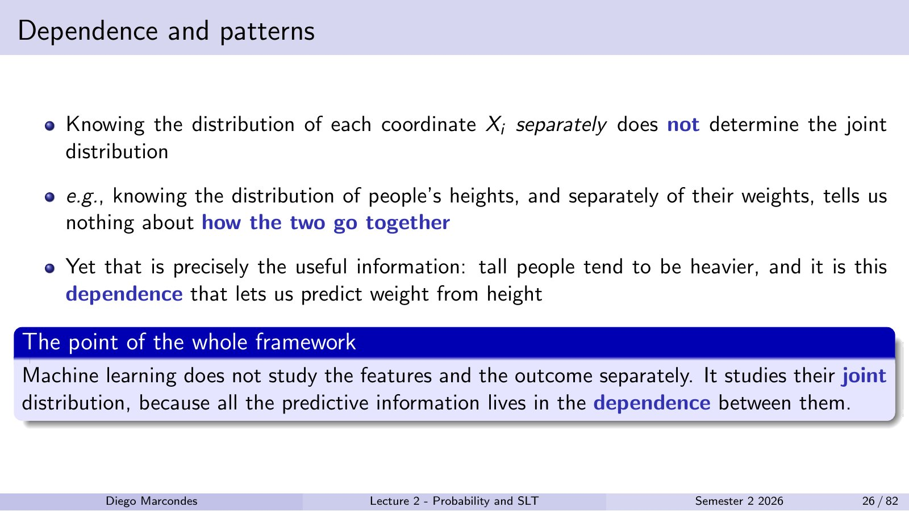

## 第 29 页：监督学习的统计模型

假设 $(X,Y)$ 来自固定但未知的联合分布 $P$，训练数据是其样本。“新数据”指来自相同 $P$ 的新抽取。部署总体若与训练总体不同，这一基本前提可能失效。

展开第 29 页原始 slide，核对图表、标注和公式

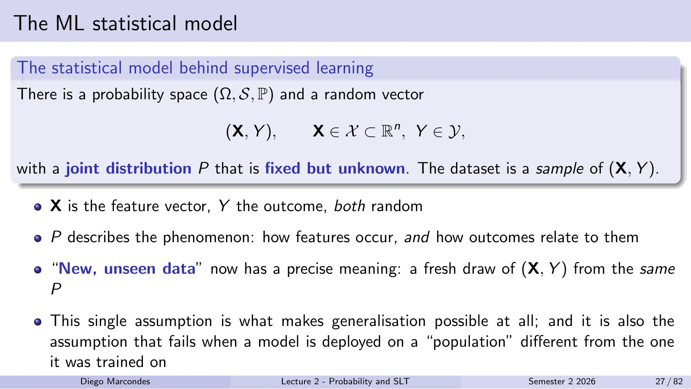

## 第 30 页：加入概率的数据学习框架

图把数据生成概率分布接入第一讲框架。分布决定哪些输入输出更常见，有限训练集只是一次抽样结果；模型的最终好坏必须相对于该分布来定义。

展开第 30 页原始 slide，核对图表、标注和公式

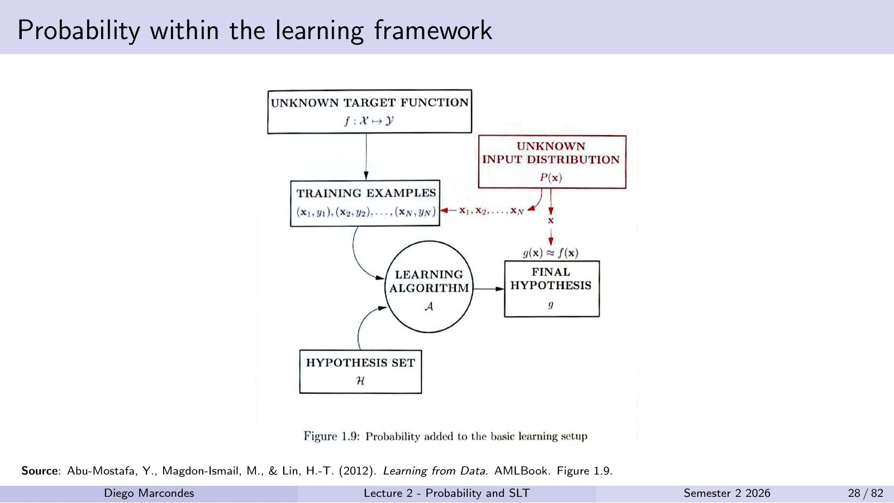

## 第 31 页：章节页：期望、积分与方差

先用期望概括中心，再用积分处理连续变量，最后用方差概括离散程度。

展开第 31 页原始 slide，核对图表、标注和公式

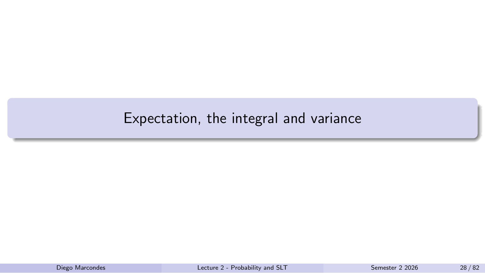

## 第 32 页：为什么用数字概括分布

完整分布是一整个函数，实际常需要几个概括量。期望回答中心位置，方差回答围绕中心的波动程度；这些摘要有用，但不能替代分布的全部形状。

展开第 32 页原始 slide，核对图表、标注和公式

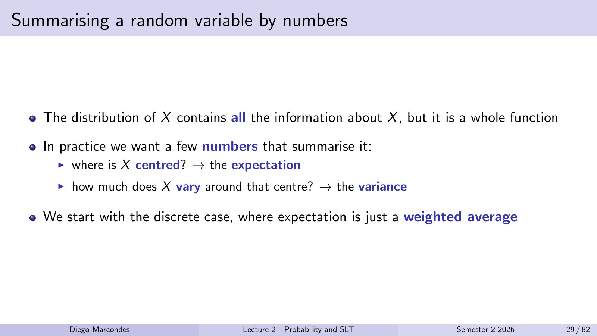

## 第 33 页：离散期望

期望是按发生概率加权的平均：

$$
\mathbb E[X]=\sum_i x_ip_X(x_i).
$$

公平骰子的期望为 $21/6=3.5$，但骰子不会掷出 3.5。期望不必是可能取值，也不等于最可能取值；公式要求相应和有意义。

展开第 33 页原始 slide，核对图表、标注和公式

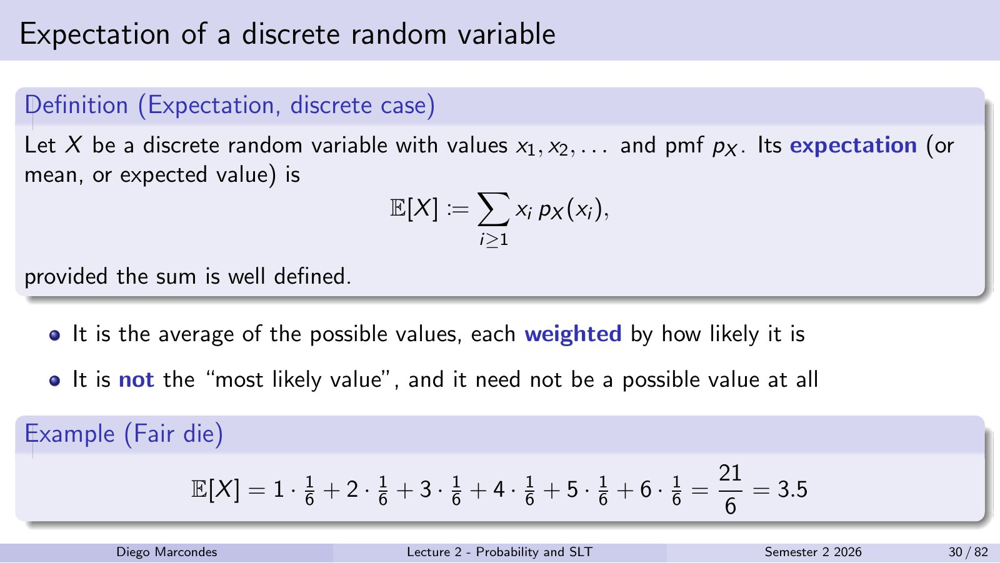

## 第 34 页：指示变量的期望等于概率

对事件 $A$，$\mathbb E[\mathbf1_A]=P(A)$。因此分类器误分类概率可写成

$$
P(h(X)\ne Y)=\mathbb E[\mathbf1\{h(X)\ne Y\}].
$$

这把“错误概率”与“平均损失”统一起来。

展开第 34 页原始 slide，核对图表、标注和公式

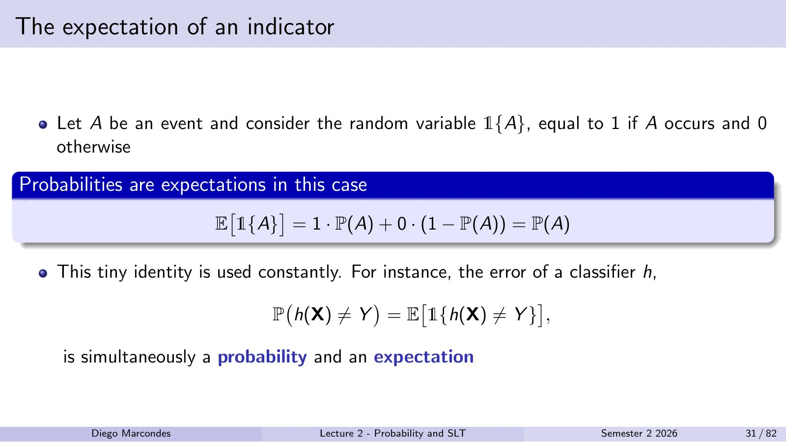

## 第 35 页：函数的期望与线性性

$\mathbb E[g(X)]=\sum_i g(x_i)p_X(x_i)$，一般不等于 $g(\mathbb E[X])$。期望满足 $\mathbb E[aX+bY]=a\mathbb E[X]+b\mathbb E[Y]$，不要求独立。骰子例中 $\mathbb E[X^2]=91/6$，而 $(\mathbb E[X])^2=12.25$。

展开第 35 页原始 slide，核对图表、标注和公式

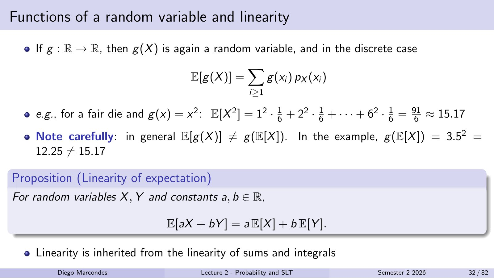

## 第 36 页：连续期望为何需要积分

连续变量不能按单点概率作普通加权求和，改用

$$
\mathbb E[X]=\int_{-\infty}^{\infty}x f_X(x)\,dx.
$$

思想仍是用分布对取值加权；接下来先解释积分及其数值近似。

展开第 36 页原始 slide，核对图表、标注和公式

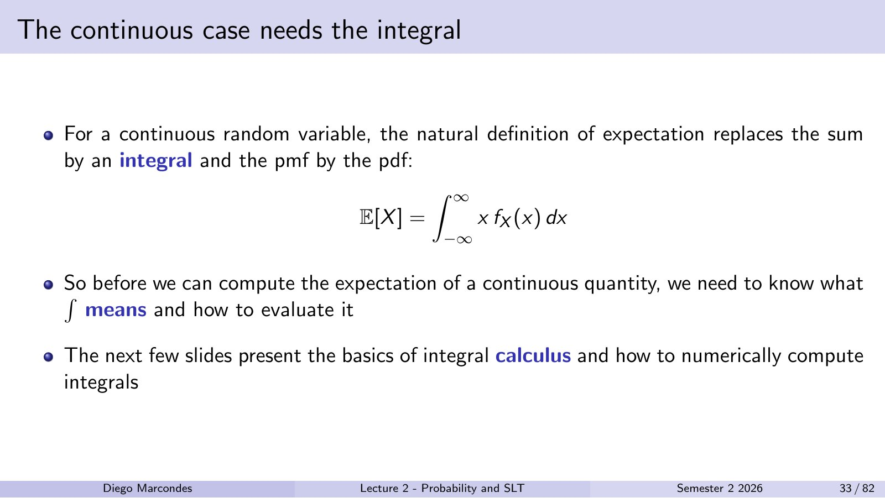

## 第 37 页：积分的面积直觉

目标是在区间 $[a,b]$ 上量出曲线与横轴之间的面积。曲边形不像矩形可直接相乘，因此先把它拆成容易计算的小块，再考虑小块越来越细时的极限。

展开第 37 页原始 slide，核对图表、标注和公式

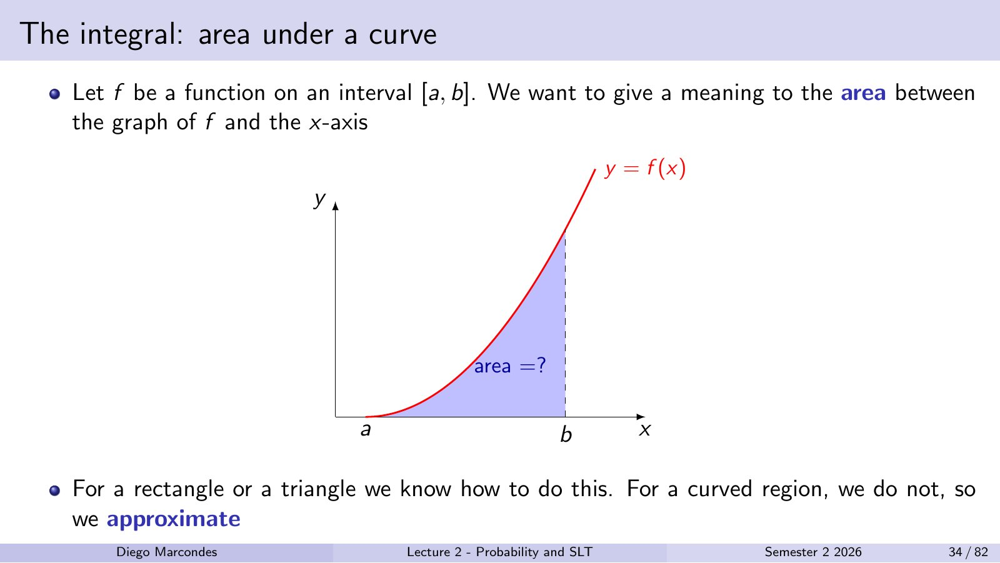

## 第 38 页：用矩形近似

把 $[a,b]$ 均分为 $n$ 段，宽度 $\Delta x=(b-a)/n$，在每段内选一点 $x_i^*$，以 $f(x_i^*)$ 为矩形高。图展示 $n=16$ 的近似，增大分段数可改善逼近。

展开第 38 页原始 slide，核对图表、标注和公式

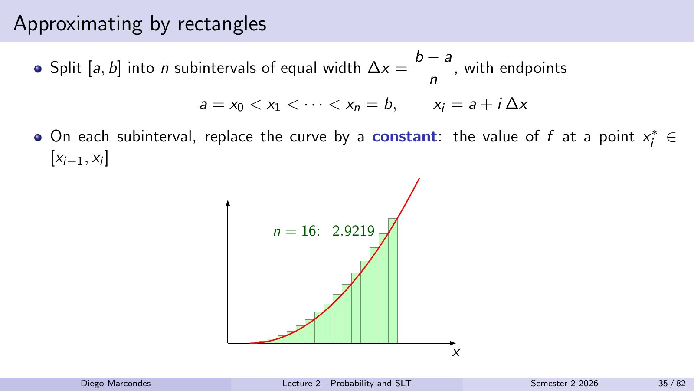

## 第 39 页：黎曼和

一般分割的黎曼和为

$$
R_n=\sum_{i=1}^nf(x_i^*)\Delta x_i.
$$

横轴上方面积记正，下方记负。课件例子的近似值从 3.75、3.1875 到 2.9219，逐渐逼近一个极限；具体单调性取决于函数和取点规则。

展开第 39 页原始 slide，核对图表、标注和公式

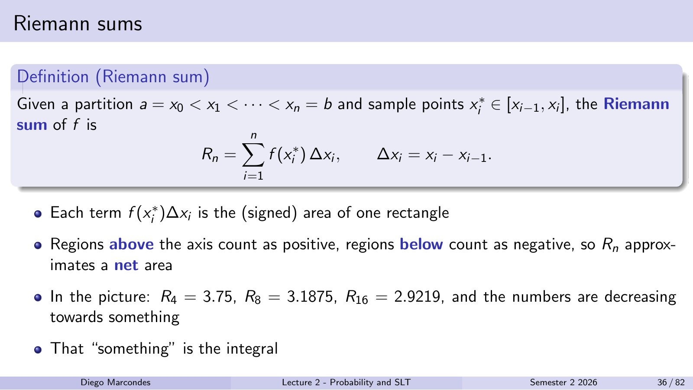

## 第 40 页：定积分的定义

当分割的最大宽度趋于 0，所有相容黎曼和趋向同一个数，定义它为

$$
\int_a^b f(x)\,dx=\lim_{\max_i\Delta x_i\to0}\sum_i f(x_i^*)\Delta x_i.
$$

$a,b$ 为上下限，$f$ 为被积函数，$x$ 是可改名的哑变量；一般表示有符号净面积。

展开第 40 页原始 slide，核对图表、标注和公式

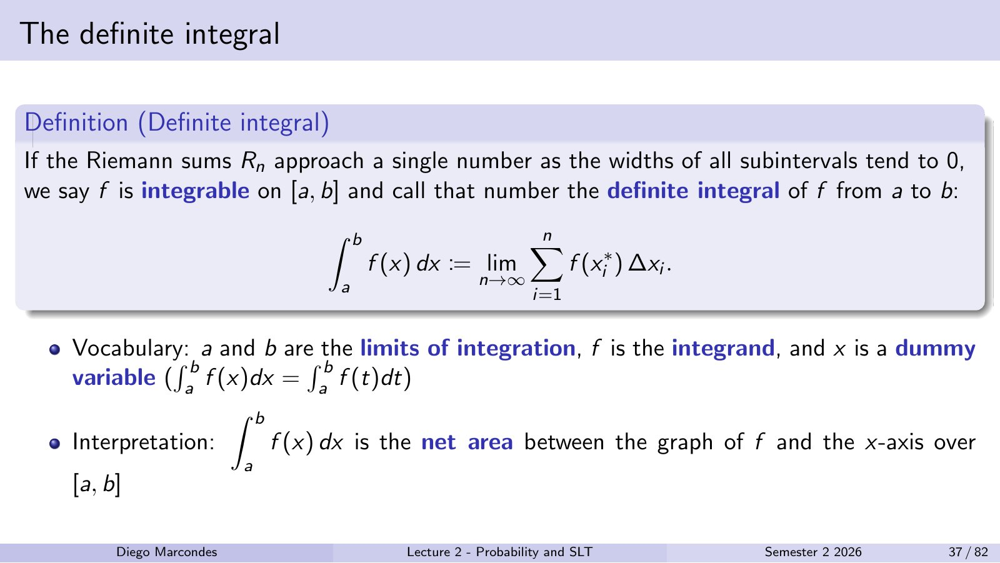

## 第 41 页：整条实线上的积分

无穷积分通过让有限区间向两端扩张定义。无限宽区域仍可有有限面积，例如正态密度总积分为 1。**理解补充：**应要求两侧广义积分分别收敛，不能依靠正负无穷相消得到普通期望。

展开第 41 页原始 slide，核对图表、标注和公式

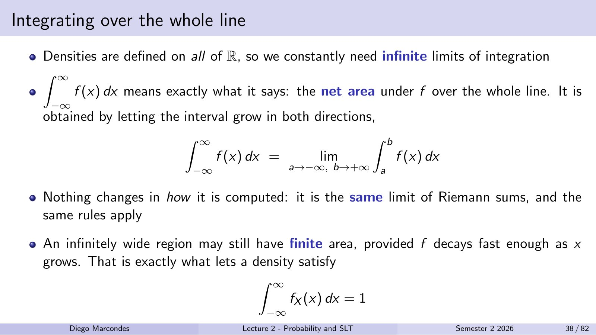

## 第 42 页：定积分的性质

积分对函数加法和数乘线性，可按区间拆分；若 $f\le g$，则相同区间上的积分也保持不等式。期望的线性性继承自求和或积分的线性，而不是来自随机变量独立。

展开第 42 页原始 slide，核对图表、标注和公式

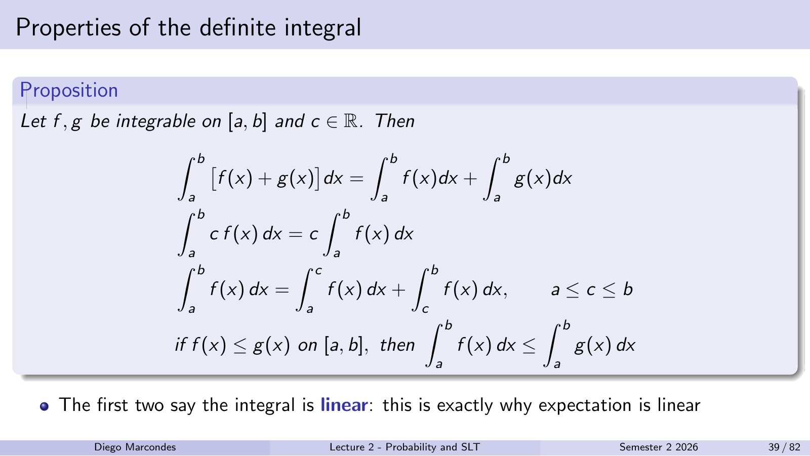

## 第 43 页：精确积分与数值积分

$x^2$ 在 $[0,2]$ 的精确积分为 $8/3$，对应前面的矩形近似极限。正态密度的区间积分一般用数值方法。**理解补充：**原页“没有公式”应理解为没有初等函数形式的原函数；可以用特殊函数或数值计算表示。

展开第 43 页原始 slide，核对图表、标注和公式

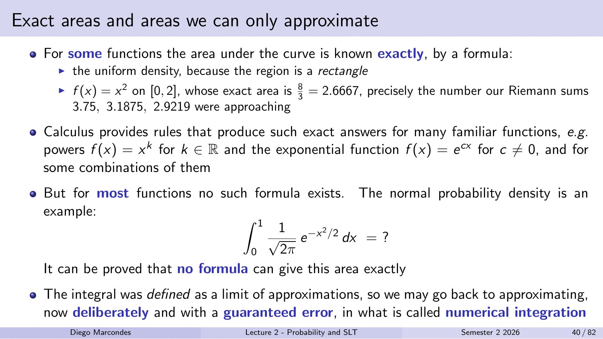

## 第 44 页：用梯形代替矩形

相邻采样点之间用直线连接，得到梯形。每段面积近似为 $\frac12[f(x_{i-1})+f(x_i)]\Delta x$；相比单一高度，它利用了两端的信息。

展开第 44 页原始 slide，核对图表、标注和公式

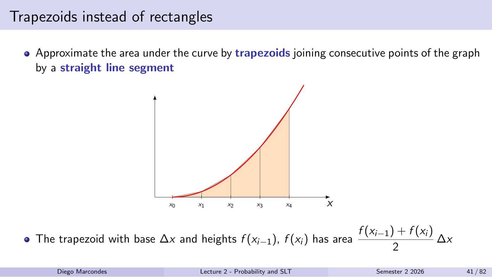

## 第 45 页：复合梯形公式及误差

等距分点下，

$$
T_n=\frac{\Delta x}{2}\left[f(x_0)+2\sum_{i=1}^{n-1}f(x_i)+f(x_n)\right].
$$

若二阶导数满足适当有界条件，误差界为 $K_f(b-a)^3/(12n^2)$。$n$ 加倍使该界缩为四分之一；内部节点权重为 2，端点为 1。

展开第 45 页原始 slide，核对图表、标注和公式

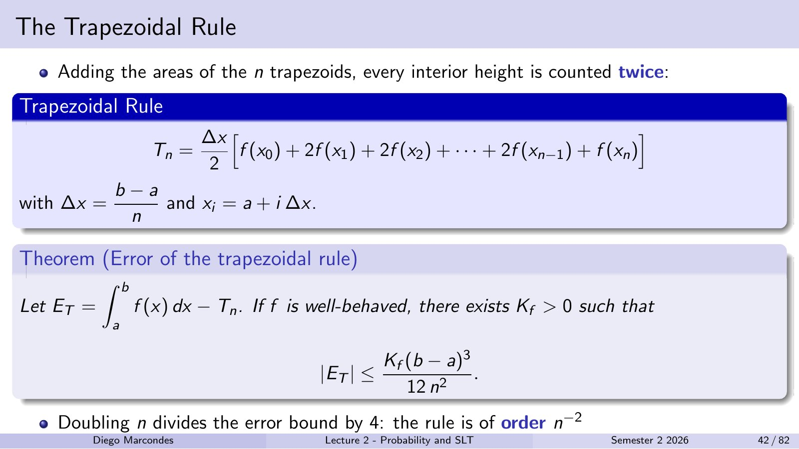

## 第 46 页：用抛物线近似

三个等距点确定一条二次插值曲线，两小段一起积分得到近似 $\frac{\Delta x}{3}[f(x_0)+4f(x_1)+f(x_2)]$。图示强调局部二次曲线通常比直线更贴合光滑函数。

展开第 46 页原始 slide，核对图表、标注和公式

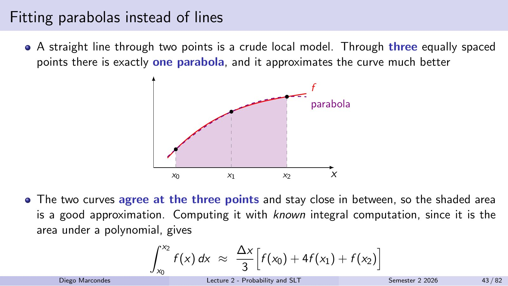

## 第 47 页：Simpson 公式与偶数分段

$n$ 为偶数时，

$$
S_n=\frac{\Delta x}{3}\left[f(x_0)+4\!\sum_{i\text{ 奇}}f(x_i)+2\!\sum_{\substack{i\text{ 偶}\\0<i<n}}f(x_i)+f(x_n)\right].
$$

权重为 $1,4,2,4,\ldots,4,1$。适当四阶光滑条件下误差界为 $C_f(b-a)^5/(180n^4)$，$n$ 加倍使界缩为原来的 $1/16$。

展开第 47 页原始 slide，核对图表、标注和公式

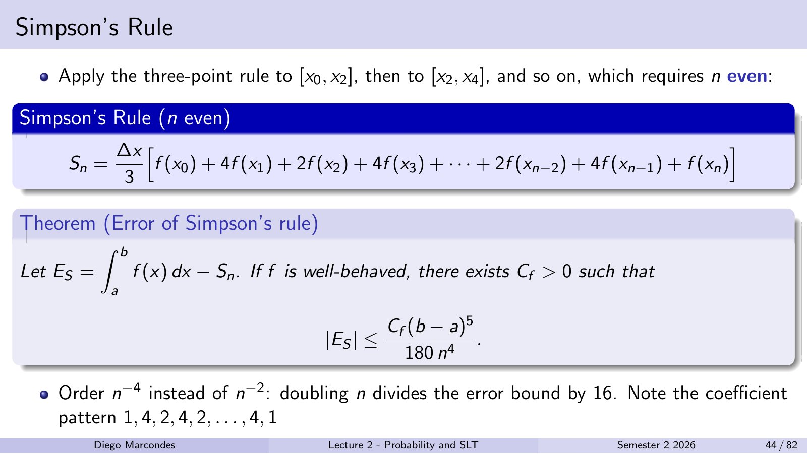

## 第 48 页：回到连续期望

定义 $\mathbb E[g(X)]=\int g(x)f_X(x)\,dx$。统一记法 $\int g(x)\,dP(x)$ 同时涵盖离散求和和连续积分；$dP$ 表示按分布加权，不表示对所有取值一律等权。

展开第 48 页原始 slide，核对图表、标注和公式

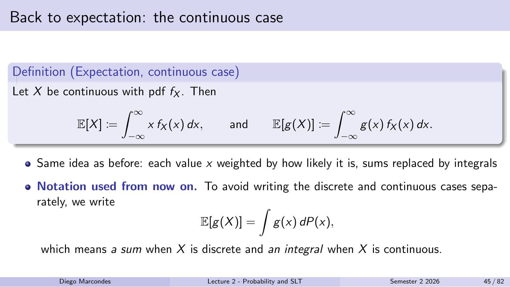

## 第 49 页：均匀与正态分布的期望

均匀分布 $U[a,b]$ 的期望为 $(a+b)/2$；正态分布 $\mathcal N(\mu,\sigma^2)$ 的期望为 $\mu$，与密度的对称中心一致。一般情形未必有简洁闭式，需要数值近似。

展开第 49 页原始 slide，核对图表、标注和公式

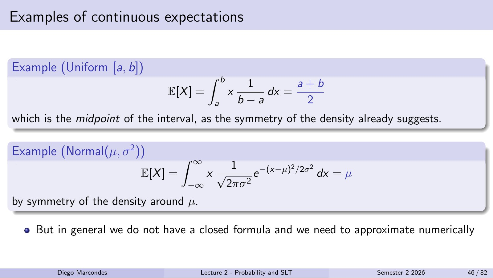

## 第 50 页：多维积分

随机向量的期望对所有坐标按联合分布加权：$\mathbb E[g(X)]=\int\cdots\int g(x)f_X(x)\,dx_1\cdots dx_n$。二维时把平面划成小矩形，面积乘曲面高度再相加；混合变量可同时出现求和与积分。

展开第 50 页原始 slide，核对图表、标注和公式

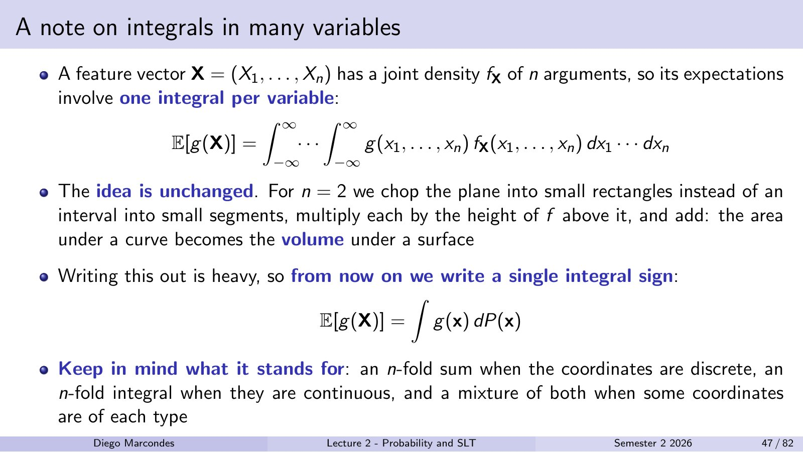

## 第 51 页：方差与标准差

若 $\mu=\mathbb E[X]$，则

$$
\operatorname{Var}(X)=\mathbb E[(X-\mu)^2]=\mathbb E[X^2]-(\mathbb E[X])^2,\qquad\operatorname{sd}(X)=\sqrt{\operatorname{Var}(X)}.
$$

平方让正负偏差都计入离散程度；公式要求相关矩存在。

展开第 51 页原始 slide，核对图表、标注和公式

## 第 52 页：相同均值可以有不同波动

两组考试成绩均值都是 60，一组集中、另一组呈两团分布。课件给出方差 124 与 646，标准差约 11.1 与 25.4。仅看均值无法区分，且均值附近未必有很多样本。

展开第 52 页原始 slide，核对图表、标注和公式

## 第 53 页：后半讲路线

条件分布描述输出如何依赖输入；损失定义好坏和目标函数；抽样定义训练集与新数据；经验风险最小化把算法放进统计框架，最后明确需要控制的泛化间隔。

展开第 53 页原始 slide，核对图表、标注和公式

## 第 54 页：章节页：条件分布与条件期望

预测要在已经知道输入的前提下讨论输出，因此需要把总体分布限制到相应条件，并重新归一化。

展开第 54 页原始 slide，核对图表、标注和公式

## 第 55 页：预测是给定特征后的预测

收入等特征不能完全决定还款，但会改变还款概率。观察 $X=x$ 后，关注的是相应子群体的 $Y$ 分布；从条件分布到条件期望，再到损失下的最佳预测，是本节的主线。

展开第 55 页原始 slide，核对图表、标注和公式

## 第 56 页：条件分布公式

离散情形为 $p_{Y\mid X}(y\mid x)=p_{X,Y}(x,y)/p_X(x)$；有联合密度时为 $f_{Y\mid X}(y\mid x)=f_{X,Y}(x,y)/f_X(x)$，要求分母为正。固定 $x$ 后，它对 $y$ 的总质量为 1。

展开第 56 页原始 slide，核对图表、标注和公式

## 第 57 页：血压与疾病的条件概率

把 $X$ 定义为血压是否大于 140，$Y$ 为是否患病。总体患病比例 $3/6=1/2$；低血压组 3 人中 1 人患病，故 $P(Y=1\mid X=0)=1/3$；高血压组为 $2/3$。特征的信息体现在条件概率的改变。

展开第 57 页原始 slide，核对图表、标注和公式

## 第 58 页：条件期望函数

用条件分布算平均：

$$
\eta(x)=\mathbb E[Y\mid X=x]=\sum_y y p_{Y\mid X}(y\mid x),
$$

连续时改为积分。对固定 $x$ 是一个数；让 $x$ 变化便得到一整个函数 $\eta$。

展开第 58 页原始 slide，核对图表、标注和公式

## 第 59 页：二元标签的条件均值就是概率

当 $Y\in\{0,1\}$，$\mathbb E[Y\mid X=x]=P(Y=1\mid X=x)$。因此患者例子中 $\eta(0)=1/3$、$\eta(1)=2/3$。同一个 $\eta$ 在回归中是平均输出，在二元分类中是正类概率。

展开第 59 页原始 slide，核对图表、标注和公式

## 第 60 页：条件期望的连续图像

每个固定横坐标对应一条 $Y$ 的条件分布曲线，各自面积为 1。红点标出条件均值，连起来得到 $\eta(x)$。这条曲线描述中心趋势，而不是声称每个点都恰好位于曲线上。

展开第 60 页原始 slide，核对图表、标注和公式

## 第 61 页：二元条件期望的图像

输出只在 0、1 两点有质量，分别为 $1-\eta(x)$ 与 $\eta(x)$。图随 $x$ 改变两类质量并画出概率曲线；$\eta(x)$ 即使连续变化，实际标签仍只能是 0 或 1。

展开第 61 页原始 slide，核对图表、标注和公式

## 第 62 页：章节页：损失函数与目标函数

在谈“最佳规则”前先指定错误代价。不同损失会得到不同的最佳预测，不能脱离评价标准讨论最优性。

展开第 62 页原始 slide，核对图表、标注和公式

## 第 63 页：损失定义预测代价

损失 $\ell((x,y),h)\ge0$ 给预测 $h(x)$ 与真实输出 $y$ 的组合赋予代价。损失属于建模选择，应在训练前确定；它表达什么错误更严重，而不是由算法自动替我们决定。

展开第 63 页原始 slide，核对图表、标注和公式

## 第 64 页：平方损失与 0–1 损失

回归常用 $(y-h(x))^2$，对大偏差惩罚更重；分类用 $\mathbf1\{h(x)\ne y\}$，只区分对错。类别编号本身的数值距离通常没有意义，不能随意当作连续输出的距离。

展开第 64 页原始 slide，核对图表、标注和公式

## 第 65 页：样本外错误是期望损失

定义总体风险

$$
L(h)=E_{\mathrm{out}}(h)=\mathbb E[\ell((X,Y),h)].
$$

平方损失下是均方误差，0–1 损失下是误分类概率。这里对总体的未知分布取期望，不是对手中有限训练集求平均。

展开第 65 页原始 slide，核对图表、标注和公式

## 第 66 页：最佳目标函数

$f^\star$ 在所有允许预测函数中最小化 $L$。平方损失下 $f^\star(x)=\eta(x)$；0–1 损失下选条件概率最大的类别。二元标签可写 $f^\star(x)=\mathbf1\{\eta(x)>1/2\}$，平局时两类风险相同，本讲选 0。

展开第 66 页原始 slide，核对图表、标注和公式

## 第 67 页：最佳规则仍然可能出错

固定 $x$ 后，平方损失由条件均值最小化，0–1 损失由最可能标签最小化。高血压组患病概率 $2/3$，最佳分类仍有 $1/3$ 错误。最优是相对于现有信息与损失而言，不意味着完美预测。

展开第 67 页原始 slide，核对图表、标注和公式

## 第 68 页：目标函数的不可约误差

平方损失下 $L(f^\star)=\mathbb E[\operatorname{Var}(Y\mid X)]$；二元 0–1 损失下 $L(f^\star)=\mathbb E[\min\{\eta(X),1-\eta(X)\}]$。它来自已知特征后仍存在的不确定性，增加样本或换算法不能突破同一信息条件下的最优风险。

展开第 68 页原始 slide，核对图表、标注和公式

## 第 69 页：患者例子的 Bayes 错误

两组各占总体一半，组内少数标签均占 $1/3$。最佳规则低血压预测健康，高血压预测患病，因此

$$
L(f^\star)=\tfrac12\cdot\tfrac13+\tfrac12\cdot\tfrac13=\tfrac13.
$$

逐人核对会错在第 3 和第 6 人，共 $2/6$。

展开第 69 页原始 slide，核对图表、标注和公式

## 第 70 页：章节页：抽样

下面明确训练数据如何从总体产生，以及为何样本的独立性和代表性关系到泛化保证。

展开第 70 页原始 slide，核对图表、标注和公式

## 第 71 页：总体与有限样本

未知分布 $P$ 描述总体，我们只能取得有限观察。随机询问不同人、只问豪车店顾客、对同一人重复问 1000 次提供的信息不同。大样本数量本身不能补救选择偏差或重复依赖。

展开第 71 页原始 slide，核对图表、标注和公式

## 第 72 页：独立随机变量

独立意味着联合分布分解为边缘分布的乘积，例如 $p_{X,Y}(x,y)=p_X(x)p_Y(y)$；连续时对应密度分解。此时知道 $X$ 不改变 $Y$ 的条件分布。多个变量的共同独立要求整个联合分布分解。

展开第 72 页原始 slide，核对图表、标注和公式

## 第 73 页：跨观察独立与同人特征依赖

独立抽取的两个患者可以视为独立观察；若总体患病率为 0.1，两人都患病概率为 0.01。同一患者的年龄与血压则可能相关。不要把“样本独立”误解成“每行内部各特征独立”。

展开第 73 页原始 slide，核对图表、标注和公式

## 第 74 页：独立性假设与可利用的依赖

我们通常假设不同观察之间独立，以获得新的样本信息；同时依赖特征与标签之间的相关关系完成预测。若 $X$ 与 $Y$ 完全独立，观察特征就不会改变输出分布，也就缺少预测收益。

展开第 74 页原始 slide，核对图表、标注和公式

## 第 75 页：独立同分布样本

简单随机样本写作 $D_N=\{(X_i,Y_i)\}_{i=1}^N$，其中各对互相独立，且都服从同一个 $P$，简称 i.i.d.。同分布对应同一总体；独立对应样本之间没有额外依赖。

展开第 75 页原始 slide，核对图表、标注和公式

## 第 76 页：i.i.d. 可能失效的情形

同一邮件链的回复、同一患者的连续日测量可能强相关；营销策略改变前后的顾客可能不再同分布。课件强调统计学习保证依赖抽样假设，不能仅因记录很多就自动套用 i.i.d. 结论。

展开第 76 页原始 slide，核对图表、标注和公式

## 第 77 页：测试点的精确定义

新测试点 $(X,Y)\sim P$，且独立于训练样本。两个要求分别是来源相同、没有参与选择假说。未来申请人的预测正是这一设定下的应用；若发生分布变化，需要重新审视结论。

展开第 77 页原始 slide，核对图表、标注和公式

## 第 78 页：样本内与样本外风险

$$
L_{D_N}(h)=\frac1N\sum_i\ell((X_i,Y_i),h),\qquad L(h)=\mathbb E[\ell((X,Y),h)].
$$

对固定 $h$，前者随抽样变化、可计算；后者相对于固定 $P$ 是未知常数。**理解补充：**若 $h=\hat h(D_N)$ 本身由训练产生，则 $L(\hat h)$ 在重抽训练集时也会变化。

展开第 78 页原始 slide，核对图表、标注和公式

## 第 79 页：章节页：经验风险最小化

总体分布未知使真实风险不能直接最小化，因此尝试用样本平均替代期望。

展开第 79 页原始 slide，核对图表、标注和公式

## 第 80 页：算法能做与不能直接做的事

算法看得到训练数据和经验风险，看不到未知总体的精确期望。将期望替换为样本平均，得到数据依赖的 $\hat h(D_N)$。换一份训练集，通常会选到不同规则，所以估计器本身也是随机对象。

展开第 80 页原始 slide，核对图表、标注和公式

## 第 81 页：ERM 的定义

给定 $\mathcal H$ 与损失，经验风险最小化选择

$$
\hat h_N\in\operatorname*{argmin}_{h\in\mathcal H}L_{D_N}(h).
$$

$L$ 是实际关心的总体风险，$L_{D_N}$ 是可计算的训练平均。两者都称风险，但作用不同；ERM 以后一种作为前一种的替代目标。

展开第 81 页原始 slide，核对图表、标注和公式

## 第 82 页：为什么普通平均收敛还不够

固定 $h$ 时，经验风险是 i.i.d. 损失的平均；但 $\hat h_N$ 是看过同一份数据后特意挑出的。复杂集合能对任何样本取得低训练误差，因此需要整个 $\mathcal H$ 上同时成立的一致保证。

展开第 82 页原始 slide，核对图表、标注和公式

## 第 83 页：泛化间隔

原页定义间隔 $E_{\mathrm{out}}(h)-E_{\mathrm{in}}(h)$，并研究所有假说中最大间隔的期望或尾概率。后续也会用绝对值控制双侧偏差。学习成功要求训练误差与间隔都小；仅有前者不够。

展开第 83 页原始 slide，核对图表、标注和公式

## 第 84 页：希望得到的概率保证

目标如

$$
P\left(\sup_{h\in\mathcal H}[E_{\mathrm{out}}(h)-E_{\mathrm{in}}(h)]>\epsilon\right)\le\delta.
$$

于是以至少 $1-\delta$ 的概率，$E_{\mathrm{out}}(\hat h_N)\le E_{\mathrm{in}}(\hat h_N)+\epsilon$。$\epsilon$ 控制容许偏差，$\delta$ 控制失败概率；这量化了归纳风险，没有把它变成逻辑必然。

展开第 84 页原始 slide，核对图表、标注和公式

## 第 85 页：统计学习框架图

图综合未知分布、抽取的训练数据、假说集合、经验误差、学习算法与最终假说。样本内最优化与样本外表现之间由概率理论联系起来，这是在第一讲框架上增加的关键层次。

展开第 85 页原始 slide，核对图表、标注和公式

## 第 86 页：下一讲的问题

本讲建立了框架，尚未给具体模型的泛化界。下一步研究复杂度、逼近误差、偏差方差权衡、PAC 学习，以及训练、验证、测试划分怎样支持模型选择和风险估计。

展开第 86 页原始 slide，核对图表、标注和公式

## 第 87 页：要点：概率、条件分布与抽样

概率空间描述随机来源，随机变量把它变成数值；PMF 与 PDF 分别通过求和和积分计算概率。期望与方差概括中心和波动，条件期望描述特征相关的输出中心。损失决定最佳目标，i.i.d. 抽样连接训练总体与新观察。

展开第 87 页原始 slide，核对图表、标注和公式

## 第 88 页：要点：风险、ERM 与一致泛化

经验风险是可计算的样本平均，总体风险是未知期望。ERM 根据样本选假说，所以要控制 $\sup_{h\in\mathcal H}|E_{\mathrm{out}}(h)-E_{\mathrm{in}}(h)|$，而非只验证事先固定的一条规则。可靠学习同时需要小训练误差和小泛化间隔。

展开第 88 页原始 slide，核对图表、标注和公式

## 第 89 页：参考文献

本页列出《Learning from Data》《Fundamentals of Pattern Recognition and Machine Learning》、Stewart《Calculus: Early Transcendentals》《A Probabilistic Theory of Pattern Recognition》以及《Understanding Machine Learning: From Theory to Algorithms》。本笔记依据课件复述，未把参考文献的额外内容当成本讲已讲内容。

展开第 89 页原始 slide，核对图表、标注和公式

