# Lecture 03：泛化界、VC 维、模型选择与误差估计，按 PDF 逐页复述

来源：[lecture03.pdf](../../comp3670_lectures/lecture03.pdf)，共 71 个 PDF 页面。严格按 PDF 页序组织，章节页、例题续页和参考文献页也单独保留。正文用中文讲解概念、公式和图表；原页未写出的解答、纠错或推导明确标为“理解补充”。每节末尾可展开完整原始 slide核对颜色、标注和排版。图片和 PDF 均使用仓库相对路径，适合本地预览与 GitHub。

## 第 1 页：课程与主题：泛化、复杂度和误差估计

本讲从 Hoeffding 不等式出发，经有限集合的并集界、打散和 VC 维建立泛化保证，再讨论逼近与估计误差、先验信息、模型选择、交叉验证和最终测试。页码以 PDF 实际 71 页为准，不采用部分页脚残留的旧编号。

展开第 1 页原始 slide，核对图表、标注和公式

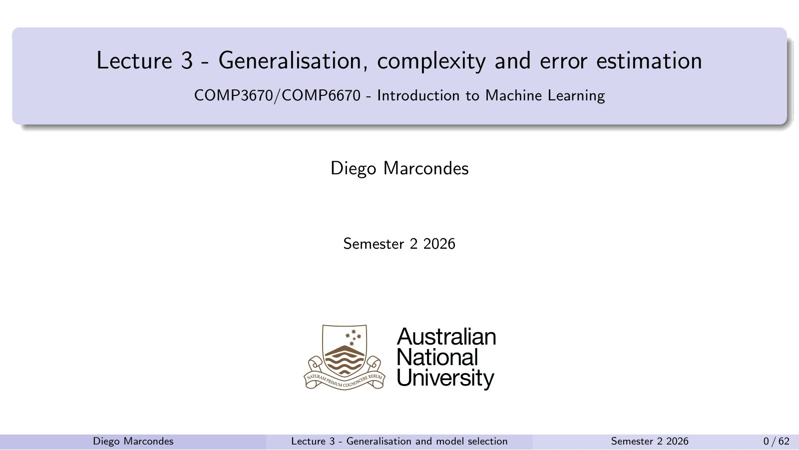

## 第 2 页：回顾统计学习框架

数据来自未知 $P$，总体风险是期望损失，经验风险是样本平均，ERM 选择训练错误最小的假说。当前缺口是证明整个假说集合上的泛化间隔能以高概率控制，而不只是写出希望成立的形式。

展开第 2 页原始 slide，核对图表、标注和公式

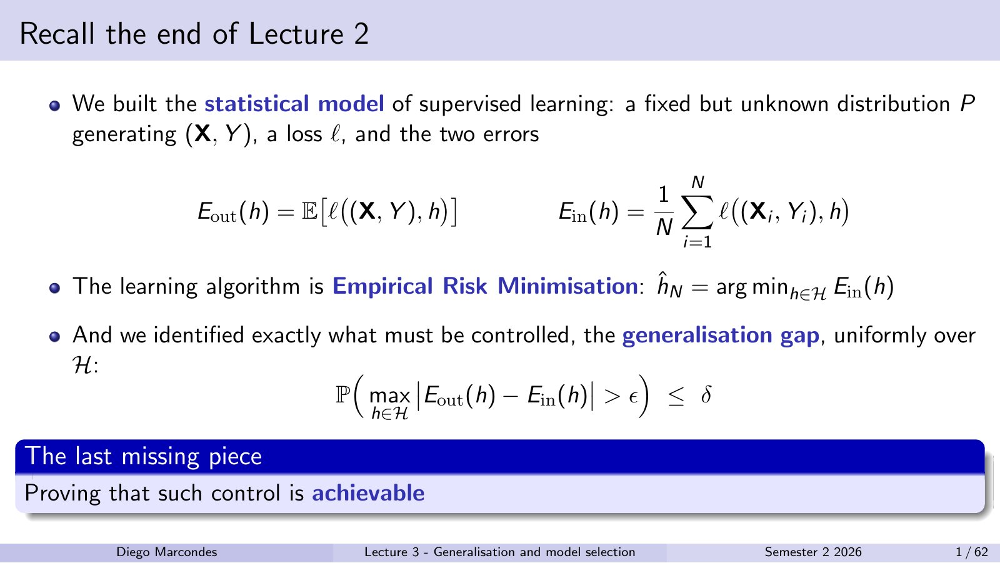

## 第 3 页：章节页：控制泛化间隔

先固定一个假说，把其损失看作随机变量的平均，再考虑从许多假说中选优带来的额外代价。

展开第 3 页原始 slide，核对图表、标注和公式

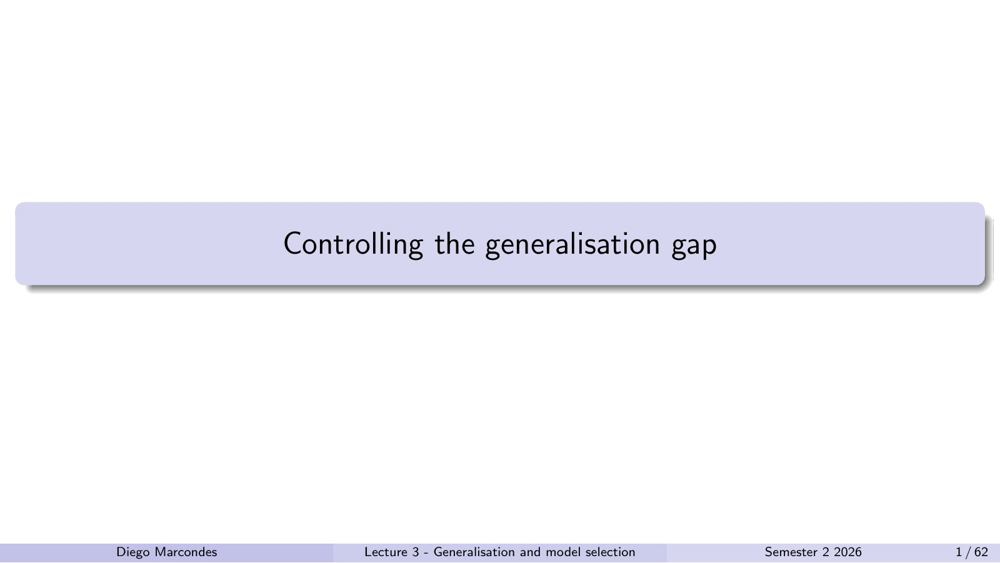

## 第 4 页：红绿弹珠的思想实验

罐中红球比例 $\mu$ 未知，独立抽取 $N$ 次观察红球比例 $\nu$。样本可能偶然很偏，但偏差很大的概率可以很小。把红球解释为固定分类器的错误，便有 $\mu=E_{\mathrm{out}}(h)$、$\nu=E_{\mathrm{in}}(h)$。

展开第 4 页原始 slide，核对图表、标注和公式

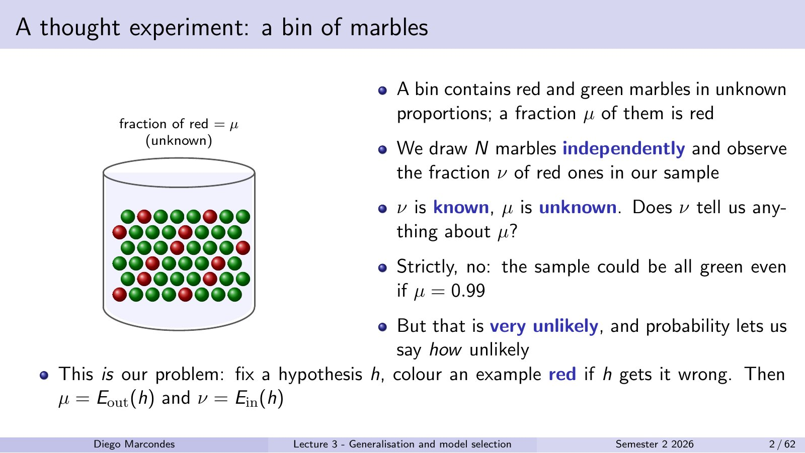

## 第 5 页：Hoeffding 不等式

若 $W_i$ 独立同分布、取值于 $[0,1]$、均值为 $\mu$，则

$$
P\left(\left|\frac1N\sum_iW_i-\mu\right|>\epsilon\right)\le2e^{-2N\epsilon^2}.
$$

它对分布具体形状没有要求，但需要独立和有界条件。偏差概率随 $N$ 指数下降。

展开第 5 页原始 slide，核对图表、标注和公式

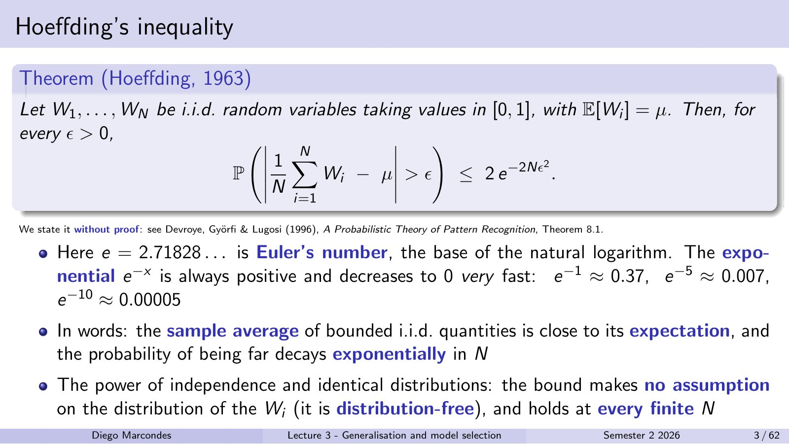

## 第 6 页：Hoeffding 界的曲线

图对比不同容许偏差 $\epsilon$ 下，概率界随样本量的衰减。偏差减半约需四倍样本：95% 保证下，$\epsilon=0.1$ 约需 185 个样本，$\epsilon=0.05$ 约需 740 个。超过 1 的概率上界虽成立但没有信息量。

展开第 6 页原始 slide，核对图表、标注和公式

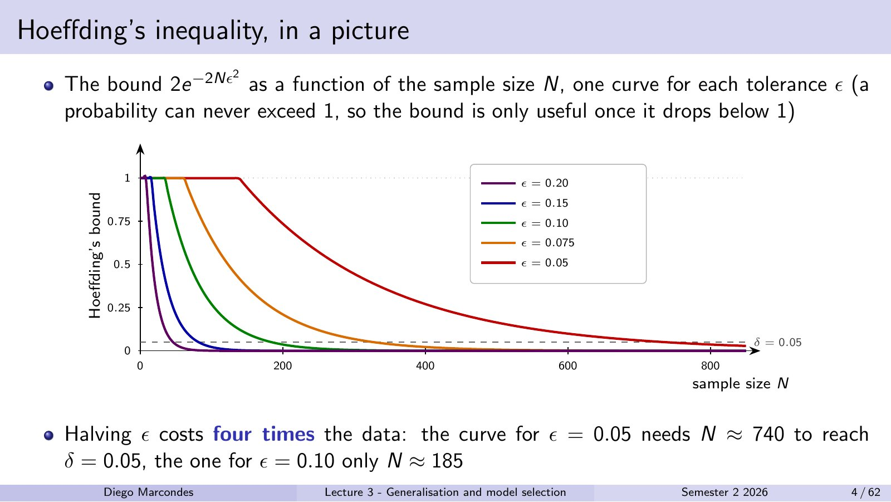

## 第 7 页：对单个固定假说应用 Hoeffding

令 $W_i=\mathbf1\{h(X_i)\ne Y_i\}$，其均值为总体误分类概率，样本平均为训练错误。若 $h$ 在看样本前固定，则

$$
P(|E_{\mathrm{out}}(h)-E_{\mathrm{in}}(h)|>\epsilon)\le2e^{-2N\epsilon^2}.
$$

展开第 7 页原始 slide，核对图表、标注和公式

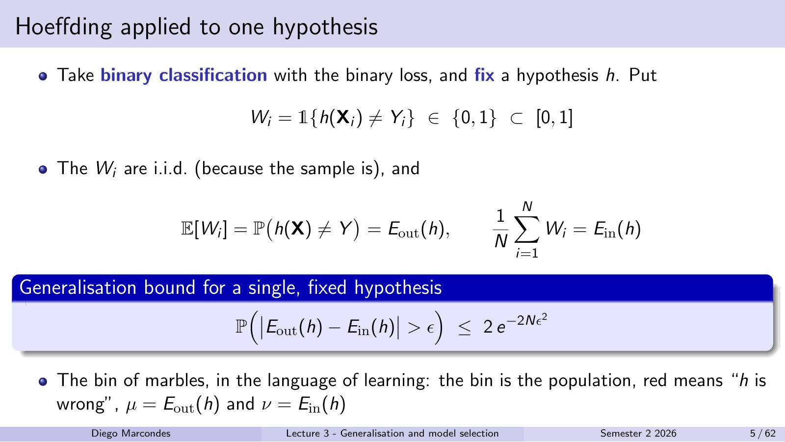

## 第 8 页：把概率界改写成误差条

令右侧等于 $\delta$，则以至少 $1-\delta$ 的概率，

$$
E_{\mathrm{out}}(h)\le E_{\mathrm{in}}(h)+\sqrt{\frac{\log(2/\delta)}{2N}}.
$$

误差条随 $1/\sqrt N$ 缩小，减半需四倍数据。这里仍是固定假说，尚未处理训练中的选择。

展开第 8 页原始 slide，核对图表、标注和公式

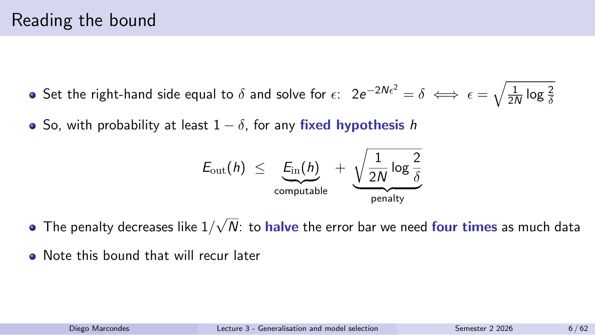

## 第 9 页：验证规则与学习规则不同

观察许多硬币后挑选最极端的一枚，更容易发现看似异常的记录。1000 枚公平硬币各抛 10 次，至少一枚全正面的概率约 0.62。ERM 同样挑选训练表现最好的规则，所以不能直接把单个固定规则的界套给获胜者。

展开第 9 页原始 slide，核对图表、标注和公式

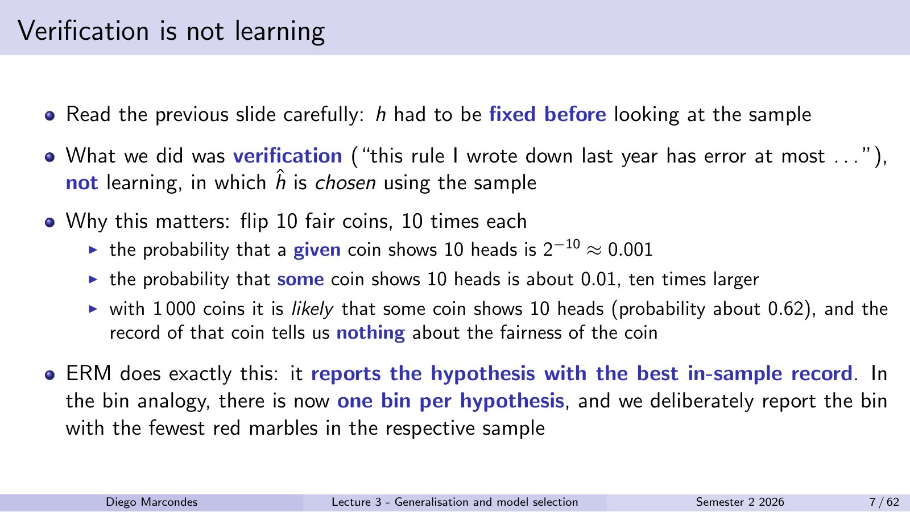

## 第 10 页：有限假说集合的并集界

若 $|\mathcal H|=M$，任一假说出现大偏差是 $M$ 个事件的并集。因此

$$
P\left(\sup_{h\in\mathcal H}|E_{\mathrm{out}}(h)-E_{\mathrm{in}}(h)|>\epsilon\right)\le2Me^{-2N\epsilon^2}.
$$

先对每个规则用 Hoeffding，再用并集界；不要求不同规则的错误事件独立。

展开第 10 页原始 slide，核对图表、标注和公式

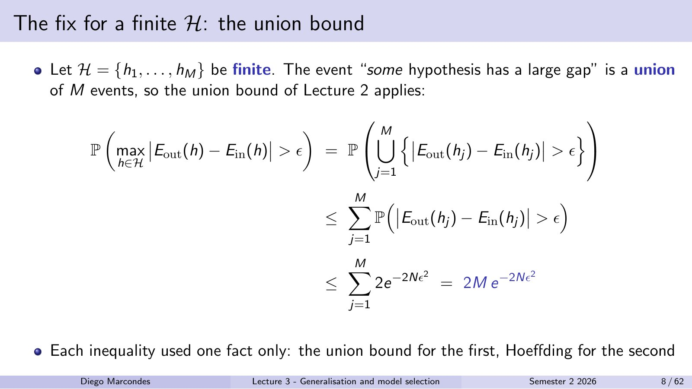

## 第 11 页：搜索有限集合的复杂度代价

以至少 $1-\delta$ 的概率，同时对全部 $h$ 有

$$
E_{\mathrm{out}}(h)\le E_{\mathrm{in}}(h)+\sqrt{\frac{\log(2M/\delta)}{2N}}.
$$

因此也适用于训练后选出的规则。取 $\epsilon=0.1,\delta=0.05$，$M=1,100,1000$ 分别约需 185、415、530 个样本；代价是 $\log M$。

展开第 11 页原始 slide，核对图表、标注和公式

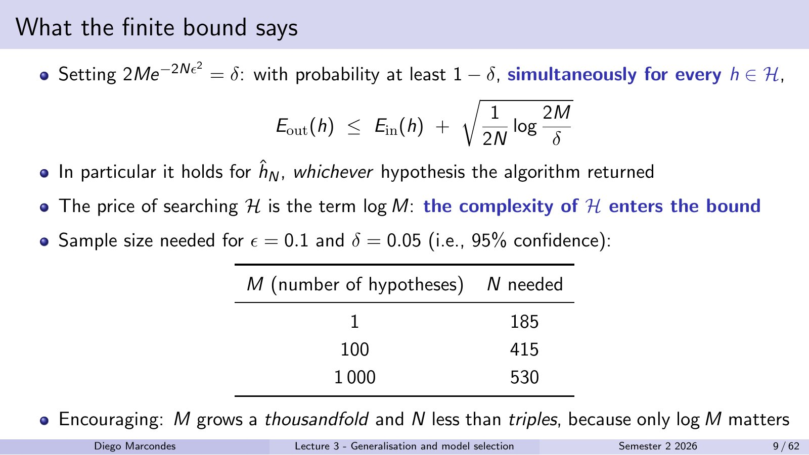

## 第 12 页：无限集合不能直接数规则个数

感知机的实数参数有无限多种，代入 $M=\infty$ 得不到有用界。但不同参数可能在有限样本上给出完全相同的标签。真正需要刻画的是样本能区分的预测模式数量，而不是参数组合数量。

展开第 12 页原始 slide，核对图表、标注和公式

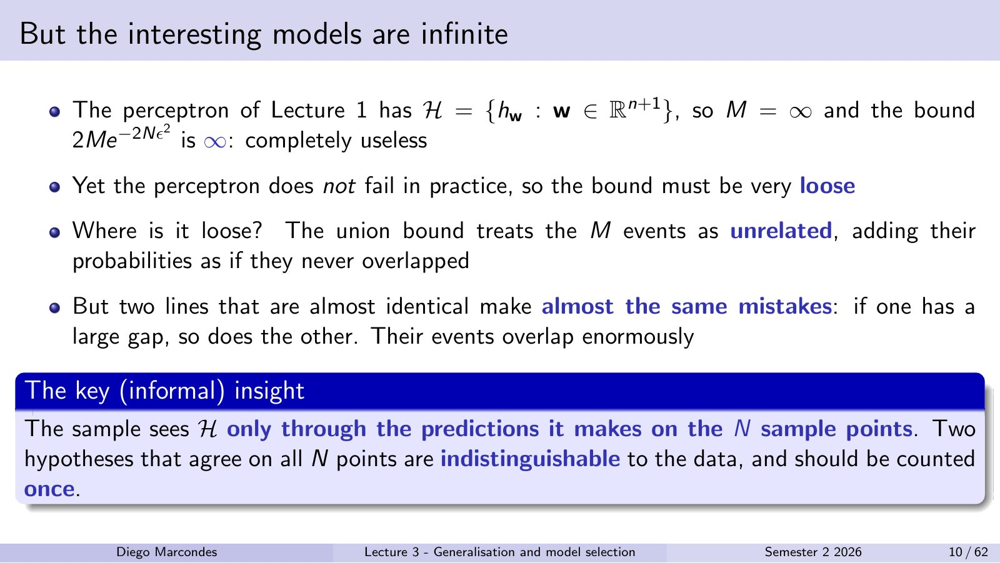

## 第 13 页：章节页：打散、增长函数与 VC 维

用假说在有限点集上能实现多少种二元标记方式来衡量表达能力。

展开第 13 页原始 slide，核对图表、标注和公式

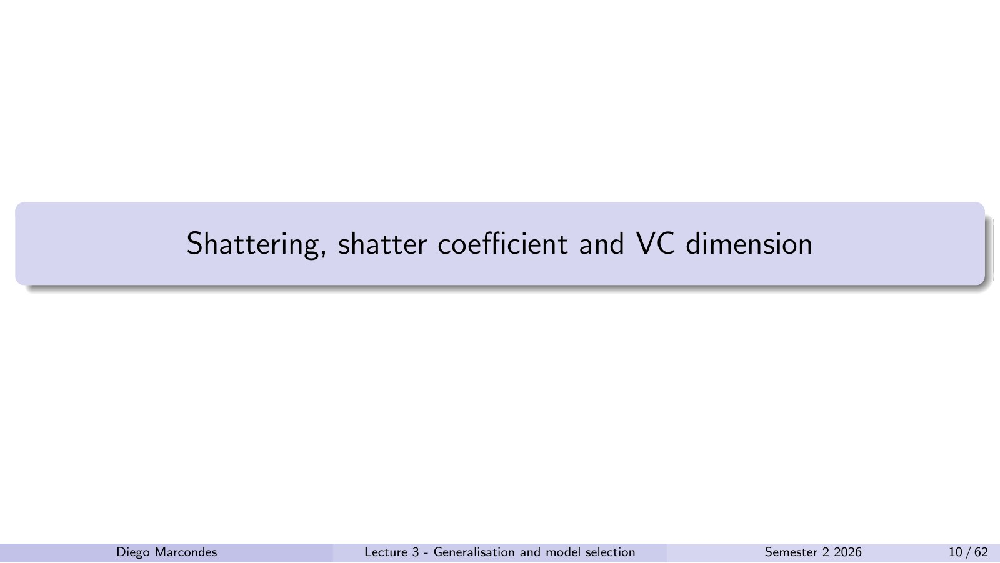

## 第 14 页：数据看到的是二分标记

固定 $N$ 点，每条二元假说生成一个标签序列 $(h(x_1),\ldots,h(x_N))$，称 dichotomy。总共最多 $2^N$ 种，哪怕假说集合无限大。许多规则可对应同一标签序列。

展开第 14 页原始 slide，核对图表、标注和公式

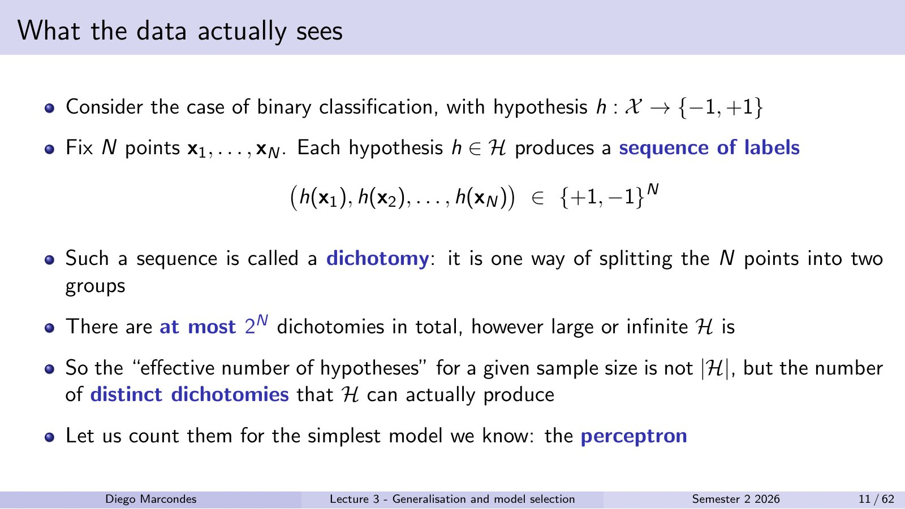

## 第 15 页：一维感知机可以打散两个点

允许阈值的两个方向时，两个不同点可实现 $--,-+,+-,++$ 四种标签。两种交错顺序需要相反方向的阈值；固定方向阈值的 VC 维不同，不能混淆。

展开第 15 页原始 slide，核对图表、标注和公式

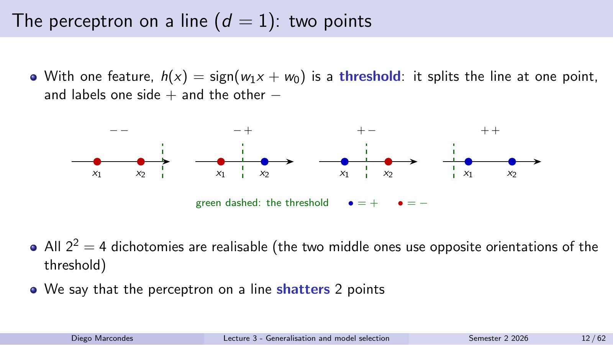

## 第 16 页：一维阈值不能打散三个点

若 $x_1<x_2<x_3$，阈值沿数轴至多改变一次类别，不能实现 $+-+$ 或 $-+-$。因此 8 种标记最多实现 6 种，三个点无法被打散，一维感知机的 VC 维为 2。

展开第 16 页原始 slide，核对图表、标注和公式

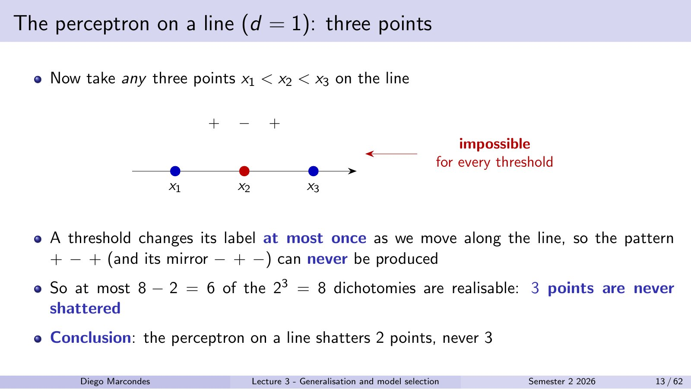

## 第 17 页：二维直线可以打散三个非共线点

三个非共线点的全部 $2^3=8$ 种标记均可由直线实现。图逐一展示不同正负安排，说明存在一个能打散的三点集；并不是所有三点配置都可以。

展开第 17 页原始 slide，核对图表、标注和公式

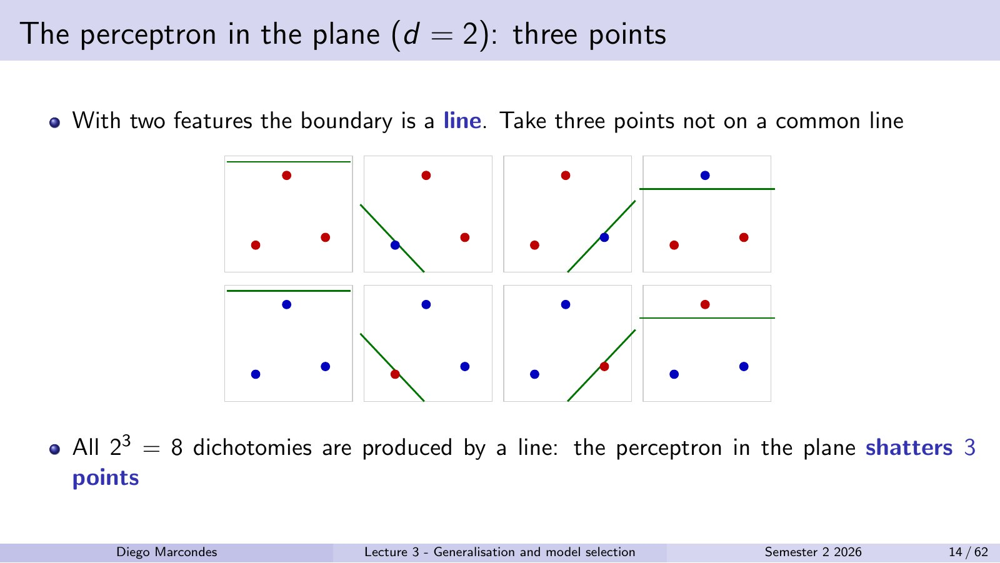

## 第 18 页：二维直线不能打散四个点

图中凸四边形对角线异类的 XOR 标记无法线性分离。**理解补充：**要证明 VC 维不超过 3，必须排除所有四点配置；若一点位于另外三点的凸包内部，可用内外相反标签说明不可分，退化配置也不增加能力。一般仿射超平面在 $\mathbb R^d$ 的 VC 维为 $d+1$。

展开第 18 页原始 slide，核对图表、标注和公式

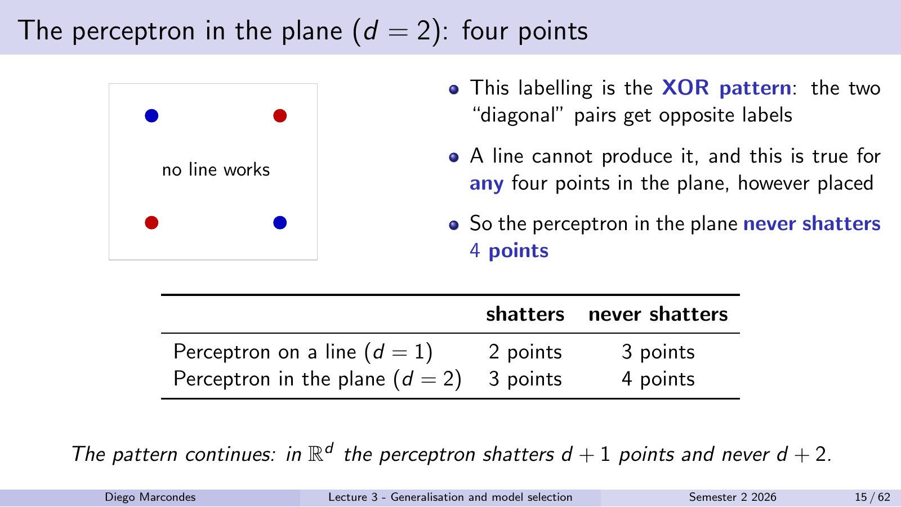

## 第 19 页：增长函数或打散系数

$S(\mathcal H,N)$ 是在所有 $N$ 点布局中，最多能产生的不同标记数。始终不超过 $2^N$；等于 $2^N$ 表示存在一个可被完全打散的点集。一维感知机的序列为 $2,4,6,8,\ldots$。

展开第 19 页原始 slide，核对图表、标注和公式

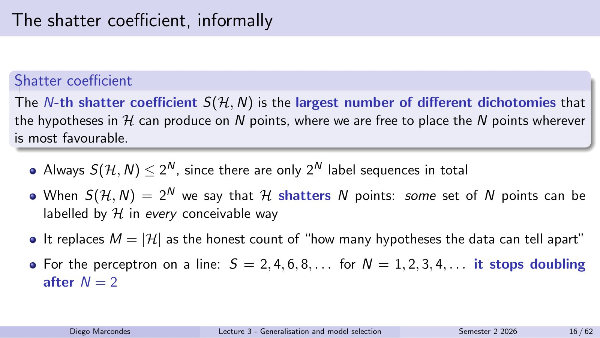

## 第 20 页：VC 维的定义及证明方向

$d_{\mathrm{VC}}$ 是可打散点集的最大大小，任意规模都能打散则为无穷。证明下界只需展示一个可打散点集；证明上界必须说明再大一点的所有点集都不能打散。这两个量词不能互换。

展开第 20 页原始 slide，核对图表、标注和公式

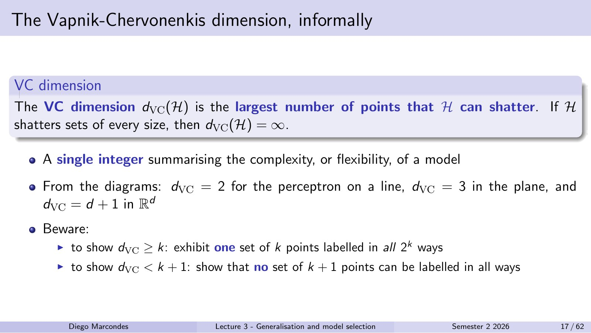

## 第 21 页：应掌握的 VC 维例子

固定方向的一维阈值 VC 维为 1，双方向一维感知机为 2，一维区间为 2，$d$ 维仿射感知机为 $d+1$。无限输入集合上的全部二元函数 VC 维无限。参数个数只是常见启发，不能普遍当作 VC 维定理。

展开第 21 页原始 slide，核对图表、标注和公式

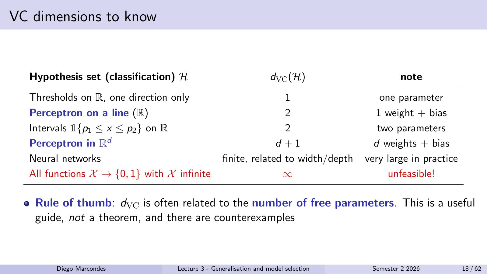

## 第 22 页：重新理解可证伪性

无限 VC 维表示任意样本规模都存在一个点集，集合能拟合其全部标签。原页把这与不可证伪联系起来。**理解补充：**这是关于任意规模和最坏分布的类比，并不表示每个有限样本都能拟合，也不表示该模型对每个实际分布都无法学习。

展开第 22 页原始 slide，核对图表、标注和公式

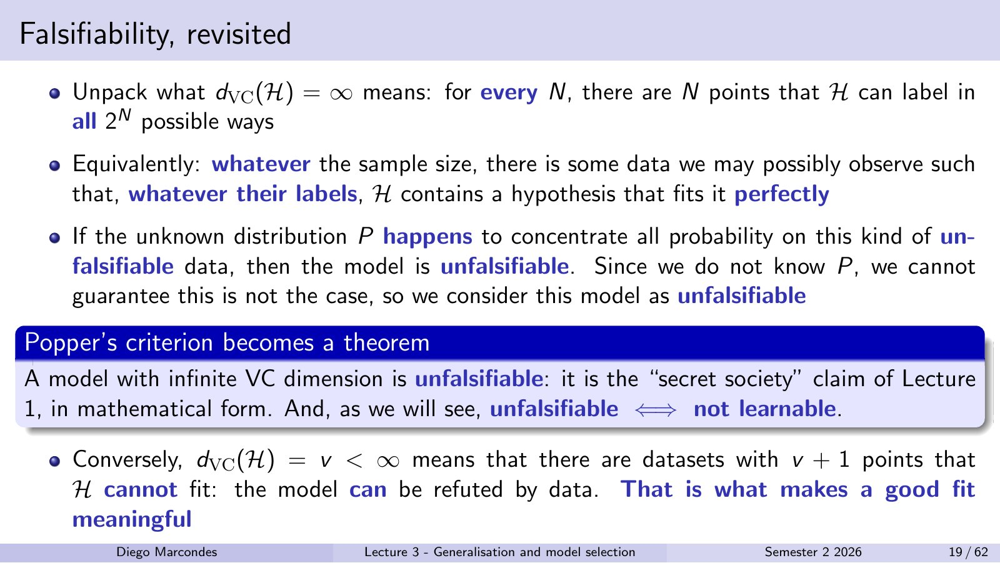

## 第 23 页：章节页：VC 泛化界与 PAC 学习

将有限点集上的组合复杂度转化为概率保证，并明确保证相对于集合内最佳规则而言。

展开第 23 页原始 slide，核对图表、标注和公式

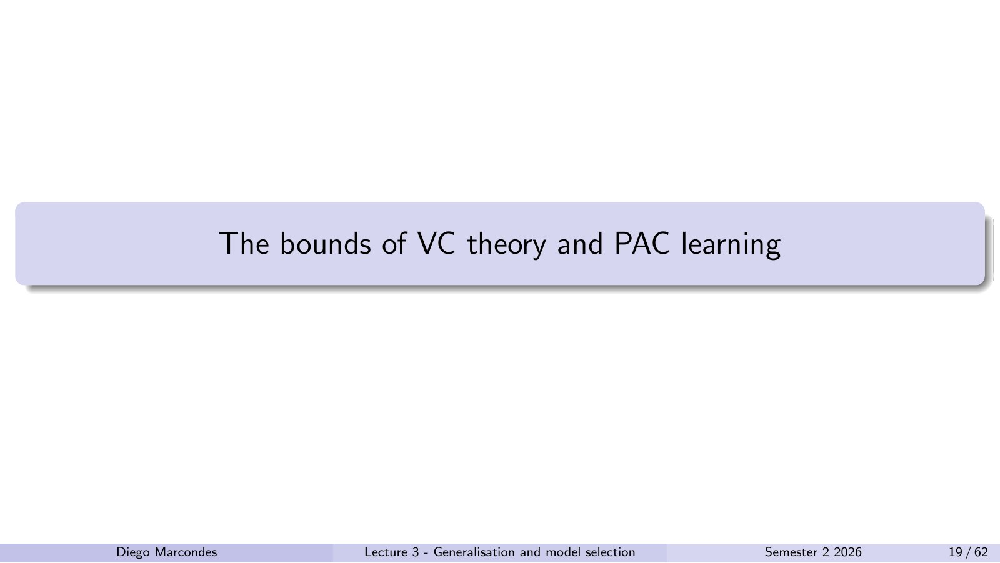

## 第 24 页：Sauer 引理

若 $v=d_{\mathrm{VC}}(\mathcal H)<\infty$，则对 $N>v$，课件采用粗界 $S(\mathcal H,N)\le(N+1)^v$。有限 VC 维使增长至多为多项式；指数衰减项最终能压过这一增长。这是无限假说集合仍可获得保证的关键。

展开第 24 页原始 slide，核对图表、标注和公式

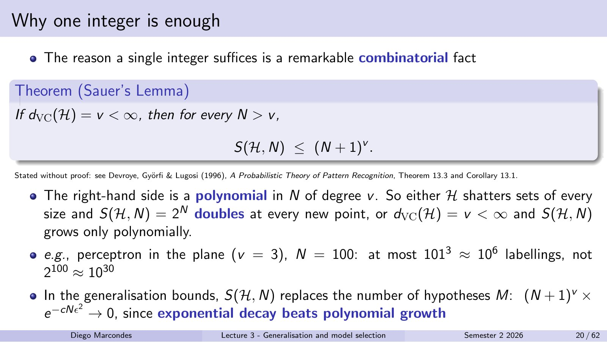

## 第 25 页：VC 泛化界

二元分类、0–1 损失下，课件给出

$$
P\left(\sup_h|E_{\mathrm{out}}(h)-E_{\mathrm{in}}(h)|>\epsilon\right)\le8S(\mathcal H,N)e^{-N\epsilon^2/32}\le8(N+1)^ve^{-N\epsilon^2/32}.
$$

具体常数来自证明，重点是复杂度增长与样本量衰减的竞争。

展开第 25 页原始 slide，核对图表、标注和公式

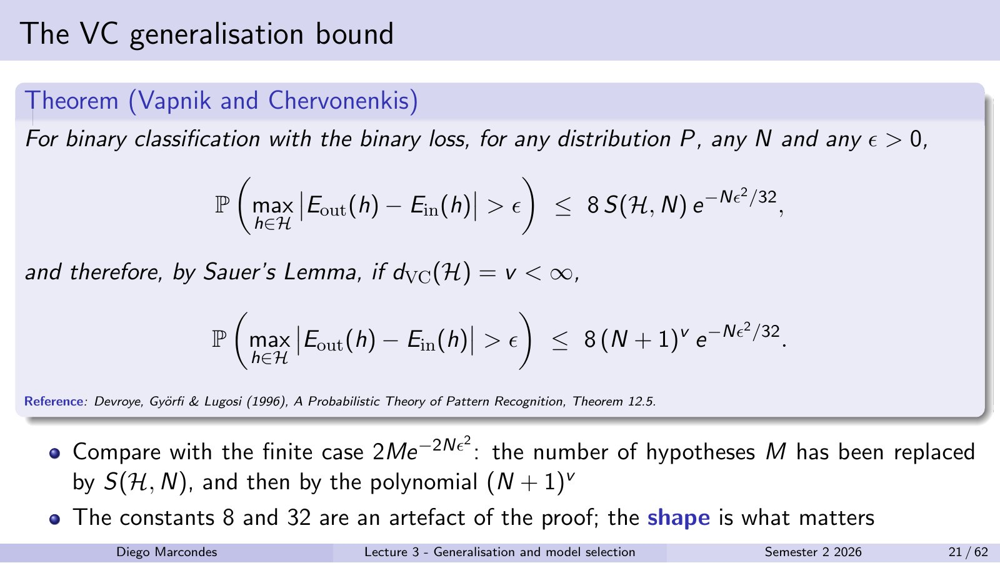

## 第 26 页：读懂复杂度罚项

解出偏差条，得到

$$
\Omega(N,v,\delta)=\sqrt{\frac{32}{N}\left[v\log(N+1)+\log\frac8\delta\right]}.
$$

以高概率同时有 $E_{\mathrm{out}}\le E_{\mathrm{in}}+\Omega$。固定 $v$ 增大 $N$ 会缩小界；固定 $N$ 增大 $v$ 会放大界。

展开第 26 页原始 slide，核对图表、标注和公式

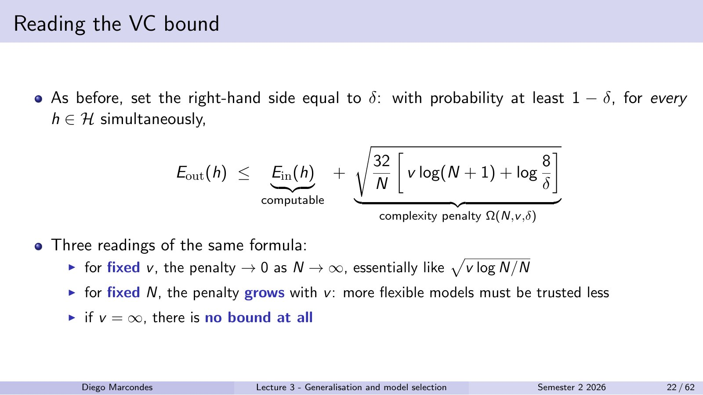

## 第 27 页：从间隔控制到估计误差

令 $h^\star$ 为 $\mathcal H$ 内总体风险最小的规则。若所有规则的双侧偏差都不超过 $\epsilon/2$，则

$$
E_{\mathrm{out}}(\hat h)\le E_{\mathrm{in}}(\hat h)+\epsilon/2\le E_{\mathrm{in}}(h^\star)+\epsilon/2\le E_{\mathrm{out}}(h^\star)+\epsilon.
$$

于是超额风险尾界为 $8(N+1)^ve^{-N\epsilon^2/128}$。**理解补充：**这里使用双侧一致界；原页相关简写应按此理解。

展开第 27 页原始 slide，核对图表、标注和公式

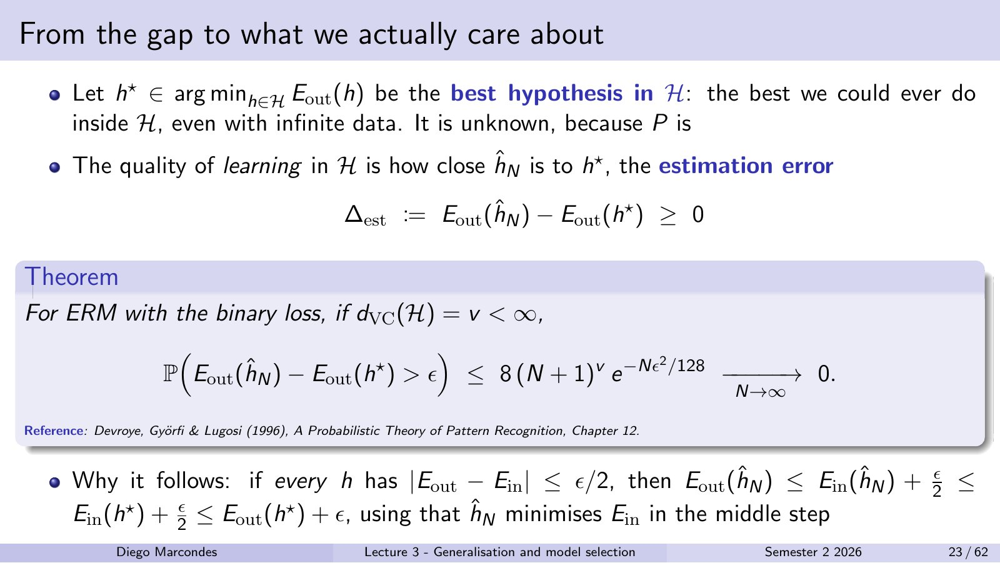

## 第 28 页：有限 VC 维的必要与充分条件

原页以“一致性”表述基本定理。**理解补充：**此处应紧扣二元 0–1 损失下的分布无关一致收敛、有限样本 PAC 保证与有限 VC 维的等价；不能将任意较弱的逐分布渐近一致性都不加条件地视为同一命题。有限 VC 维给 ERM 提供相应一致保证。

展开第 28 页原始 slide，核对图表、标注和公式

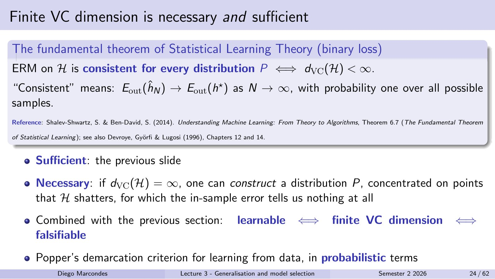

## 第 29 页：从误差界反求样本量

固定准确度 $\epsilon$、失败概率 $\delta$，寻找使 $8(N+1)^ve^{-N\epsilon^2/32}\le\delta$ 的 $N$。由此得到仅依赖复杂度、准确度与置信度的样本复杂度，而非依赖未知 $P$ 的单独计算。

展开第 29 页原始 slide，核对图表、标注和公式

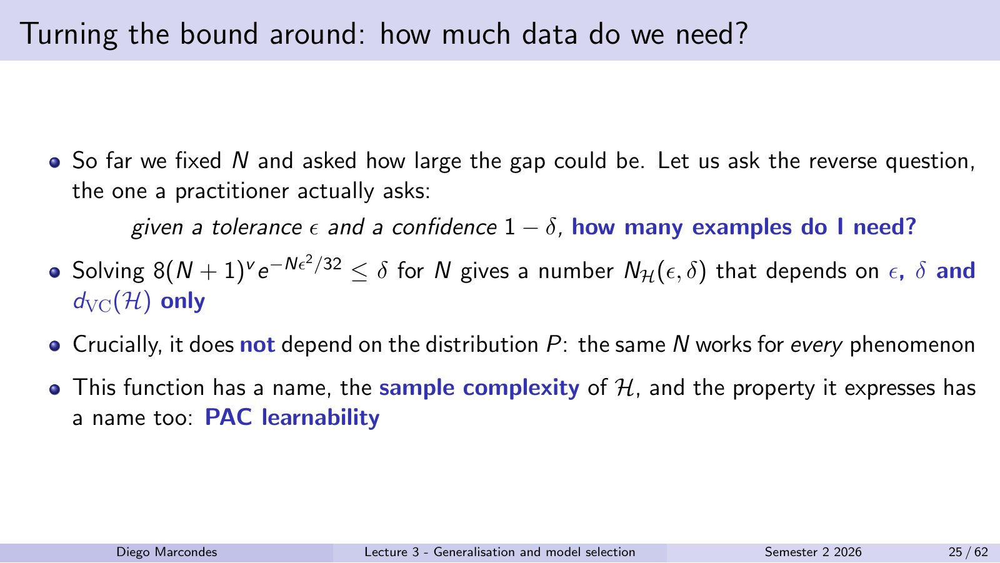

## 第 30 页：PAC 学习的含义

不可知 PAC 要求存在算法及 $N_{\mathcal H}(\epsilon,\delta)$，对任意 $P$，足量样本使

$$
P(E_{\mathrm{out}}(\hat h_N)\le E_{\mathrm{out}}(h^\star)+\epsilon)\ge1-\delta.
$$

“近似正确”相对于集合内最佳，而不是保证接近无限制的 Bayes 最优；不假设目标属于 $\mathcal H$。

展开第 30 页原始 slide，核对图表、标注和公式

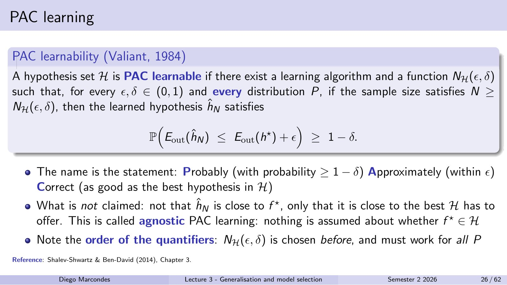

## 第 31 页：样本复杂度的主要依赖

课件由所用 VC 界给出量级

$$
N_{\mathcal H}(\epsilon,\delta)=O\!\left(\frac{v\log(1/\epsilon)+\log(1/\delta)}{\epsilon^2}\right).
$$

准确度要求更严通常代价大，置信度通过对数进入。**理解补充：**这是该推导给出的充分上界量级，不应把近似符号读成精确最优样本复杂度。

展开第 31 页原始 slide，核对图表、标注和公式

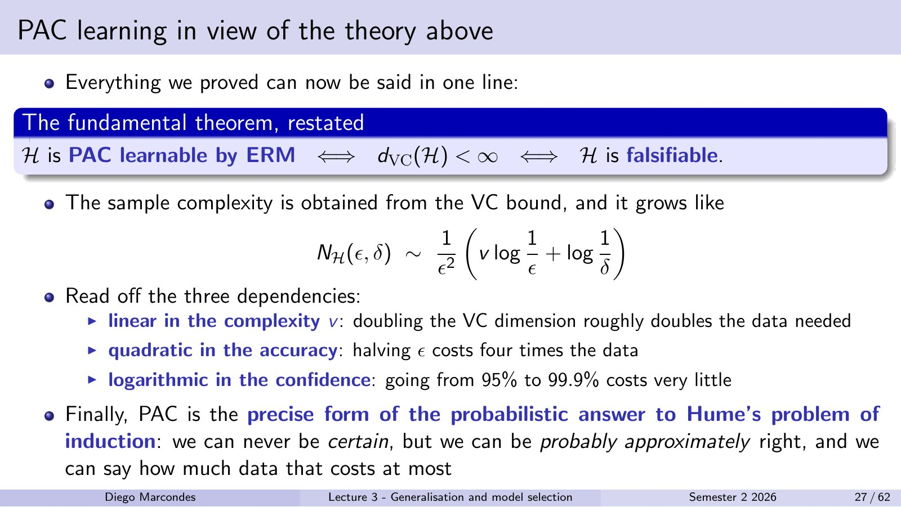

## 第 32 页：局限一：对最坏分布也要成立

分布无关保证必须覆盖极不利情形，因此常明显保守。真实数据的平滑性、结构或其他假设可能带来更紧保证。界保守不表示实际泛化差，也不表示理论没有解释价值。

展开第 32 页原始 slide，核对图表、标注和公式

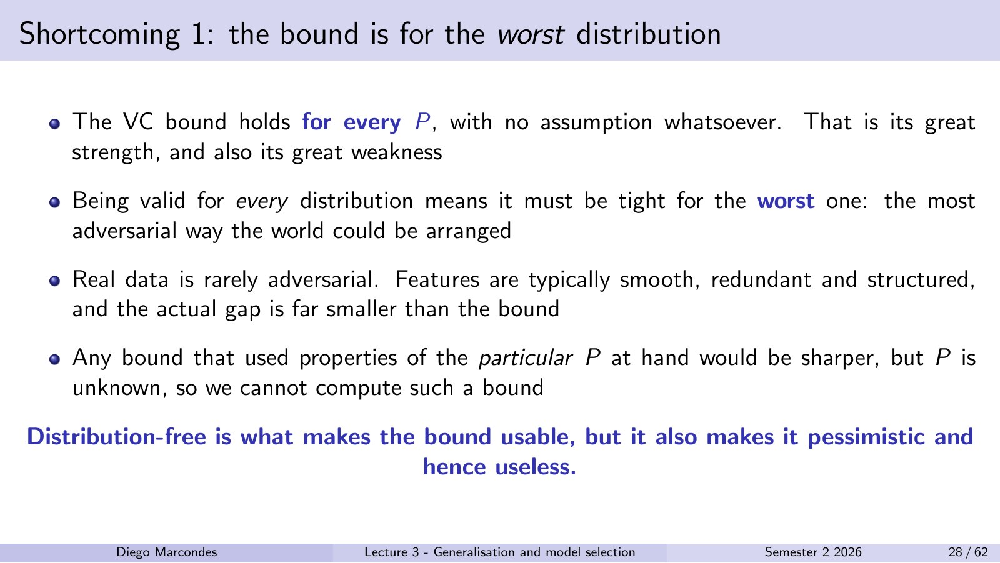

## 第 33 页：局限二：样本量界可能过大

课件表中二维感知机、$v=3$，保证误差 0.1、置信度 95% 约需 13 万样本；$v=10$ 约需 43 万。实践可能少得多，因此该界更适合解释影响因素，不宜直接作为精确的数据采购公式。

展开第 33 页原始 slide，核对图表、标注和公式

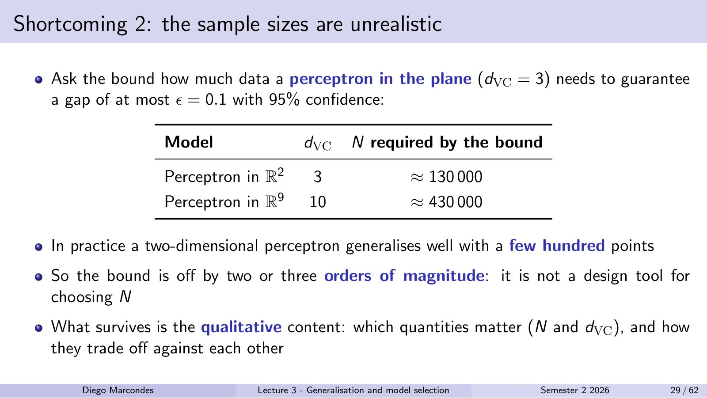

## 第 34 页：局限三：不能直接套用无界平方损失

Hoeffding 要求有界损失，而平方损失通常无界，重尾观察可能支配样本平均。回归需额外尾部、矩或有界性条件及相应复杂度工具。**理解补充：**本页把 binary loss 写成 $\{-1,+1\}$ 是笔误；标签可取正负 1，0–1 损失取 $\{0,1\}$。

展开第 34 页原始 slide，核对图表、标注和公式

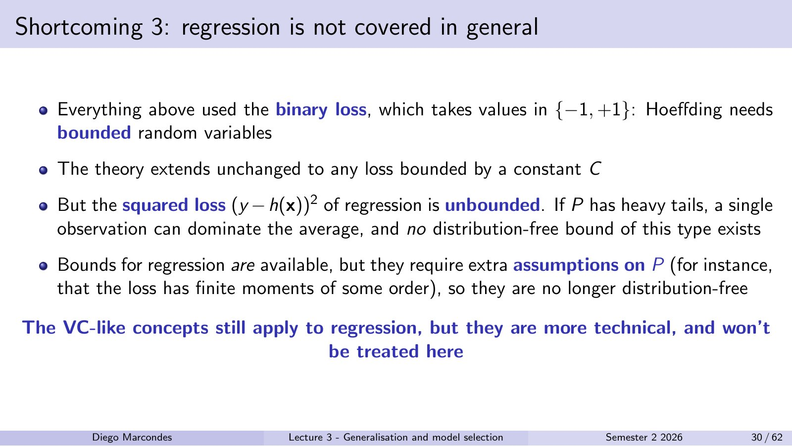

## 第 35 页：VC 理论提供的价值

在相应二元学习设定下，有限 VC 维保证足够样本时 ERM 接近集合内最优。它在收集数据前指出模型复杂度的重要性，并将归纳的不确定性量化；它没有保证所选模型集合本身适合任务。

展开第 35 页原始 slide，核对图表、标注和公式

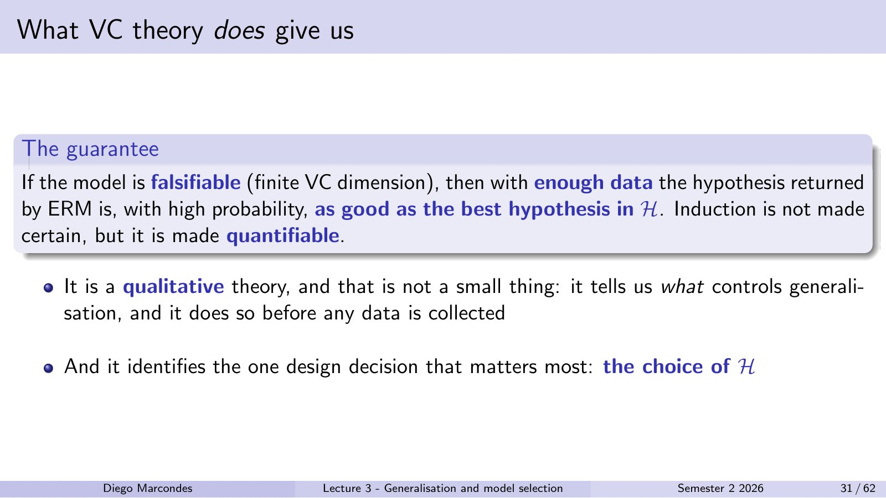

## 第 36 页：统计学习理论概览收束

图串联三讲：第一讲提出归纳与可证伪问题，第二讲用分布、损失和抽样精确化，第三讲用 Hoeffding、增长函数、VC 维给概率界。核心建模选择始终是假说集合。

展开第 36 页原始 slide，核对图表、标注和公式

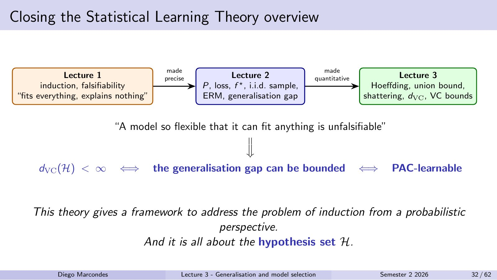

## 第 37 页：章节页：偏差、方差与模型作用

接下来区分“模型能表达什么”与“有限数据能学到什么”，再讨论如何利用先验选择集合。

展开第 37 页原始 slide，核对图表、标注和公式

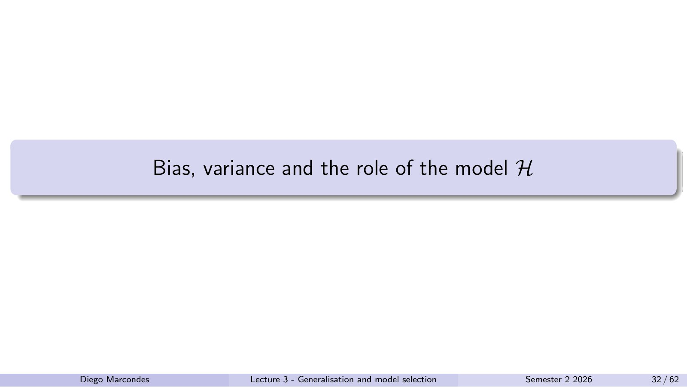

## 第 38 页：总超额风险的两项分解

以无限制最优 $f^\star$ 为基准，

$$
L(\hat h)-L(f^\star)=\underbrace{L(h^\star)-L(f^\star)}_{\Delta_{\mathrm{app}}}+\underbrace{L(\hat h)-L(h^\star)}_{\Delta_{\mathrm{est}}}.
$$

逼近误差来自限制集合，估计误差来自有限数据。即使学到集合内最优，逼近误差仍可能很大。

展开第 38 页原始 slide，核对图表、标注和公式

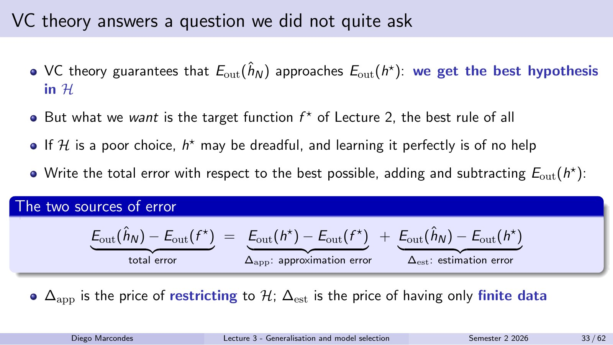

## 第 39 页：嵌套集合的几何图

图中全部函数空间包含大小不同的模型集合，分别标出集合内最优、实际训练结果和全局最佳。缩小集合可降低学习难度，却可能让集合内最优远离目标。距离箭头是误差概念的示意，不必等同参数空间欧氏距离。

展开第 39 页原始 slide，核对图表、标注和公式

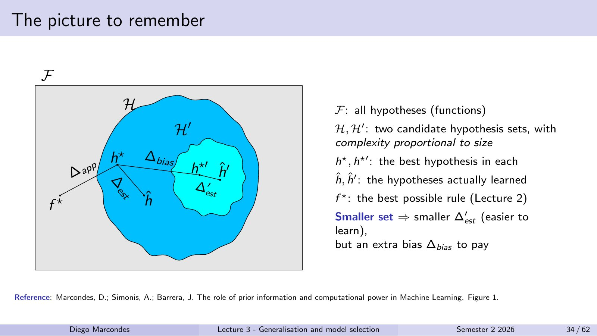

## 第 40 页：复杂度的权衡曲线

简单集合可能欠拟合，复杂集合可能因有限数据过拟合，总误差常在中间较低。更多数据通常允许更复杂的模型。**理解补充：**图将逼近、估计误差与 bias、variance 联系起来作直觉解释，不是普遍损失下严格的平方损失偏差方差恒等式。

展开第 40 页原始 slide，核对图表、标注和公式

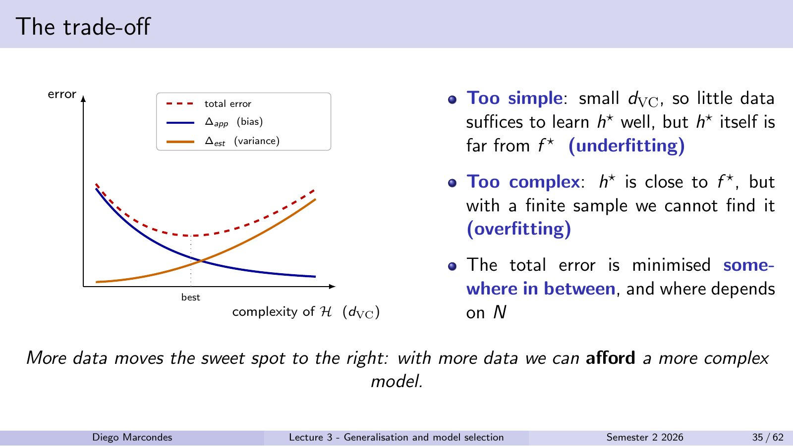

## 第 41 页：多次抽样下的拟合差异

目标为 $\sin(2\pi x)$，每次 10 个带噪点，多次独立采样后分别拟合常数、三次和九次多项式。常数拟合变化小却偏离目标；高次拟合可穿过训练点，却随样本剧烈摆动。中间模型更平衡。

展开第 41 页原始 slide，核对图表、标注和公式

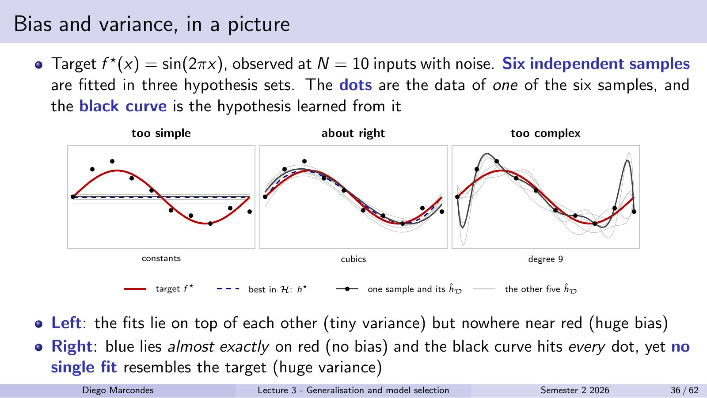

## 第 42 页：多项式阶数的经验例子

图用同一带噪数据展示逐渐增加阶数的拟合。低阶遗漏目标形状，高阶出现强烈振荡；训练点贴合程度不能独自决定最好的阶数，之后需要验证数据比较。

展开第 42 页原始 slide，核对图表、标注和公式

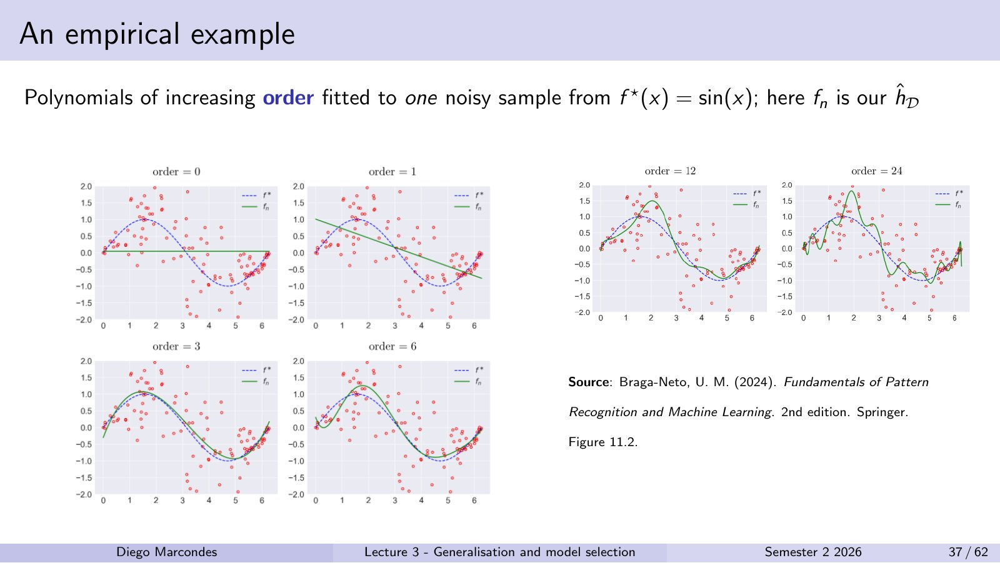

## 第 43 页：理想的模型选择

希望集合简单，同时位置恰好接近目标。简单但错误的先验造成高偏差；灵活但无约束需要更多数据。关于现象的先验知识可以帮助用较小集合表达合适规律。

展开第 43 页原始 slide，核对图表、标注和公式

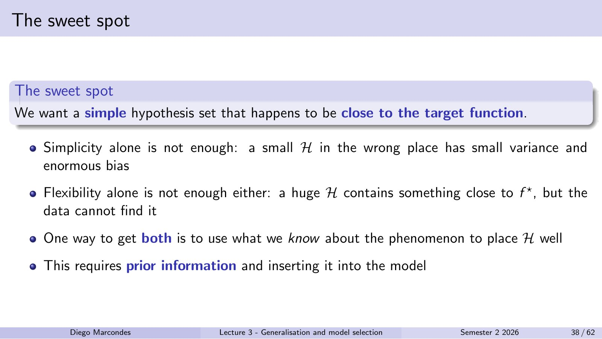

## 第 44 页：章节页：先验信息

用第一讲的八个布尔输入，展示额外结构假设怎样约束未见标签。

展开第 44 页原始 slide，核对图表、标注和公式

## 第 45 页：回顾有限布尔输入例子

$\{0,1\}^3$ 有 8 个输入，所有二元函数共 $2^8=256$ 个，观察 5 个标签后还剩 8 种相容目标。**理解补充：**该有限集合 VC 维为 8，实际上 PAC 可学习；当前困难是这 5 个观察尚不能逻辑确定另外 3 个标签，不应称其绝对不可学习。

展开第 45 页原始 slide，核对图表、标注和公式

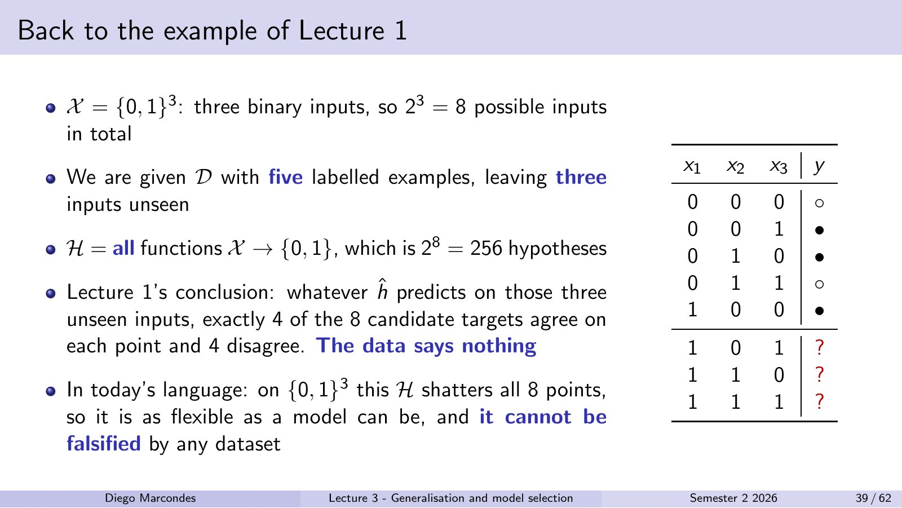

## 第 46 页：加入一条结构先验

若已知 $x_1=1$ 时输出与 $x_2,x_3$ 无关，则该四点块必须同标签。已观察 $(1,0,0)$ 为正，便推出其余 3 个未见点也为正。新信息来自先验，不是算法从无约束数据中凭空证明出来。

展开第 46 页原始 slide，核对图表、标注和公式

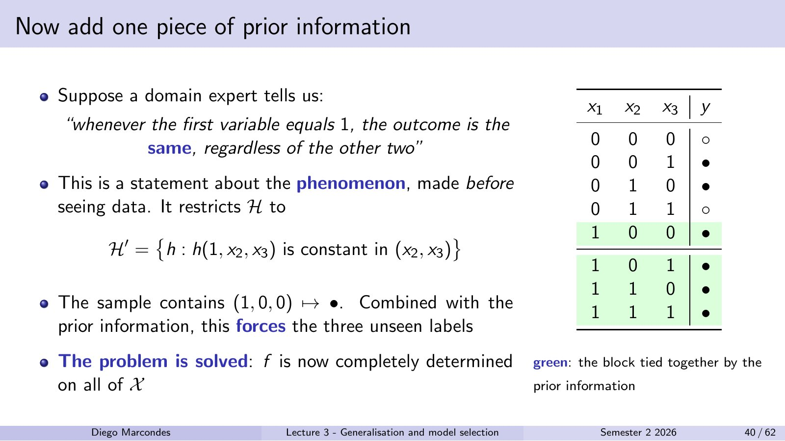

## 第 47 页：先验怎样缩小集合

四个 $x_1=0$ 输入仍可独立赋值，$x_1=1$ 的四点共享一个值，因此候选数由 256 降为 $2^4\times2=32$，VC 维由 8 降为 5。**理解补充：**收益是减少歧义与样本需求；不是把此有限例子从 PAC 不可学习变成可学习。

展开第 47 页原始 slide，核对图表、标注和公式

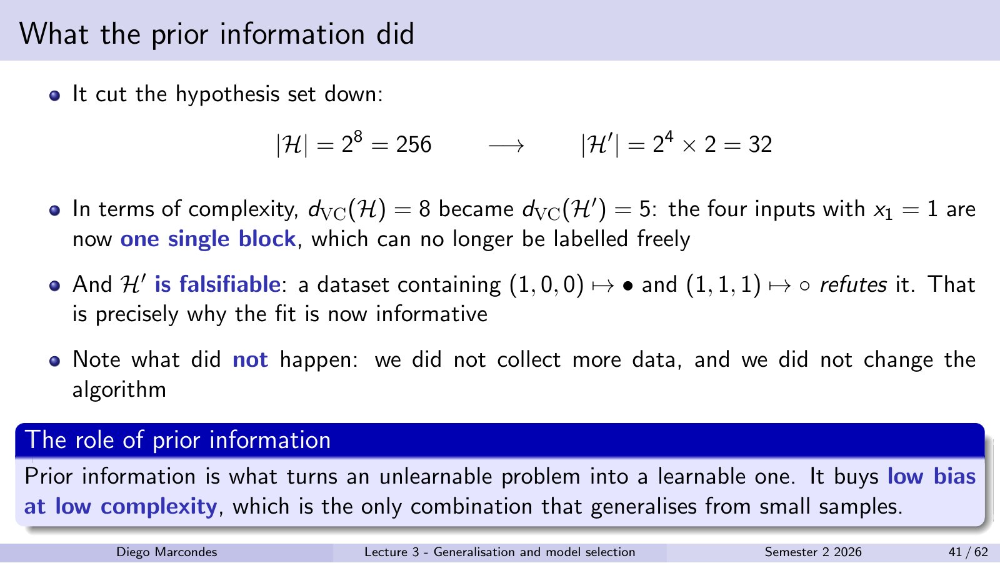

## 第 48 页：现实先验通常更模糊

“多数特征无关”“关系较平滑”等通常不能唯一指定模型，却可指导构造多个候选集合。让数据在这些候选之间选择，即模型选择；先验负责提出合理范围，验证负责比较。

展开第 48 页原始 slide，核对图表、标注和公式

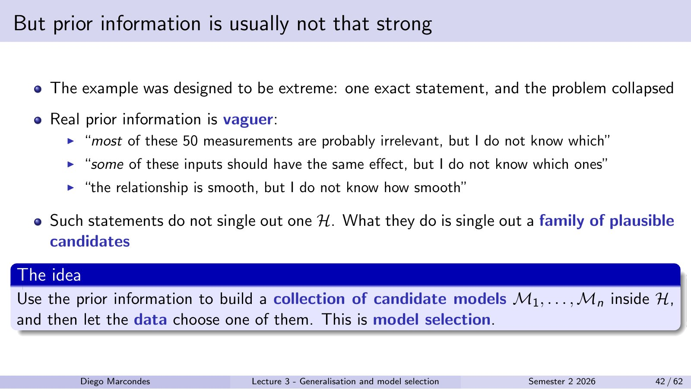

## 第 49 页：章节页：模型选择

将选择具体假说与选择假说集合区分开：前者是训练，后者需要额外的数据评价安排。

展开第 49 页原始 slide，核对图表、标注和公式

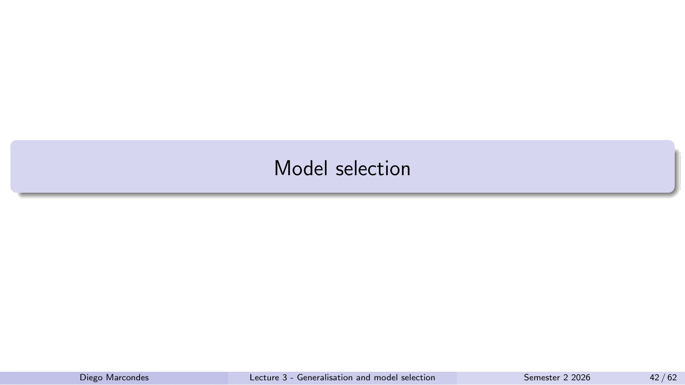

## 第 50 页：候选模型的集合

每个候选模型 $M_i\subseteq\mathcal H$ 编码一种可能结构。可以构造复杂度递增的嵌套链，也可以有互不包含的候选。候选集合应结合领域信息，而非任意无限尝试。

展开第 50 页原始 slide，核对图表、标注和公式

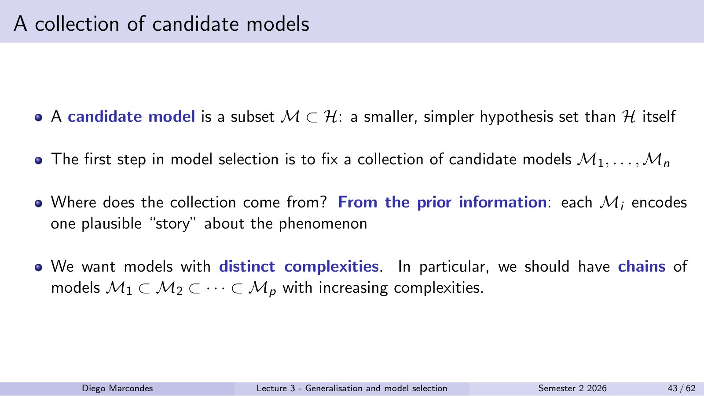

## 第 51 页：变量选择例子

对特征子集 $A$，$M_A$ 只依赖其中变量。若 $A\subseteq B$，相应集合也嵌套。$d$ 个特征有 $2^d$ 个子集，20 个特征就超过百万，说明候选搜索也有计算和选择偏差成本。

展开第 51 页原始 slide，核对图表、标注和公式

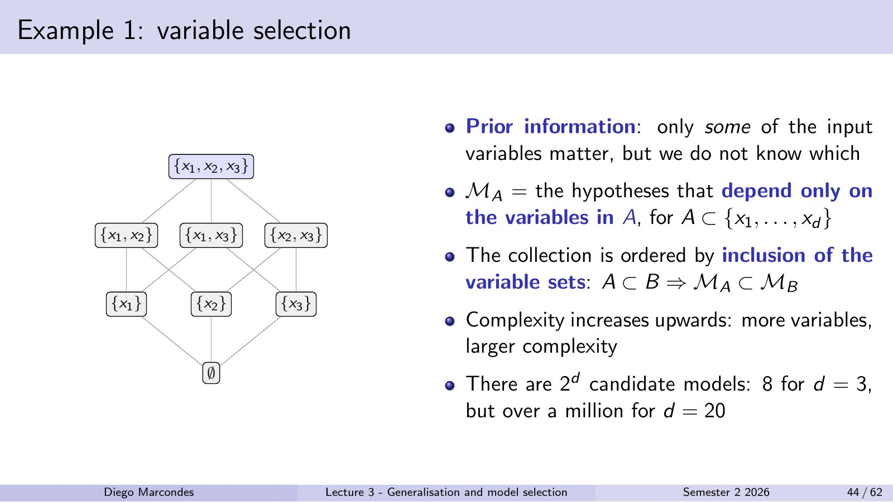

## 第 52 页：多项式阶数选择例子

次数不超过 0、1、2 到 $k$ 的多项式形成嵌套链。低阶可能高偏差，高阶可能高方差；光滑先验提供一组合理模型，但仍需决定允许多强的弯曲。

展开第 52 页原始 slide，核对图表、标注和公式

## 第 53 页：不能靠最小训练错误选复杂度

若 $M_i\subseteq M_j$，在较大集合上取得的最小训练误差不会更大。直接按它选模型会倾向最大候选集合，忽略泛化代价。必须使用未参与拟合的数据来估计实际表现。

展开第 53 页原始 slide，核对图表、标注和公式

## 第 54 页：模型选择流程图

本页再次使用第一讲的流程图：上方从领域知识到目标先验和假说空间，下方从算法池到经验测试和算法选择，两条路线都关联假说表示及最终优化目标。结合本节，图提醒我们区分模型假设、算法选择与训练参数；用于选择的信息也不能继续充当完全独立的最终测试。

展开第 54 页原始 slide，核对图表、标注和公式

## 第 55 页：章节页：验证与交叉验证

用留出数据比较模型，并通过轮换留出部分提高数据使用效率。

展开第 55 页原始 slide，核对图表、标注和公式

## 第 56 页：验证集的定义与作用

先分训练集和大小为 $K$ 的验证集；每个模型只在训练部分拟合，再计算

$$
E_{\mathrm{val}}(\hat h_i)=\frac1K\sum_{j\in\mathrm{val}}\ell((X_j,Y_j),\hat h_i).
$$

选择验证错误较低者，验证标签不参与这些候选规则的拟合。

展开第 56 页原始 slide，核对图表、标注和公式

## 第 57 页：单个候选的验证误差保证

条件于训练得到的固定候选，独立验证集允许直接用 Hoeffding。0–1 损失下误差条为 $\sqrt{\log(2/\delta)/(2K)}$，不含该模型的 VC 维。95% 时 $K=200,1000,5000$，约为 0.096、0.043、0.019。

展开第 57 页原始 slide，核对图表、标注和公式

## 第 58 页：训练与验证样本量的矛盾

验证集太小则评分不稳，太大则训练数据不足；80/20 是常见示例。选定模型后可在训练与验证合并数据上重拟合。**理解补充：**更多训练数据不保证每次实现都改善，重拟合后最终规则仍应由独立测试集评价。

展开第 58 页原始 slide，核对图表、标注和公式

## 第 59 页：比较多个候选的修正

从 $n$ 个预先确定的候选中择优，需要同时控制验证偏差。并集界给出误差条 $\sqrt{\log(2n/\delta)/(2K)}$。$K=500$、95% 时，$n=1,10,100$ 对应约 0.061、0.077、0.091；无限反复调试同一验证集会使选择偏差增加。

展开第 59 页原始 slide，核对图表、标注和公式

## 第 60 页：验证曲线

图中最小训练误差随嵌套模型复杂度不增，验证误差则示意为先降后升。谷底对应经验上较好的权衡。**理解补充：**U 形是常见示意，并非每个数据集或每种训练算法都严格呈现该形状。

展开第 60 页原始 slide，核对图表、标注和公式

## 第 61 页：k 折交叉验证

把数据分为 $k$ 折，每次在其余 $k-1$ 折训练，在当前折验证，最后平均各折分数：$E_{\mathrm{cv}}(M_i)=k^{-1}\sum_jE_{\mathrm{val}}^{(j)}(M_i)$。图中轮换的留出区域说明每个观察恰好验证一次。

展开第 61 页原始 slide，核对图表、标注和公式

## 第 62 页：交叉验证的计算与统计代价

常用 5 折或 10 折；留一法取 $k=N$。每候选需拟合 $k$ 次，$n$ 个模型总计 $kn$ 次。各折训练集高度重叠，分数不独立，因此不能直接把它们当作独立重复实验套简单 Hoeffding 界。

展开第 62 页原始 slide，核对图表、标注和公式

## 第 63 页：完整模型选择流程

先凭先验建立候选模型，再用验证或交叉验证估计表现，选分数最好的模型，最后用所有开发数据重拟合。该流程仍留下一个问题：经过模型选择之后，怎样诚实评价最终规则？答案是预先封存的测试集。

展开第 63 页原始 slide，核对图表、标注和公式

## 第 64 页：章节页：测试样本

区分用于选择模型的验证数据与用于最终报告的测试数据。

展开第 64 页原始 slide，核对图表、标注和公式

## 第 65 页：为什么需要最终测试

训练错误因优化而乐观，获胜模型的验证或交叉验证分数也有选择偏差。测试集在所有拟合、调参、模型选择中均不使用，只在最终规则确定后打开一次，以避免再次把评价信息用于选择。

展开第 65 页原始 slide，核对图表、标注和公式

## 第 66 页：训练、验证、测试三分法

训练用于拟合，验证用于选模型，测试用于最终报告。相对于独立测试集，最终 $\hat h$ 已固定，0–1 损失下双侧误差条为 $\sqrt{\log(2/\delta)/(2N_{\mathrm{test}})}$。测试集不能包含于最后的开发数据重拟合中。

展开第 66 页原始 slide，核对图表、标注和公式

## 第 67 页：读懂测试误差例子

1000 个独立测试样本中错 83 个，测试误差 0.083。Hoeffding 的 95% 误差条约 0.043，区间约 $[0.040,0.126]$。**理解补充：**对固定规则，测试平均无偏，但无偏不意味着高估与低估概率恰好各半；这里也不是保证真实误差等于观测值。

展开第 67 页原始 slide，核对图表、标注和公式

## 第 68 页：测试集的黄金规则

看完测试结果再修改模型，就让测试集承担了验证作用，原先的独立最终评价解释随之失效。迭代应使用验证集；公开基准被反复优化也存在同类选择效应。核心是评价数据是否影响了决策，而非形式上的文件命名。

展开第 68 页原始 slide，核对图表、标注和公式

## 第 69 页：三种错误各司其职

训练错误用于拟合，强烈受选择影响；验证或交叉验证用于选模型，赢家分数也可能乐观；独立测试用于最终报告。理论上训练保证涉及模型复杂度，有限验证选择涉及候选数，固定最终规则的测试误差条主要涉及测试样本量。

展开第 69 页原始 slide，核对图表、标注和公式

## 第 70 页：本讲要点

Hoeffding 控制固定规则，有限集合加并集界，无限集合用增长函数与 VC 维。总超额风险分为逼近与估计两部分。先验帮助建立合适候选，验证和交叉验证负责选择，封存测试集负责报告最终表现；后续转向具体模型。

展开第 70 页原始 slide，核对图表、标注和公式

## 第 71 页：参考文献

原页列出《Learning from Data》《Fundamentals of Pattern Recognition and Machine Learning》《A Probabilistic Theory of Pattern Recognition》《Understanding Machine Learning: From Theory to Algorithms》，以及 Valiant 1984 年《A Theory of the Learnable》。本笔记依课件整理，补充解释已在相关页面单独标明。

展开第 71 页原始 slide，核对图表、标注和公式

