# Lecture 04：参数与非参数模型、决策树、随机森林和回归，按 PDF 逐页复述

来源：[lecture04.pdf](../../comp3670_lectures/lecture04.pdf)，共 73 个 PDF 页面。严格按 PDF 页序组织，章节页、例题续页和参考文献页也单独保留。正文用中文讲解概念、公式和图表；原页未写出的解答、纠错或推导明确标为“理解补充”。每节末尾可展开完整原始 slide核对颜色、标注和排版。图片和 PDF 均使用仓库相对路径，适合本地预览与 GitHub。

## 第 1 页：课程与主题：机器学习模型

本讲介绍参数分类、非参数局部投票、决策树与随机森林，以及相应回归方法。主线是每种模型作了什么假设、怎样从数据得到预测规则、用哪个参数控制复杂度。按实际 73 个 PDF 页编号，部分旧页脚页数不作索引。

展开第 1 页原始 slide，核对图表、标注和公式

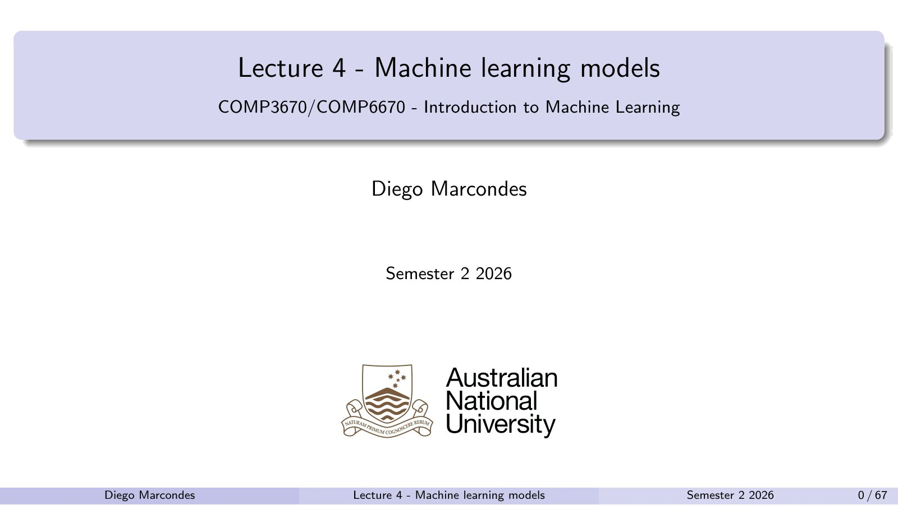

## 第 2 页：用估计的条件概率构造分类器

二元 0–1 损失下，$f^\star(x)=\mathbf1\{\eta(x)>1/2\}$，其中 $\eta(x)=P(Y=1\mid X=x)$。先估计 $\hat\eta$，再代入最优规则得到 $\hat h(x)=\mathbf1\{\hat\eta(x)>1/2\}$，称 plug-in 方法。难点转为估计条件概率。

展开第 2 页原始 slide，核对图表、标注和公式

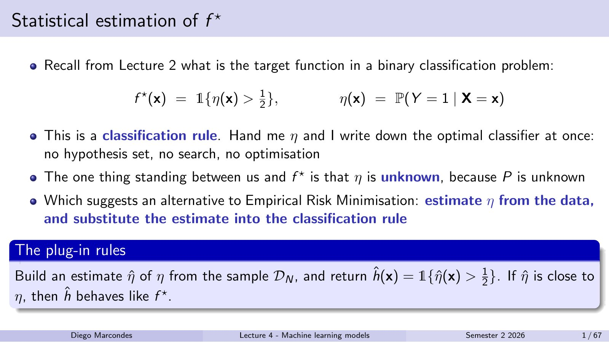

## 第 3 页：分布建模与 ERM 两种视角

分布建模先估计概率规律，再推导决策；直接 ERM 则预设预测函数集合并最小化经验损失。**理解补充：**plug-in 这一步不直接最小化分类错误，但其概率估计步骤可能有优化目标；后面的逻辑回归正展示了最大似然与交叉熵 ERM 的联系。

展开第 3 页原始 slide，核对图表、标注和公式

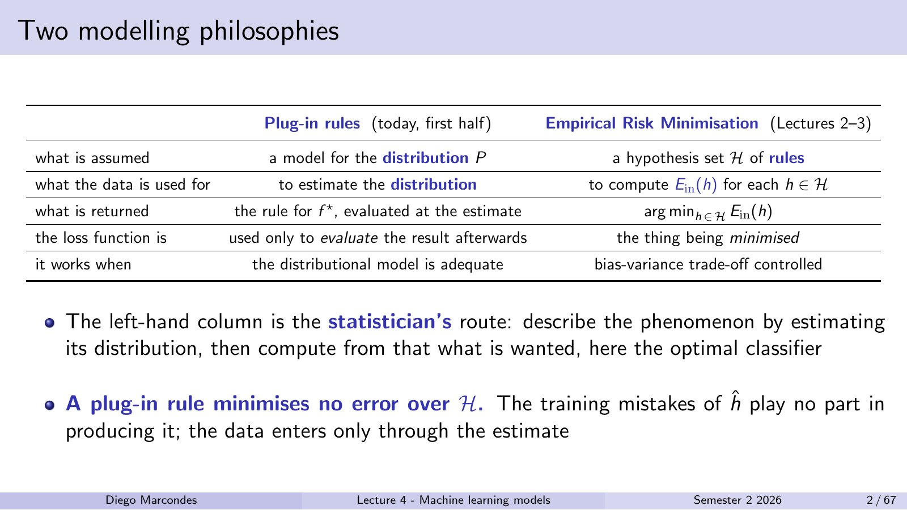

## 第 4 页：参数与非参数估计

参数方法用有限个数规定分布或条件概率的形状，若形状合适则容易估计；非参数方法通过局部平滑适应更灵活的形状，往往需要更多数据。非参数不等于没有假设，其局部性、平滑量及渐近条件仍很关键。

展开第 4 页原始 slide，核对图表、标注和公式

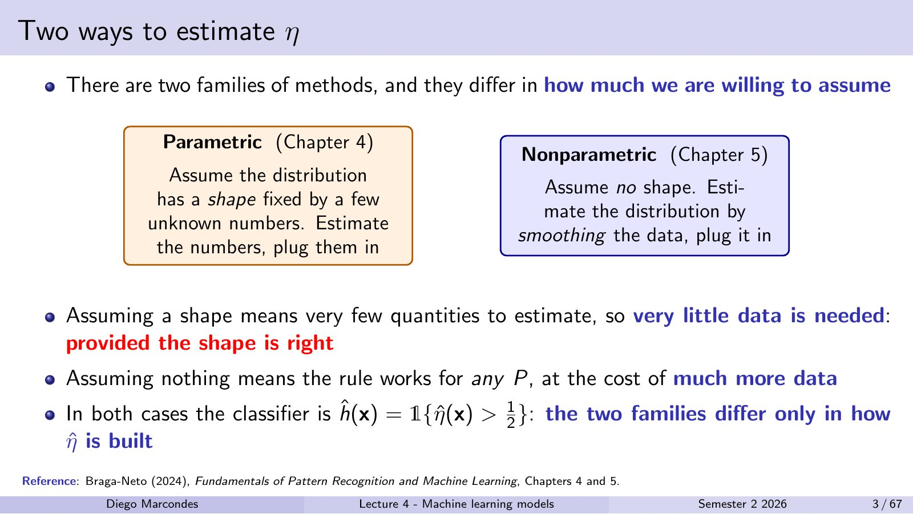

## 第 5 页：章节页：参数分类

先介绍最大似然，再用逻辑模型直接描述类别条件概率。

展开第 5 页原始 slide，核对图表、标注和公式

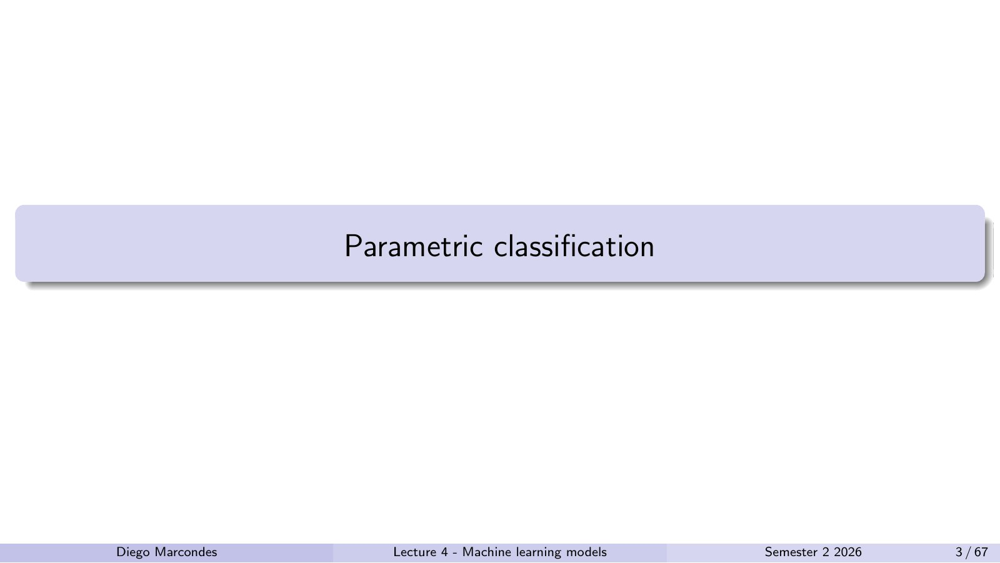

## 第 6 页：参数统计模型

模型族 $\{p(\cdot\mid\theta):\theta\in\Theta\subseteq\mathbb R^m\}$ 用有限维 $\theta$ 描述分布。Bernoulli 用一个成功概率，正态分布用均值与方差。方法是选族、估参数、代入最佳规则；族本身也可能选错。

展开第 6 页原始 slide，核对图表、标注和公式

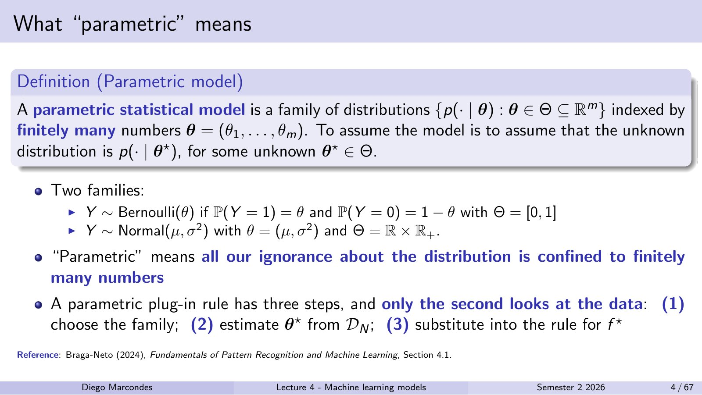

## 第 7 页：硬币参数估计的直觉

10 次抛掷有 7 次正面，观察到该计数的概率为 $\binom{10}{7}\theta^7(1-\theta)^3$。比较候选参数时，$\theta=0.7$ 让观测最可能；这不是说参数本身有 0.267 的概率，而是该参数下出现数据的概率。

展开第 7 页原始 slide，核对图表、标注和公式

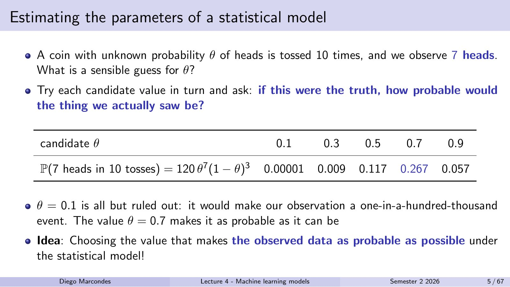

## 第 8 页：似然函数

独立同分布观测下，$\mathcal L(\theta)=\prod_{i=1}^Np(Z_i\mid\theta)$。把数据固定、让参数变化，就得到似然。它不是参数的概率分布，无需对参数积分为 1；乘积来自样本独立。

展开第 8 页原始 slide，核对图表、标注和公式

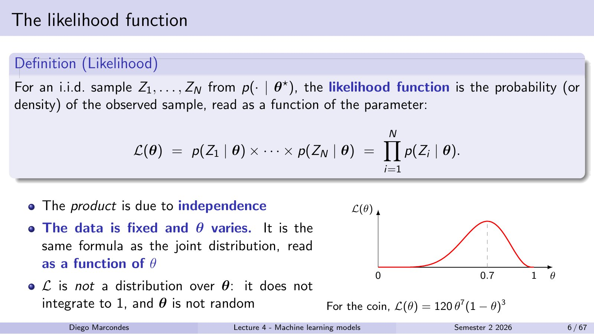

## 第 9 页：最大似然估计

$\hat\theta\in\arg\max_\theta\mathcal L(\theta)$。Bernoulli 的解是成功比例 $k/N$；正态模型给出

$$
\hat\mu=N^{-1}\sum_iZ_i,\qquad\hat\sigma^2=N^{-1}\sum_i(Z_i-\hat\mu)^2.
$$

这里方差 MLE 分母是 $N$，不同于常见无偏样本方差的 $N-1$。

展开第 9 页原始 slide，核对图表、标注和公式

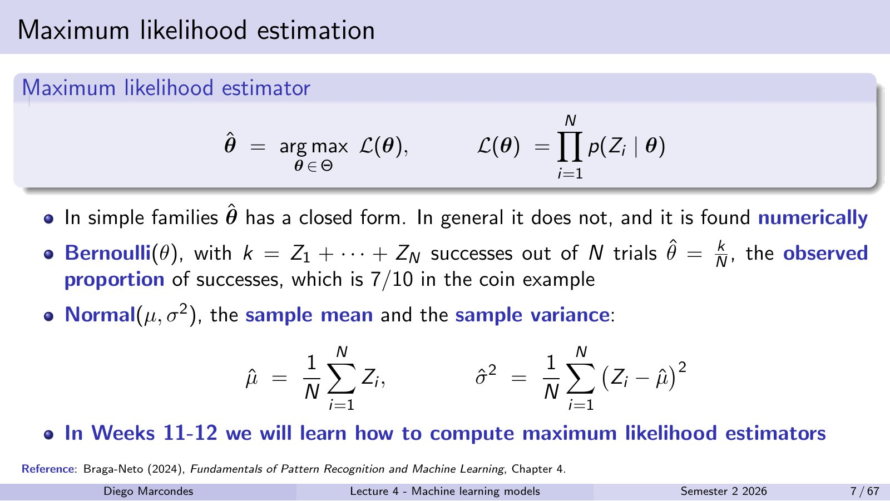

## 第 10 页：最大似然的保证与模型错误

模型正确且满足相应正则条件时，MLE 具有一致性及渐近效率等性质；模型错误时，只能逼近族内的某个最佳近似。**理解补充：**这些结论不是无条件成立；似然最大也不自动证明整个模型族适合现实。

展开第 10 页原始 slide，核对图表、标注和公式

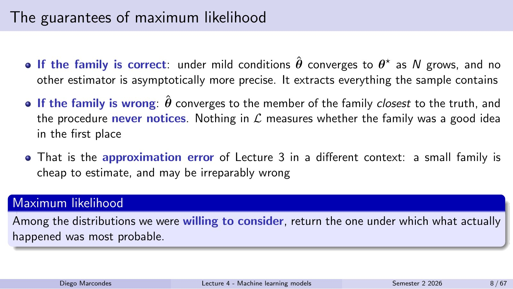

## 第 11 页：用线性 logit 建模概率

概率必须在 $[0,1]$，线性分数却可取任意实数。设

$$
\log\frac{\eta(x)}{1-\eta(x)}=w_0+w^Tx,\qquad\eta(x)=\frac1{1+e^{-(w_0+w^Tx)}}.
$$

logit 把 $(0,1)$ 映到实线，逆变换是 sigmoid。这里建模的是条件概率，无需先拟合全部特征联合分布。

展开第 11 页原始 slide，核对图表、标注和公式

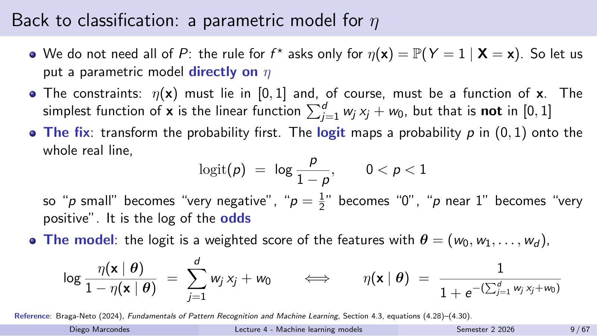

## 第 12 页：逻辑曲线

S 形曲线在分数为 0 时经过概率 $1/2$。其他条件固定时，权重符号决定相应特征让正类概率增加还是减少；幅度影响变化速率。一维不同斜率的曲线说明概率与线性分数的区别。

展开第 12 页原始 slide，核对图表、标注和公式

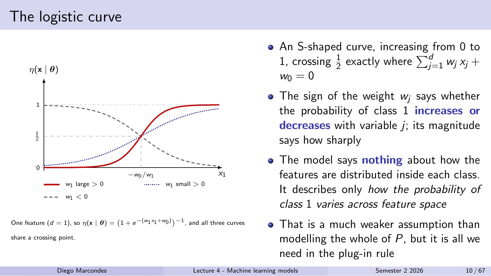

## 第 13 页：条件 Bernoulli 似然

给定输入，每个 $Y_i\in\{0,1\}$ 的正类概率为 $\eta_i=\eta(X_i\mid\theta)$。因此

$$
\mathcal L(\theta)=\prod_i\eta_i^{Y_i}(1-\eta_i)^{1-Y_i},\quad\log\mathcal L=\sum_i[Y_i\log\eta_i+(1-Y_i)\log(1-\eta_i)].
$$

对数把乘积变成求和，便于优化。

展开第 13 页原始 slide，核对图表、标注和公式

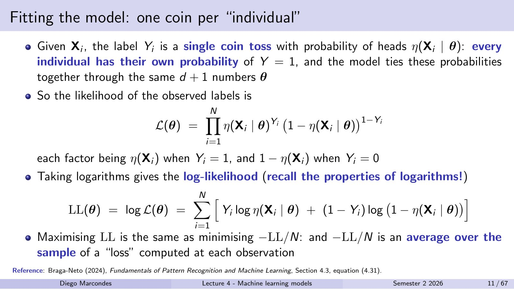

## 第 14 页：交叉熵损失

概率预测的二元交叉熵为

$$
\ell((x,y),\eta)=-y\log\eta(x)-(1-y)\log(1-\eta(x)).
$$

正确类别预测概率接近 1 时损失接近 0，接近 0 时损失趋于无穷。最大化逻辑模型似然，等价于最小化平均交叉熵。

展开第 14 页原始 slide，核对图表、标注和公式

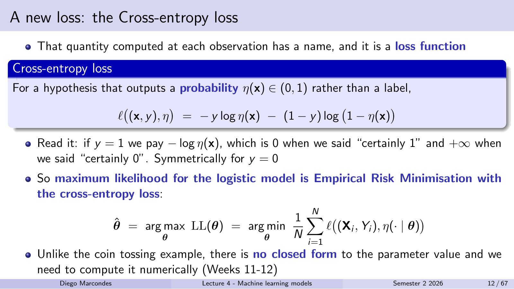

## 第 15 页：为什么引入替代损失

0–1 损失只看阈值后的类别，不能区分正确类别概率是 0.51 还是 0.99。交叉熵评价整份概率预测，并重罚自信但错误的概率。阈值化后 $\hat h(x)=\mathbf1\{\hat w_0+\hat w^Tx>0\}$；交叉熵在这里充当分类损失的替代目标。

展开第 15 页原始 slide，核对图表、标注和公式

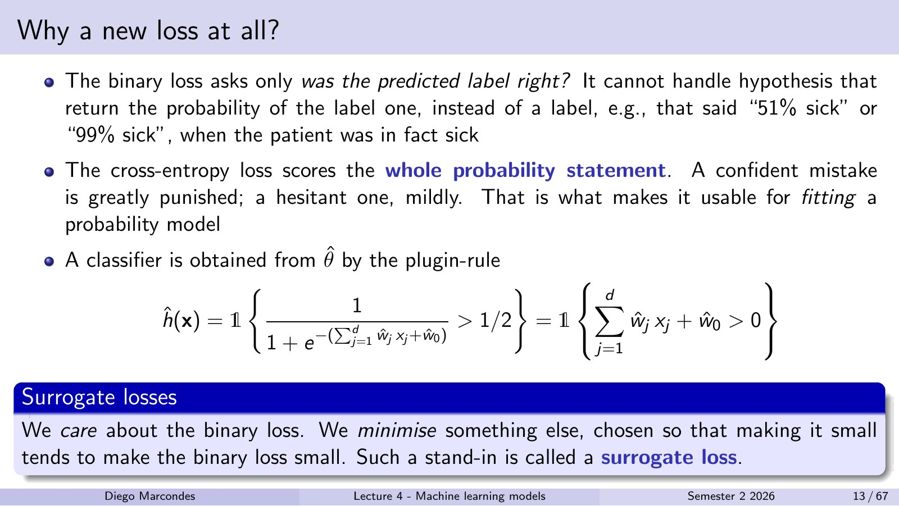

## 第 16 页：逻辑分类器仍有线性边界

sigmoid 虽非线性，但在 0.5 处阈值化等价于检查线性分数正负。因此分类边界仍是超平面，训练方式则与 PLA 不同。概率本身也有用，可表达预测的不确定程度。

展开第 16 页原始 slide，核对图表、标注和公式

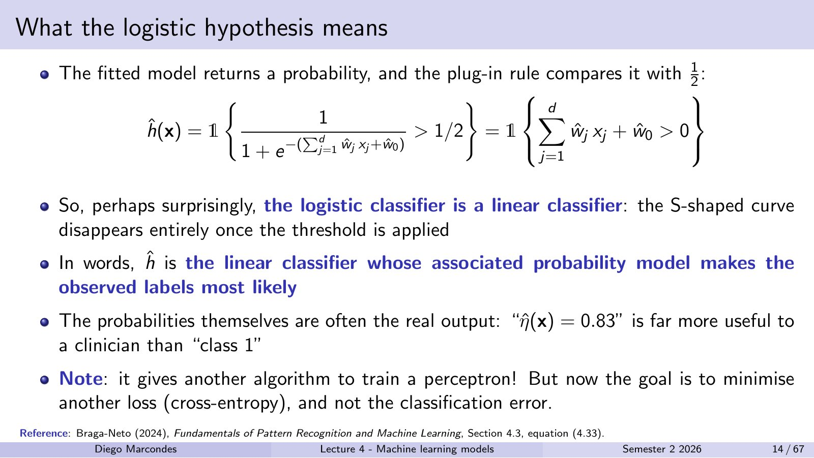

## 第 17 页：从概率族诱导假说集合

让逻辑模型参数遍历，就得到所有仿射线性二元分类器，即感知机形式的假说集合。概率建模和直接分类可导向相同边界族，却用不同训练准则；此处通过交叉熵拟合概率，而不是直接最小化 0–1 训练错误。

展开第 17 页原始 slide，核对图表、标注和公式

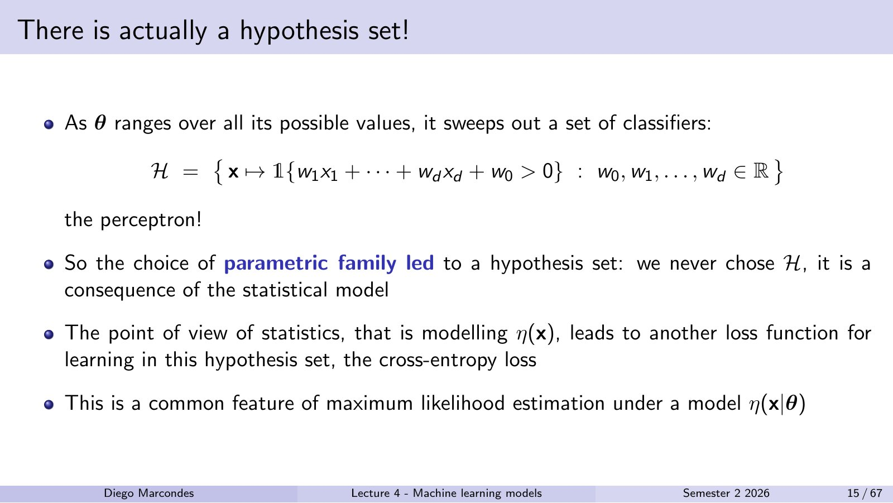

## 第 18 页：信用审批例子的参数与标签

本讲改用 $Y=1$ 表示违约、$Y=0$ 表示还款，与第一讲正负标签含义须分开。金额单位为 10,000 元，模型分数

$$
g(x)=1.20-0.60x_1-0.40x_2+1.00x_3,\qquad\hat\eta(x)=\frac1{1+e^{-g(x)}}.
$$

三特征依次是收入、工作年数和债务。

展开第 18 页原始 slide，核对图表、标注和公式

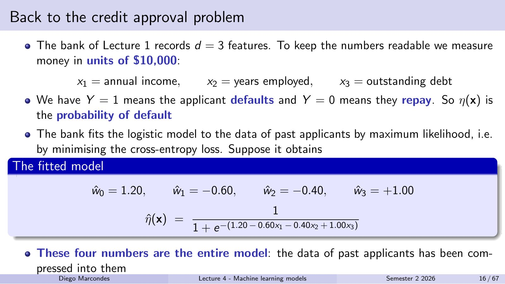

## 第 19 页：分数就是对数几率

由 sigmoid 公式可得 $1-\hat\eta=e^{-g}/(1+e^{-g})$，所以

$$
\frac{\hat\eta}{1-\hat\eta}=e^g,\qquad\log\frac{\hat\eta}{1-\hat\eta}=g.
$$

分数在线性地描述 log-odds，而不是概率本身；odds 与 probability 也不是同一个量。

展开第 19 页原始 slide，核对图表、标注和公式

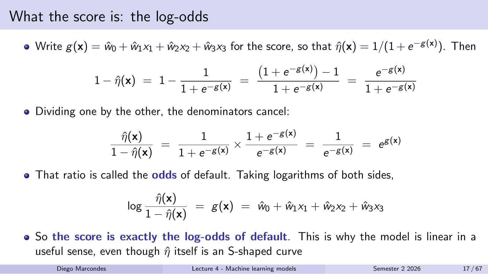

## 第 20 页：特征增加一单位的解释

其他特征固定时，第 $j$ 项加 1，使 odds 乘 $e^{w_j}$。收入增加 10,000，违约 odds 乘约 0.55；工龄加一年乘约 0.67；债务加 10,000 乘约 2.72。**理解补充：**这是条件统计关联，不自动具有因果解释；概率也不是乘同样倍数。

展开第 20 页原始 slide，核对图表、标注和公式

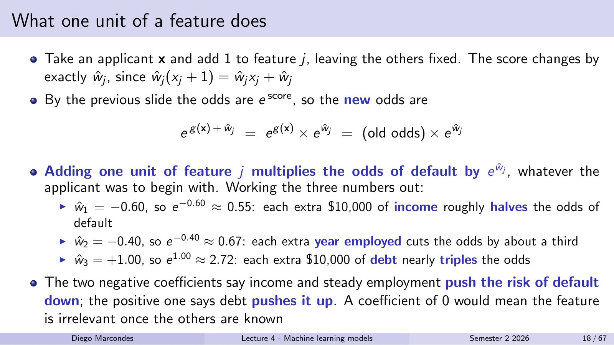

## 第 21 页：三位申请人的计算

Ana 的输入 $(5.2,5,0.32)$ 给出分数 $-3.60$、违约概率约 0.027；Ben 的 $(2.8,1,1.54)$ 给出 0.66、约 0.659；Cleo 的 $(3.4,2,1.5)$ 给出 $-0.14$、约 0.465。以 0.5 为阈值，依次批准、拒绝、批准。

展开第 21 页原始 slide，核对图表、标注和公式

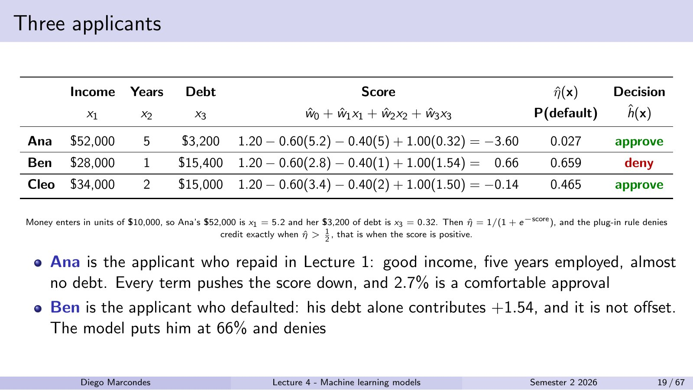

## 第 22 页：概率估计与业务决策阈值

Ana 和 Cleo 虽同获批准，违约概率差别很大。若违约损失远高于拒绝一位好客户的损失，可采用更低拒绝阈值；原页以 0.15 作示例。概率模型提供风险估计，阈值表达代价偏好，二者应区分。

展开第 22 页原始 slide，核对图表、标注和公式

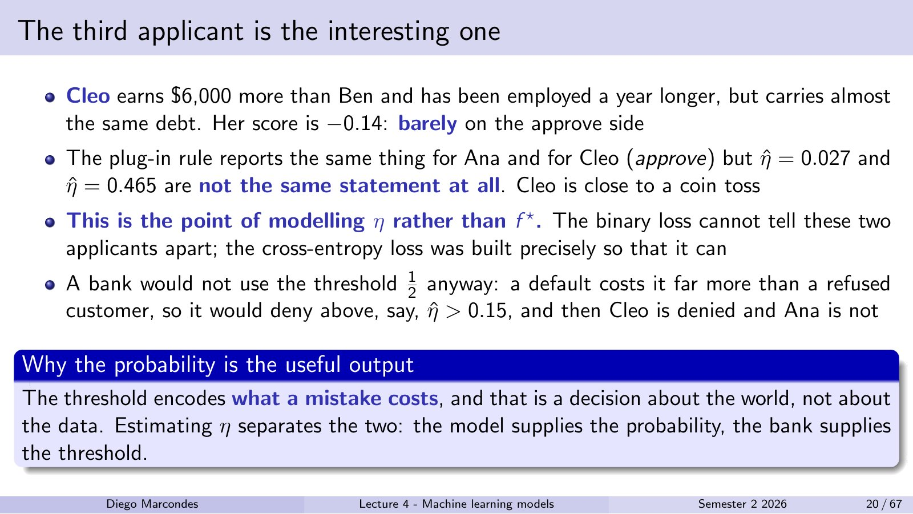

## 第 23 页：章节页：非参数分类

放松固定概率形状，用查询点附近的标签估计条件类别概率。

展开第 23 页原始 slide，核对图表、标注和公式

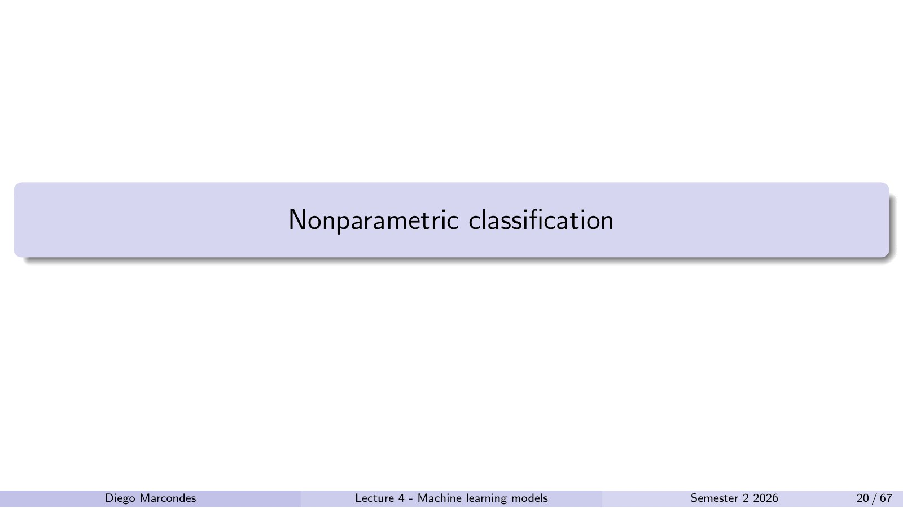

## 第 24 页：局部平滑替代固定形状

非参数方法不预设少量参数限定的全局形状，而是考察邻近点的类别比例。预测边界可更灵活，同时更容易受噪声和稀疏数据影响；每种方法都需要平滑参数决定“附近”有多大。

展开第 24 页原始 slide，核对图表、标注和公式

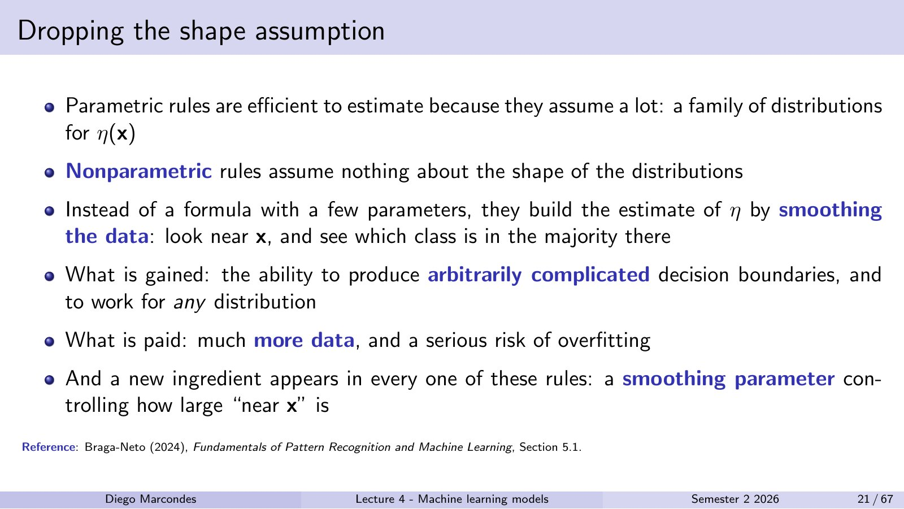

## 第 25 页：直方图密度估计

一维组宽为 $l$ 时，$\hat p(x)$ 等于所在箱内样本数除以 $Nl$。同一箱内为常数，边缘处跳变；很近的两点也可能落在不同箱。结果依赖箱宽和网格起点，还可能出现空箱。

展开第 25 页原始 slide，核对图表、标注和公式

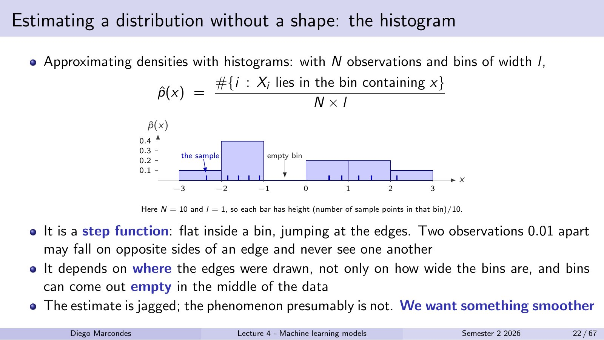

## 第 26 页：核密度估计

让每个观察贡献一个以自身为中心的小峰，再相加：

$$
\hat p(x)=\frac1{N\sigma^d}\sum_i\kappa\left(\frac{x-X_i}{\sigma}\right).
$$

$\kappa$ 决定峰形，$\sigma$ 决定带宽。作为密度估计时核须适当归一化；一维高斯核是常见例子。

展开第 26 页原始 slide，核对图表、标注和公式

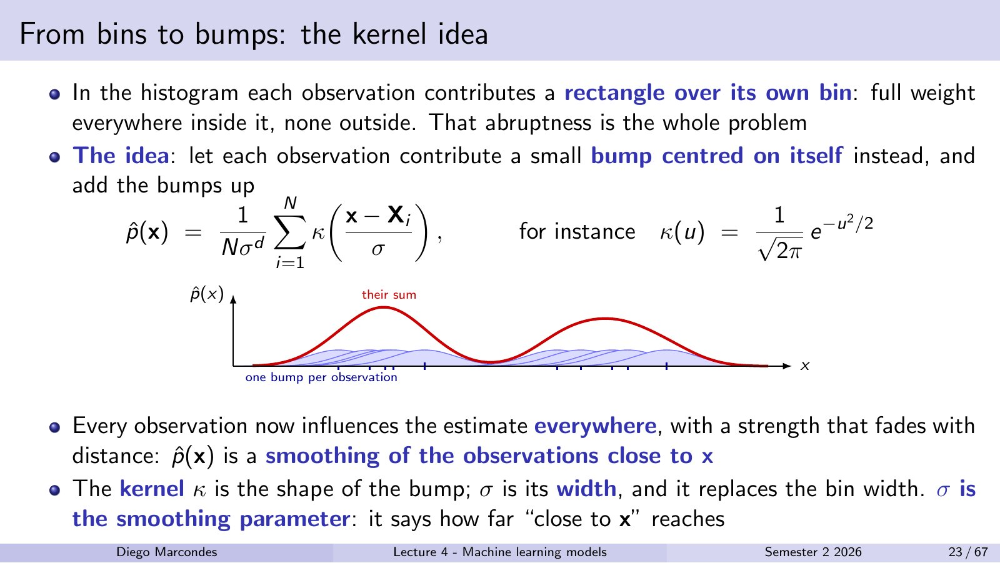

## 第 27 页：带宽太小与太大

图用同一数据对比 $\sigma=0.01,0.3,1$。小带宽为每个点产生尖峰，容易拟合样本噪声；大带宽把结构抹平。中间平滑程度较合适，但具体选择应依验证，而非只凭图形好看。

展开第 27 页原始 slide，核对图表、标注和公式

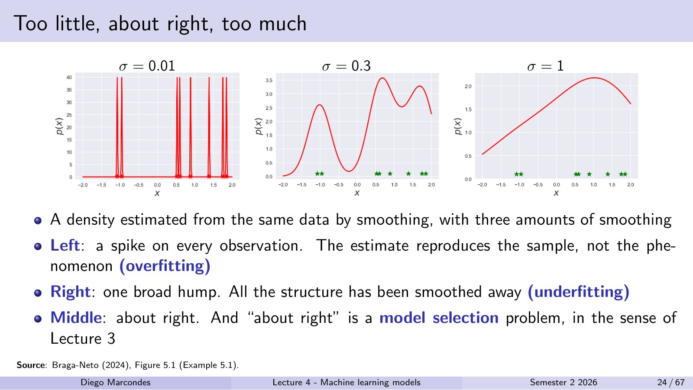

## 第 28 页：由联合密度得到条件概率估计

分别平滑两类的联合贡献 $\hat p_1,\hat p_0$，再取比例：

$$
\hat\eta(x)=\frac{\hat p_1(x)}{\hat p_1(x)+\hat p_0(x)}=\sum_iW_i(x)\mathbf1\{Y_i=1\}.
$$

$W_i$ 为核值除以全部核值之和；共同归一化因子抵消。这里估计的是局部标签比例。

展开第 28 页原始 slide，核对图表、标注和公式

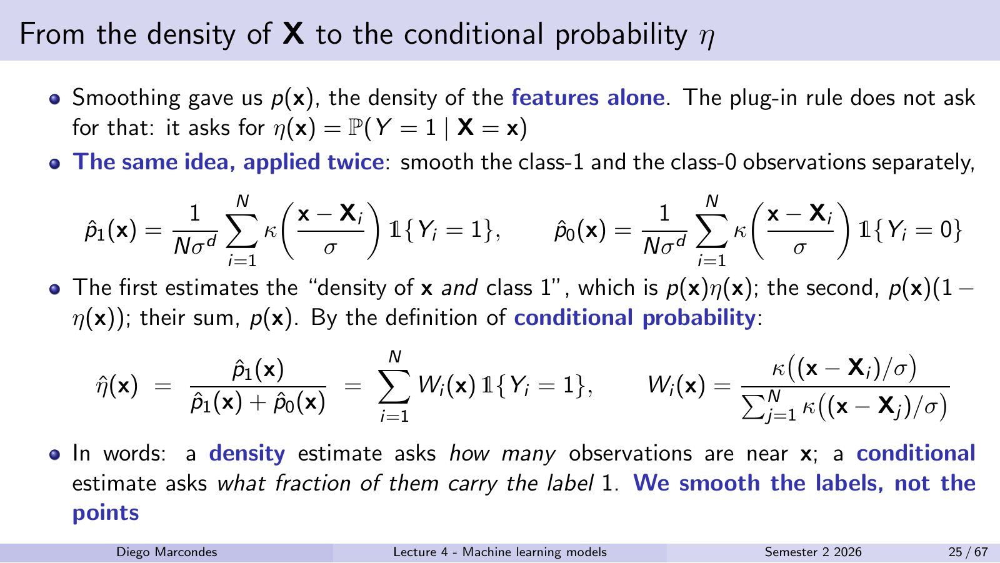

## 第 29 页：统一的加权投票形式

非参数分类可写为 $\hat\eta(x)=\sum_iW_i(x)\mathbf1\{Y_i=1\}$，要求 $W_i\ge0$、$\sum_iW_i=1$。大于一半就预测 1，否则预测 0。不同方法主要区别在谁有投票权、权重怎样决定。

展开第 29 页原始 slide，核对图表、标注和公式

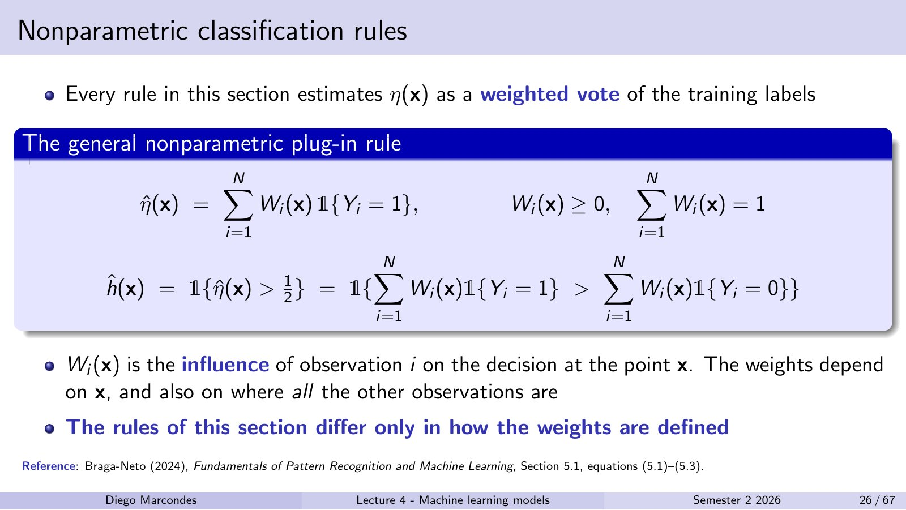

## 第 30 页：加权投票的图示

柱高表示训练点对查询 $x$ 的权重，近点通常较高。按类别堆叠后，正类总权重约 0.75，所以预测 1。移动查询点会改变全部权重；大量较远点在某些权重规则下也可能合力影响结果。

展开第 30 页原始 slide，核对图表、标注和公式

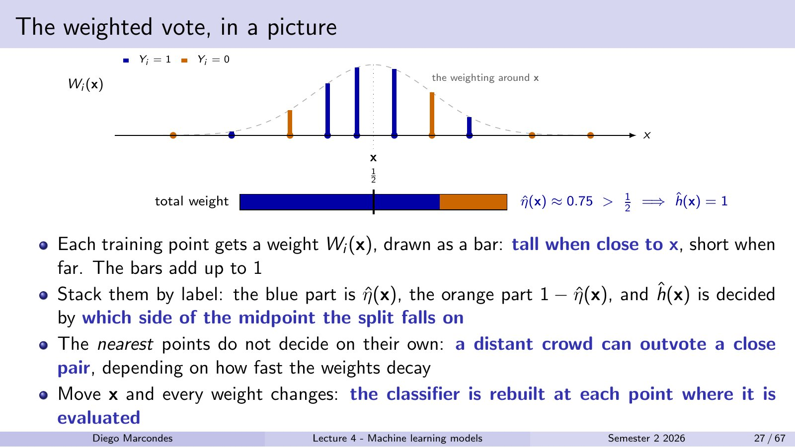

## 第 31 页：非参数方法仍有局部性假设

空间相近的点更可能同类，是局部方法的基础。特征量纲和无关变量会改变距离含义，高维中局部邻域也可能十分稀疏。非参数并不等于没有假设或无需预处理。

展开第 31 页原始 slide，核对图表、标注和公式

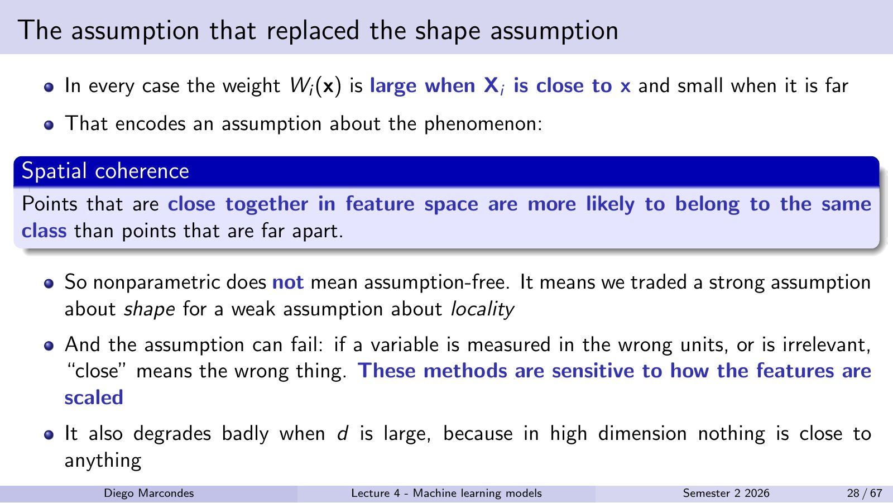

## 第 32 页：非参数规则的模型复杂度

对固定样本量，所有可能数据集能诱导一组输出分类器；随 $N$ 增加，这个家族也可变丰富。平滑参数控制有效复杂度。**理解补充：**更丰富不自动保证一致性，还要让邻域尺度与有效邻居数满足相应条件。

展开第 32 页原始 slide，核对图表、标注和公式

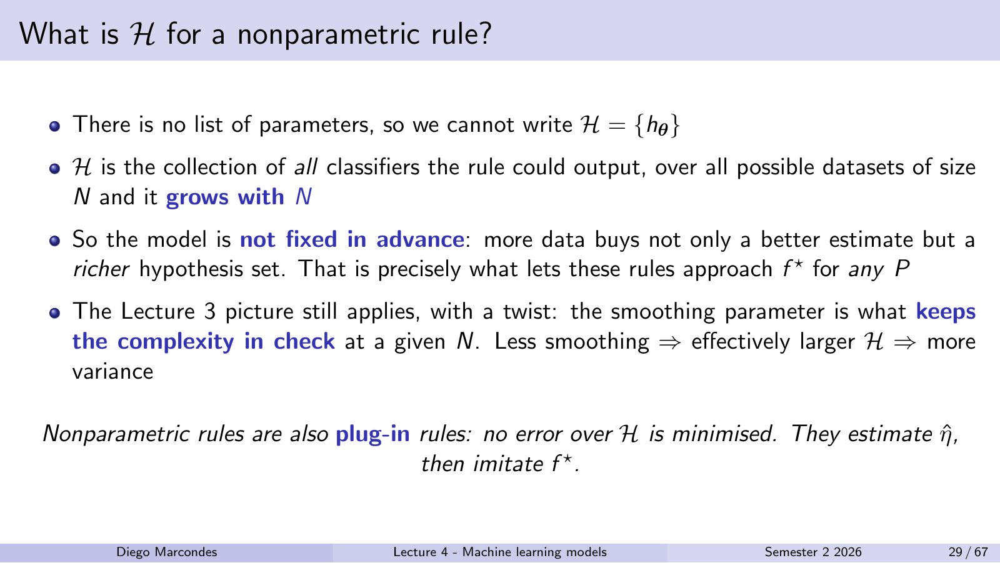

## 第 33 页：立方网格直方图分类

图对比边长 $l=0.5,1,2,3$：小格子样本少或为空，大格子无法描述精细边界。轴对齐网格对斜边界存在有限分辨率误差。**理解补充：**减小格宽并增加数据仍可逼近斜边界，不能把图理解为网格永远无法逼近它。

展开第 33 页原始 slide，核对图表、标注和公式

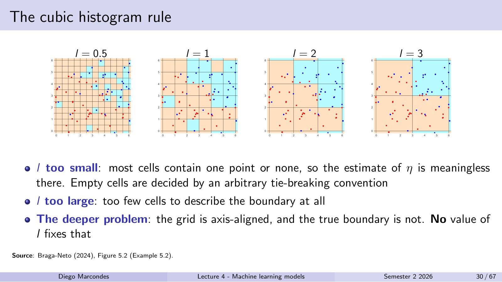

## 第 34 页：一般分区直方图分类

把空间划成不重叠且覆盖全部区域的单元。查询点所在单元为 $A(x)$，内部 $N(x)$ 个训练点等权投票，即 $W_i=1/N(x)$，单元外为 0。空单元需要另定规则；每个非空单元最终输出一个常数类别。

展开第 34 页原始 slide，核对图表、标注和公式

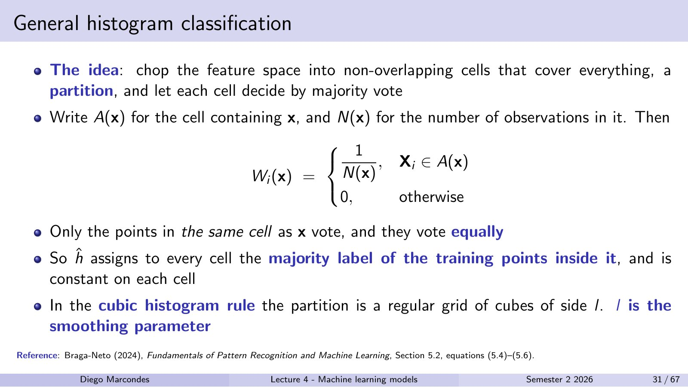

## 第 35 页：k 近邻分类

取离 $x$ 最近的 $k$ 个点，每个权重 $1/k$，其余为 0。邻域形状和大小随数据自适应；$k=1$ 直接复制最近标签，较小 $k$ 平滑较少。奇数 $k$ 可避免二元票数平局，但仍需处理距离并列等细节。

展开第 35 页原始 slide，核对图表、标注和公式

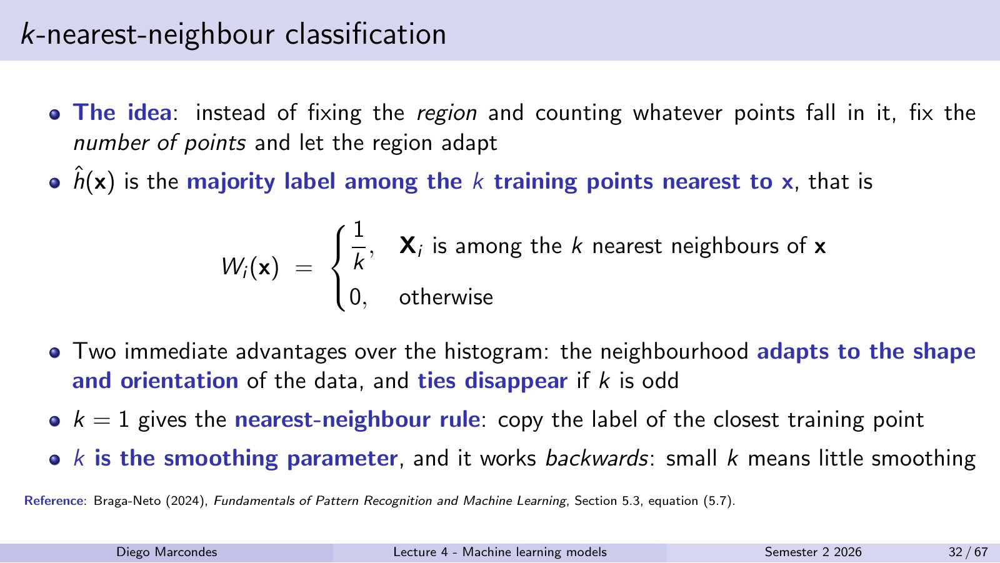

## 第 36 页：不同 k 的决策边界

图比较 $k=1,3,5,7$。1NN 容易围绕孤立点形成小岛，增大 $k$ 会更平滑；本例中 $k=5$ 已较接近理想边界。这里是特定数据的展示，不是普遍最优邻居数的结论。

展开第 36 页原始 slide，核对图表、标注和公式

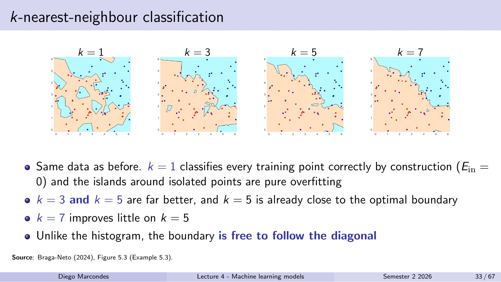

## 第 37 页：kNN 把训练数据保留为模型

预测时需要搜索邻居，训练主要是存储数据及可能建立索引。**理解补充：**1NN 在训练查询包含自身、无冲突重复输入时才有零训练错误；不是任意数据都成立。原页还介绍 Cover–Hart 的大样本错误保证，适用时需相应条件；$k$ 应用验证选择。

展开第 37 页原始 slide，核对图表、标注和公式

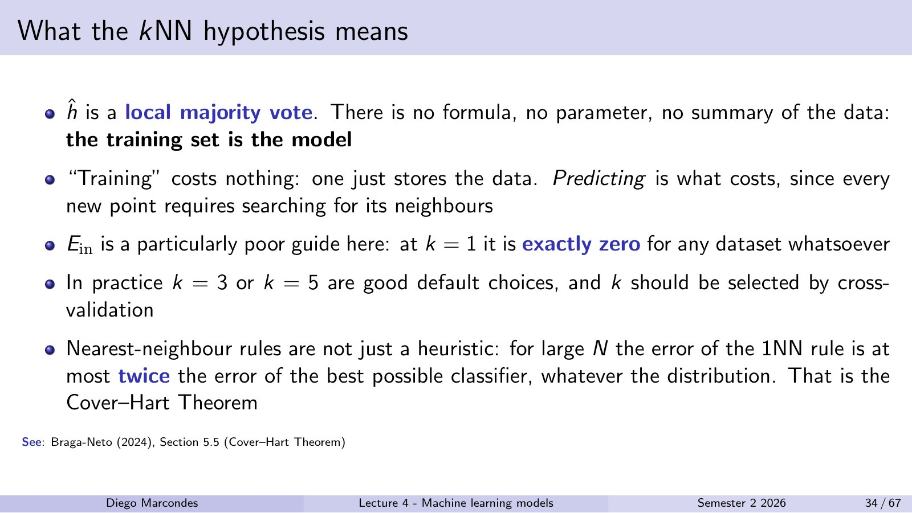

## 第 38 页：核分类的权重

令非负核衡量接近程度，

$$
W_i(x)=\frac{\kappa((x-X_i)/\sigma)}{\sum_j\kappa((x-X_j)/\sigma)}.
$$

分母使权重和为 1；带宽控制影响范围。紧支撑核只让有限邻域投票，需要处理分母为零；高斯核对所有有限距离给正权重。

展开第 38 页原始 slide，核对图表、标注和公式

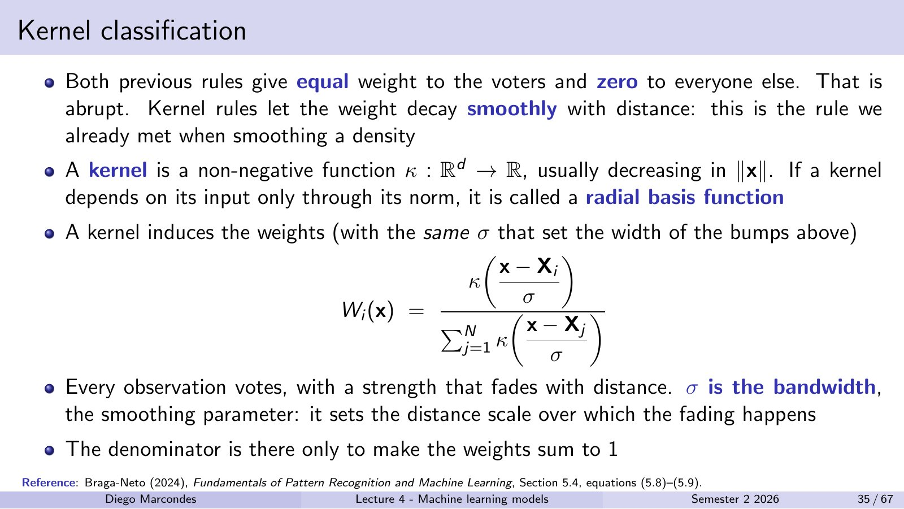

## 第 39 页：核函数例子

原页给出 Gaussian $e^{-\|u\|^2}$、Cauchy $(1+\|u\|^{d+1})^{-1}$、Uniform $\mathbf1\{\|u\|\le1\}$、Triangular $(1-\|u\|)\mathbf1\{\|u\|\le1\}$、Epanechnikov $(1-\|u\|^2)\mathbf1\{\|u\|\le1\}$。后三者有紧支撑；分类的归一化权重会抵消共同常数。

展开第 39 页原始 slide，核对图表、标注和公式

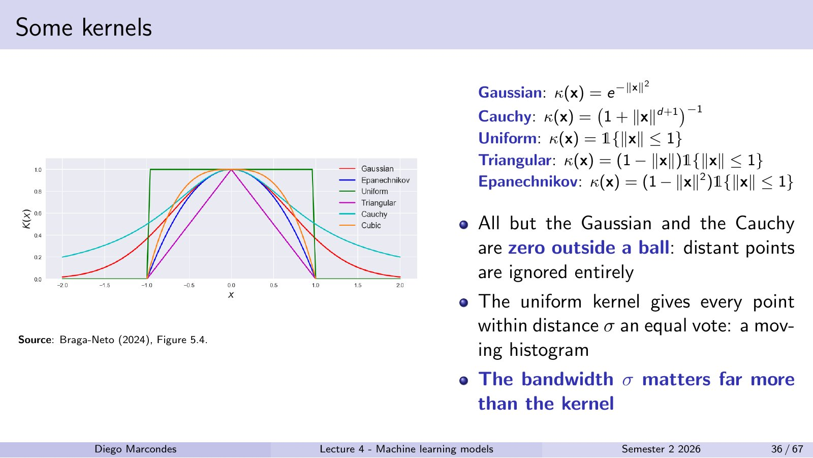

## 第 40 页：核分类的带宽图

高斯带宽为 $0.1,0.3,0.5,1$ 时，边界从局部碎片逐渐变平滑。非常小时最近点可能压过其他点，近似 1NN；过大则远处观察影响过强。图展示的是同一份数据上的平滑程度变化。

展开第 40 页原始 slide，核对图表、标注和公式

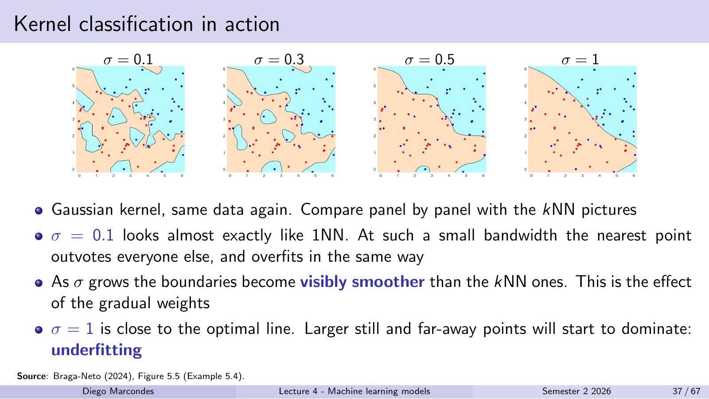

## 第 41 页：三类非参数规则对照

直方图由同一格内点等权投票，参数是格宽；kNN 由最近 $k$ 点等权投票，参数是 $k$；核方法按距离赋权，参数是带宽。三者都是条件概率的局部估计后再阈值分类，平滑量应用验证或交叉验证选择。

展开第 41 页原始 slide，核对图表、标注和公式

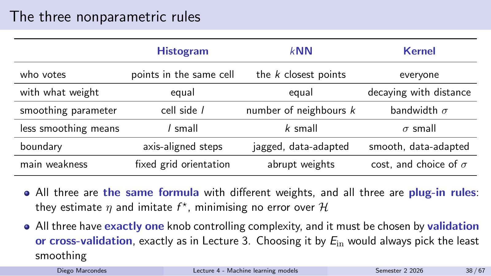

## 第 42 页：章节页：决策树与随机森林

从固定网格转向数据驱动分区，再通过多棵树集成缓解单树的不稳定。

展开第 42 页原始 slide，核对图表、标注和公式

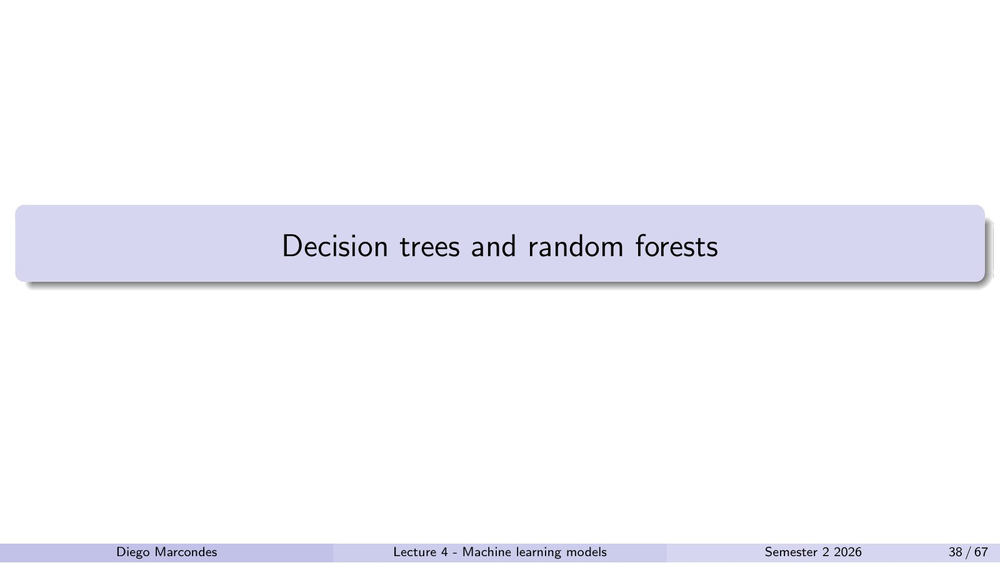

## 第 43 页：树与其空间划分

XOR 图通过三个分裂节点得到四个叶子区域。路径上的条件作“且”，属于同一类的多个叶子作“或”。例中类别 1 对应两个坐标同时非正或同时为正，说明树可表达单条直线无法表达的规则。

展开第 43 页原始 slide，核对图表、标注和公式

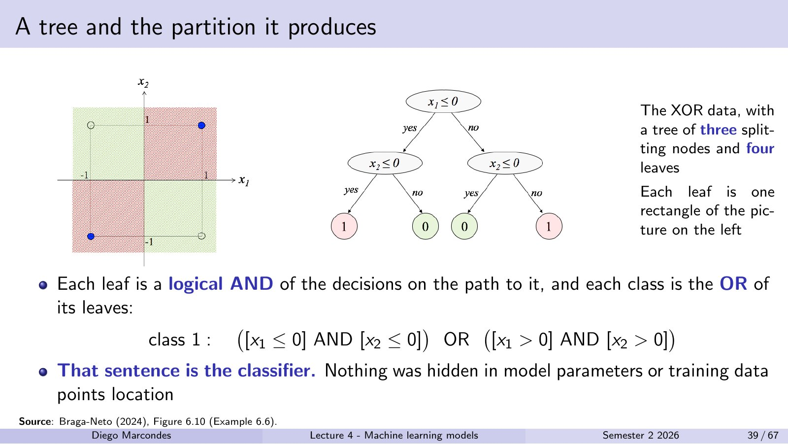

## 第 44 页：二元问题构成树

内部节点询问阈值条件，叶子给类别，根是起始节点，深度是最长路径的问题数。叶子区域构成空间分区。树可将预测读成条件规则，分区由数据与贪心准则决定，并非必须先拟合概率分布。

展开第 44 页原始 slide，核对图表、标注和公式

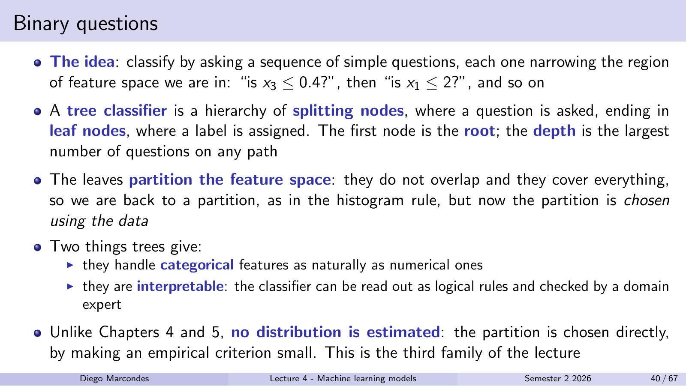

## 第 45 页：CART 的假说形式与约束

每次分裂问 $x_j\le\alpha$，所以叶子区域为轴对齐矩形或高维盒子。深度无限容易记忆训练点，须用深度、叶数、最小叶样本数等限制复杂度。**理解补充：**若相同输入带相反标签，单靠分裂无法将它们分开，不能无条件保证零训练错误。

展开第 45 页原始 slide，核对图表、标注和公式

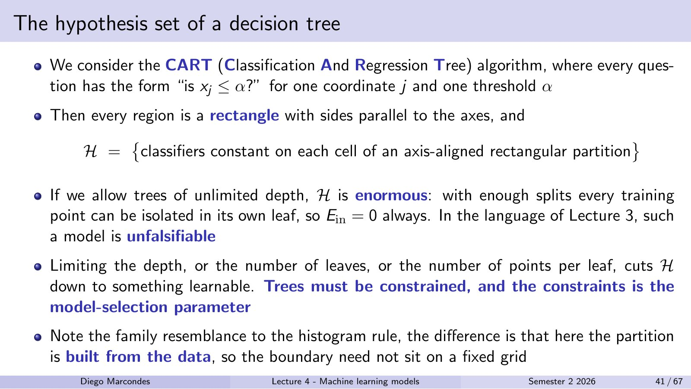

## 第 46 页：区域不纯度

设区域内正类比例 $p$，不纯度在 $p=0,1$ 为零，在 $1/2$ 最大。常见形式：熵 $-p\log p-(1-p)\log(1-p)$、Gini $2p(1-p)$、误分类不纯度 $\min(p,1-p)$。它评价一组点的混合程度，不是直接逐点预测损失。

展开第 46 页原始 slide，核对图表、标注和公式

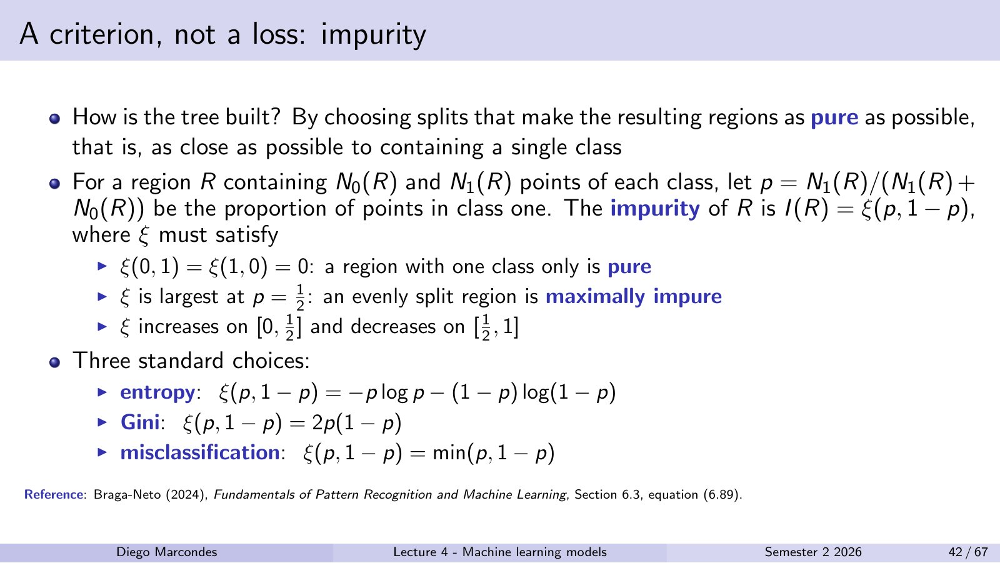

## 第 47 页：三种不纯度曲线

图展示三条曲线均在两端为零、中间最大。误分类不纯度等于区域内采用多数类的错误比例；熵和 Gini 对比例变化往往更敏感，因此某些不改变多数类的分裂仍可得到明显奖励。

展开第 47 页原始 slide，核对图表、标注和公式

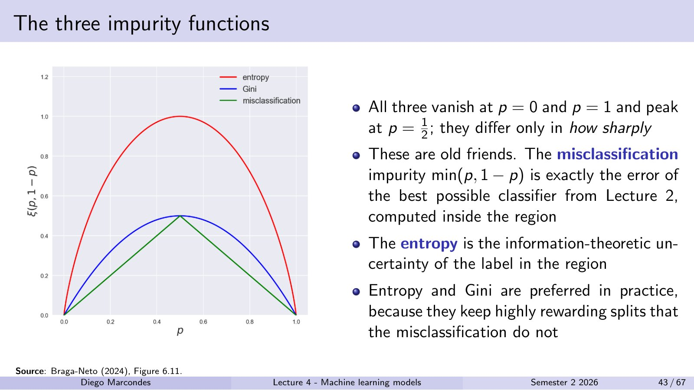

## 第 48 页：贪心生长与加权不纯度下降

对候选左右子区，选择使

$$
\Delta=I(R)-\frac{N_-}{N}I(R_-)-\frac{N_+}{N}I(R_+)
$$

最大的分裂，再递归。必须按子区人数加权。局部选最佳分裂不保证最后得到整个树空间中的全局最优树，因此不能把 CART 贪心过程直接等同完整 ERM。

展开第 48 页原始 slide，核对图表、标注和公式

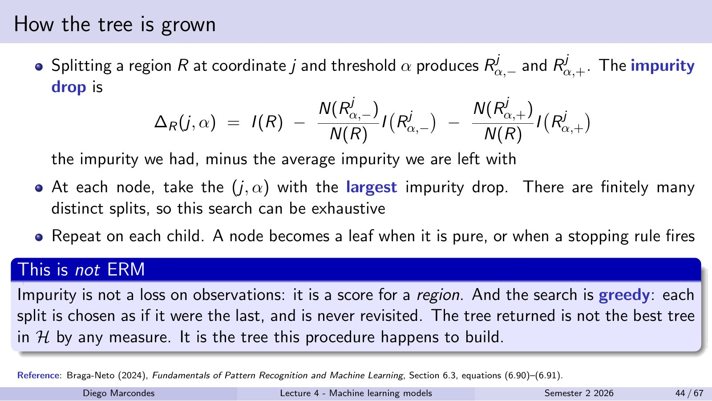

## 第 49 页：十二个点的手算例

二维数据有 12 个观察，正类 5、负类 7；用 Gini，并要求每个子节点至少 $s=2$ 点。候选阈值取相邻已观察特征值的中点，例如第一坐标为 $0.5,1.5,3,5$。图显示数据不能由一条直线很好分开。

展开第 49 页原始 slide，核对图表、标注和公式

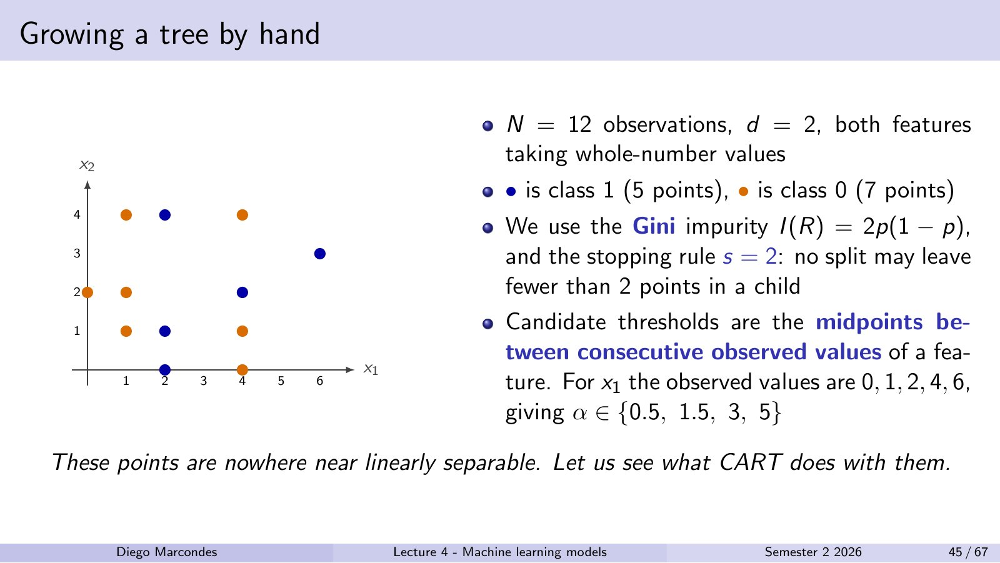

## 第 50 页：根节点的分裂计算

根的不纯度为 $2(5/12)(7/12)=35/72\approx0.486$。候选 $x_1\le1.5$ 把 4 个纯负类点分到左侧，右侧 8 点的 Gini 为 $15/32$，下降

$$
35/72-(8/12)(15/32)=25/144\approx0.174.
$$

只有 1 点的子区违反 $s=2$，不可选。

展开第 50 页原始 slide，核对图表、标注和公式

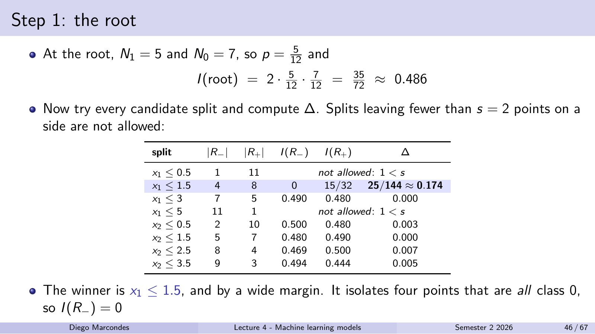

## 第 51 页：第一次分裂的图示

$x_1\le1.5$ 左边四个点全为类别 0，立即成为叶子；右边剩 5 个正类、3 个负类，继续递归。图把纯净左区与仍混合的右区分开，解释根节点为何选这个阈值。

展开第 51 页原始 slide，核对图表、标注和公式

## 第 52 页：第二、第三次分裂

在右区按 $x_1\le3$ 切出三个 $x_1=2$ 的正类点，下降 $27/160\approx0.169$。余下五点再按 $x_2\le1.5$ 切出 $(4,0),(4,1)$ 两个负类，下降 $16/75\approx0.213$；最后剩三个混合点。

展开第 52 页原始 slide，核对图表、标注和公式

## 第 53 页：停止规则保留一个训练错误

最后节点有三点，任一切分会产生只有一点的子区，违反 $s=2$。因此以多数正类作叶标签，把 $(4,4)$ 错分，训练误差为 $1/12$。减小到 $s=1$ 可继续拟合，但是否泛化更好须由验证决定。

展开第 53 页原始 slide，核对图表、标注和公式

## 第 54 页：最终树与分区

树依次问 $x_1\le1.5$、$x_1\le3$、$x_2\le1.5$，共三个分裂、四个叶子。规则是：第一坐标小预测 0，中等预测 1，较大时第二坐标小预测 0，否则预测 1。图圈出唯一训练错点。

展开第 54 页原始 slide，核对图表、标注和公式

## 第 55 页：单树的过拟合图

图对比 $s=20,8,4,1$，叶样本限制放松后分区越来越细，可能追逐孤立点。可用最小叶样本、深度、叶数或剪枝控制。**理解补充：**原页对“完全长树”的劝诫针对单树过拟合；下一节随机森林恰会集成很深的树，不能把它当绝对禁令。

展开第 55 页原始 slide，核对图表、标注和公式

## 第 56 页：树的优势与不稳定性

树给出可读规则，不依赖欧氏距离缩放，每次只比较一个特征。轴对齐边界表示斜线时可能需要很多台阶，早期分裂的微小变化也会影响整棵子树。**理解补充：**能在分裂时忽略无关特征，不保证有限样本中永远不会错误选择它们。

展开第 56 页原始 slide，核对图表、标注和公式

## 第 57 页：Bootstrap 与 bagging

从原样本有放回抽取 $N$ 次形成一份重采样，重复 $B$ 次训练多个规则，分类时多数投票。重复样本和缺席样本使各树不同。**理解补充：**集成通常降低方差，幅度取决于各成员相关性；偏差也不保证严格不变。

展开第 57 页原始 slide，核对图表、标注和公式

## 第 58 页：随机森林

每棵树使用 bootstrap 样本，每个分裂再随机限制可选特征，最后投票。两种随机性降低树之间的相似程度，使平均更有效。深树提供灵活性，集成缓解方差，但不保证任何数据下都不会过拟合；整体也比单树难解释。

展开第 58 页原始 slide，核对图表、标注和公式

## 第 59 页：十二点例子的三份重采样

每份仍抽 12 次，但只有约 7–9 个不同点，有些点重复多次，有些完全缺席。表中不同重采样和随机候选特征导致根节点不同：有的从 $x_1\le1.5$ 开始，有的从 $x_2\le3.5$ 开始。

展开第 59 页原始 slide，核对图表、标注和公式

## 第 60 页：投票怎样修正单树错误

原页展示三棵示例树都把 $(4,4)$ 判成正确的 0，而先前受叶样本约束的单树判错。这个例子说明重采样可打破某个局部偶然结构；并不能只凭修正一个训练点证明森林的总体风险更低，实际收益应在独立数据上检验。

展开第 60 页原始 slide，核对图表、标注和公式

## 第 61 页：章节页：回归

输出从离散类别变为数值，条件概率多数投票对应改为条件均值估计和平方损失。

展开第 61 页原始 slide，核对图表、标注和公式

## 第 62 页：回归目标与信号加噪声表示

平方损失下 $f^\star(x)=\mathbb E[Y\mid X=x]$，最优风险是 $\mathbb E[\operatorname{Var}(Y\mid X)]$。定义 $\varepsilon=Y-f^\star(X)$，便有 $Y=f^\star(X)+\varepsilon$ 且 $\mathbb E[\varepsilon\mid X]=0$。这一定义不额外要求噪声独立或同方差。

展开第 62 页原始 slide，核对图表、标注和公式

## 第 63 页：噪声水平决定可达表现

同一 $\sin x$ 趋势在低噪声和高噪声下，观察散布不同。高噪声时即使知道最佳均值函数，单个结果仍难预测。评价模型应结合不可约误差下限，不能把全部剩余波动都归咎于训练不足。

展开第 63 页原始 slide，核对图表、标注和公式

## 第 64 页：参数回归与最小二乘

设 $Y=h(X;\theta)+\varepsilon$，残差为 $Y_i-h(X_i;\theta)$。最小二乘最小化残差平方和

$$
\mathrm{RSS}(\theta)=\sum_i[Y_i-h(X_i;\theta)]^2.
$$

除以 $N$ 就是平方损失的经验风险，因此最小二乘本身是 ERM。

展开第 64 页原始 slide，核对图表、标注和公式

## 第 65 页：线性是对参数而言

一般形式 $h(x;\theta)=\sum_{j=0}^k\theta_j\phi_j(x)$ 对未知系数线性，但基函数可为幂、对数、正弦或交互项。多项式回归虽然关于输入弯曲，仍是线性参数模型；次数控制复杂度。

展开第 65 页原始 slide，核对图表、标注和公式

## 第 66 页：钢合金的线性回归例子

图分别用铁含量与镍含量预测层错能，拟合斜率一负一正，可与材料学知识对照。散点围绕趋势有明显波动，线条概括平均关联，不是对每块合金都准确的确定关系。

展开第 66 页原始 slide，核对图表、标注和公式

## 第 67 页：局部加权回归

Nadaraya–Watson 估计为

$$
\hat h(x)=\frac{\sum_i\kappa((x-X_i)/\sigma)Y_i}{\sum_i\kappa((x-X_i)/\sigma)}=\sum_iW_i(x)Y_i.
$$

与核分类使用相同权重，改为平均数值输出。kNN 回归则平均最近 $k$ 个输出，带宽或邻居数仍控制平滑。

展开第 67 页原始 slide，核对图表、标注和公式

## 第 68 页：局部平均的图示

在查询点放置一个核形权重窗，按权重平均周围输出，再移动查询点形成曲线。数据稀疏区域往往只有少数点承担大权重，估计较不稳定。模型依赖训练数据，难以压缩成少数可解释的全局系数。

展开第 68 页原始 slide，核对图表、标注和公式

## 第 69 页：回归树与回归森林

叶子输出区域内平均值，分裂比较两子区的残差平方和。树的轴对齐递归结构不变，预测为分段常数；更深会更灵活，也可能追噪声。回归森林把多棵树的数值预测平均，分类森林则投票。

展开第 69 页原始 slide，核对图表、标注和公式

## 第 70 页：章节页：为什么需要线性代数与微积分

许多方法最后都要求计算某个最优参数或分裂。后续数学内容服务于理解并实现这些优化，而不是脱离模型孤立学习公式。

展开第 70 页原始 slide，核对图表、标注和公式

## 第 71 页：目前进度与下一步

前两讲建立统计框架和泛化理论，本讲给出可用模型、训练准则及复杂度控制量。尚需解决如何实际计算最小值：交叉熵、残差平方和等将引向线性代数、微积分和优化。

展开第 71 页原始 slide，核对图表、标注和公式

## 第 72 页：本讲要点

参数方法选形状并估计有限参数；非参数方法用局部平滑；树方法贪心构造分区，森林通过集成降低不稳定性。**理解补充：**原页称 plug-in“不最小化误差”，指代入决策步骤不直接最小化 0–1 风险，不能否认概率估计可优化交叉熵。区域不纯度也应与逐观察损失区分。

展开第 72 页原始 slide，核对图表、标注和公式

## 第 73 页：参考文献

主要参考 Braga-Neto《Fundamentals of Pattern Recognition and Machine Learning》第 4、5、6、11 章，另列《Learning from Data》《A Probabilistic Theory of Pattern Recognition》和《The Elements of Statistical Learning》。原页图表来源已随原图保留，本笔记未额外引入书中未展示的推导。

展开第 73 页原始 slide，核对图表、标注和公式

