# Lecture 05B：向量、距离与聚类，按幻灯片逐页复述

来源：[lecture05b.pdf](../../comp3670_lectures/lecture05b.pdf)，共 42 个 PDF 页面。严格按 PDF 页序组织，章节页、例题续页和证明留白页也单独保留。默认向量为列向量；数据矩阵中的每一行通常是一个数据点的转置。正文用中文讲解概念、公式和图表；原页未写出的解答或推导明确标为“理解补充”。每节末尾可展开完整原始 slide 核对颜色、标注和排版。图片和 PDF 均使用仓库相对路径，适合本地预览与 GitHub。

## 第 1 页：课程与主题：向量、距离和聚类

这是 COMP3670/6670《Introduction to Machine Learning》第 5b 周，英文主题为 Vectors, Distance and Clustering。讲师是 ANU School of Computing 的 Senior Lecturer Yun Kuen Cheung（Marco）。本讲把歌曲、词语、图像变成向量，再用距离把相近的数据分组。

展开第 1 页原始 slide，核对图表、标注和公式

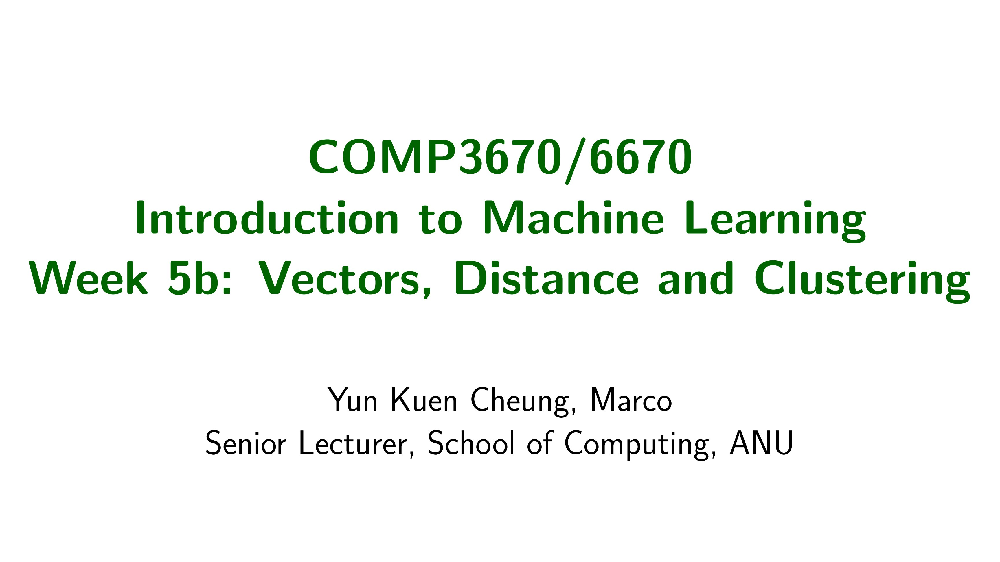

## 第 2 页：学习目标

本讲的五个目标依次是：把歌曲、词语、图像表示为向量；完成基本向量运算并测量距离；用质心代表一组数据；理解 K-Means 及其终止原因；通过 linkage 规则和 dendrogram（树状图）比较层次聚类。

展开第 2 页原始 slide，核对图表、标注和公式

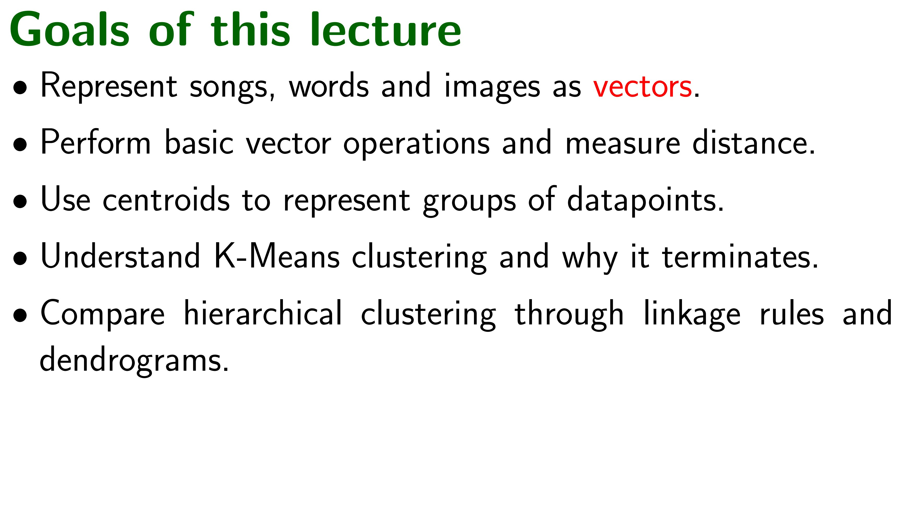

## 第 3 页：章节页：向量描述数据点

这一节先回答“算法究竟怎样看到一首歌、一个词或一张图片”，再引入向量的正式定义。

展开第 3 页原始 slide，核对图表、标注和公式

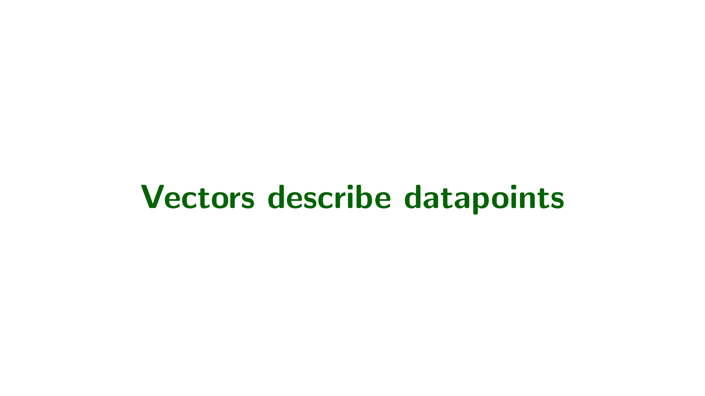

## 第 4 页：为什么需要数值表示

计算机擅长处理数字，而词语、歌曲、图像没有天然统一的数值形式。机器学习需要选择一种数值表示，保留对当前任务有用的信息，再把选出的数排成向量。线性代数提供操作这些向量的工具。表示的选择决定哪些信息进入后面的算法。

展开第 4 页原始 slide，核对图表、标注和公式

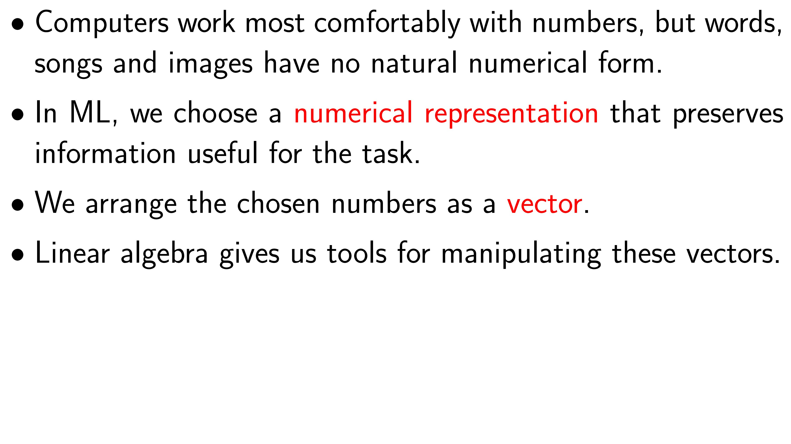

## 第 5 页：例 1：同一首歌可以有不同表示

如果任务与音乐风格有关，可以用 danceability（舞蹈性）、energy（能量）、acoustic score（原声程度）三个特征：$x_{\mathrm{genre}}=(0.8,0.7,0.1)^T$。如果任务是预测用户参与度，同一首歌可以改用 listens、likes、dislikes、comments，得到 $x_{\mathrm{engagement}}=(34689,2026,721,852)^T$。

每个坐标对应哪个含义、坐标按什么顺序排列，都是表示的一部分。同一对象在不同任务下不必使用同一个向量。

展开第 5 页原始 slide，核对图表、标注和公式

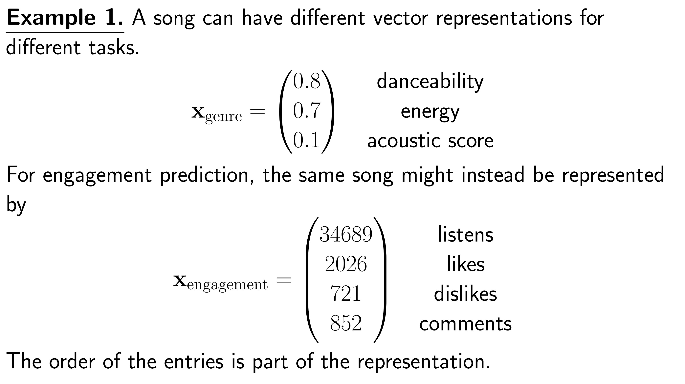

## 第 6 页：例 2：词向量不一定有可命名的坐标

课件给出以下四维词向量；每一维可以没有自然语言解释：

| 单词 | 向量的转置 |
| --- | --- |
| cat | $(0.3,-0.8,0.9,0.1)$ |
| dog | $(0.4,-0.8,0.9,-0.1)$ |
| bird | $(-0.9,-0.7,1.0,0.1)$ |
| fly | $(-0.8,-0.1,0.9,-0.2)$ |
| car | $(0.5,0.1,-0.1,0.2)$ |

cat 和 dog 意思相近，所以向量应相近。bird 与 fly 有关联，但“鸟”与“飞”不是相同含义，表示应体现关联，而不要求二者非常接近。cat 和 car 拼写相近却意义不同，因此向量可以显著不同。这里要保留的是任务相关的语义，而不只是拼写。

展开第 6 页原始 slide，核对图表、标注和公式

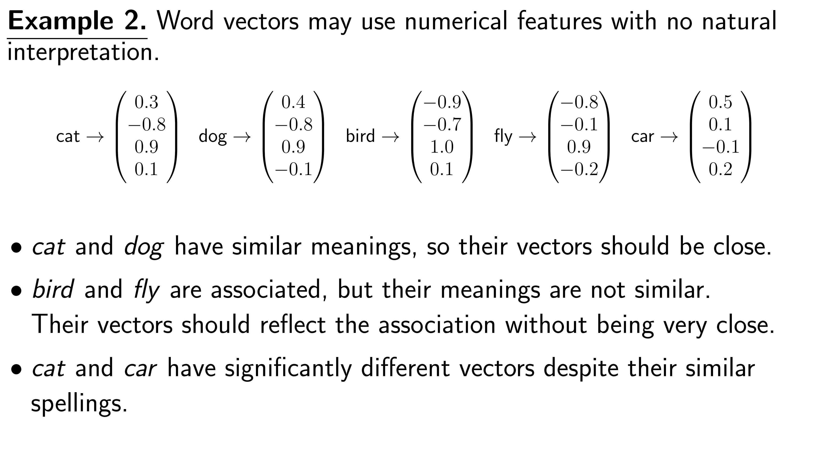

## 第 7 页：向量、坐标、维度与行列约定

一个 $d$ 维向量是 $d$ 个实数组成的一列：$x=(x_1,x_2,\ldots,x_d)^T\in\mathbb R^d$。$x_j$ 是第 $j$ 个坐标，$d$ 是表示的维度。行向量则横着写成 $(x_1\ x_2\ \cdots\ x_d)$。除非特别声明，本讲所说的“向量”默认指列向量。

展开第 7 页原始 slide，核对图表、标注和公式

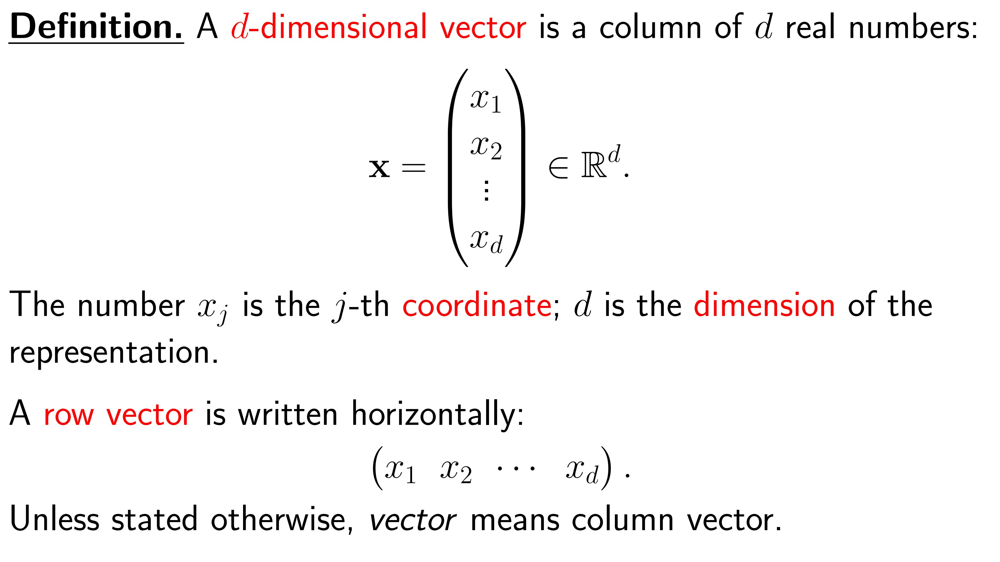

## 第 8 页：例 3：MNIST 图像变成 784 维向量

MNIST 的一个数据点是一张 $28\times28$ 灰度图，原页用手写数字 5 示意。按固定顺序列出全部像素强度，就得到 $x=(x_1,\ldots,x_{784})^T\in\mathbb R^{784}$。顺序必须固定，才可以比较不同图片的相应像素。784 维看起来很多，但现代机器学习数据常有几千甚至几百万维。

展开第 8 页原始 slide，核对图表、标注和公式

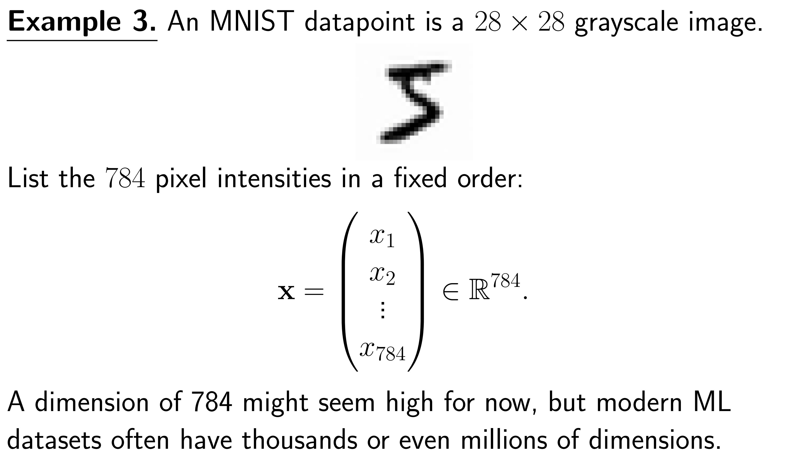

## 第 9 页：章节页：基本向量运算

接下来介绍逐坐标运算、向量长度和两个向量之间的距离。这些运算会用于后面的质心和聚类。

展开第 9 页原始 slide，核对图表、标注和公式

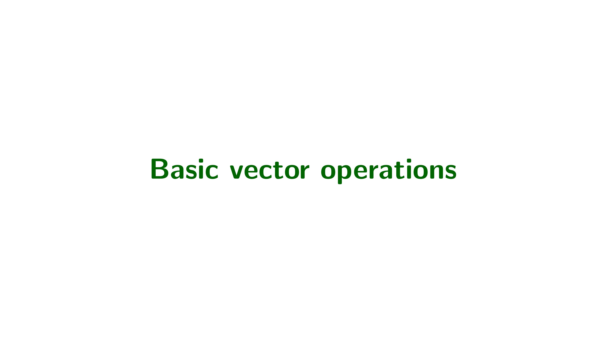

## 第 10 页：加法、数乘、减法和数除

对 $x,y\in\mathbb R^d$ 与标量 $a\in\mathbb R$，加法和数乘逐坐标进行：

$$
x+y=(x_1+y_1,\ldots,x_d+y_d)^T,\qquad ax=(ax_1,\ldots,ax_d)^T.
$$

减去向量等于加上其相反向量：$x-y=x+(-1)y$。当 $a\ne0$ 时，$x/a=(1/a)x$。标量除法不能在 $a=0$ 时使用。

展开第 10 页原始 slide，核对图表、标注和公式

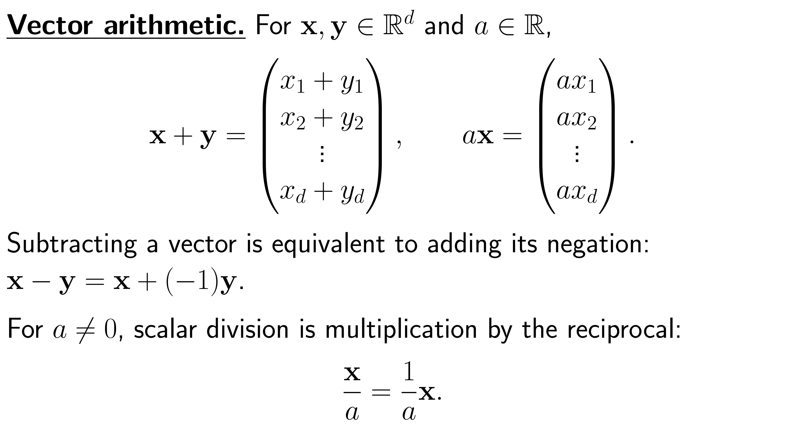

## 第 11 页：欧氏范数与欧氏距离

欧氏范数测量一个向量的长度：

$$
\|x\|_2=\sqrt{\sum_{j=1}^d x_j^2}.
$$

两个向量的欧氏距离是差向量的长度：$d(x,y)=\|x-y\|_2$。在许多机器学习任务里，距离较小被用来表示相似程度较高；是否合理取决于前面选择的表示。

展开第 11 页原始 slide，核对图表、标注和公式

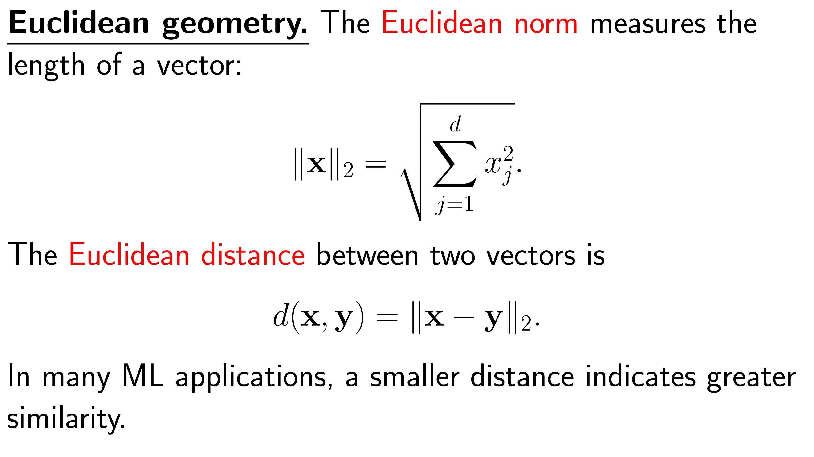

## 第 12 页：例 4：比较两对向量的距离

给定 $x=(0.2,0.9,-0.4)^T$、$y=(-0.3,0.8,0.5)^T$、$z=(0.9,-0.1,0.4)^T$。原页要求计算 $d(x,y)$ 和 $d(y,z)$，并判断哪一对更近。

**理解补充（解题）：**$x-y=(0.5,0.1,-0.9)^T$，所以 $d(x,y)=\sqrt{0.25+0.01+0.81}=\sqrt{1.07}\approx1.0344$。$y-z=(-1.2,0.9,0.1)^T$，所以 $d(y,z)=\sqrt{1.44+0.81+0.01}=\sqrt{2.26}\approx1.5033$。因此 $x,y$ 更近。

展开第 12 页原始 slide，核对图表、标注和公式

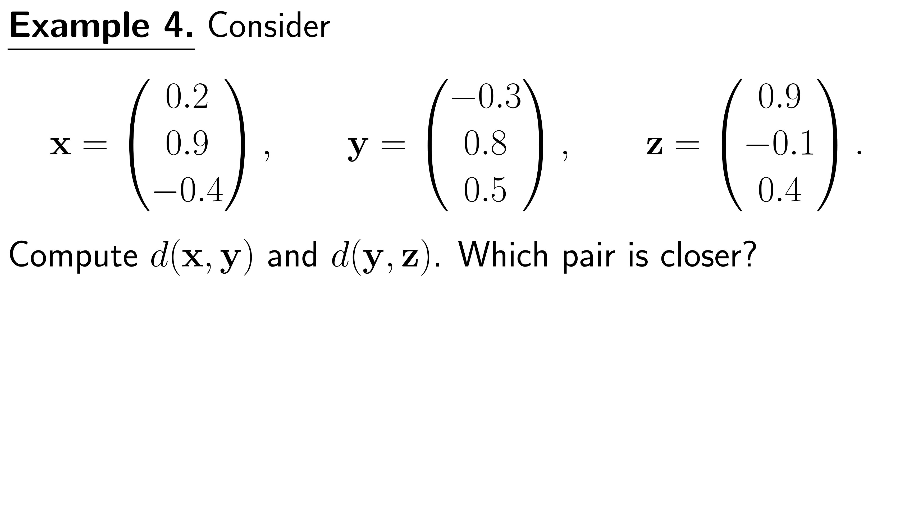

## 第 13 页：其他范数及其诱导的距离

当 $p\ge1$ 时，$\ell_p$ 范数定义为

$$
\|x\|_p=\left(\sum_{j=1}^d|x_j|^p\right)^{1/p}.
$$

欧氏范数是 $p=2$ 的情形。极限情形为 $\|x\|_\infty=\max_{j=1,\ldots,d}|x_j|$。每种范数都能诱导距离 $d_p(x,y)=\|x-y\|_p$，因此“距离”不只一种定义。

展开第 13 页原始 slide，核对图表、标注和公式

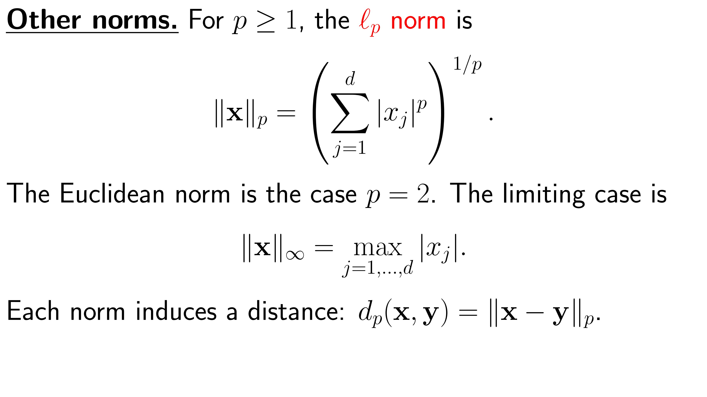

## 第 14 页：章节页：K-Means 按距离聚类

这一节把数值表示和距离结合起来，用 K-Means 为数据分组。

展开第 14 页原始 slide，核对图表、标注和公式

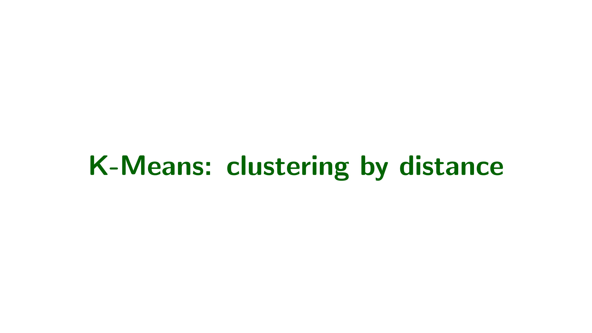

## 第 15 页：无监督学习与聚类的用途

无监督学习是在没有带标签结果的情况下寻找结构。聚类把在选定表示和距离下接近的数据点放在一起。歌曲聚类可以支持推荐与探索；客户聚类可以用于客户分群。这里没有一个预先给定的“正确类别”要求算法照着预测。

展开第 15 页原始 slide，核对图表、标注和公式

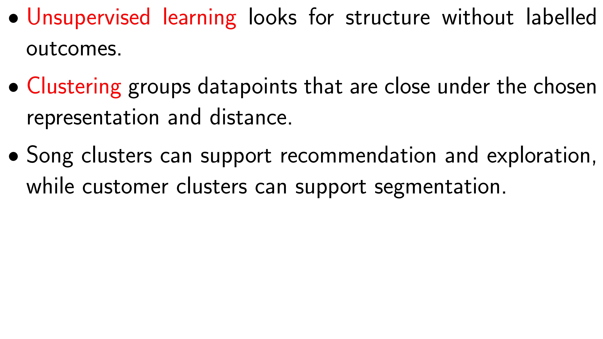

## 第 16 页：七首歌曲的数据集

七首歌使用三个已归一化特征，坐标顺序固定为 danceability、energy、acoustic score：

| 歌曲 | danceability | energy | acoustic score |
| --- | ---: | ---: | ---: |
| $x_1$ | 0.91 | 0.08 | 0.37 |
| $x_2$ | 0.71 | 0.10 | 0.37 |
| $x_3$ | 0.25 | 0.20 | 0.46 |
| $x_4$ | 0.31 | 0.57 | 0.29 |
| $x_5$ | 0.11 | 0.59 | 0.34 |
| $x_6$ | 0.12 | 0.57 | 0.35 |
| $x_7$ | 0.25 | 0.31 | 0.10 |

表中一行虽然横着显示，记录的仍是列向量 $x_i\in\mathbb R^3$ 的三个坐标。

展开第 16 页原始 slide，核对图表、标注和公式

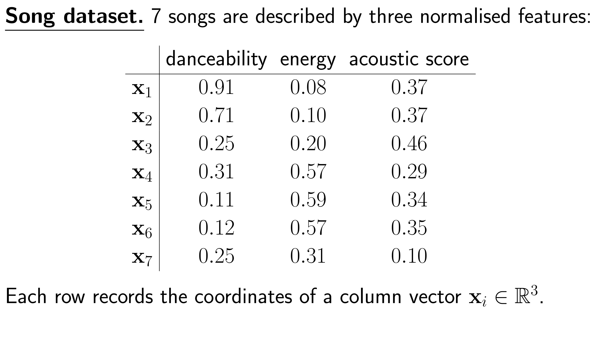

## 第 17 页：质心：逐坐标平均的代表

对 $x_1,\ldots,x_n\in\mathbb R^d$，质心为

$$
m=\frac1n\sum_{i=1}^n x_i.
$$

它就是每个坐标分别取平均。假设同一歌手演唱 $x_1,x_3,x_6$，其平均向量为 $(x_1+x_3+x_6)/3\approx(0.42667,0.28333,0.39333)^T$。平均向量不必对应一首真实存在的歌，但可以代表这个歌手的风格。

展开第 17 页原始 slide，核对图表、标注和公式

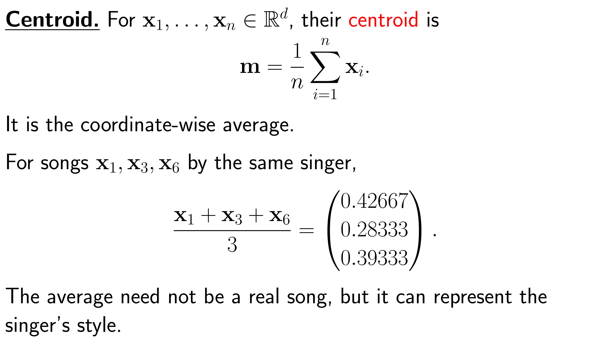

## 第 18 页：K-Means 的算法步骤

输入是 $D=\{x_1,\ldots,x_n\}\subseteq\mathbb R^d$，以及一个划分为 $k\ge2$ 个非空簇的初始分组。算法依次进行：

1. 计算每个簇 $C_r$ 的质心 $c_r$。
2. 把每个 $x_i$ 分配给质心距离最近的簇。
3. 距离并列时，保留该点当前所属的簇。
4. 重复，直到没有点改变所属簇。

因此每轮交替更新“用来代表簇的质心”和“每个点的归属”。并列规则在终止性证明中很重要。

展开第 18 页原始 slide，核对图表、标注和公式

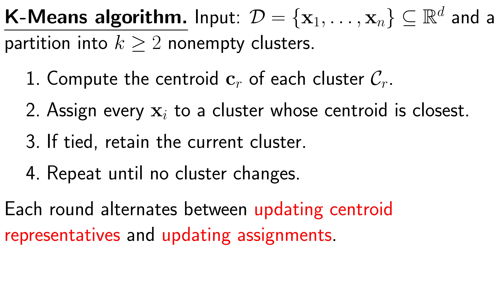

## 第 19 页：例 5：三簇 K-Means 的初始化

仍使用以下七首歌，并设 $k=3$：

| 歌曲 | danceability | energy | acoustic score |
| --- | ---: | ---: | ---: |
| $x_1$ | 0.91 | 0.08 | 0.37 |
| $x_2$ | 0.71 | 0.10 | 0.37 |
| $x_3$ | 0.25 | 0.20 | 0.46 |
| $x_4$ | 0.31 | 0.57 | 0.29 |
| $x_5$ | 0.11 | 0.59 | 0.34 |
| $x_6$ | 0.12 | 0.57 | 0.35 |
| $x_7$ | 0.25 | 0.31 | 0.10 |

初始划分是 $C_1^{(0)}=\{x_1,x_2,x_3,x_4\}$、$C_2^{(0)}=\{x_5,x_6\}$、$C_3^{(0)}=\{x_7\}$。分别求平均得到

$$
c_1^{(0)}=(0.545,0.2375,0.3725)^T,\quad
c_2^{(0)}=(0.115,0.58,0.345)^T,\quad
c_3^{(0)}=(0.25,0.31,0.10)^T.
$$

上标记录迭代阶段，不是乘方。

展开第 19 页原始 slide，核对图表、标注和公式

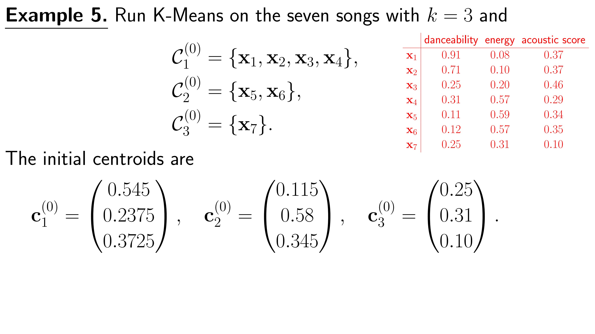

## 第 20 页：例 5 续：第一次重新分配

用上一页的质心比较距离，第一次分配得到 $C_1^{(1)}=\{x_1,x_2,x_3\}$、$C_2^{(1)}=\{x_4,x_5,x_6\}$、$C_3^{(1)}=\{x_7\}$。变化是 $x_4$ 从第一簇移入第二簇。原页再次列出同一数据表：

| 歌曲 | danceability | energy | acoustic score |
| --- | ---: | ---: | ---: |
| $x_1$ | 0.91 | 0.08 | 0.37 |
| $x_2$ | 0.71 | 0.10 | 0.37 |
| $x_3$ | 0.25 | 0.20 | 0.46 |
| $x_4$ | 0.31 | 0.57 | 0.29 |
| $x_5$ | 0.11 | 0.59 | 0.34 |
| $x_6$ | 0.12 | 0.57 | 0.35 |
| $x_7$ | 0.25 | 0.31 | 0.10 |

新质心是

$$
c_1^{(1)}\approx(0.6233,0.1267,0.40)^T,\quad
c_2^{(1)}\approx(0.18,0.5767,0.3267)^T,\quad
c_3^{(1)}=(0.25,0.31,0.10)^T.
$$

展开第 20 页原始 slide，核对图表、标注和公式

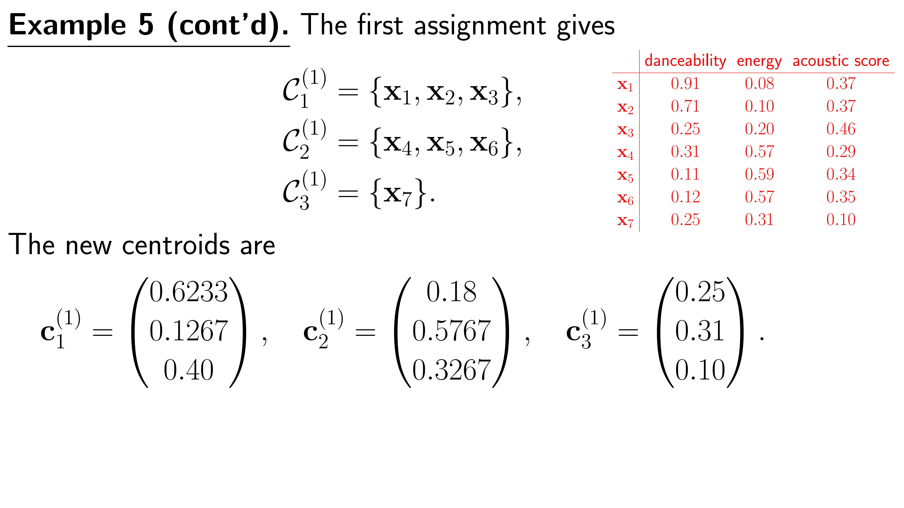

## 第 21 页：例 5 续：第二次分配与终止

第二次分配得到 $C_1^{(2)}=\{x_1,x_2\}$、$C_2^{(2)}=\{x_4,x_5,x_6\}$、$C_3^{(2)}=\{x_3,x_7\}$。这次 $x_3$ 从第一簇移到第三簇。对应数据仍是：

| 歌曲 | danceability | energy | acoustic score |
| --- | ---: | ---: | ---: |
| $x_1$ | 0.91 | 0.08 | 0.37 |
| $x_2$ | 0.71 | 0.10 | 0.37 |
| $x_3$ | 0.25 | 0.20 | 0.46 |
| $x_4$ | 0.31 | 0.57 | 0.29 |
| $x_5$ | 0.11 | 0.59 | 0.34 |
| $x_6$ | 0.12 | 0.57 | 0.35 |
| $x_7$ | 0.25 | 0.31 | 0.10 |

第三轮使用的质心为

$$
c_1^{(2)}=(0.81,0.09,0.37)^T,\quad
c_2^{(2)}\approx(0.18,0.5767,0.3267)^T,\quad
c_3^{(2)}=(0.25,0.255,0.28)^T.
$$

接下来再分配时所有点都保持原簇，因此算法终止。

展开第 21 页原始 slide，核对图表、标注和公式

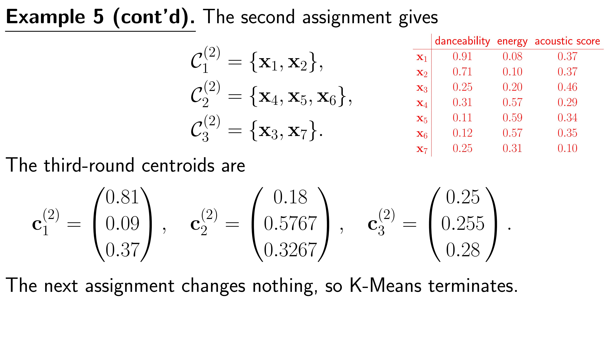

## 第 22 页：章节页：分析 K-Means

前面看到一次具体运行停止了；这一节转向证明，讨论算法是否一定会在有限轮内停止。

展开第 22 页原始 slide，核对图表、标注和公式

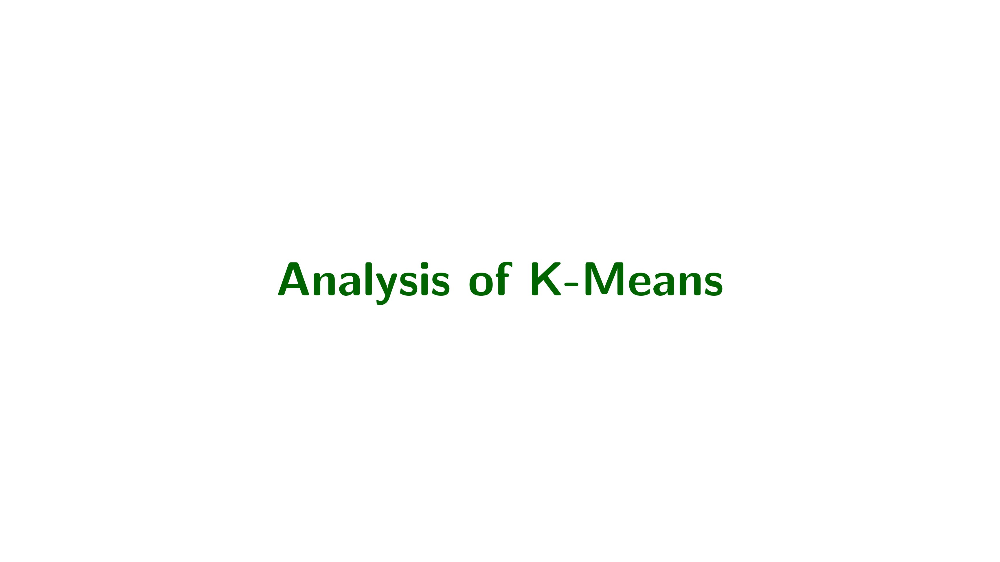

## 第 23 页：会不会在几个划分之间循环

K-Means 的动机很自然，但这本身不等于终止性证明。每一轮产生一个数据划分；要排除的是算法在若干划分之间反复循环、永远不停止的可能。下一步需要找到一个只要分组变化就严格下降的量。

展开第 23 页原始 slide，核对图表、标注和公式

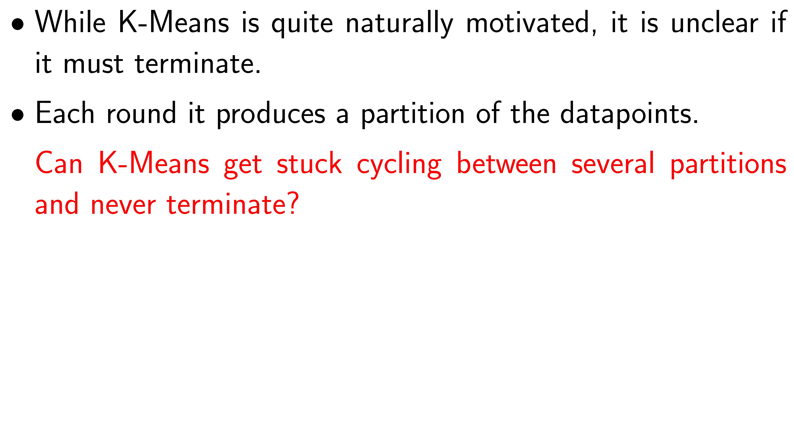

## 第 24 页：引理 1：质心唯一最小化平方距离和

设 $m$ 是 $x_1,\ldots,x_n$ 的质心。对每个 $c\in\mathbb R^d$，有

$$
\sum_{i=1}^n\|x_i-c\|_2^2
=\sum_{i=1}^n\|x_i-m\|_2^2+n\|m-c\|_2^2.
$$

右边第一项不依赖 $c$，第二项非负且仅在 $c=m$ 时为零。因此质心是使所有数据点到中心的**平方距离之和**最小的唯一中心。

展开第 24 页原始 slide，核对图表、标注和公式

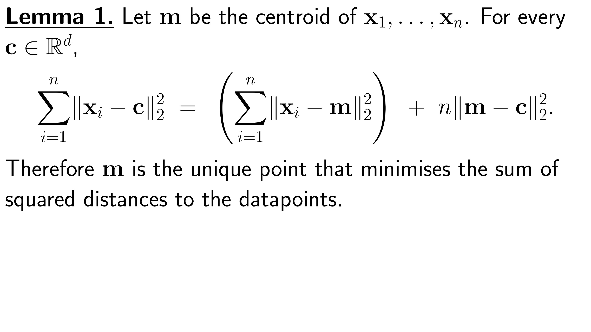

## 第 25 页：证明留白页：展开平方

原 PDF 这一页只有“Proof sketch.”标题，没有写出推导。

**理解补充：**令 $a_i=x_i-m$、$h=m-c$，则 $x_i-c=a_i+h$。逐项展开再求和：

$$
\sum_i\|x_i-c\|_2^2
=\sum_i\|a_i\|_2^2+2\left\langle\sum_i a_i,h\right\rangle+n\|h\|_2^2.
$$

这一步把原平方距离和分成组内变化、交叉项、中心偏移三部分。

展开第 25 页原始 slide，核对图表、标注和公式

## 第 26 页：证明留白续页：交叉项消失

原 PDF 这一页只有“Proof sketch (cont’d).”标题。

**理解补充：**根据质心定义，$\sum_i(x_i-m)=\sum_i x_i-nm=0$，上一页的交叉项因此为零，便得到引理 1 的恒等式。若 $n>0$，中心偏离质心时 $n\|m-c\|_2^2>0$，所以最小值不仅在质心处达到，而且该最小化中心唯一。

展开第 26 页原始 slide，核对图表、标注和公式

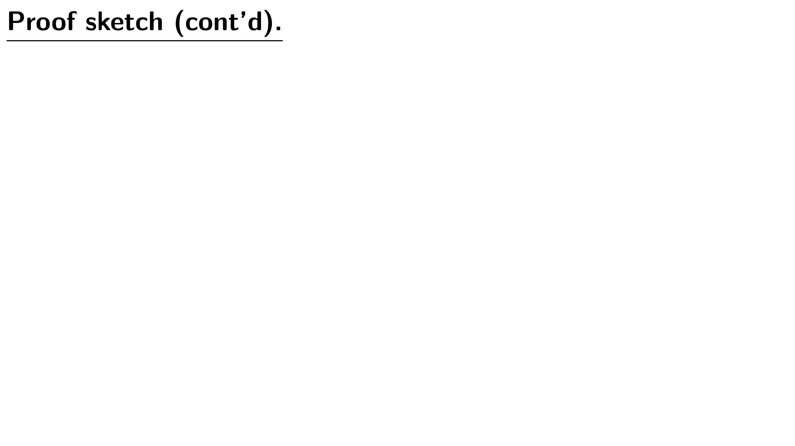

## 第 27 页：定理 2：有条件的有限终止

定理的两个条件是：每个簇在迭代中始终非空；距离并列时让点留在当前簇。在这些条件下，K-Means 在有限轮后终止。非空条件保证质心始终有定义，并列规则则确保发生移动时能得到严格的改进。

展开第 27 页原始 slide，核对图表、标注和公式

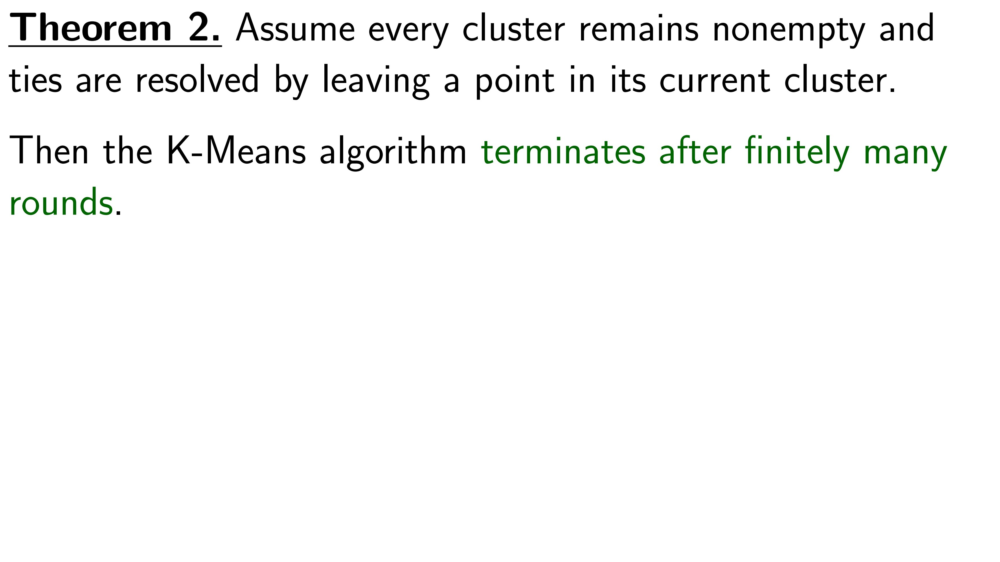

## 第 28 页：K-Means 目标：簇内平方误差和

对非空簇 $C_1,\ldots,C_k$ 及其质心 $c_1,\ldots,c_k$，定义 within-cluster sum of squared errors（SSE）：

$$
J(C_1,\ldots,C_k)=\sum_{r=1}^k\sum_{x_i\in C_r}\|x_i-c_r\|_2^2.
$$

K-Means 希望找到 SSE 小的划分。这里还用 SSE 衡量每轮的进展，以排除循环。

展开第 28 页原始 slide，核对图表、标注和公式

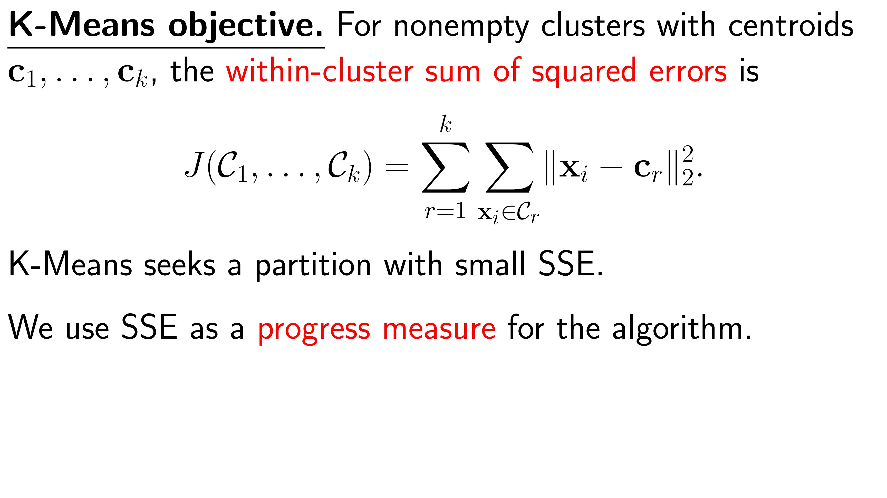

## 第 29 页：为什么 SSE 的下降保证终止

固定质心时，把每个点分给最近的质心不会增大目标。若任何点真正移动，由于并列时不移动，它的新距离必定严格较小，因此这一步使目标严格下降。固定新分组后，引理 1 保证把中心换成各组质心也不会使目标增大。

所以终止前的每个有效轮次都使 SSE 严格下降。带簇编号的划分只有有限多种，同一个划分又会有同样的质心与 SSE，因此不能再次出现。有限划分加上严格下降，才推出有限终止；仅仅“目标有下界”并不足以单独推出有限步停止。

展开第 29 页原始 slide，核对图表、标注和公式

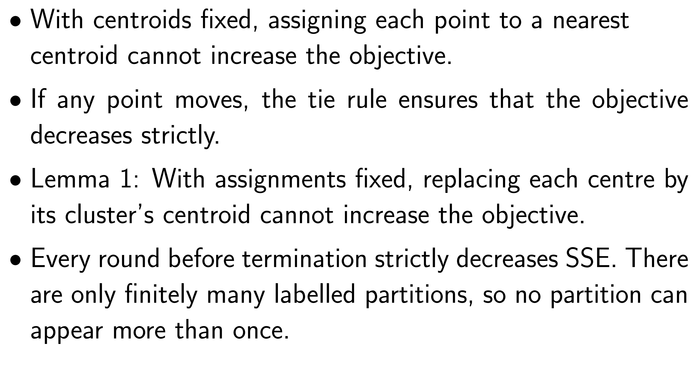

## 第 30 页：每轮成本、最坏轮数与空簇

每轮要计算 $nk$ 个 $d$ 维距离，并求至多 $k$ 个簇平均值，算术操作量为 $O(nkd)$。K-Means 实际中常很快，但课件提到 Vattani（2011）构造了平面上的实例，需要指数多轮迭代。

另一个问题是重新分配可能使某个簇变空。这解释了终止定理为何要明确加上“所有簇始终非空”的假设；空簇的质心不能用普通平均值定义。

展开第 30 页原始 slide，核对图表、标注和公式

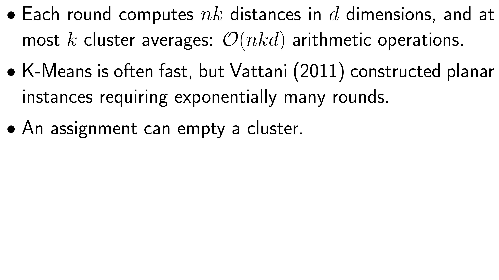

## 第 31 页：例 6：一次分配就能制造空簇

把标量看成 $\mathbb R^1$ 中的数据点，设 $D=\{-1.1,-1,1,1.1\}$。初始化为 $C_1^{(0)}=\{-1.1\}$、$C_2^{(0)}=\{1.1\}$、$C_3^{(0)}=\{-1,1\}$，质心依次为 $-1.1,1.1,0$。原页提问：分配之后会怎样？

**理解补充（解题）：**$-1$ 到 $-1.1$ 的距离为 $0.1$，到 0 的距离为 1，因此进入第一簇；$1$ 同理进入第二簇。两个端点不移动。结果为 $C_1=\{-1.1,-1\}$、$C_2=\{1,1.1\}$、$C_3=\varnothing$。问题不是并列，而是第三簇失去全部成员。

展开第 31 页原始 slide，核对图表、标注和公式

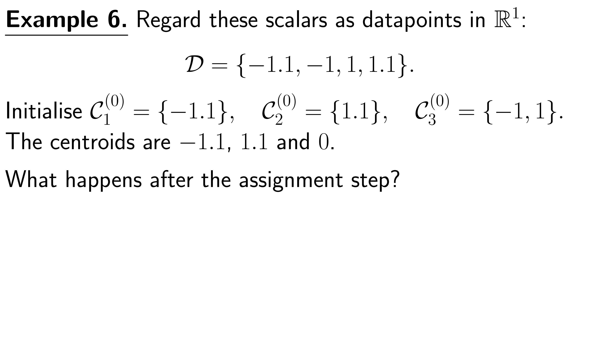

## 第 32 页：章节页：层次聚类

接下来用层次聚类一次展示多种分组尺度，并通过树状图在事后选择分组数量。

展开第 32 页原始 slide，核对图表、标注和公式

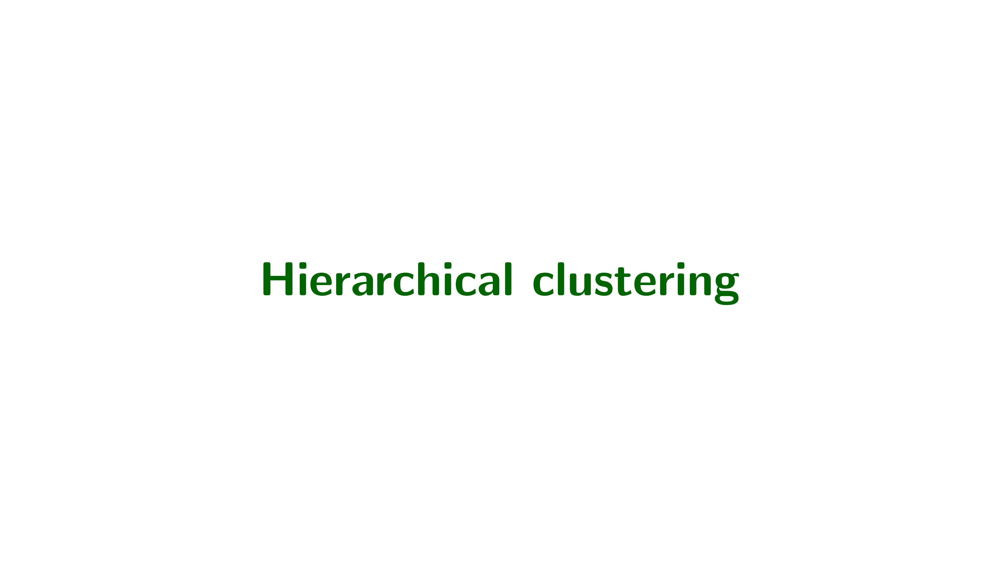

## 第 33 页：为什么考虑层次聚类

K-Means 要求事先选择簇数 $k$，但不少任务希望先查看数据结构，再决定分成多少组。层次聚类通过一次分析构造多个尺度的分组家族，便于观察从细分组到粗分组的变化。

展开第 33 页原始 slide，核对图表、标注和公式

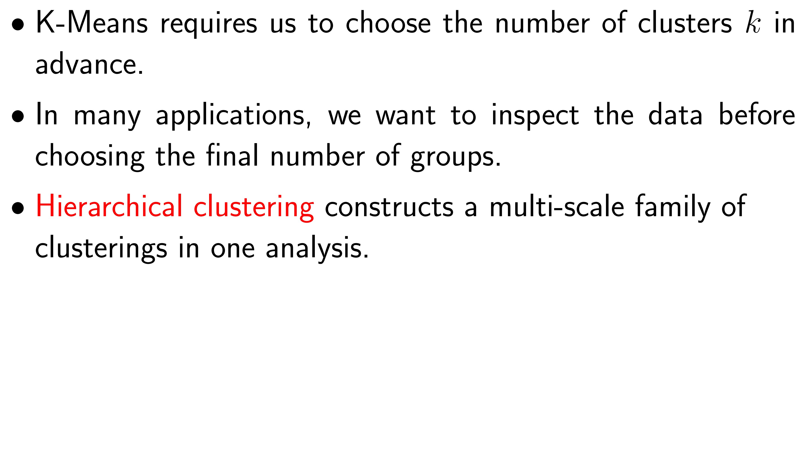

## 第 34 页：凝聚式层次聚类的四步

Agglomerative hierarchical clustering 从最细的分组开始：每个观测先独自成为一个单元素簇；找到当前最近的两个簇；合并它们；不断重复直到只剩一个簇。“两个簇相距多远”由 linkage（连接）规则定义，不能只凭点间距离自动得到。

展开第 34 页原始 slide，核对图表、标注和公式

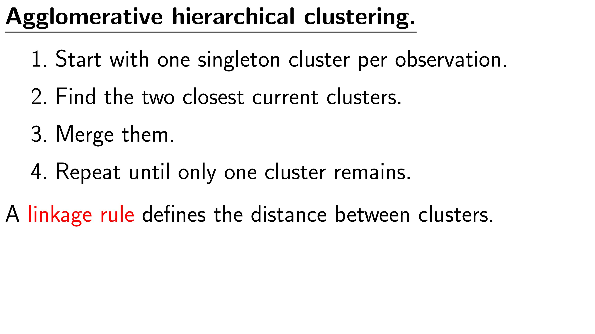

## 第 35 页：Single linkage 与 complete linkage

对于非空簇 $A,B$，两种规则为

$$
d_{\mathrm{single}}(A,B)=\min_{x\in A,y\in B}d(x,y),\qquad
d_{\mathrm{complete}}(A,B)=\max_{x\in A,y\in B}d(x,y).
$$

Single linkage 看两簇之间最近的一对点；complete linkage 看最远的一对点。即使数据和点间距离相同，这两个定义也可能导致不同的合并次序。

展开第 35 页原始 slide，核对图表、标注和公式

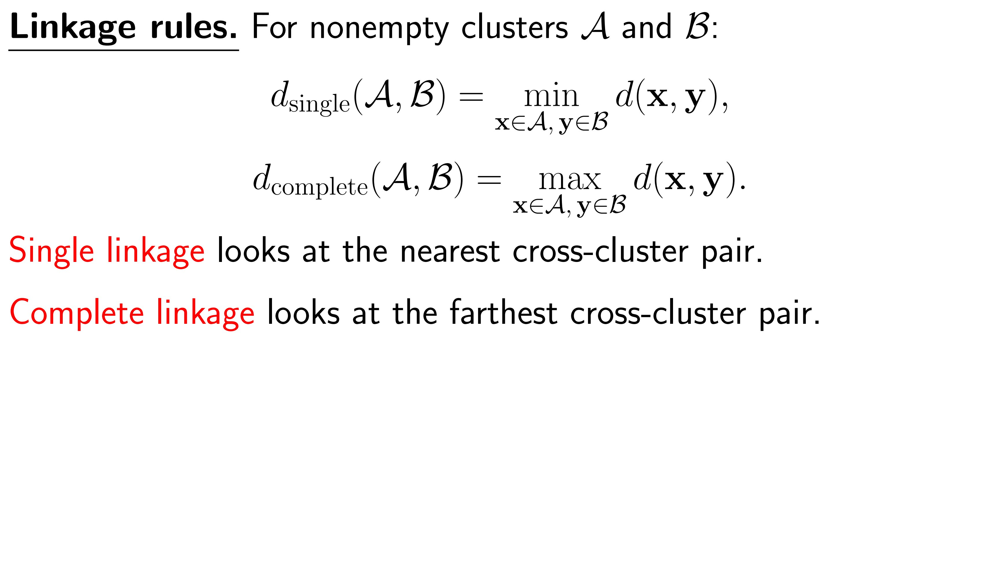

## 第 36 页：Average linkage 与树状图

Average linkage 使用所有跨簇点对的平均距离：

$$
d_{\mathrm{average}}(A,B)=\frac1{|A||B|}\sum_{x\in A}\sum_{y\in B}d(x,y).
$$

分母是跨簇点对的数量。Dendrogram（树状图）记录合并次序和每次合并的高度；选定一个高度水平切开树状图，就得到该尺度的分组。

展开第 36 页原始 slide，核对图表、标注和公式

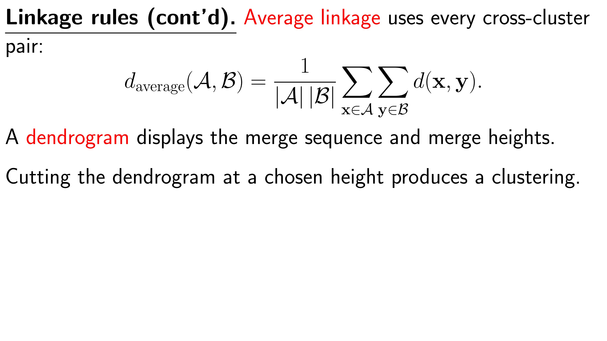

## 第 37 页：例 7：七首歌曲的 single-linkage 合并

仍使用同一歌曲表：

| 歌曲 | danceability | energy | acoustic score |
| --- | ---: | ---: | ---: |
| $x_1$ | 0.91 | 0.08 | 0.37 |
| $x_2$ | 0.71 | 0.10 | 0.37 |
| $x_3$ | 0.25 | 0.20 | 0.46 |
| $x_4$ | 0.31 | 0.57 | 0.29 |
| $x_5$ | 0.11 | 0.59 | 0.34 |
| $x_6$ | 0.12 | 0.57 | 0.35 |
| $x_7$ | 0.25 | 0.31 | 0.10 |

使用欧氏距离，原页列出六次合并及高度：

| 次序 | 合并 | 高度 |
| --- | --- | --- |
| 1 | $x_5,x_6$ | 0.0245 |
| 2 | $x_4$ 加入 $\{x_5,x_6\}$ | 0.1992 |
| 3 | $x_1,x_2$ | 0.2010 |
| 4 | $x_7$ 加入 $\{x_4,x_5,x_6\}$ | 0.3276 |
| 5 | $x_3$ 加入右侧大簇 | 0.3764 |
| 6 | 最后两簇合并 | 0.4793 |

七个初始单元素簇经过六次合并变成一个簇，树状图将记录全部六次。

展开第 37 页原始 slide，核对图表、标注和公式

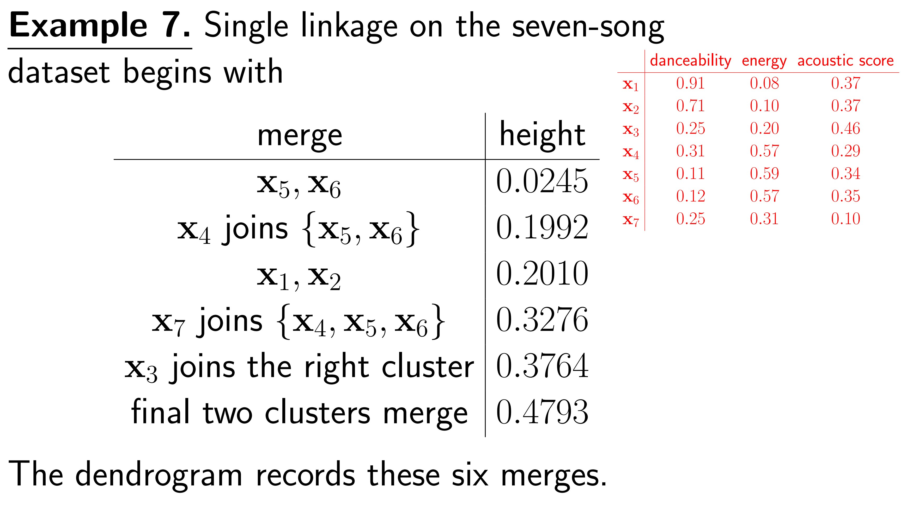

## 第 38 页：例 7 续：single-linkage 树状图

图题是“Single linkage”。横轴叶子从左到右为 $x_1,x_2,x_3,x_7,x_4,x_5,x_6$；纵轴标出 0.25、0.50、0.75、1.00，横向连线的高度表示合并距离。$x_5,x_6$ 最先连接，$x_4$、$x_7$、$x_3$ 依次接入这支，最后与 $\{x_1,x_2\}$ 合并；具体高度见上一页。

**理解补充：**阅读合并高度而不是叶子之间的水平间隔。该图最高合并仅约 0.4793，纵轴仍统一画到 1.00，便于和随后两图比较。

展开第 38 页原始 slide，核对图表、标注和公式

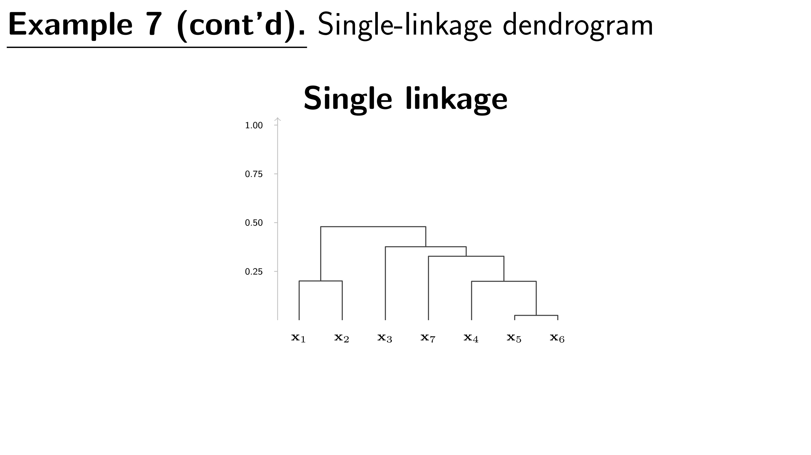

## 第 39 页：例 7 续：complete-linkage 树状图

图题是“Complete linkage”，纵轴同样标出 0.25、0.50、0.75、1.00。叶子顺序为 $x_1,x_2,x_4,x_5,x_6,x_3,x_7$。图中 $x_5,x_6$ 先合并；$x_1,x_2$ 合并；$x_4$ 加入 $\{x_5,x_6\}$；$x_3,x_7$ 合并；后两支合并；最后再与 $\{x_1,x_2\}$ 合并。最高连接接近 0.95，明显高于 single linkage。

**理解补充（按数据重算图中高度）：**以上六次合并高度约为 0.0245、0.2010、0.2071、0.3764、0.4314、0.9492。原图用线条显示高度，并未逐项标注这些数值。

展开第 39 页原始 slide，核对图表、标注和公式

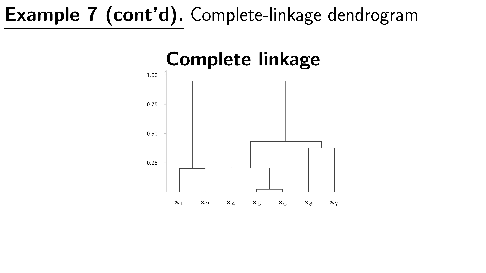

## 第 40 页：例 7 续：average-linkage 树状图

图题是“Average linkage”，叶子从左到右为 $x_1,x_2,x_3,x_7,x_4,x_5,x_6$，纵轴仍标出 0.25、0.50、0.75、1.00。$x_5,x_6$ 合并，$x_1,x_2$ 合并，$x_4$ 加入 $\{x_5,x_6\}$，随后 $x_7$、$x_3$ 依次接入右支，最后左右两大支合并。

**理解补充（按数据重算图中高度）：**六次高度约为 0.0245、0.2010、0.2032、0.3685、0.4067、0.7289。它既不只看最近点对，也不只看最远点对。

展开第 40 页原始 slide，核对图表、标注和公式

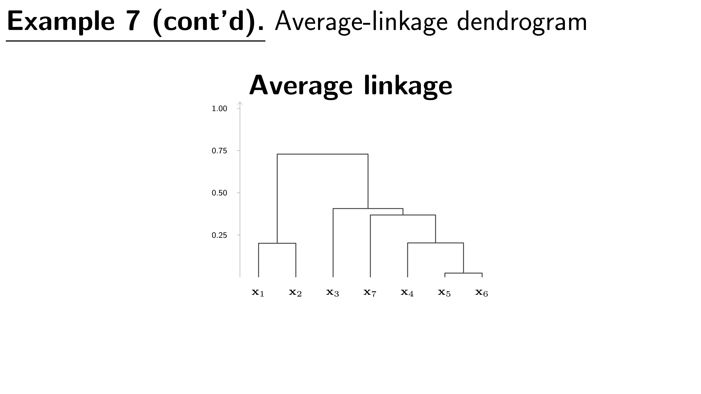

## 第 41 页：在相同高度 0.40 切树，结果不同

原页对三张树状图都在高度 0.40 切开：

| linkage | 得到的簇 |
| --- | --- |
| single | $\{x_1,x_2\}$；$\{x_3,x_4,x_5,x_6,x_7\}$ |
| complete | $\{x_1,x_2\}$；$\{x_3,x_7\}$；$\{x_4,x_5,x_6\}$ |
| average | $\{x_1,x_2\}$；$\{x_3\}$；$\{x_4,x_5,x_6,x_7\}$ |

Single linkage 容易形成链条：有局部相近的连接就能把群体串起来。Complete linkage 更偏好紧凑簇；average linkage 提供折中。这不是三个算法发现了不同的“唯一真相”，而是连接规则不同。

展开第 41 页原始 slide，核对图表、标注和公式

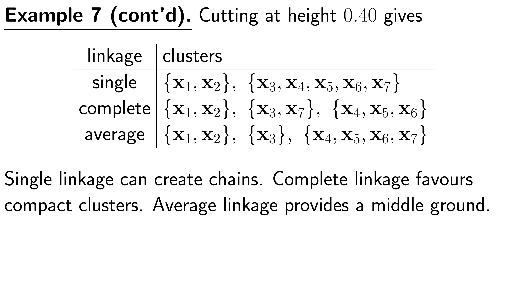

## 第 42 页：本讲总结

向量表示决定算法能够看到什么；范数和距离把数值差异变成相似性的概念。K-Means 在选定 $k$ 后交替更新质心与最近质心分配。层次聚类则允许先查看树状图，再选择簇数。最终的簇依赖表示、距离和 linkage 规则：它们是关于数据结构的假设，不能当成对象天然自带、与建模选择无关的事实。

展开第 42 页原始 slide，核对图表、标注和公式

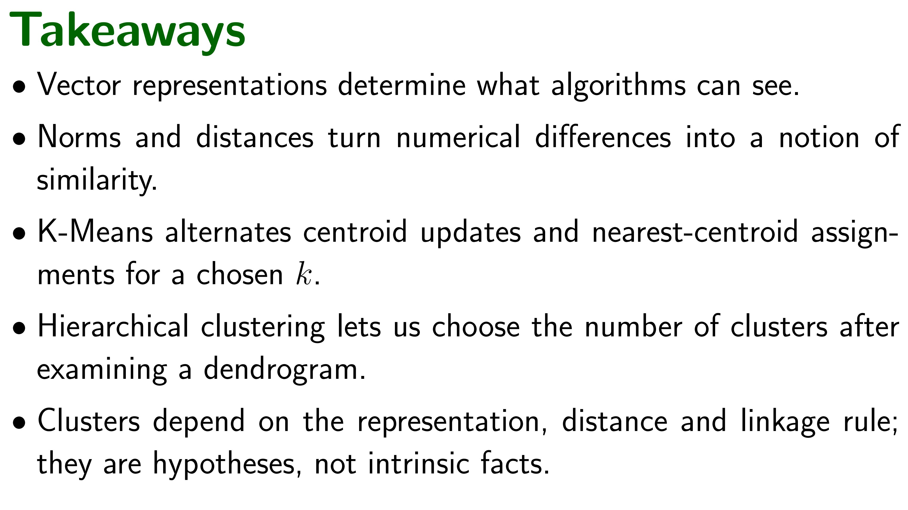

