# Lecture 06A：矩阵、线性映射与线性方程组，按幻灯片逐页复述

来源：[lecture06a.pdf](../../comp3670_lectures/lecture06a.pdf)，共 71 个 PDF 页面。严格按 PDF 页序组织，章节页、例题续页和证明留白页也单独保留。默认向量为列向量；数据矩阵中的每一行通常是一个数据点的转置。正文用中文讲解概念、公式和图表；原页未写出的解答或推导明确标为“理解补充”。每节末尾可展开完整原始 slide 核对颜色、标注和排版。图片和 PDF 均使用仓库相对路径，适合本地预览与 GitHub。

## 第 1 页：课程与主题：矩阵、线性映射和方程组

这是 COMP3670/6670《Introduction to Machine Learning》第 6a 周，主题为 Matrices, Linear Maps & Systems。讲师为 ANU School of Computing 的 Senior Lecturer Yun Kuen Cheung（Marco）。本讲从批量存储数据开始，介绍矩阵如何变换数据、组合模型，再用消元法求精确拟合的权重。

展开第 1 页原始 slide，核对图表、标注和公式

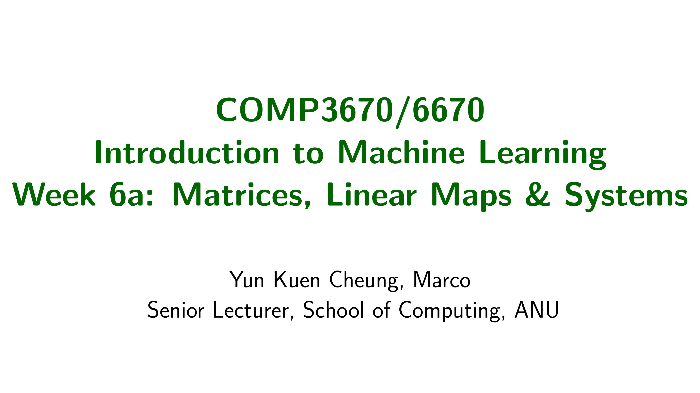

## 第 2 页：学习目标

五个目标依次是：用矩阵和张量组织数据集与图像批次；用矩阵及转置表示线性映射并组合模型阶段；通过高斯消元求解精确拟合方程；读懂行阶梯形、简化行阶梯形，并用主元区分解集；识别和计算逆矩阵。

展开第 2 页原始 slide，核对图表、标注和公式

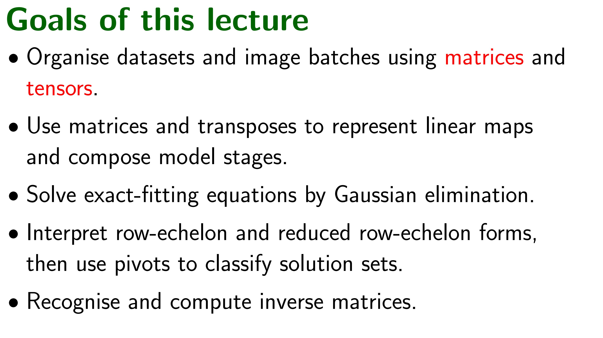

## 第 3 页：章节页：矩阵组织数据集

首先把许多独立的数据向量排进一张表，并固定“行是数据点、列是特征”的约定。

展开第 3 页原始 slide，核对图表、标注和公式

## 第 4 页：为什么需要矩阵

机器学习系统很少只处理一个数据点，通常要把多个数据点堆成矩形表。每行代表一个数据点，每列代表一个特征。矩阵让我们能用同一种数学语言存储数据、变换向量和组合模型。

展开第 4 页原始 slide，核对图表、标注和公式

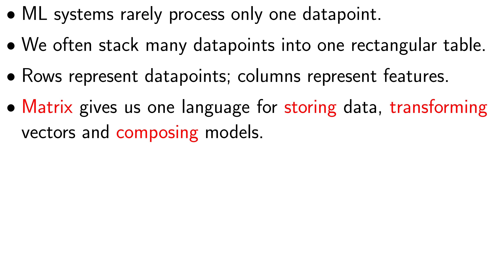

## 第 5 页：例 1：七首歌曲构成数据矩阵

七首歌以 danceability、energy、acoustic score 为三列，组成

$$
X=\begin{pmatrix}
0.91&0.08&0.37\\
0.71&0.10&0.37\\
0.25&0.20&0.46\\
0.31&0.57&0.29\\
0.11&0.59&0.34\\
0.12&0.57&0.35\\
0.25&0.31&0.10
\end{pmatrix}\in\mathbb R^{7\times3}.
$$

一行是一首歌，一列是在全部歌曲上测量的同一个特征。数据点本身默认是列向量 $x_i$，所以数据矩阵第 $i$ 行写的是 $x_i^T$。

展开第 5 页原始 slide，核对图表、标注和公式

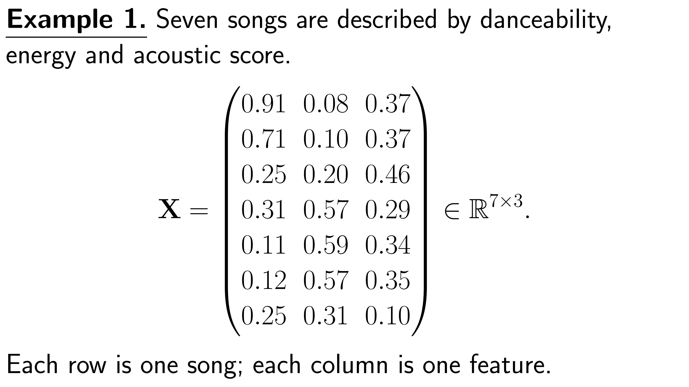

## 第 6 页：矩阵的定义与逐项运算

$m\times d$ 矩阵 $A=(a_{ij})\in\mathbb R^{m\times d}$ 是一个有 $m$ 行、$d$ 列的实数矩形数组。$a_{ij}$ 位于第 $i$ 行、第 $j$ 列；第一个下标管行，第二个管列。相同形状的矩阵逐项相加，数乘也逐项进行，即 $(A+B)_{ij}=a_{ij}+b_{ij}$、$(sA)_{ij}=sa_{ij}$。

展开第 6 页原始 slide，核对图表、标注和公式

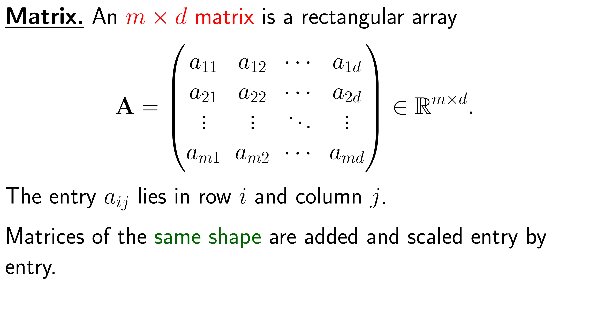

## 第 7 页：章节页：矩阵实现线性映射

矩阵除了可以装数据，也可以记录一种对向量的变换。下面先定义变换应满足什么性质，再写出其矩阵。

展开第 7 页原始 slide，核对图表、标注和公式

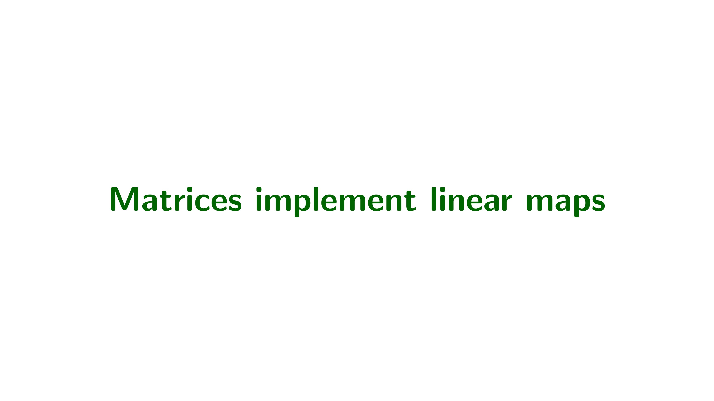

## 第 8 页：机器学习中的线性映射

机器学习工具反复把一个特征向量变成另一个向量，例如线性回归、神经网络层、特征处理流水线。线性映射是这些工具的基本构件。做法是先明确想要的映射，再把各输出对各输入的系数记录到矩阵中。

展开第 8 页原始 slide，核对图表、标注和公式

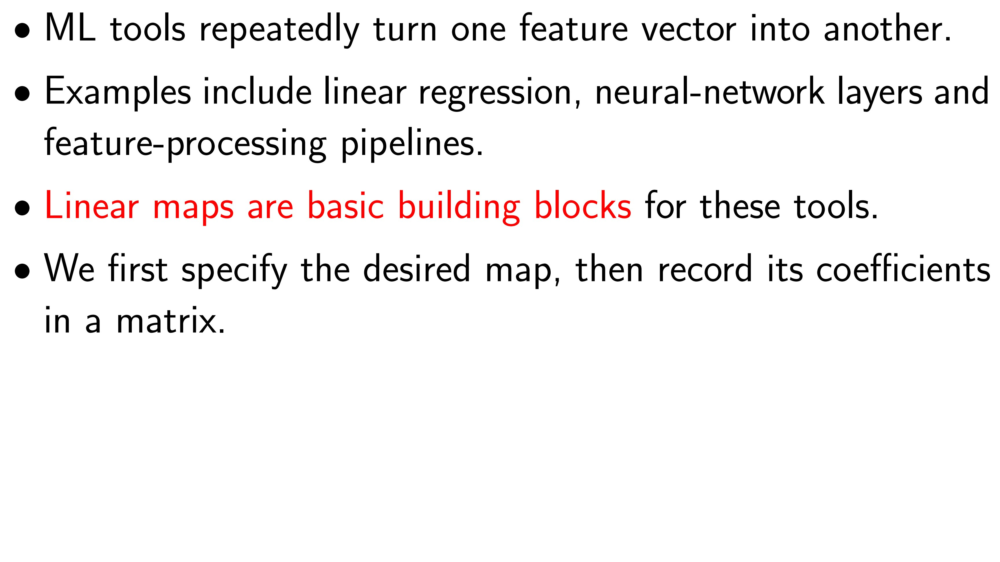

## 第 9 页：线性映射的定义

函数 $T:\mathbb R^d\to\mathbb R^m$ 是线性映射，如果对所有 $x,y\in\mathbb R^d$ 和 $s,t\in\mathbb R$ 都满足

$$
T(sx+ty)=sT(x)+tT(y).
$$

也就是先线性组合输入再变换，等于先变换再做同样的线性组合。**理解补充：**该定义也要求 $T(0)=0$，因此随意添加非零常数偏置会变成仿射映射，不能直接沿用这里的纯线性定义。

展开第 9 页原始 slide，核对图表、标注和公式

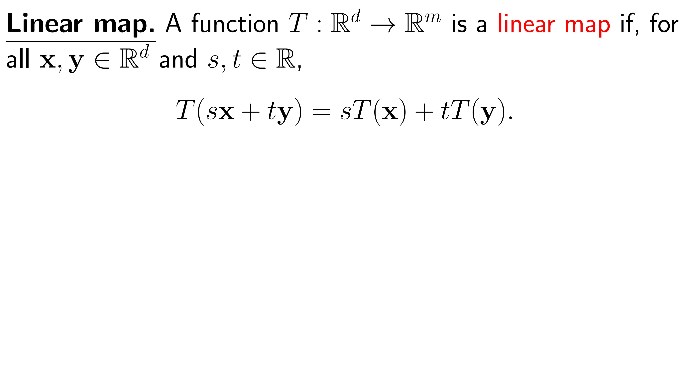

## 第 10 页：例 2：把三条输出规则写成矩阵

输入是 $x=(x_1,x_2,x_3,x_4,x_5)^T$，希望输出

$$
T(x)=\begin{pmatrix}(x_1+x_3+x_4)/3\\5x_2-3x_3-12x_5\\2(x_3+x_4)\end{pmatrix}.
$$

把每条输出的五个系数排成一行，就得到

$$
A=\begin{pmatrix}1/3&0&1/3&1/3&0\\0&5&-3&0&-12\\0&0&2&2&0\end{pmatrix},\qquad T(x)=Ax.
$$

没有出现的输入坐标，其系数是 0。矩阵为 $3\times5$，表示把五维输入变为三维输出。

展开第 10 页原始 slide，核对图表、标注和公式

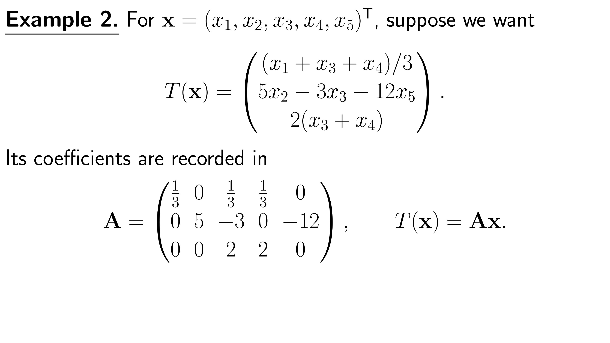

## 第 11 页：矩阵乘向量的定义与形状

设 $A\in\mathbb R^{m\times d}$、$x\in\mathbb R^d$，则 $y=Ax\in\mathbb R^m$，且

$$
y_i=\sum_{j=1}^d a_{ij}x_j.
$$

每个输出都是所有输入的加权和。形状检查为 $(m\times d)(d\times1)=(m\times1)$；中间的 $d$ 必须吻合。

展开第 11 页原始 slide，核对图表、标注和公式

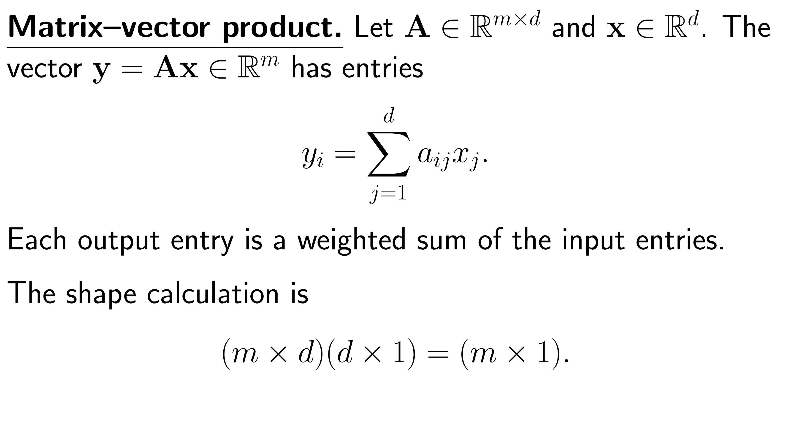

## 第 12 页：例 2 续：实际计算矩阵乘向量

使用第 10 页的

$$
A=\begin{pmatrix}1/3&0&1/3&1/3&0\\0&5&-3&0&-12\\0&0&2&2&0\end{pmatrix},\qquad
x=(3,2,-6,9,-1)^T.
$$

逐行计算：第一项是 $(3-6+9)/3=2$；第二项是 $5(2)-3(-6)-12(-1)=40$；第三项是 $2(-6+9)=6$。因此 $Ax=(2,40,6)^T$。

展开第 12 页原始 slide，核对图表、标注和公式

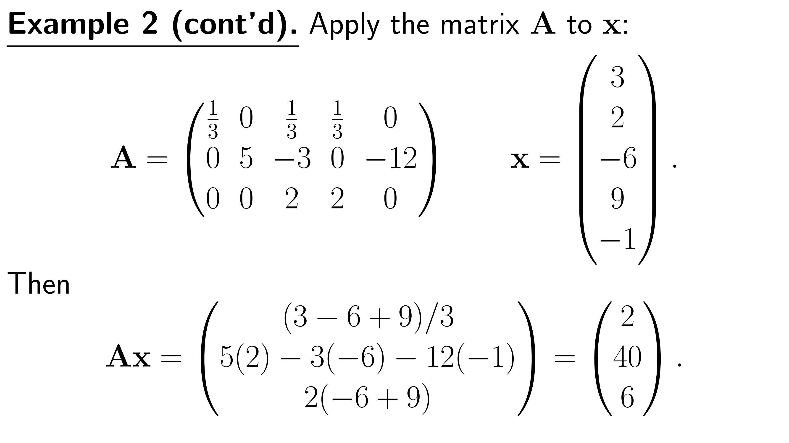

## 第 13 页：命题 1：矩阵一定定义线性映射

每个 $A\in\mathbb R^{m\times d}$ 都定义线性映射 $T_A:\mathbb R^d\to\mathbb R^m$，规则为 $T_A(x)=Ax$。等价地，对所有相容的向量和实数，

$$
A(sx+ty)=sAx+tAy.
$$

这说明前面的矩阵计算保留线性组合的结构。

展开第 13 页原始 slide，核对图表、标注和公式

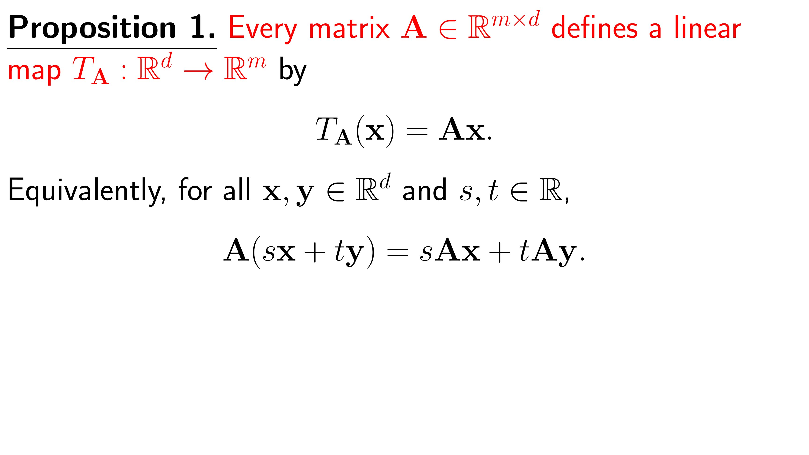

## 第 14 页：章节页：矩阵乘法组合模型

接下来把两个先后执行的线性阶段合并成一个矩阵，并由此解释矩阵乘矩阵的规则。

展开第 14 页原始 slide，核对图表、标注和公式

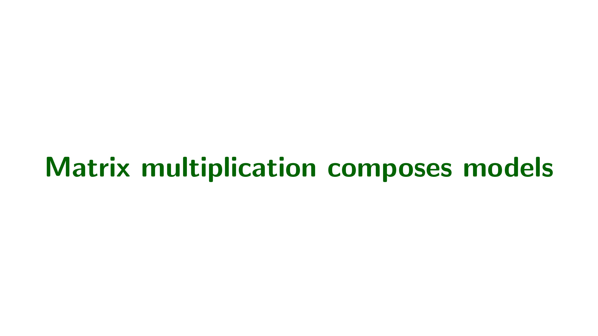

## 第 15 页：例 3：先做三维到二维，再做二维到二维

第一阶段 $T_B:\mathbb R^3\to\mathbb R^2$ 为

$$
T_B((x_1,x_2,x_3)^T)=(x_1+x_3,x_2-x_3)^T.
$$

第二阶段 $T_A:\mathbb R^2\to\mathbb R^2$ 为

$$
T_A((y_1,y_2)^T)=(2y_1-y_2,-3y_1+4y_2)^T.
$$

计算顺序是先 $B$ 后 $A$，第二阶段的输入就是第一阶段的输出。

展开第 15 页原始 slide，核对图表、标注和公式

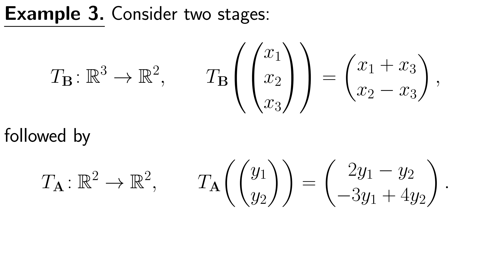

## 第 16 页：例 3 续：把中间变量代回去

两个矩阵分别是

$$
B=\begin{pmatrix}1&0&1\\0&1&-1\end{pmatrix},\qquad
A=\begin{pmatrix}2&-1\\-3&4\end{pmatrix}.
$$

组合后

$$
T_A(T_B(x))=
\begin{pmatrix}2(x_1+x_3)-(x_2-x_3)\\-3(x_1+x_3)+4(x_2-x_3)\end{pmatrix}
=\begin{pmatrix}2x_1-x_2+3x_3\\-3x_1+4x_2-7x_3\end{pmatrix}.
$$

把中间输出直接代入，就可读出组合映射的系数。

展开第 16 页原始 slide，核对图表、标注和公式

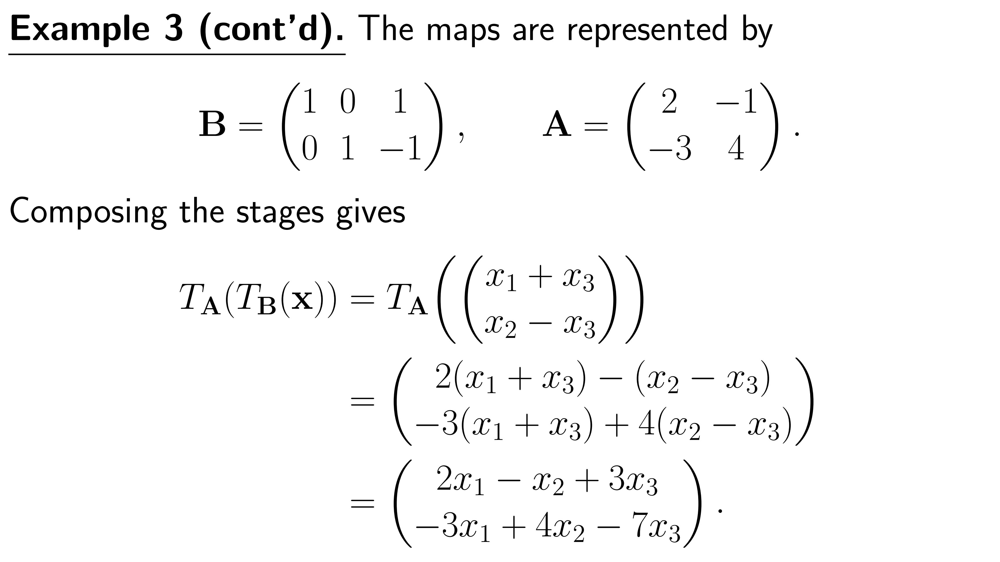

## 第 17 页：矩阵乘法的定义

设 $A\in\mathbb R^{m\times r}$、$B\in\mathbb R^{r\times d}$，其乘积 $C=AB\in\mathbb R^{m\times d}$ 的元素为

$$
c_{ij}=\sum_{q=1}^r a_{iq}b_{qj}.
$$

也就是 $A$ 的第 $i$ 行与 $B$ 的第 $j$ 列对应相乘再相加。内侧维度必须相同：$(m\times r)(r\times d)=(m\times d)$。这里的 $r$ 是求和下标遍历的长度。

展开第 17 页原始 slide，核对图表、标注和公式

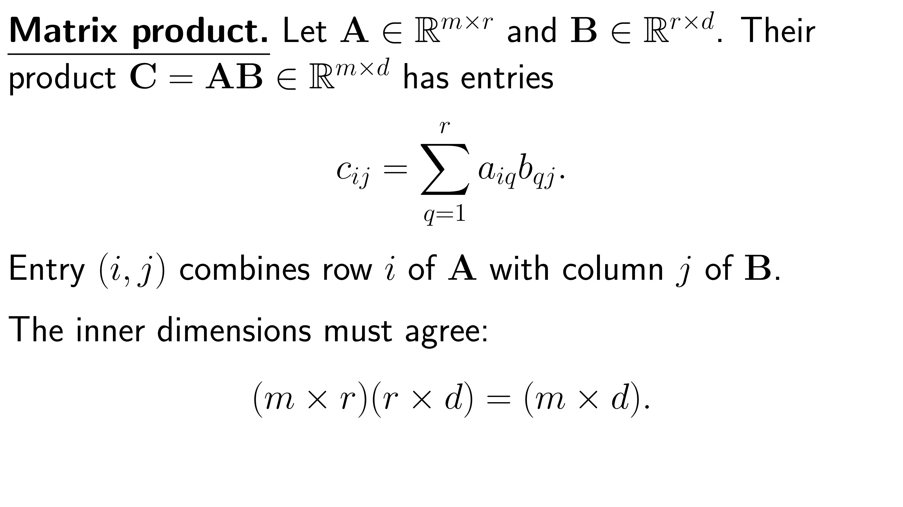

## 第 18 页：例 3 续：逐行乘列验证组合矩阵

对 $A=\begin{pmatrix}2&-1\\-3&4\end{pmatrix}$ 和 $B=\begin{pmatrix}1&0&1\\0&1&-1\end{pmatrix}$，六个元素的计算是

$$
AB=\begin{pmatrix}
2(1)+(-1)(0)&2(0)+(-1)(1)&2(1)+(-1)(-1)\\
(-3)(1)+4(0)&(-3)(0)+4(1)&(-3)(1)+4(-1)
\end{pmatrix}
=\begin{pmatrix}2&-1&3\\-3&4&-7\end{pmatrix}.
$$

它恰好是第 16 页把变量代回后得到的系数矩阵。

展开第 18 页原始 slide，核对图表、标注和公式

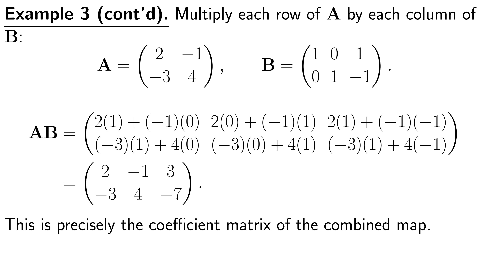

## 第 19 页：为什么矩阵计算适合 GPU

输入矩阵固定后，乘积的各个元素可以独立计算。课件用个人电脑 CPU 大约有 4–32 个较强核心，对比现代 GPU 可有数千个较简单的并行处理单元，说明大矩阵乘法适合深度学习使用的并行硬件。这些数目是课件中的硬件量级示意。

展开第 19 页原始 slide，核对图表、标注和公式

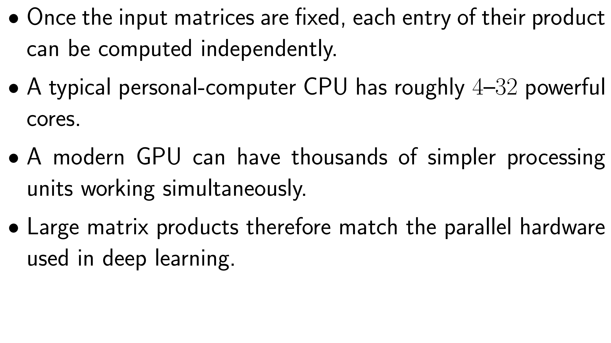

## 第 20 页：命题 2：乘积表示先 B 后 A

若 $A\in\mathbb R^{m\times r}$、$B\in\mathbb R^{r\times d}$，则对每个 $x\in\mathbb R^d$，

$$
A(Bx)=(AB)x.
$$

所以 $AB$ 表示从 $\mathbb R^d$ 到 $\mathbb R^m$ 的组合映射，执行顺序是先右侧的 $B$，再左侧的 $A$。

展开第 20 页原始 slide，核对图表、标注和公式

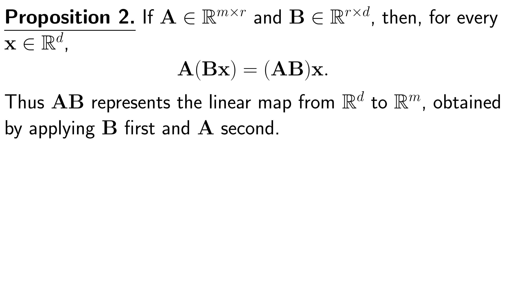

## 第 21 页：证明留白页：交换有限求和顺序

原 PDF 只有“Proof sketch.”标题，没有填出证明。

**理解补充：**考察第 $i$ 个输出坐标：

$$
[A(Bx)]_i=\sum_{q=1}^r a_{iq}\left(\sum_{j=1}^d b_{qj}x_j\right)
=\sum_{j=1}^d\left(\sum_{q=1}^r a_{iq}b_{qj}\right)x_j
=[(AB)x]_i.
$$

所有坐标都相同，两个向量就相同。

展开第 21 页原始 slide，核对图表、标注和公式

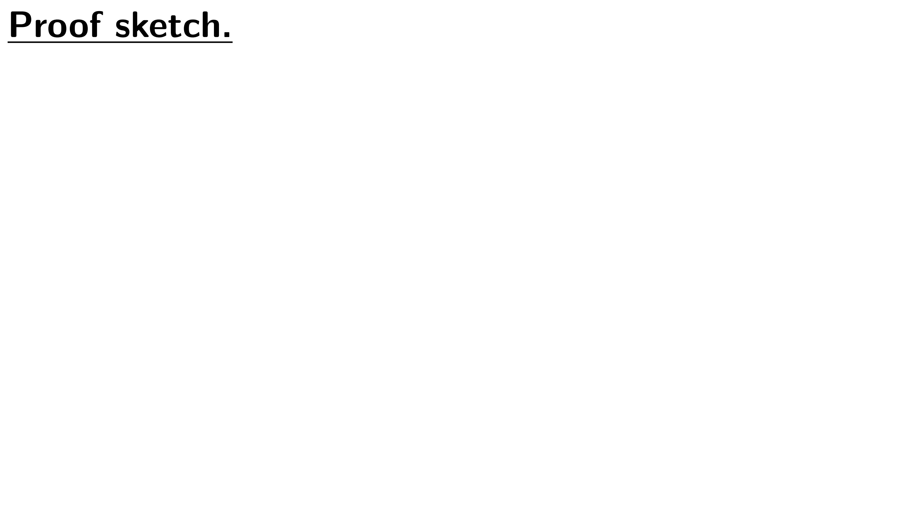

## 第 22 页：章节页：矩阵乘法的性质

接下来分清哪些实数乘法规则仍成立，哪些规则不能直接套到矩阵上。

展开第 22 页原始 slide，核对图表、标注和公式

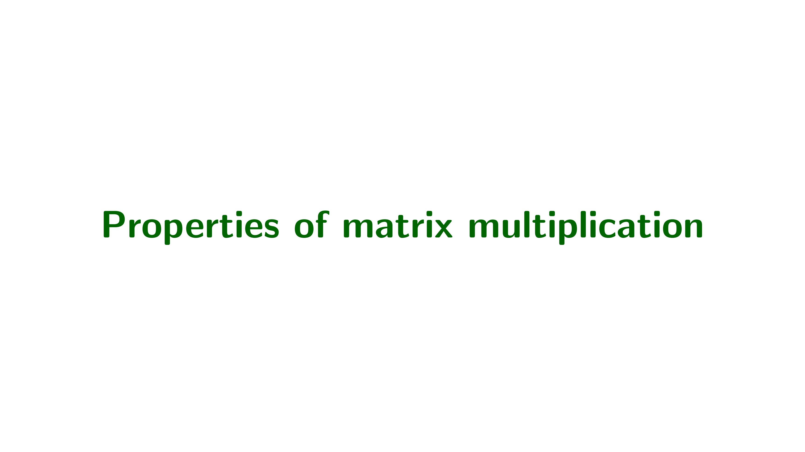

## 第 23 页：例 4：矩阵乘法不满足交换律

令

$$
A=\begin{pmatrix}1&1\\0&1\end{pmatrix},\qquad B=\begin{pmatrix}1&0\\1&1\end{pmatrix}.
$$

两个方向都能相乘，但结果分别是

$$
AB=\begin{pmatrix}2&1\\1&1\end{pmatrix},\qquad BA=\begin{pmatrix}1&1\\1&2\end{pmatrix}.
$$

因此 $AB\ne BA$。执行变换的先后顺序会影响结果。

展开第 23 页原始 slide，核对图表、标注和公式

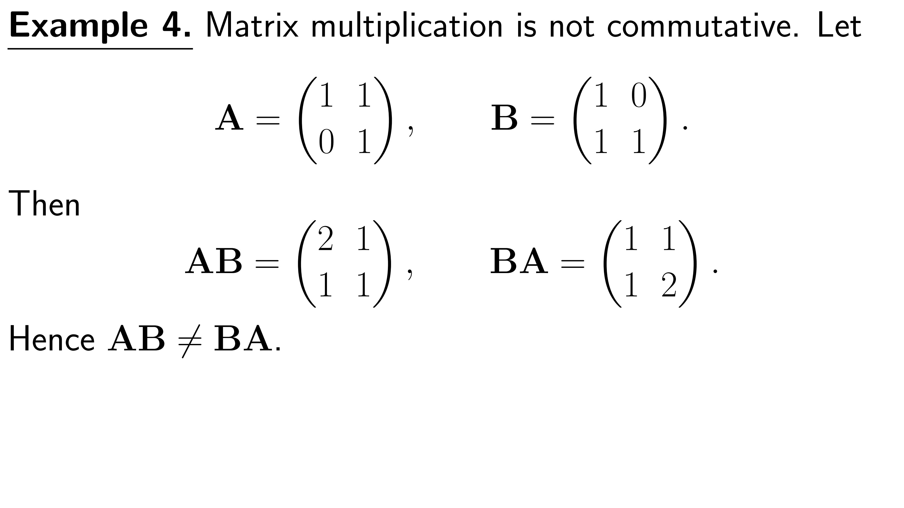

## 第 24 页：结合律和分配律仍成立

只要各表达式有定义，就有

$$
(AB)C=A(BC),\qquad A(B+C)=AB+AC,\qquad (A+B)C=AC+BC.
$$

矩阵乘法满足结合律、左右分配律，但一般不满足交换律。结合律允许改变括号，不能据此调换矩阵顺序。

展开第 24 页原始 slide，核对图表、标注和公式

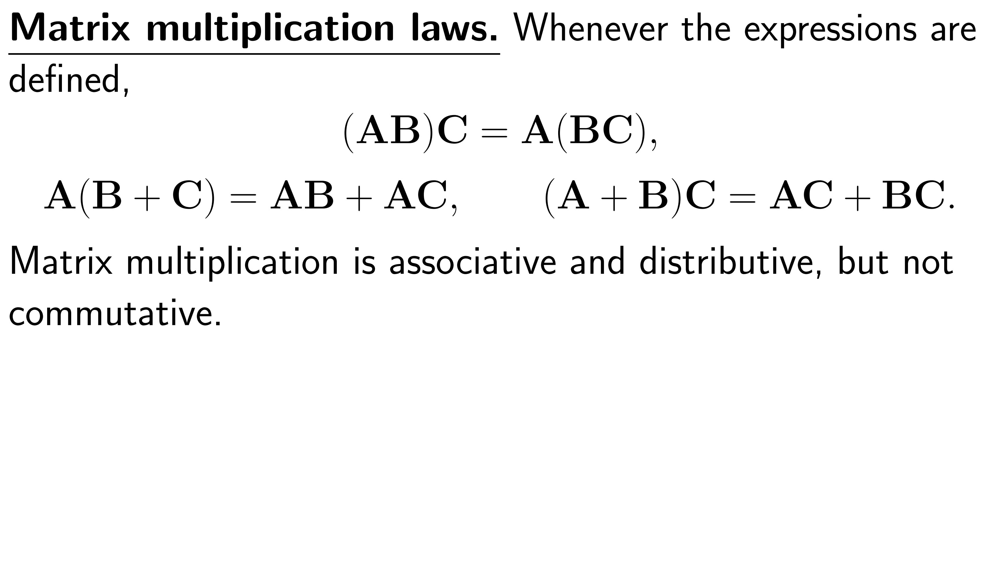

## 第 25 页：章节页：转置及其性质

下面引入把行列互换的操作，并用转置把长度、回归损失和批量变换写成矩阵公式。

展开第 25 页原始 slide，核对图表、标注和公式

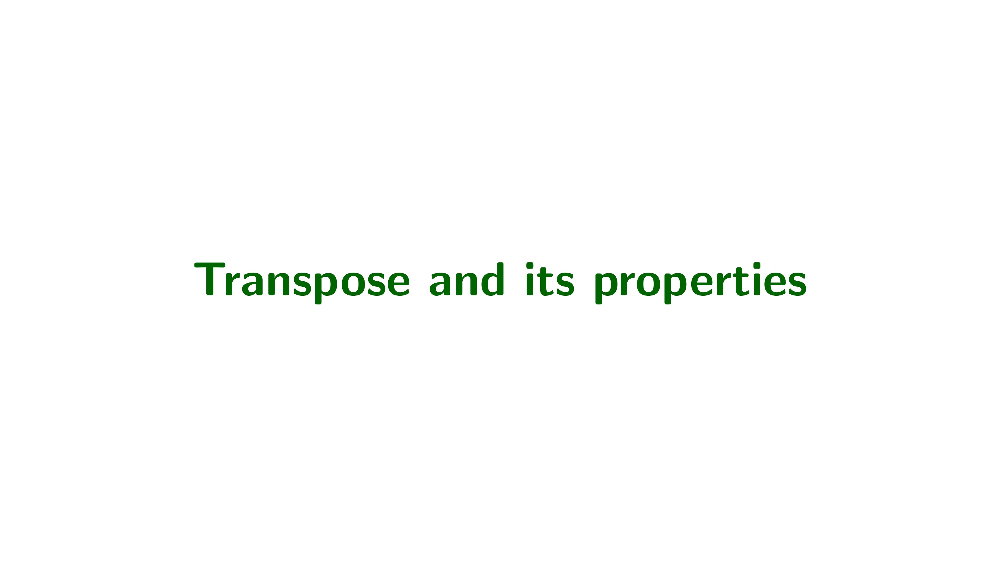

## 第 26 页：转置的定义

若 $A\in\mathbb R^{m\times d}$，其转置 $A^T\in\mathbb R^{d\times m}$ 把行变成列，满足 $(A^T)_{ji}=a_{ij}$。连续转置两次回到原矩阵：$(A^T)^T=A$。形状也从 $m\times d$ 变成 $d\times m$，然后再变回来。

展开第 26 页原始 slide，核对图表、标注和公式

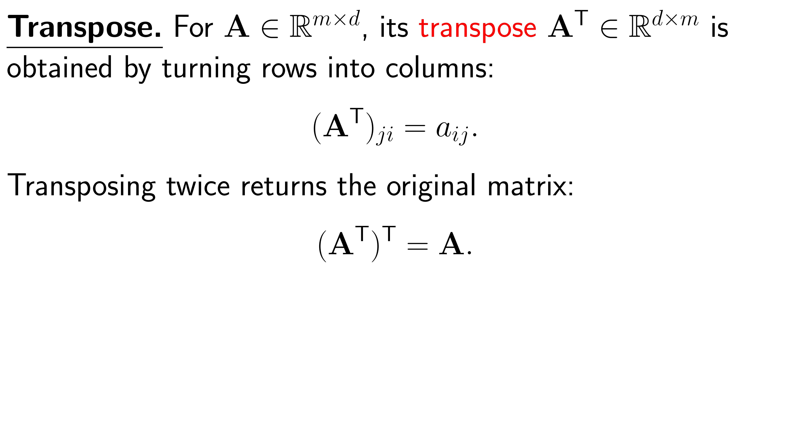

## 第 27 页：例 5：歌曲矩阵的转置

七首歌原先每行一首，转置后每列一首：

$$
X^T=\begin{pmatrix}
0.91&0.71&0.25&0.31&0.11&0.12&0.25\\
0.08&0.10&0.20&0.57&0.59&0.57&0.31\\
0.37&0.37&0.46&0.29&0.34&0.35&0.10
\end{pmatrix}\in\mathbb R^{3\times7}.
$$

$X$ 的每一行变成 $X^T$ 的一列；现在每一行横跨七首歌，记录一个固定特征。

展开第 27 页原始 slide，核对图表、标注和公式

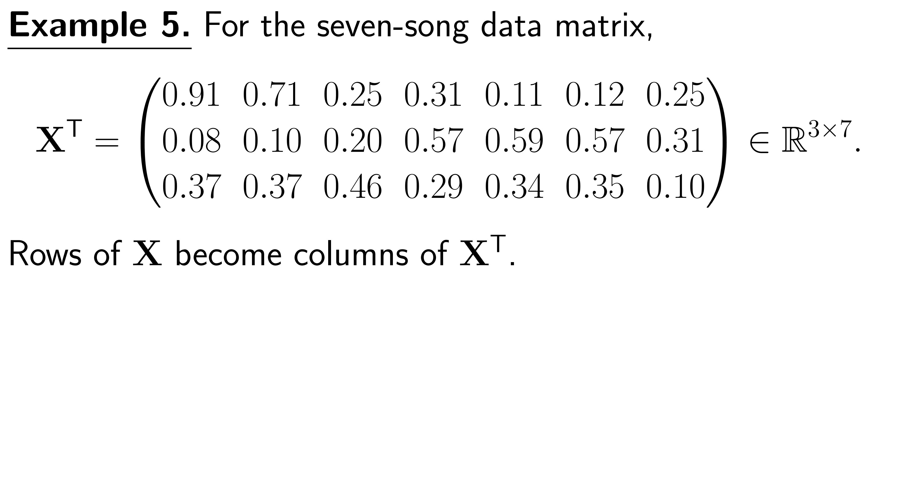

## 第 28 页：例 6：用转置计算长度平方

设 $x=(3,-4,12)^T$，则

$$
x^Tx=(3\ -4\ 12)(3,-4,12)^T=3^2+(-4)^2+12^2=169=\|x\|_2^2.
$$

一般地，对所有 $x\in\mathbb R^d$ 都有 $\|x\|_2^2=x^Tx$。这里得到的是一个标量，向量长度本身为 $\sqrt{169}=13$。

展开第 28 页原始 slide，核对图表、标注和公式

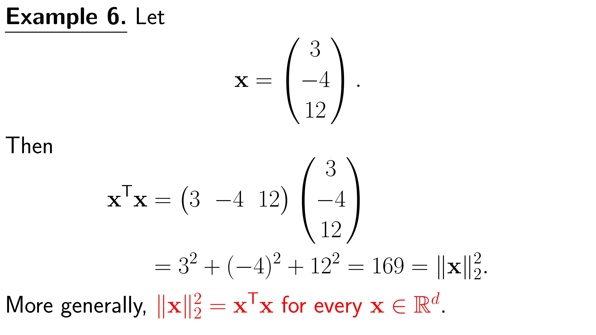

## 第 29 页：转置的三条运算规则

对形状相容的矩阵和 $s\in\mathbb R$，

$$
(A+B)^T=A^T+B^T,\qquad(sA)^T=sA^T,\qquad(AB)^T=B^TA^T.
$$

乘积转置时顺序反转。这个反转同时使形状相容，例如 $AB$ 为 $m\times d$ 时，$B^TA^T$ 为 $d\times m$。

展开第 29 页原始 slide，核对图表、标注和公式

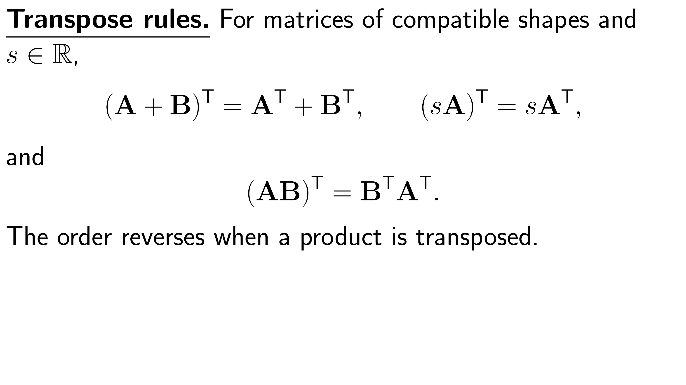

## 第 30 页：线性回归均方误差的三种写法

设数据矩阵 $X\in\mathbb R^{n\times d}$、目标 $y\in\mathbb R^n$、权重 $w\in\mathbb R^d$。全部预测组成 $\hat y=Xw$。均方误差是

$$
L(w)=\frac1n\sum_{i=1}^n(x_i^Tw-y_i)^2
=\frac1n\|Xw-y\|_2^2
=\frac1n(Xw-y)^T(Xw-y).
$$

逐样本平方误差、残差向量的长度平方、转置乘积，是同一个量的三种写法。

展开第 30 页原始 slide，核对图表、标注和公式

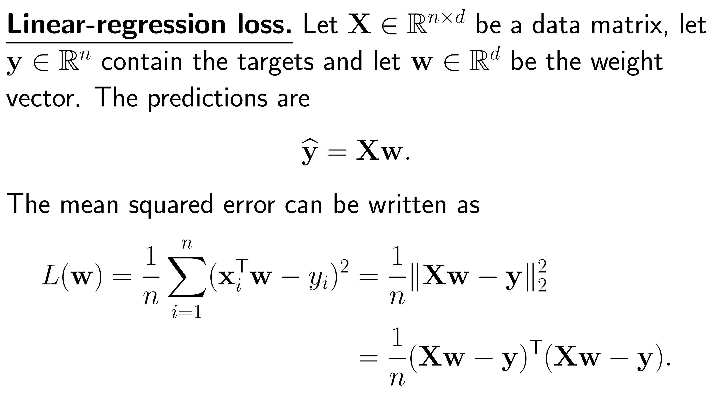

## 第 31 页：展开回归损失与合并交叉项

利用乘积的转置规则，

$$
\begin{aligned}
nL(w)&=(Xw-y)^T(Xw-y)\\
&=(w^TX^T-y^T)(Xw-y)\\
&=w^TX^TXw-y^TXw-w^TX^Ty+y^Ty.
\end{aligned}
$$

交叉项 $w^TX^Ty$ 与 $y^TXw$ 都是标量，且互为转置，所以相等。$y^Ty$ 与 $w$ 无关；再去掉正的常数倍 $1/n$，最小化 $L(w)$ 就等价于最小化 $w^TX^TXw-2y^TXw$。

展开第 31 页原始 slide，核对图表、标注和公式

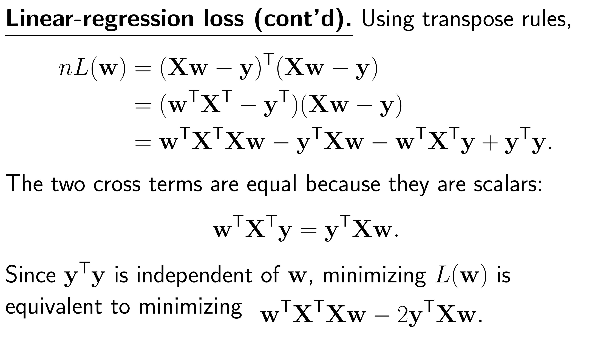

## 第 32 页：章节页：批量变换与分层模型

单个数据点的变换已经会算了；接下来处理一整批按行存储的数据，并解释连续线性层可以怎样合并。

展开第 32 页原始 slide，核对图表、标注和公式

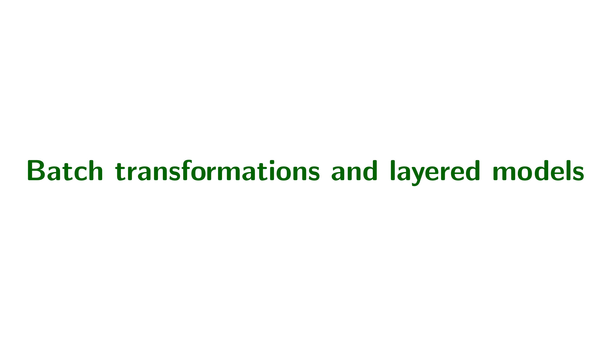

## 第 33 页：批量变换为什么要右乘转置矩阵

设 $X\in\mathbb R^{n\times d}$ 的第 $i$ 行是 $x_i^T$，$A\in\mathbb R^{p\times d}$ 负责变换单个点。单点输出是 $Ax_i$，其行表示为

$$
(Ax_i)^T=x_i^TA^T.
$$

把这 $n$ 行堆起来，得到 $Y=XA^T\in\mathbb R^{n\times p}$。单点左乘 $A$，批量按行存储时则右乘 $A^T$；区别来自存储方向。

展开第 33 页原始 slide，核对图表、标注和公式

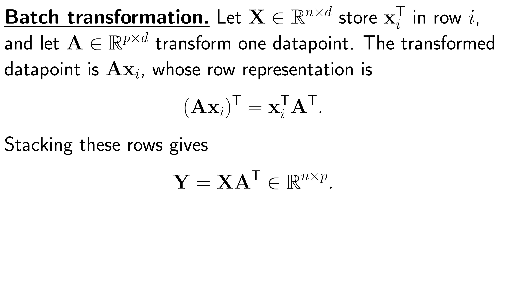

## 第 34 页：两层线性网络合并为一层

若第一层 $h=Bx$，第二层 $y=Ah$，那么 $y=A(Bx)=(AB)x$。两个连续线性层等价于一个线性映射。

对于批量 $X\in\mathbb R^{n\times d}$，输出为

$$
X(AB)^T=XB^TA^T\in\mathbb R^{n\times p}.
$$

**理解补充：**这里讨论连续的纯线性变换；若中间加入非线性激活，就不能仅用矩阵乘积合并。

展开第 34 页原始 slide，核对图表、标注和公式

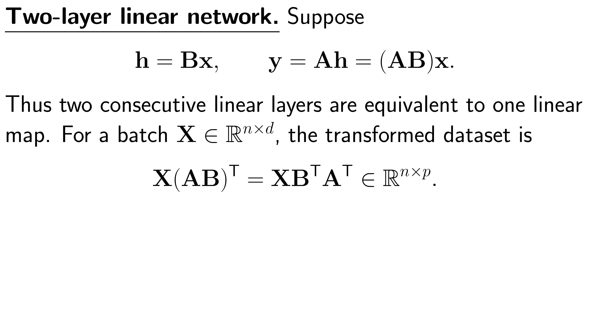

## 第 35 页：图像、矩阵与张量

前面把每个点都表示成向量，但计算机视觉中的图像用矩阵表示更容易保留几何结构。原页再次展示手写数字 5。多张图像需要张量（tensor），它是矩阵的自然推广。

例如在 PyTorch 中，$n$ 张 MNIST 图像可组成 $\mathbb R^{n\times28\times28}$ 的单个张量：第一维索引图片，另两维保留像素行列。原页要求阅读 Lecture Note 2，了解更多细节和例子。

展开第 35 页原始 slide，核对图表、标注和公式

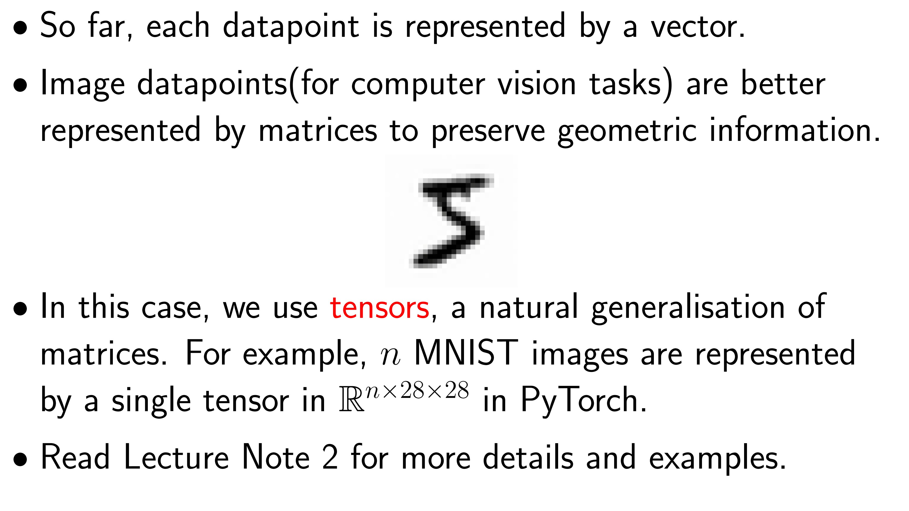

## 第 36 页：章节页：精确拟合转化为线性方程组

接下来不只是给权重算预测，而是反过来寻找一组权重，让模型在所有训练点上精确给出指定目标。

展开第 36 页原始 slide，核对图表、标注和公式

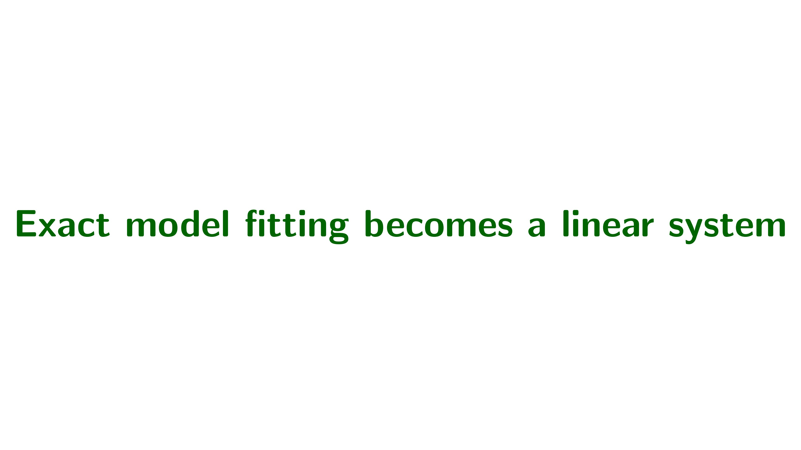

## 第 37 页：从逐点要求得到 Xw=y

监督学习中，$x_i\in\mathbb R^d$ 带有目标 $y_i$。线性模型用权重 $w\in\mathbb R^d$ 预测 $x_i^Tw$。精确拟合要求每个点都满足 $x_i^Tw=y_i$。把所有要求堆起来就是线性方程组 $Xw=y$，其中 $X$ 的第 $i$ 行为 $x_i^T$。

展开第 37 页原始 slide，核对图表、标注和公式

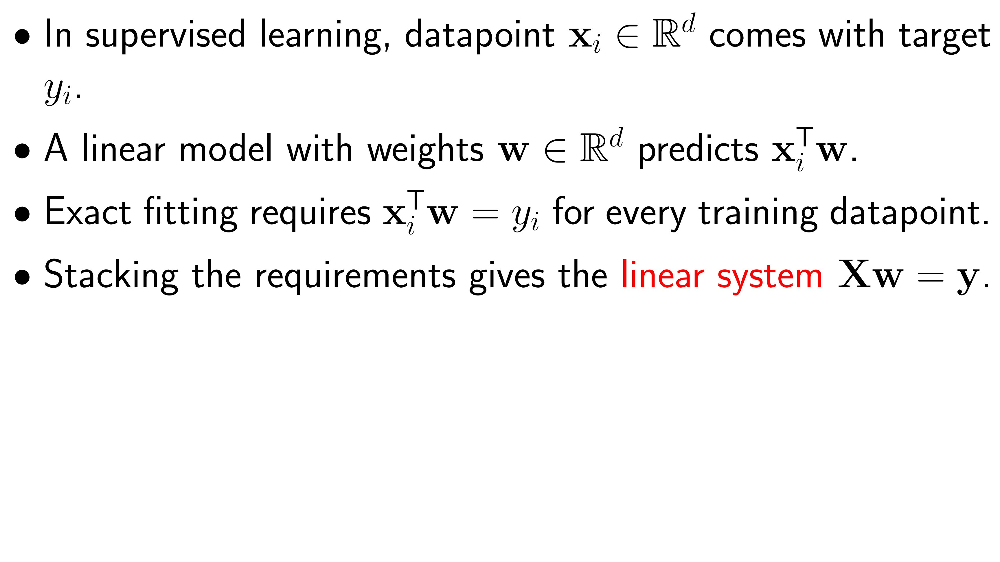

## 第 38 页：例 7：三个带标签数据点

给出 $x_1=(1,1,0)^T,y_1=5$；$x_2=(0,1,1)^T,y_2=4$；$x_3=(1,0,1)^T,y_3=3$。模型是 $f_w(x)=w^Tx$。原页提问：哪些权重可以同时拟合这三个点？每个样本都贡献一条约束，不能只满足其中一部分。

展开第 38 页原始 slide，核对图表、标注和公式

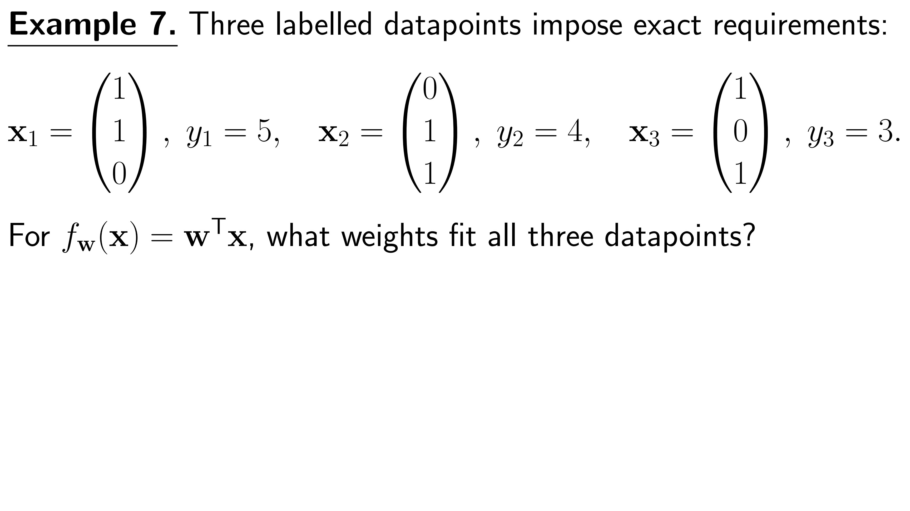

## 第 39 页：例 7 续：写方程并给出权重

三条要求为 $w_1+w_2=5$、$w_2+w_3=4$、$w_1+w_3=3$，合写为

$$
\underbrace{\begin{pmatrix}1&1&0\\0&1&1\\1&0&1\end{pmatrix}}_{A}
\underbrace{\begin{pmatrix}w_1\\w_2\\w_3\end{pmatrix}}_{w}
=\underbrace{\begin{pmatrix}5\\4\\3\end{pmatrix}}_{b}.
$$

解为 $w=(2,3,1)^T$。代回检查：$2+3=5$、$3+1=4$、$2+1=3$。

展开第 39 页原始 slide，核对图表、标注和公式

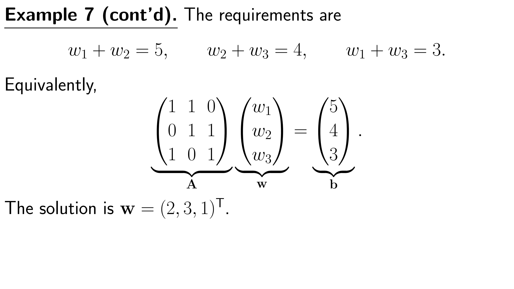

## 第 40 页：线性方程组、一致与不一致

设 $A\in\mathbb R^{n\times d}$、$b\in\mathbb R^n$，未知数是 $w\in\mathbb R^d$，线性方程组写成 $Aw=b$。一个解必须同时满足全部 $n$ 条方程。至少有一个解称 consistent（一致、有解）；一个解都没有称 inconsistent（不一致、无解）。一致并不意味着解唯一。

展开第 40 页原始 slide，核对图表、标注和公式

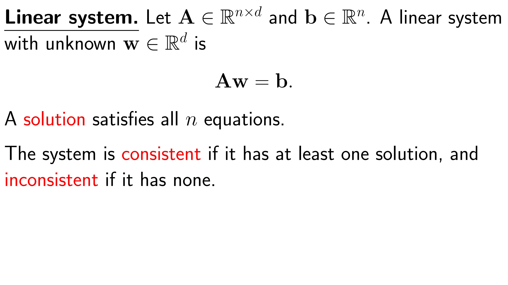

## 第 41 页：增广矩阵

把目标向量并到系数矩阵右侧，得到增广矩阵

$$
[A\mid b]=\begin{pmatrix}
a_{11}&a_{12}&\cdots&a_{1d}&b_1\\
a_{21}&a_{22}&\cdots&a_{2d}&b_2\\
\vdots&\vdots&\ddots&\vdots&\vdots\\
a_{n1}&a_{n2}&\cdots&a_{nd}&b_n
\end{pmatrix}.
$$

竖线只用来区分左边的系数与右边的输出，不是额外的一列数。它提醒我们行操作必须同时作用到右端。

展开第 41 页原始 slide，核对图表、标注和公式

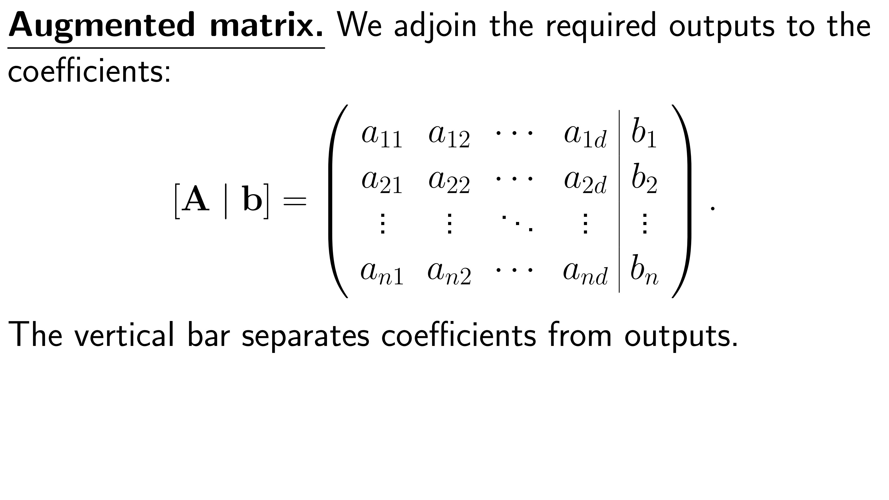

## 第 42 页：几何上为何有三类解集

三个未知数时，一个非平凡线性方程描述一个平面。多个平面可能相交于一点，可能共享一条线，也可能没有共同交点，分别示意唯一解、无穷多解和无解。高斯消元可以识别这些情况，不依赖我们是否能画出高维几何图。

展开第 42 页原始 slide，核对图表、标注和公式

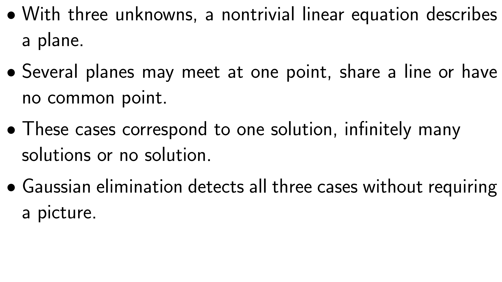

## 第 43 页：章节页：高斯消元保持解集

下面通过可逆的行操作化简方程组。重点是在让方程变容易的同时，不改变原来哪些权重是解。

展开第 43 页原始 slide，核对图表、标注和公式

## 第 44 页：例 8：消去主元下方的元素

从例 7 的增广矩阵出发：

$$
\begin{pmatrix}1&1&0&5\\0&1&1&4\\1&0&1&3\end{pmatrix}
\xrightarrow{R_3\leftarrow R_3-R_1}
\begin{pmatrix}1&1&0&5\\0&1&1&4\\0&-1&1&-2\end{pmatrix}
\xrightarrow{R_3\leftarrow R_3+R_2}
\begin{pmatrix}1&1&0&5\\0&1&1&4\\0&0&2&2\end{pmatrix}
\xrightarrow{R_3\leftarrow\frac12R_3}
\begin{pmatrix}1&1&0&5\\0&1&1&4\\0&0&1&1\end{pmatrix}.
$$

三步依次消去第一列下方的 1、第二列下方的 $-1$，再把第三行主元化为 1。

展开第 44 页原始 slide，核对图表、标注和公式

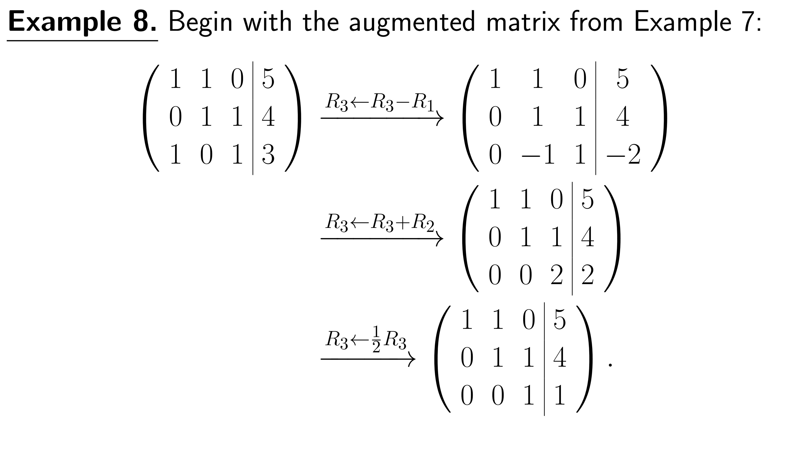

## 第 45 页：例 8 续：消去主元上方的元素

继续从上一页最后的矩阵出发：

$$
\begin{pmatrix}1&1&0&5\\0&1&1&4\\0&0&1&1\end{pmatrix}
\xrightarrow{R_2\leftarrow R_2-R_3}
\begin{pmatrix}1&1&0&5\\0&1&0&3\\0&0&1&1\end{pmatrix}
\xrightarrow{R_1\leftarrow R_1-R_2}
\begin{pmatrix}1&0&0&2\\0&1&0&3\\0&0&1&1\end{pmatrix}.
$$

最终三行直接说明 $w_1=2,w_2=3,w_3=1$。

展开第 45 页原始 slide，核对图表、标注和公式

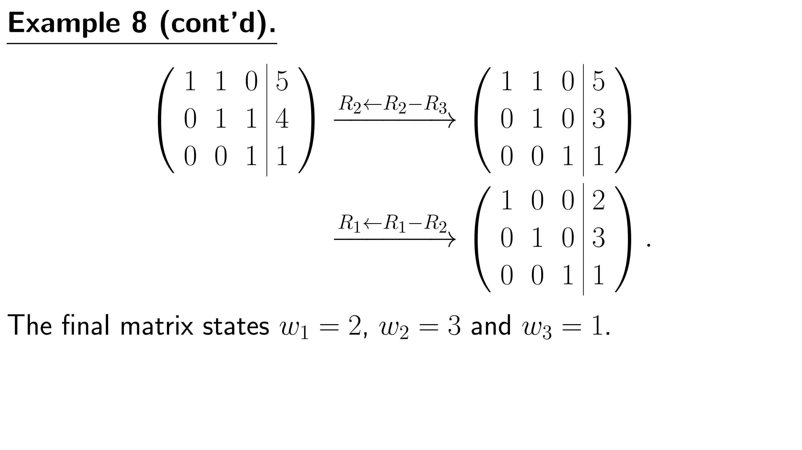

## 第 46 页：三种初等行操作与行等价

允许的初等行操作共有三类：交换两行；把一行乘以一个非零标量；把某一行的标量倍数加到另一行。若一串这样的操作能把一个矩阵变成另一个，就称二者 row equivalent（行等价）。乘以零不允许，因为那会抹掉一条约束。

展开第 46 页原始 slide，核对图表、标注和公式

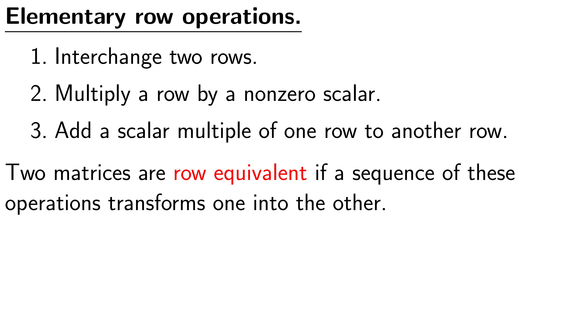

## 第 47 页：命题 3：为何行操作不改变解

行等价的增广矩阵表示具有相同解集的方程组，因为每一步操作都可逆：换行后可以换回来；乘非零数后可以除以它；加上另一行的某个倍数后，可以减去同样的倍数。因此旧系统的解也是新系统的解，反向也成立。

展开第 47 页原始 slide，核对图表、标注和公式

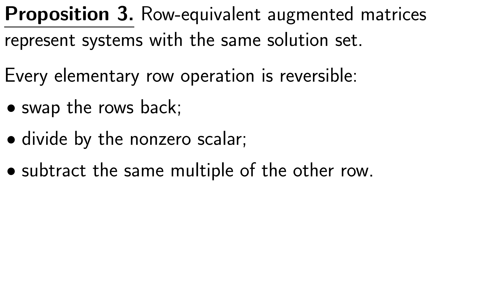

## 第 48 页：行阶梯形与主元

每个非零行的第一个非零元素称 pivot（主元）。矩阵为 row-echelon form（行阶梯形）时，要同时满足：所有零行在非零行下面；较低一行的主元严格位于上一主元右边；主元下面的元素全为零。各主元形成向右下走的阶梯。此时主元不一定等于 1，上方也不一定为零。

展开第 48 页原始 slide，核对图表、标注和公式

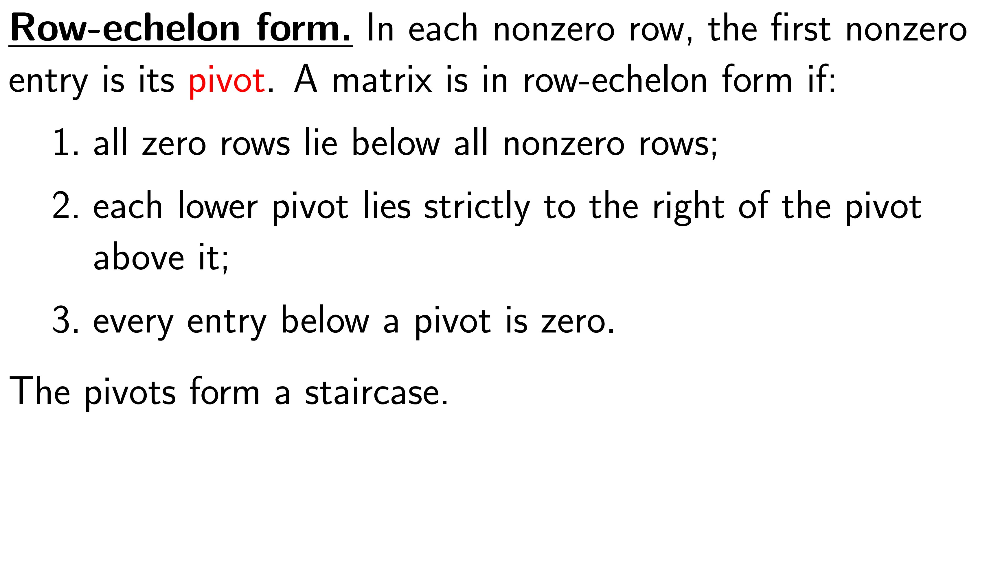

## 第 49 页：简化行阶梯形与自由变量

Reduced row-echelon form（简化行阶梯形）在行阶梯形基础上再要求：每个主元等于 1；主元是其所在列唯一的非零元素。系数部分有主元的列对应 pivot variable（主元变量）；没有主元的系数列对应 free variable（自由变量）。右端常数列不能当作未知变量列。

展开第 49 页原始 slide，核对图表、标注和公式

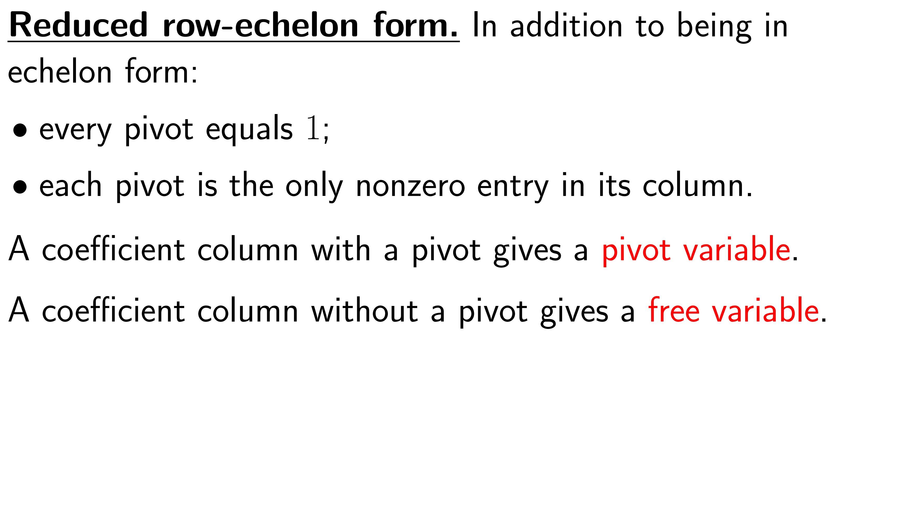

## 第 50 页：例 9：阶梯形不一定是简化阶梯形

考虑增广矩阵

$$
E=\begin{pmatrix}3&6&-18&9&87\\0&5&-25&-4&11\\0&0&0&7&42\end{pmatrix}.
$$

主元位于第 1、2、4 列，原页用红色标出 3、5、7。它们逐行右移且下方均为零，所以是阶梯形。主元并非 1，且所在列上方仍有非零数，所以不是简化阶梯形。第三列没有主元。

展开第 50 页原始 slide，核对图表、标注和公式

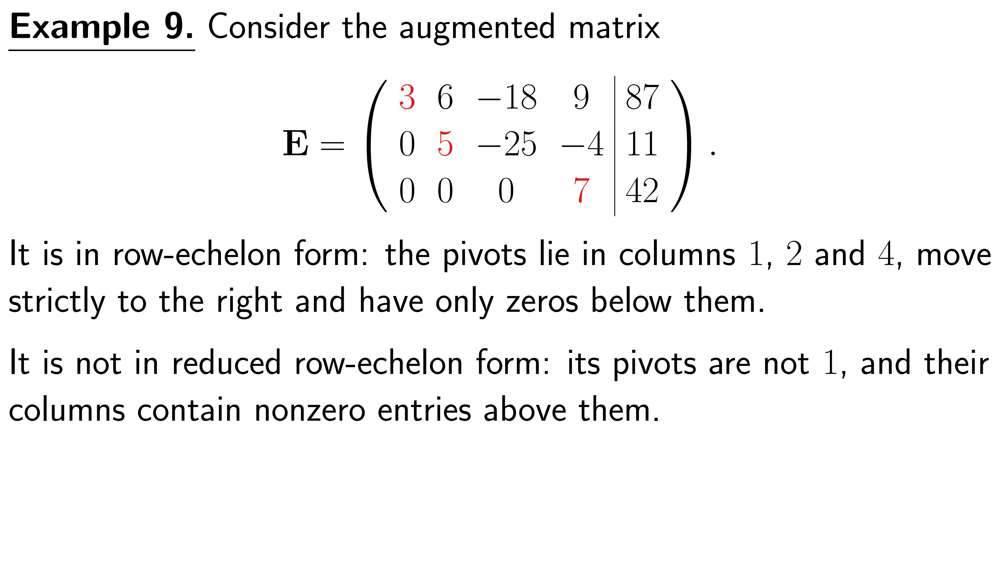

## 第 51 页：例 9 续：先处理第四列主元

原页从 $E$ 出发，只写 $R_3\leftarrow\frac17R_3$ 与 $R_2\leftarrow R_2+4R_3$ 的箭头，中间结果留白。

**理解补充（填出计算）：**

$$
\begin{pmatrix}3&6&-18&9&87\\0&5&-25&-4&11\\0&0&0&7&42\end{pmatrix}
\longrightarrow\begin{pmatrix}3&6&-18&9&87\\0&5&-25&-4&11\\0&0&0&1&6\end{pmatrix}
\longrightarrow\begin{pmatrix}3&6&-18&9&87\\0&5&-25&0&35\\0&0&0&1&6\end{pmatrix}.
$$

第二步的右端为 $11+4\cdot6=35$，必须和左侧一起变换。

展开第 51 页原始 slide，核对图表、标注和公式

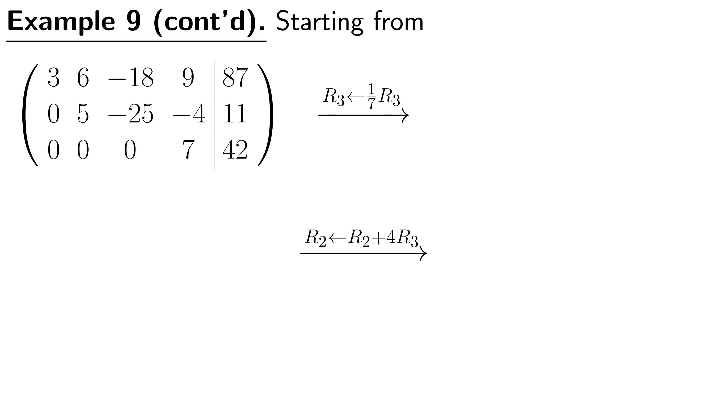

## 第 52 页：例 9 续：消掉第一行第四列并归一化第二行

原页只给出 $R_1\leftarrow R_1-9R_3$、$R_2\leftarrow\frac15R_2$ 两个操作箭头，矩阵结果留白。

**理解补充：**依次得到

$$
\begin{pmatrix}3&6&-18&0&33\\0&5&-25&0&35\\0&0&0&1&6\end{pmatrix}
\longrightarrow\begin{pmatrix}3&6&-18&0&33\\0&1&-5&0&7\\0&0&0&1&6\end{pmatrix}.
$$

第一步右端 $87-9\cdot6=33$，第二步把第二行每个数都除以 5。

展开第 52 页原始 slide，核对图表、标注和公式

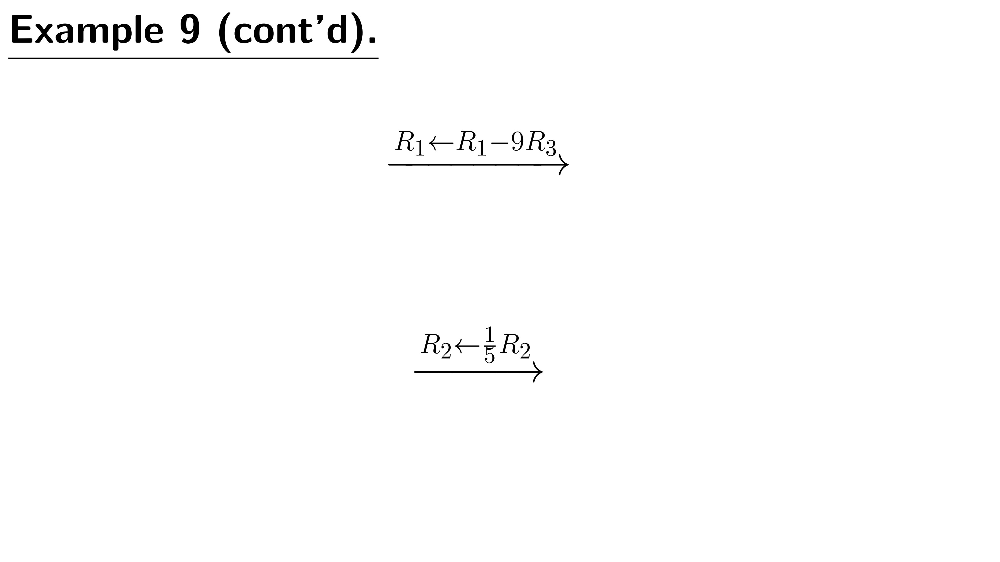

## 第 53 页：例 9 续：得到简化行阶梯形

原页给出 $R_1\leftarrow R_1-6R_2$ 和 $R_1\leftarrow\frac13R_1$，继续留出计算空间。

**理解补充：**结果为

$$
\begin{pmatrix}3&0&12&0&-9\\0&1&-5&0&7\\0&0&0&1&6\end{pmatrix}
\longrightarrow\begin{pmatrix}1&0&4&0&-3\\0&1&-5&0&7\\0&0&0&1&6\end{pmatrix}.
$$

主元列是 1、2、4，第三个未知数自由。若设 $w_3=t$，则 $w_1=-3-4t,w_2=7+5t,w_4=6$。

展开第 53 页原始 slide，核对图表、标注和公式

## 第 54 页：高斯消元与 Gauss-Jordan 消元

高斯消元的步骤是：按列从左向右；把一个非零元素移到下一个主元位置；消掉主元下方的元素；继续直到得到行阶梯形，再回代。Gauss-Jordan 消元还会把主元缩放成 1，并消掉主元上方的元素，得到简化行阶梯形。

展开第 54 页原始 slide，核对图表、标注和公式

## 第 55 页：章节页：主元揭示全部解的情况

接下来把前面的具体计算归纳成通用判据：什么时候无解，什么时候唯一解，什么时候有自由变量和无穷多解。

展开第 55 页原始 slide，核对图表、标注和公式

## 第 56 页：例 10：每个系数列都有主元，解唯一

例 8 化简成

$$
\begin{pmatrix}1&0&0&2\\0&1&0&3\\0&0&1&1\end{pmatrix}.
$$

三个系数列都含主元，没有自由变量，系统唯一解为 $(w_1,w_2,w_3)=(2,3,1)$。

展开第 56 页原始 slide，核对图表、标注和公式

## 第 57 页：例 10 续：相关约束产生无穷多解

把第三条方程改为 $w_1-w_3=1$，增广矩阵化简为

$$
\begin{pmatrix}1&1&0&5\\0&1&1&4\\1&0&-1&1\end{pmatrix}
\longrightarrow\begin{pmatrix}1&1&0&5\\0&1&1&4\\0&0&0&0\end{pmatrix}.
$$

第三条并未增加独立约束。$w_3$ 自由，设 $w_3=t$，则 $w_2=4-t,w_1=1+t$，$t\in\mathbb R$，所以有无穷多解。

展开第 57 页原始 slide，核对图表、标注和公式

## 第 58 页：例 10 续：相同左端要求不同右端导致无解

把上一页第三条方程右端从 1 改为 2：

$$
\begin{pmatrix}1&1&0&5\\0&1&1&4\\1&0&-1&2\end{pmatrix}
\longrightarrow\begin{pmatrix}1&1&0&5\\0&1&1&4\\0&0&0&1\end{pmatrix}.
$$

最后一行要求 $0=1$，不可能成立，所以系统不一致、没有解。

展开第 58 页原始 slide，核对图表、标注和公式

## 第 59 页：定理 4：根据阶梯形完整分类

设 $[A\mid b]$ 已是行阶梯形：若且唯若出现 $(0\ \cdots\ 0\mid c)$ 且 $c\ne0$，系统无解。如果系统一致，则当且仅当每个系数列都有主元时解唯一。其余一致情形至少有一个自由变量，因此有无穷多解。判断自由变量之前必须先排除矛盾行。

展开第 59 页原始 slide，核对图表、标注和公式

## 第 60 页：例 11：六个权重、四条精确要求

给出增广矩阵

$$
\begin{pmatrix}
0&2&0&0&0&4&6\\
1&0&0&0&2&0&2\\
0&0&-3&0&-9&-6&-12\\
1&0&0&1&5&4&3
\end{pmatrix}.
$$

左六列对应六个权重，右一列是目标。第一步交换 $R_1,R_2$，把第一列的非零元素放到第一主元位置。

展开第 60 页原始 slide，核对图表、标注和公式

## 第 61 页：例 11 续：得到四个主元

换行后执行 $R_2\leftarrow\frac12R_2$、$R_3\leftarrow-\frac13R_3$、$R_4\leftarrow R_4-R_1$，得到

$$
\begin{pmatrix}
1&0&0&0&2&0&2\\
0&1&0&0&0&2&3\\
0&0&1&0&3&2&4\\
0&0&0&1&3&4&1
\end{pmatrix}.
$$

前四列各有一个主元，最后两个系数列没有主元，也没有矛盾行。

展开第 61 页原始 slide，核对图表、标注和公式

## 第 62 页：例 11 续：用两个参数写全体解

主元变量是 $w_1,w_2,w_3,w_4$，自由变量是 $w_5,w_6$。设 $w_5=s,w_6=t$，可写出全部解：

$$
w=\begin{pmatrix}2-2s\\3-2t\\4-3s-2t\\1-3s-4t\\s\\t\end{pmatrix},\qquad s,t\in\mathbb R.
$$

任意选择两个实参数都会得到一个解；前四个坐标不能独立选择，而由这两个参数决定。

展开第 62 页原始 slide，核对图表、标注和公式

## 第 63 页：章节页：逆矩阵撤销方阵变换

最后一部分讨论能否把一个方阵的变换完整撤销，以及怎样通过消元同时求出这种撤销操作。

展开第 63 页原始 slide，核对图表、标注和公式

## 第 64 页：例 12：两个矩阵互相撤销

令

$$
A=\begin{pmatrix}1&1&0\\0&1&1\\1&0&1\end{pmatrix},\qquad
B=\frac12\begin{pmatrix}1&-1&1\\1&1&-1\\-1&1&1\end{pmatrix}.
$$

直接相乘得到 $AB=BA=I_3$。所以 $B$ 能撤销 $A$ 对向量的变换，反过来也成立。

展开第 64 页原始 slide，核对图表、标注和公式

## 第 65 页：单位矩阵与逆矩阵的定义

单位矩阵满足 $I_dx=x$。方阵 $A\in\mathbb R^{d\times d}$ 可逆，是指存在 $A^{-1}$ 使

$$
A^{-1}A=AA^{-1}=I_d.
$$

$A^{-1}$ 称为 $A$ 的逆矩阵。这里讨论的是方阵的双侧逆，不能把任意矩形矩阵都当作有这种逆。

展开第 65 页原始 slide，核对图表、标注和公式

## 第 66 页：命题 5：可逆方阵的方程组唯一可解

若 $A\in\mathbb R^{d\times d}$ 可逆，那么对每个 $b\in\mathbb R^d$，$Aw=b$ 都有唯一解 $w=A^{-1}b$。

**理解补充：**左乘 $A^{-1}$ 可推出任何解只能是这个向量；再代回 $A(A^{-1}b)=b$，确认它确实是解。因此既有存在性，也有唯一性。

展开第 66 页原始 slide，核对图表、标注和公式

## 第 67 页：用 Gauss-Jordan 求逆

把 $[A\mid I_d]$ 作为初始分块矩阵，对左右两块同步执行全部行操作。如果化成 $[I_d\mid B]$，则 $B=A^{-1}$。这相当于同时解 $d$ 个右端分别为标准基向量的方程组。如果左块最终少于 $d$ 个主元，$A$ 就不可逆。

展开第 67 页原始 slide，核对图表、标注和公式

## 第 68 页：例 13：对 A 和单位矩阵同步消元

从

$$
\begin{pmatrix}1&1&0&1&0&0\\0&1&1&0&1&0\\1&0&1&0&0&1\end{pmatrix}
$$

出发，依次做 $R_3\leftarrow R_3-R_1$、$R_3\leftarrow R_3+R_2$、$R_3\leftarrow\frac12R_3$。注意这些操作作用于整行六个数，而不是只作用于左边。

**理解补充：**第三行右块由 $(0,0,1)$ 先变为 $(-1,0,1)$，再变为 $(-1,1,1)$，最后变为 $(-1/2,1/2,1/2)$；左块第三行同时变成 $(0,0,1)$。

展开第 68 页原始 slide，核对图表、标注和公式

## 第 69 页：例 13 续：读出逆矩阵

继续执行 $R_2\leftarrow R_2-R_3$、$R_1\leftarrow R_1-R_2$，得到

$$
\begin{pmatrix}
1&0&0&1/2&-1/2&1/2\\
0&1&0&1/2&1/2&-1/2\\
0&0&1&-1/2&1/2&1/2
\end{pmatrix}.
$$

左块变成单位矩阵，右块就是 $A^{-1}=\frac12\begin{pmatrix}1&-1&1\\1&1&-1\\-1&1&1\end{pmatrix}$，与例 12 的 $B$ 一致。

展开第 69 页原始 slide，核对图表、标注和公式

## 第 70 页：例 14：主元不够，方阵不可逆

考虑

$$
A=\begin{pmatrix}4&7&-3&-6\\0&5&8&3\\0&0&6&6\\8&29&-6&-27\end{pmatrix}.
$$

高斯消元得到左块的阶梯形

$$
\begin{pmatrix}4&7&-3&-6\\0&5&8&3\\0&0&6&6\\0&0&0&0\end{pmatrix}.
$$

$4\times4$ 方阵只有三个主元，无法化成 $I_4$，所以不可逆。

展开第 70 页原始 slide，核对图表、标注和公式

## 第 71 页：本讲总结

矩阵既组织数据，也表示线性映射；矩阵乘法组合模型阶段，并适合并行计算。行操作保持线性方程组的解集；主元区分唯一解、无穷多解与无解。逆矩阵可以撤销可逆方阵的变换，并通过增广单位矩阵的消元法计算。

展开第 71 页原始 slide，核对图表、标注和公式

