# Lecture 06B：张成、线性无关、基、维度与秩，按幻灯片逐页复述

来源：[lecture06b.pdf](../../comp3670_lectures/lecture06b.pdf)，共 34 个 PDF 页面。严格按 PDF 页序组织，章节页、例题续页和证明留白页也单独保留。默认向量为列向量；数据矩阵中的每一行通常是一个数据点的转置。正文用中文讲解概念、公式和图表；原页未写出的解答或推导明确标为“理解补充”。每节末尾可展开完整原始 slide 核对颜色、标注和排版。图片和 PDF 均使用仓库相对路径，适合本地预览与 GitHub。

## 第 1 页：课程与主题：张成、线性无关、基、维度和秩

这是 COMP3670/6670《Introduction to Machine Learning》第 6b 周，英文主题为 Span, Independence, Bases, Dimension & Rank。讲师为 ANU School of Computing 的 Senior Lecturer Yun Kuen Cheung（Marco）。这一讲把矩阵的列看成可组合的方向，回答模型能输出什么、哪些特征冗余，以及真正需要多少方向。

展开第 1 页原始 slide，核对图表、标注和公式

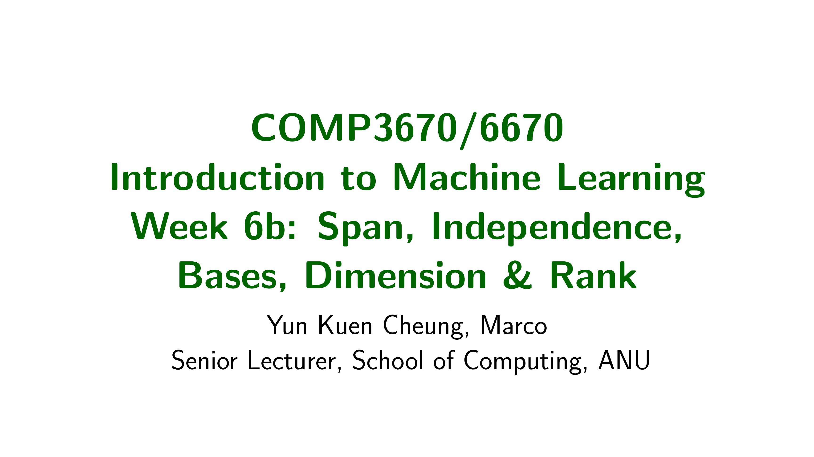

## 第 2 页：学习目标

四个目标是：用数据矩阵的列空间解释预测；用零空间描述不改变预测的输入变化；识别线性无关的张成集、基和维度；通过主元计算秩与零度，并理解秩在机器学习里的意义。

展开第 2 页原始 slide，核对图表、标注和公式

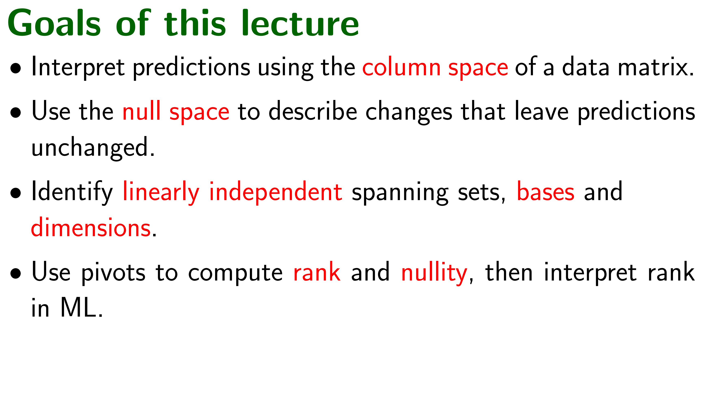

## 第 3 页：从特征列提出三个问题

数据矩阵 $X\in\mathbb R^{n\times d}$ 的每列记录一个特征在全部样本上的取值。若列为 $c_1,\ldots,c_d$，则

$$
Xw=w_1c_1+\cdots+w_dc_d.
$$

所以整个训练集的预测向量，是特征列的加权和。由此提出：模型能产生哪些预测向量？哪些特征提供了新的方向？至少保留多少原始特征列，才能保留全部可能的预测？

展开第 3 页原始 slide，核对图表、标注和公式

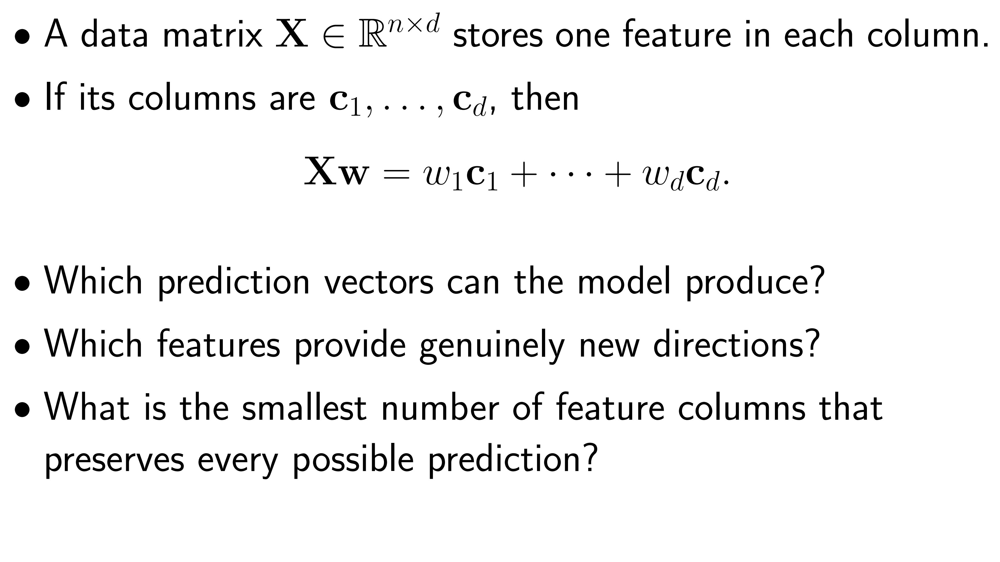

## 第 4 页：章节页：线性组合描述可获得的预测

接下来用线性组合和 span（张成）精确描述“改变权重后所有能到达的输出”。

展开第 4 页原始 slide，核对图表、标注和公式

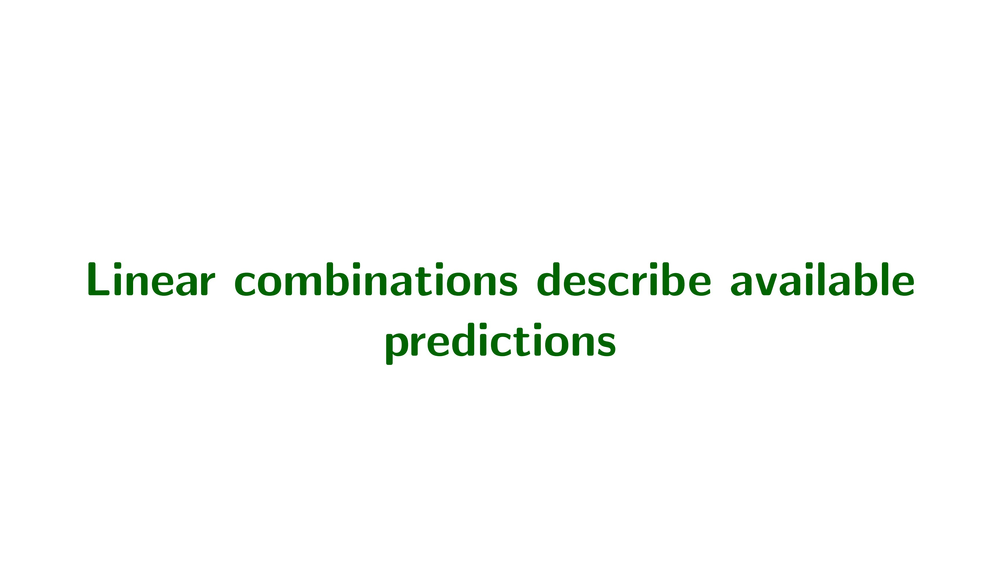

## 第 5 页：例 1：四个数据点、四个特征

给出

$$
X=\begin{pmatrix}3&4&7&5\\5&7&12&9\\8&11&19&14\\6&9&15&8\end{pmatrix}
=(c_1\ c_2\ c_3\ c_4),\qquad
w=\begin{pmatrix}8\\-3\\0\\6\end{pmatrix}.
$$

四行对应四个数据点，四列对应四个特征。原页提问：这个权重向量产生怎样的预测向量？列向量 $c_j$ 的长度为样本数 4，不是只属于一个样本。

展开第 5 页原始 slide，核对图表、标注和公式

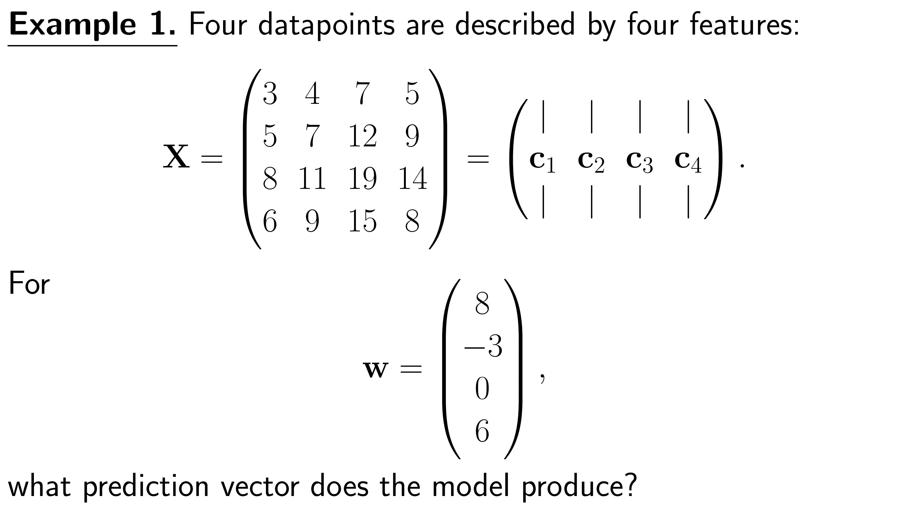

## 第 6 页：例 1 续：预测是列组合，冗余列不增加方向

计算得到

$$
Xw=8c_1-3c_2+6c_4=(42,73,115,69)^T.
$$

第三个权重为零，所以该项没有写进加和。模型通过缩放、相加特征列生成预测。此外 $c_3=c_1+c_2$，第三个特征没有提供前两列无法生成的新方向。

**理解补充：**$w_1c_1+w_2c_2+w_3c_3=(w_1+w_3)c_1+(w_2+w_3)c_2$。删除第三列后重新调整前两个权重，就能保留原有输出能力。

展开第 6 页原始 slide，核对图表、标注和公式

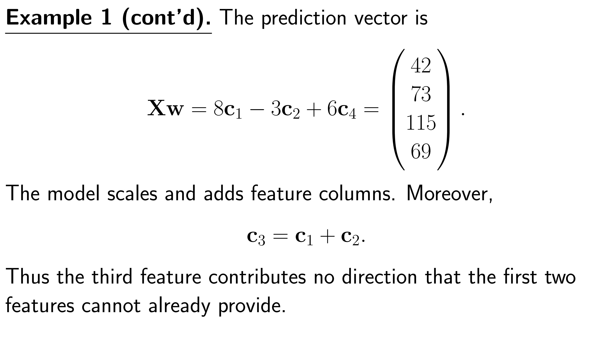

## 第 7 页：线性组合与张成的正式定义

对 $v_1,\ldots,v_k\in\mathbb R^m$，一个线性组合形如 $\alpha_1v_1+\cdots+\alpha_kv_k$，其中 $\alpha_j\in\mathbb R$。所有这样的向量构成它们的 span：

$$
\operatorname{span}\{v_1,\ldots,v_k\}
=\left\{\sum_{j=1}^k\alpha_jv_j:\alpha_j\in\mathbb R\right\}.
$$

把这些向量放入 $V=(v_1\ \cdots\ v_k)$ 的列，span 也就是 $\{V\alpha:\alpha\in\mathbb R^k\}$。一个线性组合是一个向量，span 是所有这些向量组成的集合。

展开第 7 页原始 slide，核对图表、标注和公式

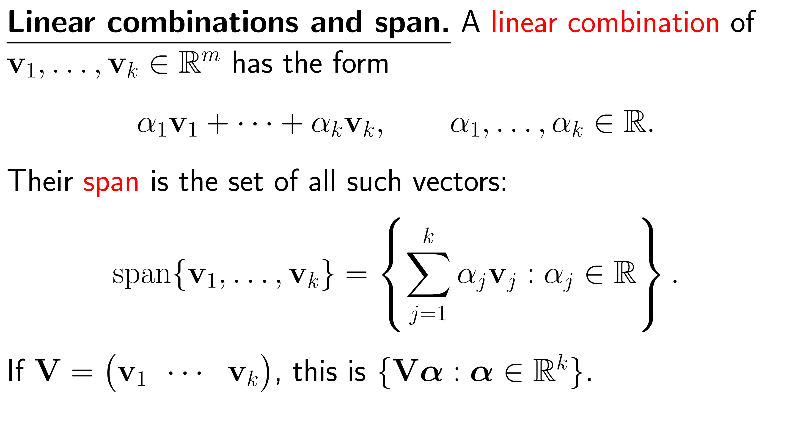

## 第 8 页：子空间的三个条件

集合 $S\subseteq\mathbb R^m$ 是 subspace（子空间），必须满足：$0\in S$；$x,y\in S$ 时 $x+y\in S$；$x\in S,a\in\mathbb R$ 时 $ax\in S$。简言之，它包含零向量，并且对加法、数乘封闭。不能仅凭集合看起来像一条直线或一个平面就跳过这些条件。

展开第 8 页原始 slide，核对图表、标注和公式

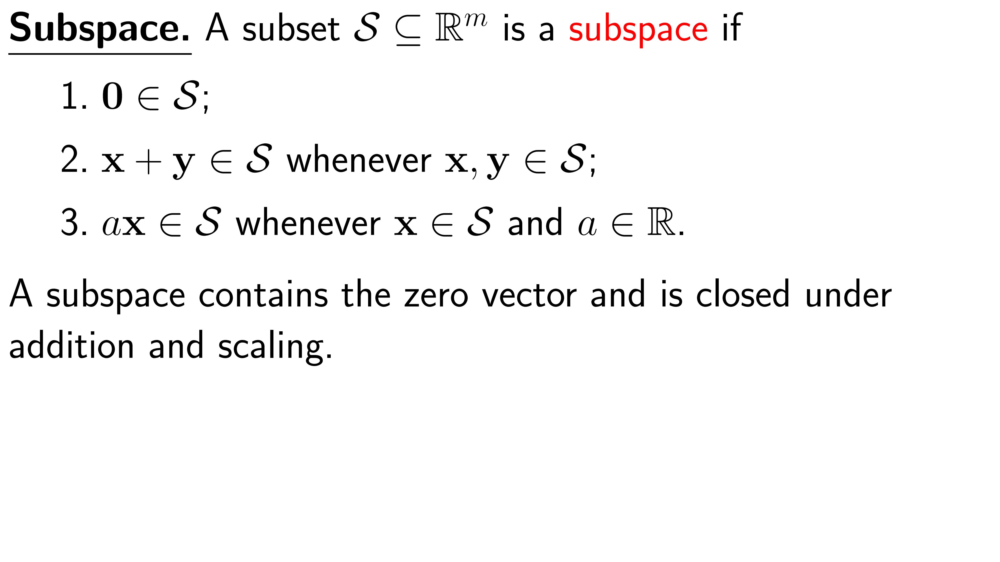

## 第 9 页：命题 1：span 是最小的包含性子空间

任意 $v_1,\ldots,v_k\in\mathbb R^m$ 的 $\operatorname{span}\{v_1,\ldots,v_k\}$ 都是 $\mathbb R^m$ 的子空间。而且它是包含全部这些向量的最小子空间：“最小”按集合包含关系理解，任何包含这些向量的子空间都必须包含它们的一切线性组合。

展开第 9 页原始 slide，核对图表、标注和公式

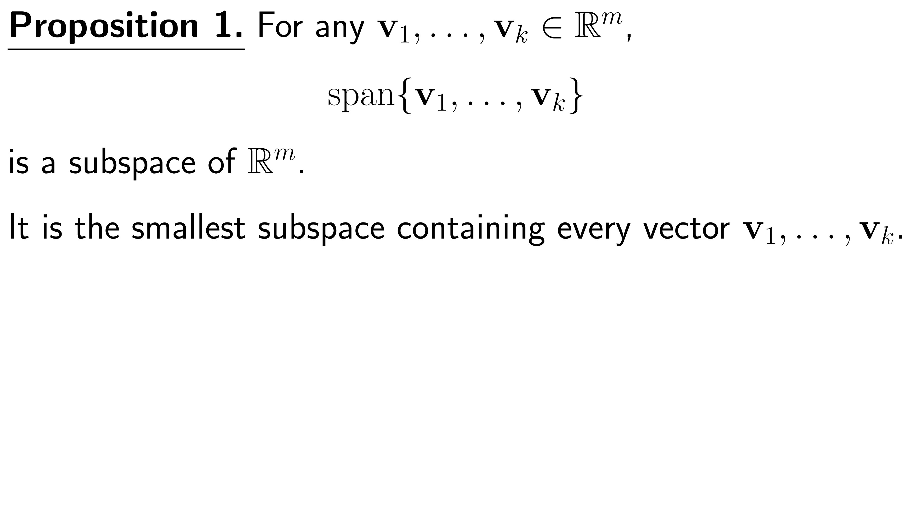

## 第 10 页：证明留白页：检查封闭性与最小性

原页只有“Proof of Proposition 1.”标题。

**理解补充：**所有系数取 0，可得零向量。若 $x=\sum_j\alpha_jv_j$、$y=\sum_j\beta_jv_j$，则 $x+y=\sum_j(\alpha_j+\beta_j)v_j$，仍在 span 内；对任意实数 $a$，$ax=\sum_j(a\alpha_j)v_j$ 也在 span 内，因此它是子空间。若另一个子空间 $U$ 包含全部 $v_j$，它的加法与数乘封闭性保证每个 $\sum_j\alpha_jv_j$ 都在 $U$ 中，所以 span 包含于 $U$，证明最小性。

展开第 10 页原始 slide，核对图表、标注和公式

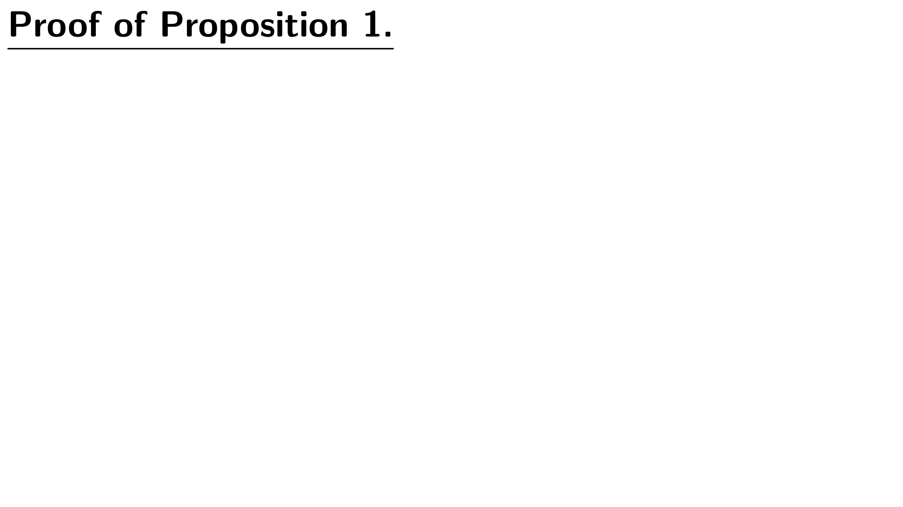

## 第 11 页：章节页：列空间与零空间

接下来分别描述矩阵能够产生的输出，以及哪些输入方向经过矩阵后会完全消失。

展开第 11 页原始 slide，核对图表、标注和公式

## 第 12 页：两个空间分属输出端与输入端

设 $A\in\mathbb R^{m\times d}$，列为 $a_1,\ldots,a_d$。列空间定义为

$$
\operatorname{Col}(A)=\operatorname{span}\{a_1,\ldots,a_d\}
=\{Aw:w\in\mathbb R^d\}\subseteq\mathbb R^m.
$$

零空间定义为

$$
\operatorname{Nul}(A)=\{z\in\mathbb R^d:Az=0\}\subseteq\mathbb R^d.
$$

列空间在输出空间中，记录可达到的结果；零空间在输入空间中，记录被变换送到零的方向。两者通常连向量长度都不同。

展开第 12 页原始 slide，核对图表、标注和公式

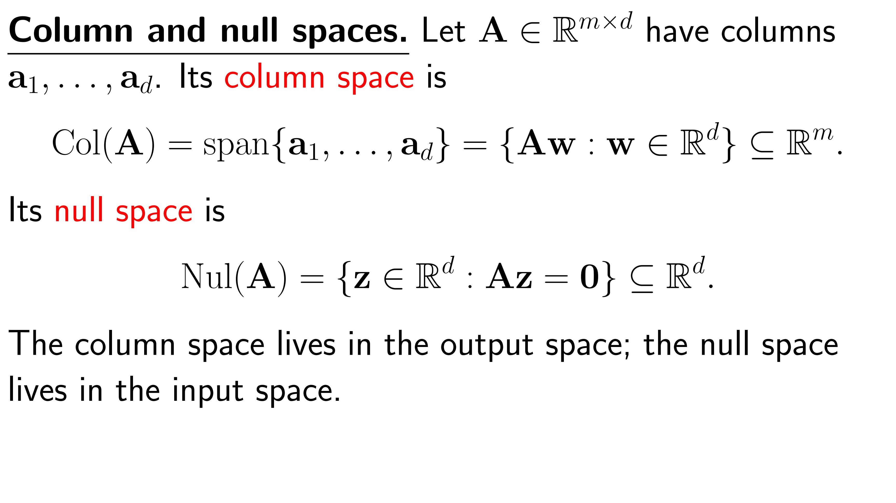

## 第 13 页：命题 2：列空间与零空间都是子空间

对每个矩阵 $A$，$\operatorname{Col}(A)$ 和 $\operatorname{Nul}(A)$ 都分别是其所在环境空间的子空间。对 $m\times d$ 矩阵，前者属于 $\mathbb R^m$，后者属于 $\mathbb R^d$。因此可以为两者讨论基和维度。

展开第 13 页原始 slide，核对图表、标注和公式

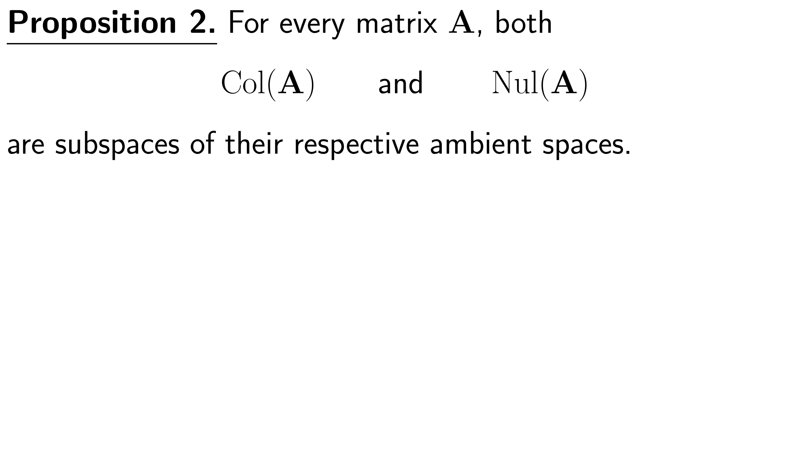

## 第 14 页：证明留白页：列空间的子空间性质

原页只有“Proof of Proposition 2 (for Col(A)).”标题，指定证明列空间的情形，没有展示证明步骤。

**理解补充：**$A0=0$，所以零向量在列空间。若 $u=Ax,v=Ay$，则 $u+v=A(x+y)$；若 $a\in\mathbb R$，则 $au=A(ax)$。两者仍是 $A$ 的输出，故列空间封闭。也可以直接引用“列空间是列向量的 span”和命题 1。

**理解补充（零空间的对应检查）：**若 $Az=Az'=0$，则 $A(z+z')=0$、$A(az)=0$，且 $A0=0$，因此零空间也满足三个条件。

展开第 14 页原始 slide，核对图表、标注和公式

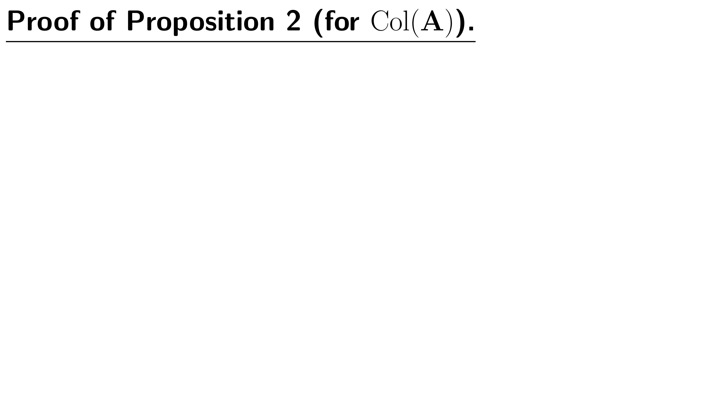

## 第 15 页：命题 3：有解条件与全体解

对 $A\in\mathbb R^{m\times d},b\in\mathbb R^m$，$Aw=b$ 有解，当且仅当 $b\in\operatorname{Col}(A)$。若 $w_0$ 是其中一个解，全部解恰好为

$$
\{w_0+z:z\in\operatorname{Nul}(A)\}=w_0+\operatorname{Nul}(A).
$$

**理解补充：**加上零空间方向不改变输出，因为 $A(w_0+z)=b+0$；任意另一个解 $w$ 与 $w_0$ 的差又满足 $A(w-w_0)=0$，所以不会遗漏其他解。非齐次解集是零空间的平移，不一定自身通过原点。

展开第 15 页原始 slide，核对图表、标注和公式

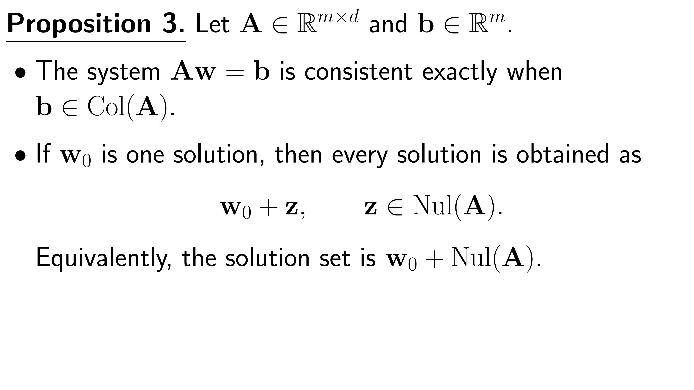

## 第 16 页：章节页：线性无关、基和维度

下面从“哪些向量能够生成空间”进一步问“这些生成方向是否冗余”，再定义不冗余的坐标体系。

展开第 16 页原始 slide，核对图表、标注和公式

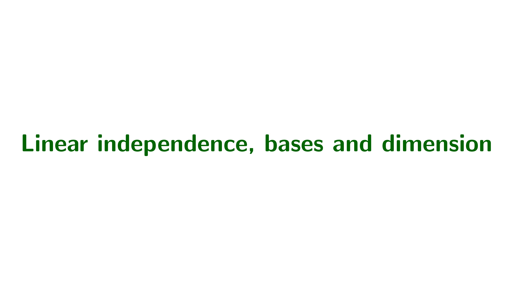

## 第 17 页：线性无关的定义与模型意义

向量 $v_1,\ldots,v_k$ 线性无关，意思是

$$
\alpha_1v_1+\cdots+\alpha_kv_k=0
\quad\Longrightarrow\quad\alpha_1=\cdots=\alpha_k=0.
$$

如果存在系数不全为零却组合出零向量，则线性相关。数据矩阵列相关表示某些特征方向冗余，也表示存在不同权重却给出相同预测的情况：权重之间的差可以是一个非零零空间向量。

展开第 17 页原始 slide，核对图表、标注和公式

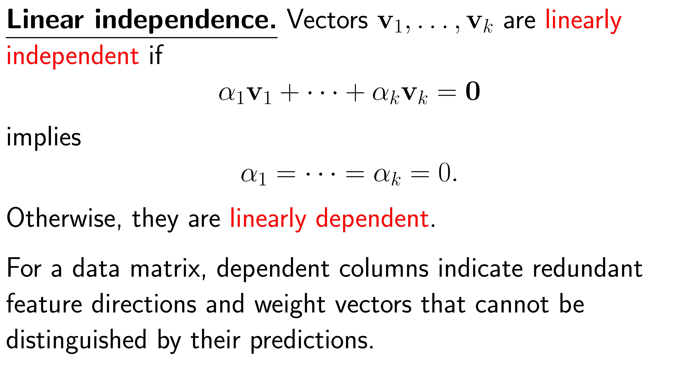

## 第 18 页：例 2：逐坐标证明三个向量线性无关

令 $v_1=(1,0,0)^T$、$v_2=(1,4,2)^T$、$v_3=(2,0,5)^T$。若它们以系数组合为零，展开为

$$
\begin{pmatrix}\alpha_1+\alpha_2+2\alpha_3\\4\alpha_2\\2\alpha_2+5\alpha_3\end{pmatrix}
=\begin{pmatrix}0\\0\\0\end{pmatrix}.
$$

第二行先给出 $\alpha_2=0$；代入第三行得 $\alpha_3=0$；最后第一行得 $\alpha_1=0$。因此只有全零系数组合能得到零，这三个向量线性无关。

展开第 18 页原始 slide，核对图表、标注和公式

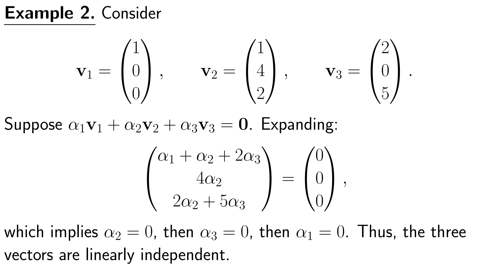

## 第 19 页：例 2 续：用非零系数组合证明相关

回到例 1，$c_3=c_1+c_2$ 等价于 $-c_1-c_2+c_3=0$。系数 $-1,-1,1$ 不全为零，因此 $c_1,c_2,c_3$ 线性相关。判断相关只需要找到一个这样的非平凡组合。

展开第 19 页原始 slide，核对图表、标注和公式

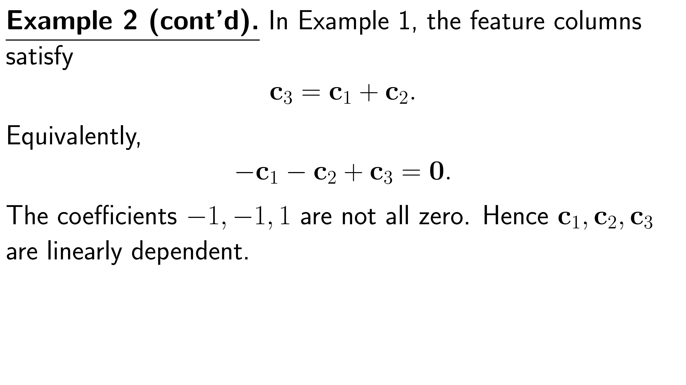

## 第 20 页：基与相对于有序基的坐标

子空间 $S$ 的一组基 $v_1,\ldots,v_r\in S$ 必须同时满足：$\operatorname{span}\{v_1,\ldots,v_r\}=S$；这些向量线性无关。前者保证能表示全部向量，后者排除冗余。

如果 $x=\alpha_1v_1+\cdots+\alpha_rv_r$，则 $(\alpha_1,\ldots,\alpha_r)^T$ 是 $x$ 相对于这组**有序基**的坐标向量。基的顺序决定坐标的顺序。

展开第 20 页原始 slide，核对图表、标注和公式

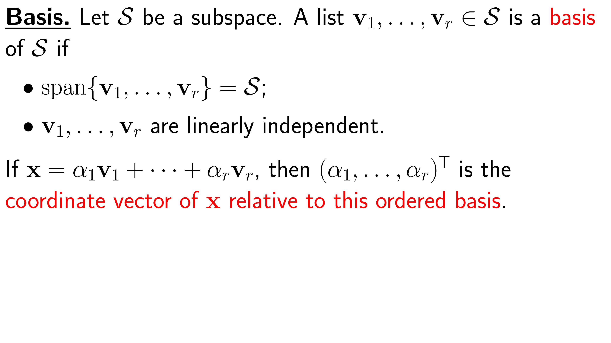

## 第 21 页：命题 4：给定有序基，坐标唯一

子空间中的每个向量相对于该子空间的一组有序基，恰好有一个坐标向量。

**理解补充：**存在性来自基张成整个空间。若 $\sum_j\alpha_jv_j=\sum_j\beta_jv_j$，两边相减得到 $\sum_j(\alpha_j-\beta_j)v_j=0$；线性无关迫使所有 $\alpha_j=\beta_j$，所以坐标唯一。

展开第 21 页原始 slide，核对图表、标注和公式

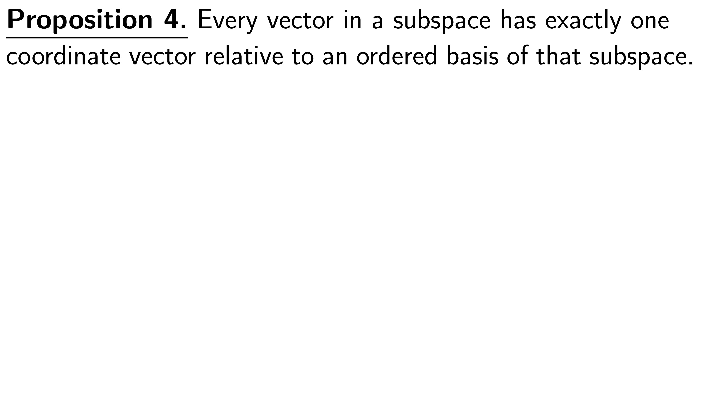

## 第 22 页：定理 5：独立向量数量不超过张成向量数量

若 $v_1,\ldots,v_r$ 张成子空间 $S$，而 $u_1,\ldots,u_k\in S$ 线性无关，则 $k\le r$。因此同一个子空间的任意两组基都有相同数量的向量；每个 $\mathbb R^m$ 的子空间都有一组至多含 $m$ 个向量的基。这为“维度”成为确定数目提供保证。

展开第 22 页原始 slide，核对图表、标注和公式

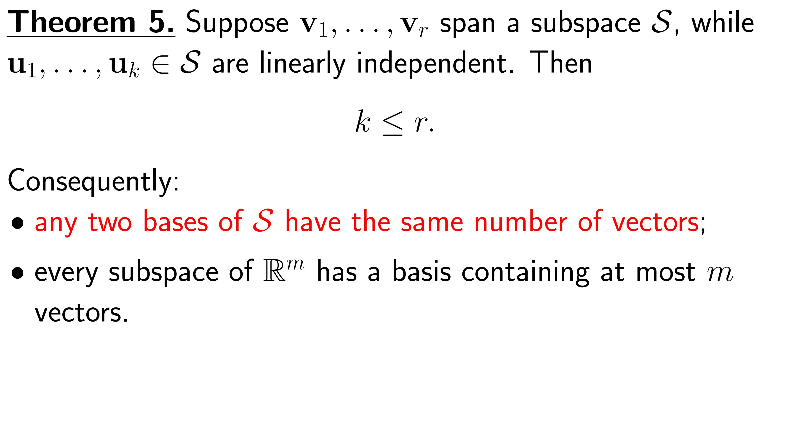

## 第 23 页：定理 5 的证明：把独立向量写进张成集

把向量放成列，令 $V=(v_1\ \cdots\ v_r)$、$U=(u_1\ \cdots\ u_k)$。由于 $U$ 的每列都在 $V$ 的列张成空间里，存在 $C\in\mathbb R^{r\times k}$ 使 $U=VC$。

如果 $k>r$，方程 $Cz=0$ 的未知数多于方程，至少有一个自由变量，故有非零解 $z$。于是 $Uz=VCz=0$，与 $U$ 的列线性无关矛盾。所以 $k\le r$。这是原页写出的反证法。

展开第 23 页原始 slide，核对图表、标注和公式

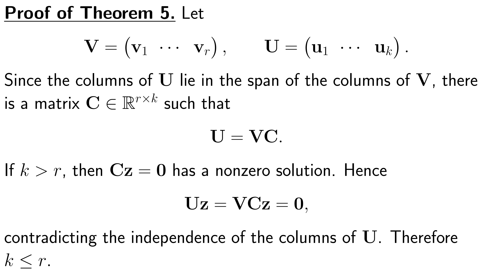

## 第 24 页：维度的定义与标准基

子空间 $S$ 的维度 $\dim(S)$ 定义为它任意一组基中的向量数量。定理 5 保证这个数不随基的选择而改变。例如标准向量 $e_1,\ldots,e_m$ 构成 $\mathbb R^m$ 的基，因此 $\dim(\mathbb R^m)=m$。

**理解补充：**$e_j$ 只有第 $j$ 个坐标为 1，其余为 0。换一组基可以换坐标，不能改变空间的维度。

展开第 24 页原始 slide，核对图表、标注和公式

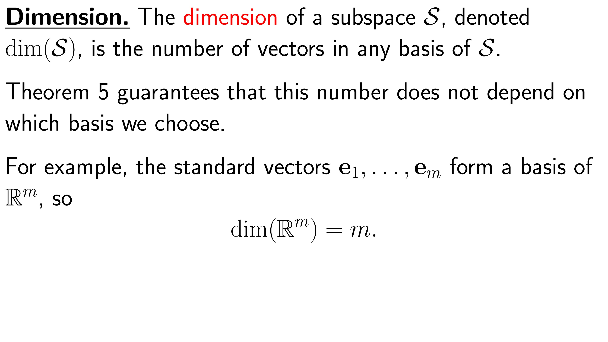

## 第 25 页：章节页：秩统计可用的方向

下面把维度应用到矩阵的列空间和零空间，量化有多少方向能传到输出、有多少方向在输入端被消去。

展开第 25 页原始 slide，核对图表、标注和公式

## 第 26 页：列空间和零空间也有维度

前面已知子空间有维度，可以用一组线性无关的张成向量来计数。列空间 $\operatorname{Col}(A)$ 和零空间 $\operatorname{Nul}(A)$ 都是子空间，因此都具有维度。接下来为这两个数分别取名。

展开第 26 页原始 slide，核对图表、标注和公式

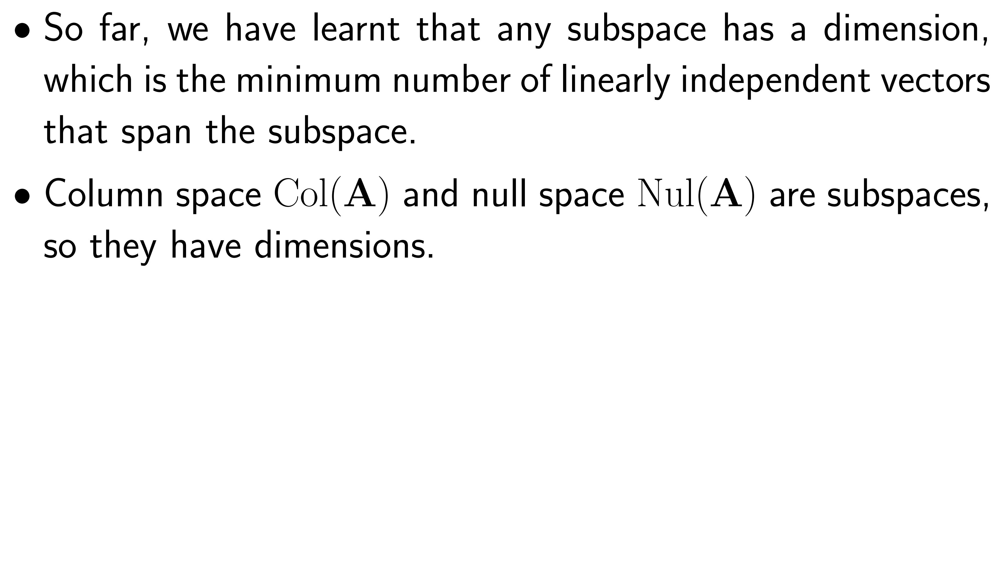

## 第 27 页：秩与零度

对 $A\in\mathbb R^{m\times d}$，定义

$$
\operatorname{rank}(A)=\dim(\operatorname{Col}(A)),\qquad
\operatorname{nullity}(A)=\dim(\operatorname{Nul}(A)).
$$

Rank（秩）统计独立的输出方向数；nullity（零度）统计输入中被映射为零的独立方向数。它们分别针对两个不同空间，不能直接把二者理解成列数和零列数。

展开第 27 页原始 slide，核对图表、标注和公式

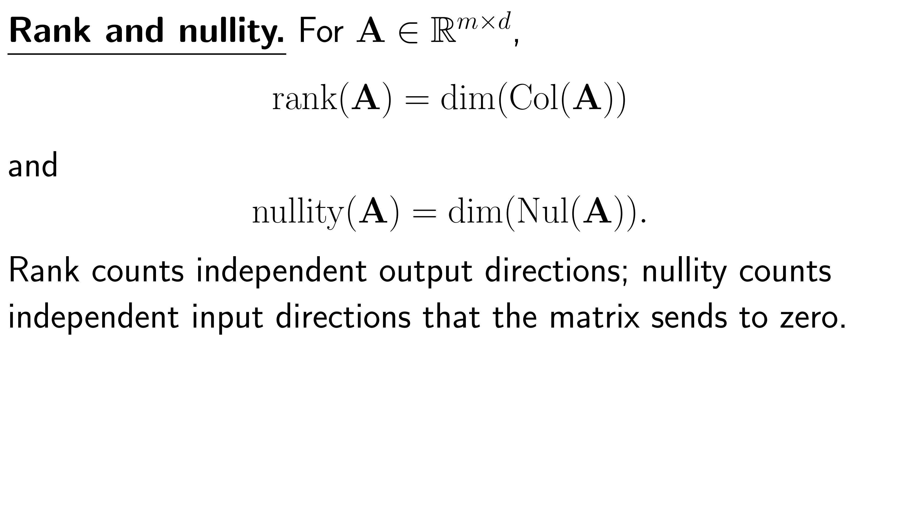

## 第 28 页：定理 6：主元、秩与秩零度定理

设 $A\in\mathbb R^{m\times d}$ 的行阶梯形有 $r$ 个主元，则原矩阵中对应主元位置的列构成 $\operatorname{Col}(A)$ 的一组基；$\operatorname{rank}(A)=r$；$\operatorname{nullity}(A)=d-r$。因此

$$
\operatorname{rank}(A)+\operatorname{nullity}(A)=d.
$$

**理解补充：**右端是输入维度，即列数 $d$。用消元后的主元位置选列，再回到**原矩阵**取这些列；行操作通常会改变列空间中的具体向量，不能直接把消元后的列冒充原列空间的基。

展开第 28 页原始 slide，核对图表、标注和公式

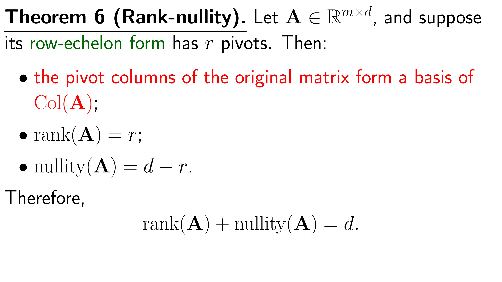

## 第 29 页：推论 7：秩是保留全部输出所需的最少原始列数

若 $A$ 的秩为 $r$，则至少要取 $r$ 列，才能张成整个 $\operatorname{Col}(A)$；主元列恰好给出这样一个最小集合。对于数据矩阵，这意味着至少保留 $r$ 个恰当选择的原始特征列，才能保留线性模型全部可能的训练集预测向量。并不是任意 $r$ 列都可以。

展开第 29 页原始 slide，核对图表、标注和公式

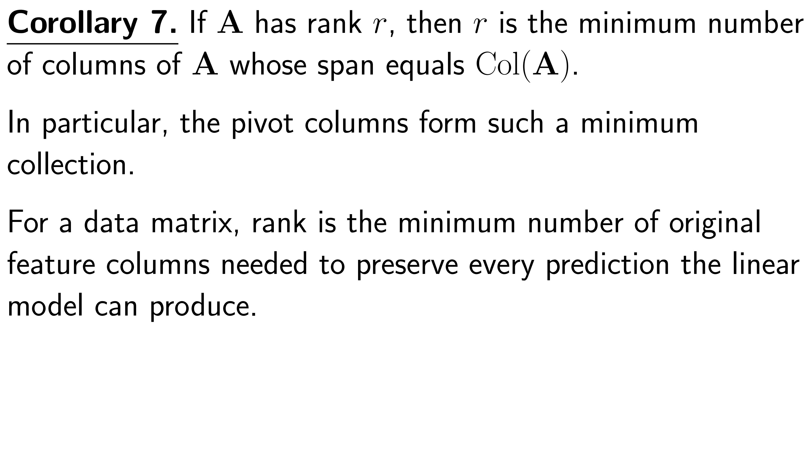

## 第 30 页：例 3：十个七维数据点

原页给出的完整数据矩阵为

$$
X=\begin{pmatrix}
3&9&4&-6&-4&5&15\\
17&51&26&-44&-16&23&71\\
6&18&9&-15&-6&8&25\\
15&45&20&-30&-20&29&83\\
5&15&7&-11&-6&9&26\\
11&33&16&-26&-12&13&43\\
5&15&5&-5&-10&13&36\\
15&45&23&-39&-14&15&52\\
25&75&38&-64&-24&35&107\\
13&39&20&-34&-12&11&41
\end{pmatrix}\in\mathbb R^{10\times7}.
$$

每行一个数据点，每点名义上有七个坐标。问题是这七个特征是否真能提供七个独立方向。

展开第 30 页原始 slide，核对图表、标注和公式

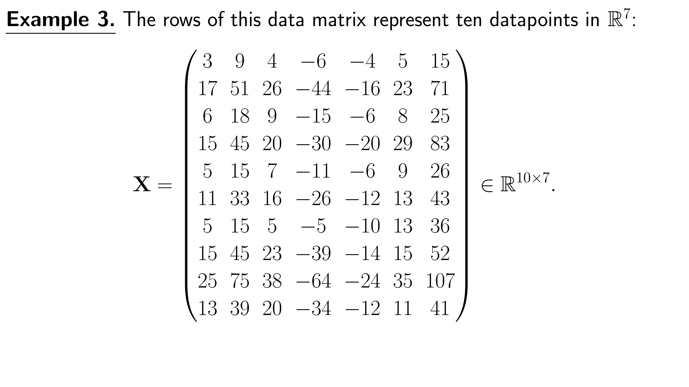

## 第 31 页：例 3 续：消元后只有三个主元

高斯消元给出行等价矩阵

$$
X\sim\begin{pmatrix}
3&9&4&-6&-4&5&15\\
0&0&1&-3&2&2&3\\
0&0&0&0&0&-4&-8\\
0&0&0&0&0&0&0\\
0&0&0&0&0&0&0\\
0&0&0&0&0&0&0\\
0&0&0&0&0&0&0\\
0&0&0&0&0&0&0\\
0&0&0&0&0&0&0\\
0&0&0&0&0&0&0
\end{pmatrix}.
$$

主元在第 1、3、6 列，分别为 3、1、$-4$。七列中只有三个主元，说明独立输出方向只有三个。

展开第 31 页原始 slide，核对图表、标注和公式

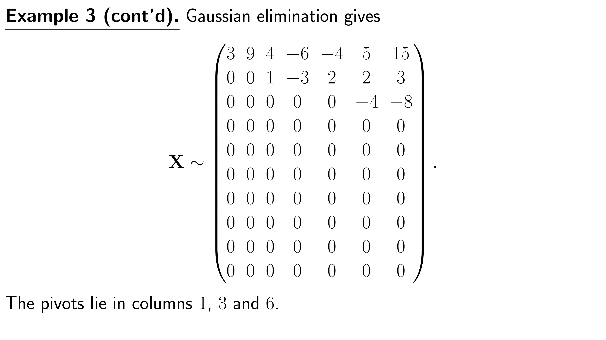

## 第 32 页：例 3 续：列空间与行空间都是三维

取原矩阵第 1、3、6 列可得 $\operatorname{Col}(X)$ 的一组基，所以 $\operatorname{rank}(X)=3$。行操作还保持行向量的张成空间；阶梯形的三个非零行因为主元位置不同而线性无关，因此行空间维度也是 3。

列空间在 $\mathbb R^{10}$ 中描述训练集预测；行空间在 $\mathbb R^7$ 中描述样本方向。虽然有十个七维数据点，这十个点全都位于一个仅三维的子空间内。

**理解补充：**按秩零度定理，$\operatorname{nullity}(X)=7-3=4$，因此有四个独立的权重变化方向不改变训练集预测。

展开第 32 页原始 slide，核对图表、标注和公式

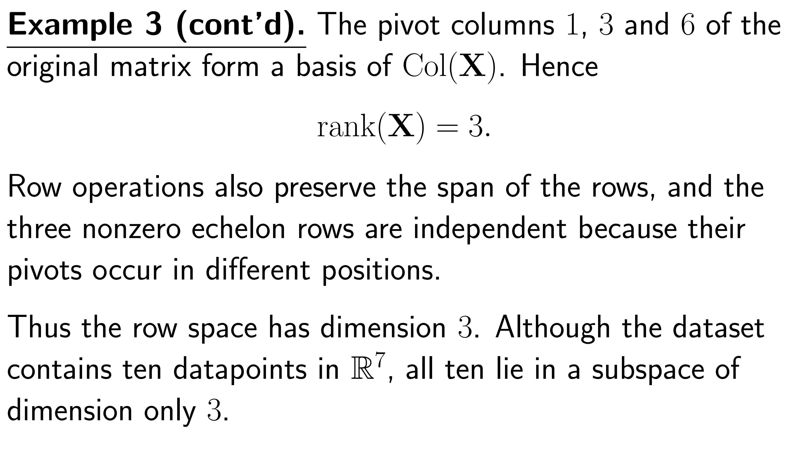

## 第 33 页：低维结构如何引出降维

如果数据位于 $\mathbb R^d$ 的一个 $r$ 维子空间内，且 $r<d$，则数据只有 $r$ 个有效自由度。每个点可以改用 $r$ 个基系数描述，而不必保留全部 $d$ 个原坐标，这也常能减少需要学习的有效参数数量。

这引出 dimensionality reduction（降维）。以后 PCA 会寻找尽量保留数据变化的低维子空间。这里先讨论精确落在子空间中的情形；PCA 还会处理只能近似表示的情况。

展开第 33 页原始 slide，核对图表、标注和公式

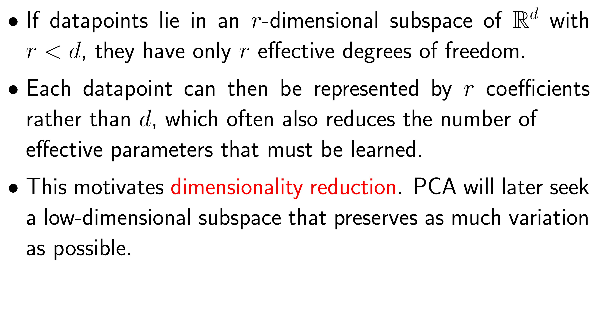

## 第 34 页：本讲总结

Span 记录所有能由线性组合得到的向量。列空间描述可达到的输出，零空间描述输出看不见的输入变化。基既能张成又无冗余，基的大小就是维度。原矩阵的主元列给出列空间的一组基，秩则统计可用的独立方向数量。

展开第 34 页原始 slide，核对图表、标注和公式

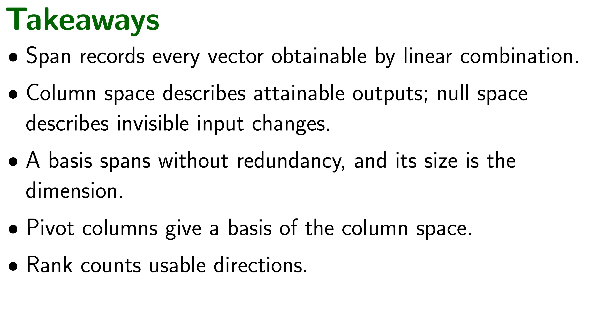

