# Lecture 08A：点积、标准正交基与正交投影，按幻灯片逐页复述

来源：[lecture08a.pdf](../../comp3670_lectures/lecture08a.pdf)，共 38 个 PDF 页面。严格按 PDF 页序组织，章节页、例题续页和证明留白页也单独保留。默认向量为列向量；数据矩阵中的每一行通常是一个数据点的转置。正文用中文讲解概念、公式和图表；原页未写出的解答或推导明确标为“理解补充”。每节末尾可展开完整原始 slide 核对颜色、标注和排版。图片和 PDF 均使用仓库相对路径，适合本地预览与 GitHub。

## 第 1 页：课程与主题：点积、标准正交基与正交投影

这是 COMP3670/6670《Introduction to Machine Learning》第 8a 周，英文主题为 Dot Products, Orthonormal Bases & Orthogonal Projection。讲师为 ANU School of Computing 的 Senior Lecturer Yun Kuen Cheung（Marco）。本讲利用点积比较方向，再借助标准正交基简化坐标计算，并把空间外的点投到子空间中。

展开第 1 页原始 slide，核对图表、标注和公式

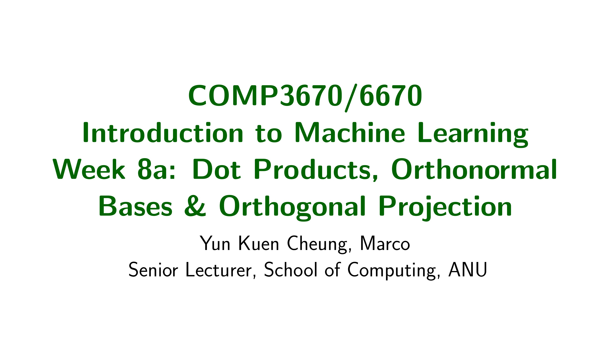

## 第 2 页：学习目标

五个目标依次是：用点积和余弦相似度比较向量；从标准正交基直接求坐标；理解正交矩阵保持哪些量；用 Gram-Schmidt 构造标准正交方向；通过正交投影找到子空间内离给定点最近的位置。

展开第 2 页原始 slide，核对图表、标注和公式

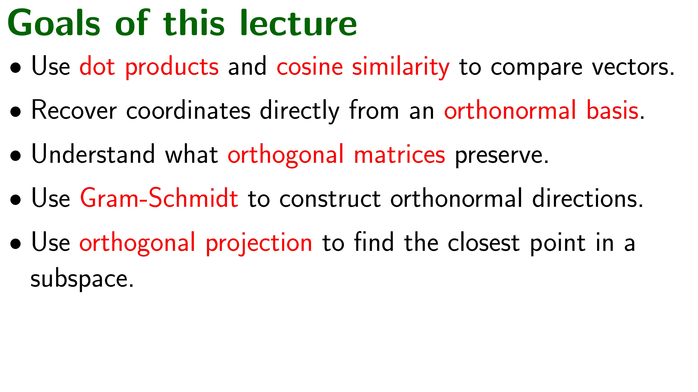

## 第 3 页：为什么想要特殊的基

一组基为子空间中的向量提供坐标。若数据点在 $\mathbb R^d$ 的一个 $k$ 维子空间内，只需要 $k$ 个坐标，$k$ 可以远小于 $d$。但一般基要求解线性方程组才能恢复这些坐标。标准正交基让坐标恢复和投影都变得简单，是本讲要建立的便利工具。

展开第 3 页原始 slide，核对图表、标注和公式

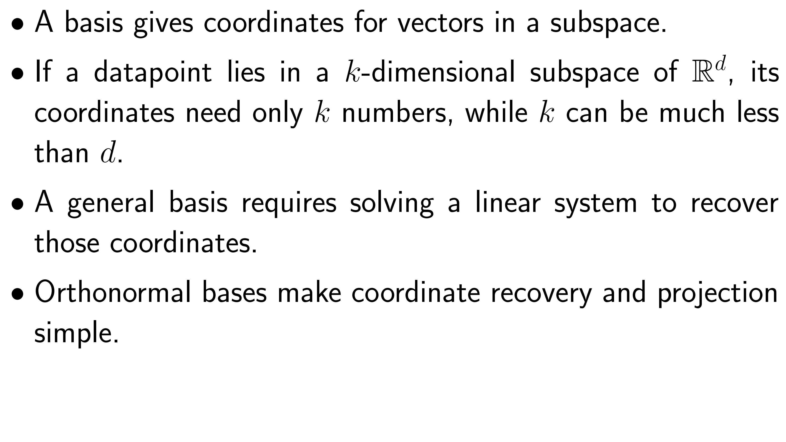

## 第 4 页：章节页：点积衡量方向的一致程度

先从查询与文档的词频向量开始，用一个数衡量两个向量沿相同坐标方向的配合程度。

展开第 4 页原始 slide，核对图表、标注和公式

## 第 5 页：例 1：查询与两份文档

用相同的三个词的出现次数表示查询和文档：$q=(4,1,3)^T$、$d_1=(1,8,2)^T$、$d_2=(6,2,5)^T$。每个坐标对应同一个词。原页提问：哪份文档与查询更一致？下一页用对应坐标相乘再相加作评分。

展开第 5 页原始 slide，核对图表、标注和公式

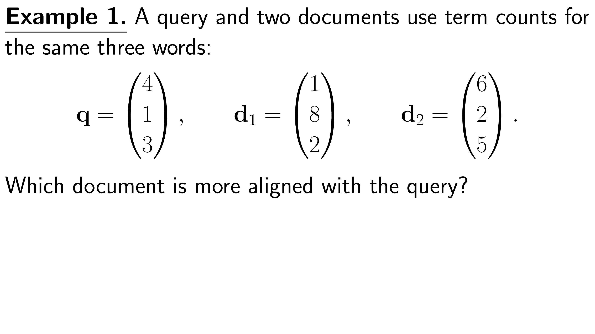

## 第 6 页：例 1 续：原始点积让第二份文档胜出

分别计算

$$
\langle q,d_1\rangle=4\times1+1\times8+3\times2=18,\qquad
\langle q,d_2\rangle=4\times6+1\times2+3\times5=41.
$$

原始点积评分下文档 2 排第一，因为它在查询重视的词上有较大的计数。这个评分尚未排除文档长度的影响。

展开第 6 页原始 slide，核对图表、标注和公式

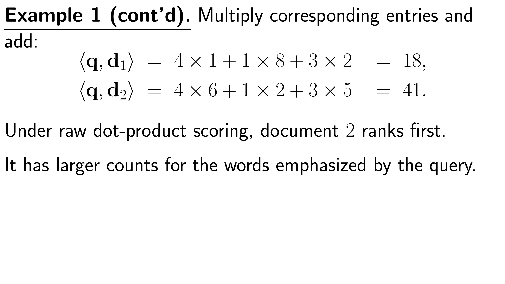

## 第 7 页：点积定义与性质

对 $x,y\in\mathbb R^d$，

$$
\langle x,y\rangle=x^Ty=\sum_{j=1}^d x_jy_j.
$$

点积具有对称性，并对每个输入都线性。特别地，$\langle x,x\rangle=\|x\|_2^2$。**理解补充：**线性例如体现为 $\langle ax+bz,y\rangle=a\langle x,y\rangle+b\langle z,y\rangle$；它不是把整个向量逐项乘完后保留向量，而是求和得到标量。

展开第 7 页原始 slide，核对图表、标注和公式

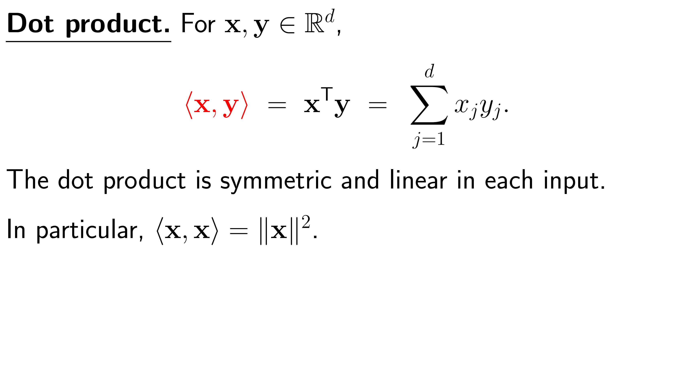

## 第 8 页：原始词频会偏爱长文档

原始计数可能只因文章长、词多，就给它更高评分。若查询只有“cat”，一篇 10,000 词文章出现 cat 五次，会在原始计数下胜过一篇 100 词文章出现两次的文章。但在后者中 cat 更突出。这促使我们设计归一化的相似度，而不是仅看次数。

展开第 8 页原始 slide，核对图表、标注和公式

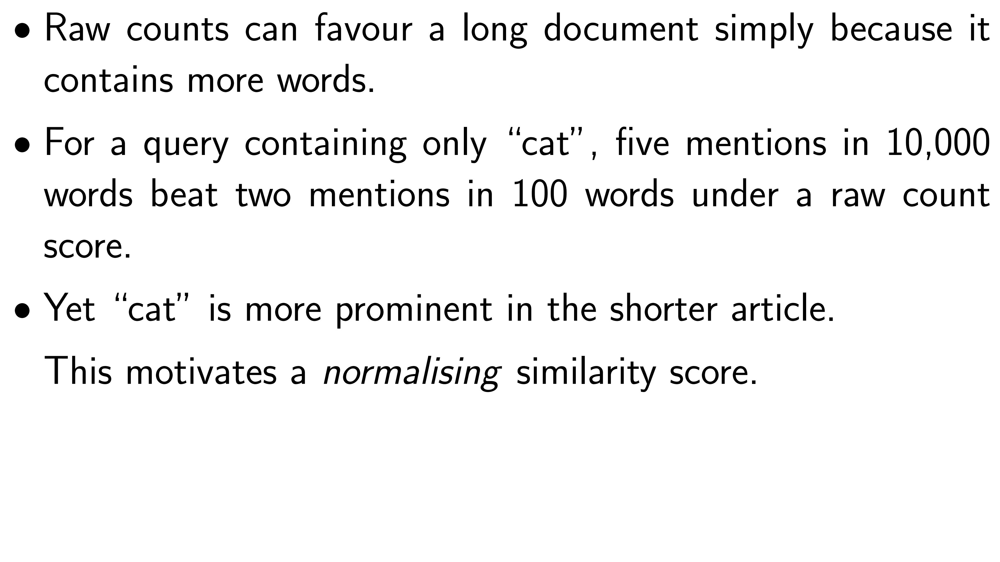

## 第 9 页：Cauchy-Schwarz 不等式

对所有 $x,y\in\mathbb R^d$，

$$
|\langle x,y\rangle|\le\|x\|_2\|y\|_2.
$$

当且仅当两个向量线性相关时取等号。对非零 $x,y$，由此得到

$$
-1\le\frac{\langle x,y\rangle}{\|x\|_2\|y\|_2}\le1.
$$

这个界使归一化点积可以解释为某个角的余弦。

展开第 9 页原始 slide，核对图表、标注和公式

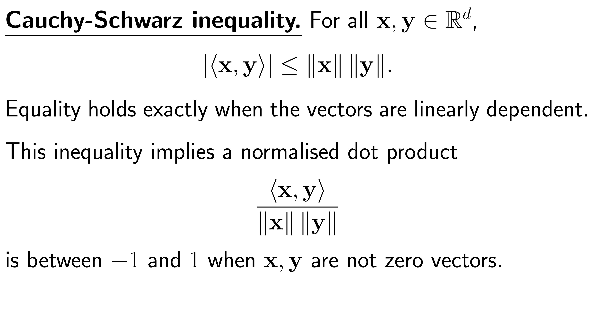

## 第 10 页：Cauchy-Schwarz 的证明思路

若 $y=0$，不等式立即成立。否则设 $a=\langle x,y\rangle/\|y\|_2^2$。平方范数非负，展开有

$$
0\le\|x-ay\|_2^2=\|x\|_2^2-\frac{\langle x,y\rangle^2}{\|y\|_2^2}.
$$

乘以正数 $\|y\|_2^2$，再开平方，就得到不等式。

**理解补充：**等号要求 $x-ay=0$，即 $x$ 为 $y$ 的倍数；若有零向量也属于线性相关情形，解释了上一页的等号条件。

展开第 10 页原始 slide，核对图表、标注和公式

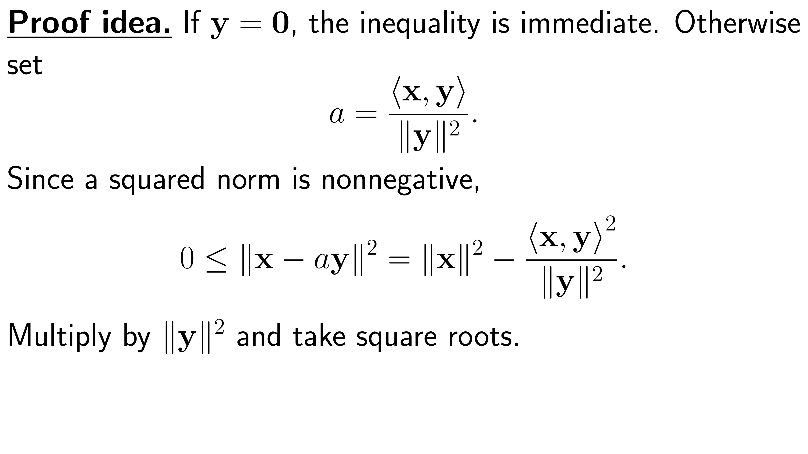

## 第 11 页：夹角、余弦相似度与正交

对非零向量，定义夹角 $0\le\theta\le\pi$ 满足

$$
\cos\theta=\frac{\langle x,y\rangle}{\|x\|_2\|y\|_2}.
$$

这个分式就是 cosine similarity（余弦相似度）。图中两个箭头 $x,y$ 从同一点出发，并用弧线标出夹角 $\theta$。对任意向量，$x\perp y$ 表示 $\langle x,y\rangle=0$；零向量与所有向量正交。但零向量不能代进余弦相似度，因为分母为零。

展开第 11 页原始 slide，核对图表、标注和公式

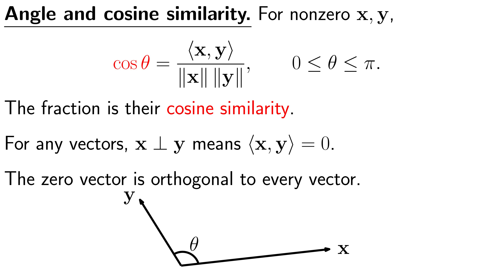

## 第 12 页：例 2：文档的余弦相似度

回到 $q=(4,1,3)^T,d_1=(1,8,2)^T,d_2=(6,2,5)^T$，三个范数分别为 $\sqrt{26},\sqrt{69},\sqrt{65}$。所以

$$
\frac{\langle q,d_1\rangle}{\|q\|_2\|d_1\|_2}=\frac{18}{\sqrt{26}\sqrt{69}}\approx0.425,\qquad
\frac{\langle q,d_2\rangle}{\|q\|_2\|d_2\|_2}=\frac{41}{\sqrt{26}\sqrt{65}}\approx0.997.
$$

文档 2 仍排第一，而且其方向几乎与查询完全相同。这次比较已把两个向量各自的长度除去。

展开第 12 页原始 slide，核对图表、标注和公式

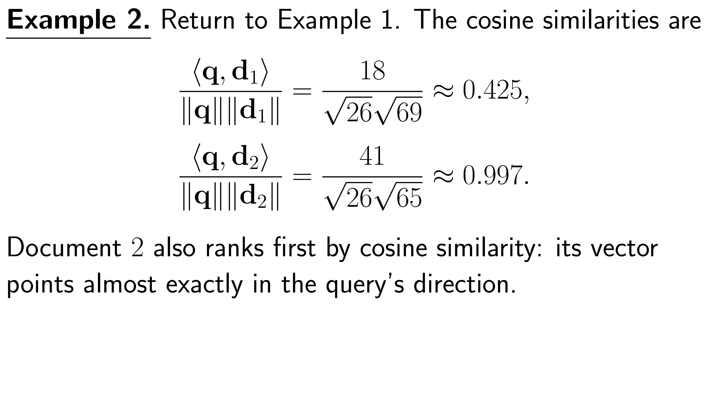

## 第 13 页：章节页：标准正交基让坐标容易计算

下面用两两垂直、长度为 1 的基向量，替代一般的基，借助点积直接取出坐标。

展开第 13 页原始 slide，核对图表、标注和公式

## 第 14 页：基矩阵与从坐标重构向量

若有序基 $\mathcal B=(b_1,\ldots,b_k)$ 张成 $S\subseteq\mathbb R^d$，把基向量放成列：$B=(b_1\ \cdots\ b_k)\in\mathbb R^{d\times k}$。对于 $x\in S$，

$$
x=B[x]_{\mathcal B}.
$$

$[x]_{\mathcal B}$ 是 $k$ 维系数列，$x$ 是原空间中的 $d$ 维向量，矩阵 $B$ 把坐标重新组合成原向量。

展开第 14 页原始 slide，核对图表、标注和公式

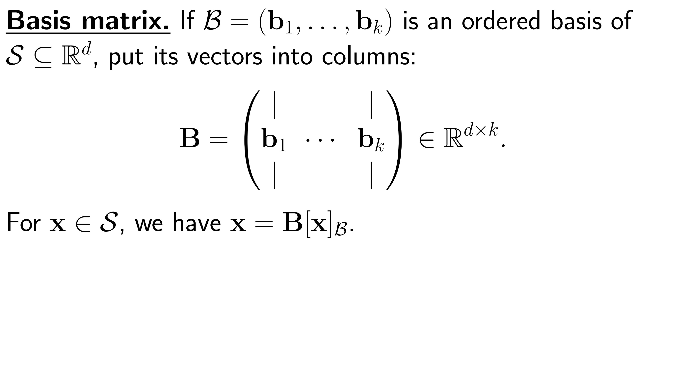

## 第 15 页：一般基的坐标恢复问题

要从 $x$ 找 $[x]_{\mathcal B}$，通常需求解 $By=x$。若 $k=d$，$B$ 为列线性无关的方阵，因此可逆，有 $[x]_{\mathcal B}=B^{-1}x$。标准正交基会让这个计算更容易：在适用条件下，可以用转置代替求逆。

展开第 15 页原始 slide，核对图表、标注和公式

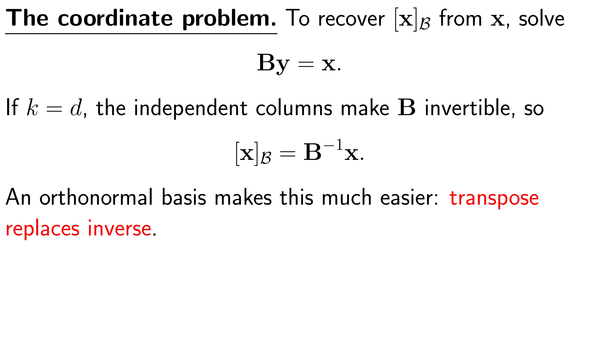

## 第 16 页：标准正交向量的定义

$q_1,\ldots,q_k\in\mathbb R^d$ 为 orthonormal（标准正交）向量，意思是每个 $\|q_i\|_2=1$，并且 $i\ne j$ 时 $\langle q_i,q_j\rangle=0$。两个条件分别是单位长度与两两垂直，缺少其中任何一个都不能称为标准正交。

展开第 16 页原始 slide，核对图表、标注和公式

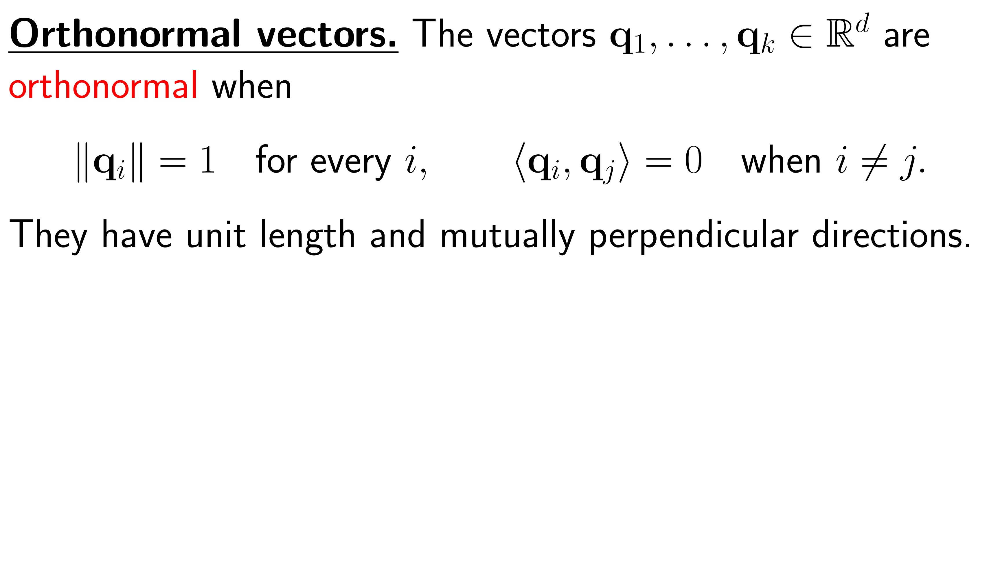

## 第 17 页：命题 1：标准正交必然线性无关

设 $\alpha_1q_1+\cdots+\alpha_kq_k=0$。两边与任意一个 $q_\ell$ 做点积，得到

$$
0=\sum_{i=1}^k\alpha_i\langle q_\ell,q_i\rangle=\alpha_\ell.
$$

其他向量与 $q_\ell$ 点积为零，而自身点积为 1，因此只剩第 $\ell$ 个系数。对每个 $\ell$ 都成立，所以全部系数为零，证明线性无关。

展开第 17 页原始 slide，核对图表、标注和公式

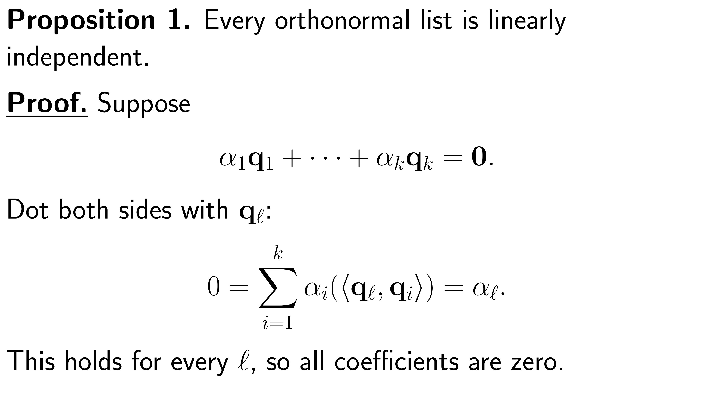

## 第 18 页：标准正交坐标直接等于点积

若 $q_1,\ldots,q_k$ 是 $S$ 的标准正交基，令 $Q=(q_1\ \cdots\ q_k)$。对每个 $x\in S$，

$$
[x]_{\mathcal Q}=Q^Tx=\begin{pmatrix}\langle q_1,x\rangle\\\vdots\\\langle q_k,x\rangle\end{pmatrix}.
$$

把 $x$ 与每个基方向做一次点积，就能得到全部坐标。这里 $Q$ 是 $d\times k$，$Q^Tx$ 是 $k$ 维坐标。

展开第 18 页原始 slide，核对图表、标注和公式

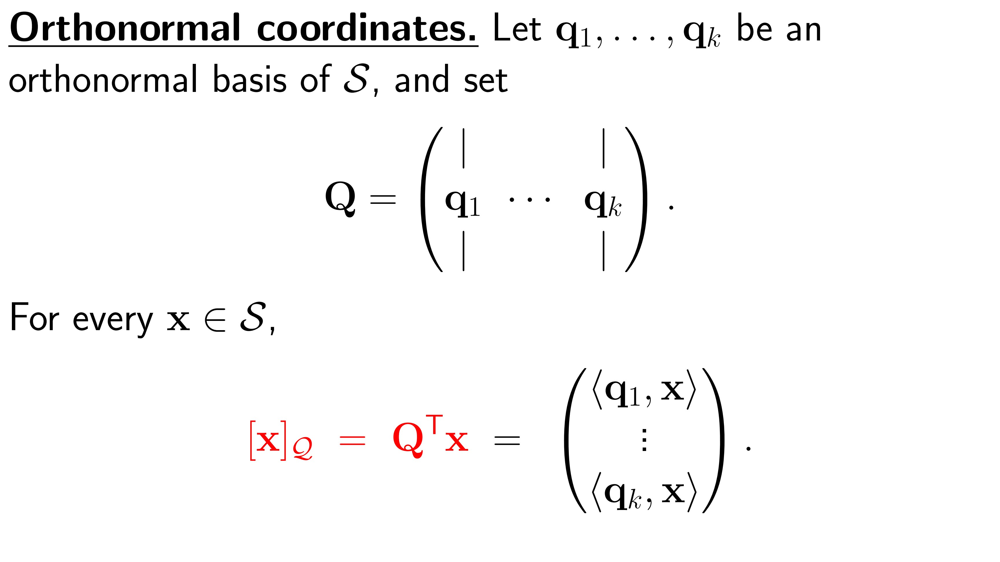

## 第 19 页：为什么点积能取出单个坐标

把 $x$ 写成 $x=\sum_i\alpha_iq_i$，则

$$
\langle q_j,x\rangle=\sum_i\alpha_i\langle q_j,q_i\rangle=\alpha_j.
$$

正交性消去其他方向，单位长度保留系数本身。每个坐标只需一个点积，不必再解方程组或计算矩阵逆。

展开第 19 页原始 slide，核对图表、标注和公式

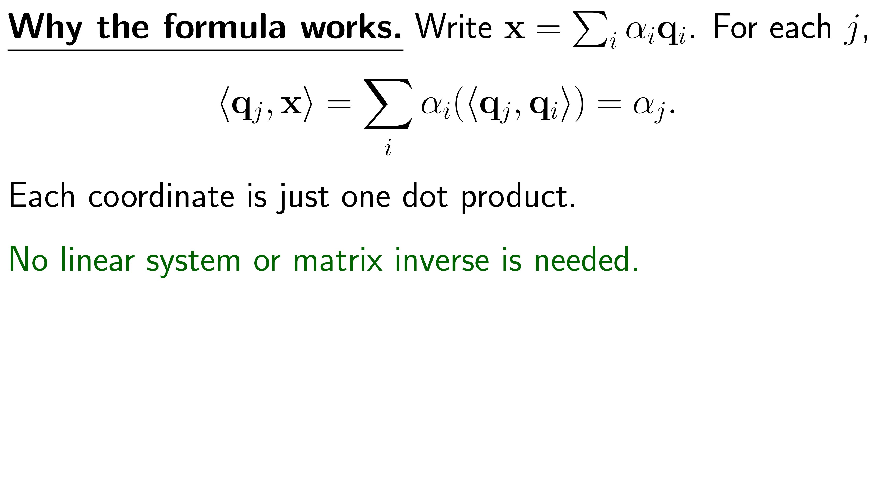

## 第 20 页：正交矩阵及其保持的量

方阵 $Q\in\mathbb R^{d\times d}$ 的列标准正交时，称为 orthogonal matrix（正交矩阵）。等价关系为

$$
Q^TQ=I_d,\qquad Q^{-1}=Q^T.
$$

对任意 $x,y\in\mathbb R^d$，有 $\langle Qx,Qy\rangle=\langle x,y\rangle$、$\|Qx\|_2=\|x\|_2$，因此保持长度和夹角。

**理解补充：**这里“正交矩阵”要求方阵。若 $Q$ 只有 $k<d$ 个标准正交列，仍有 $Q^TQ=I_k$，但 $QQ^T$ 一般不是 $I_d$，也不存在这里定义的方阵逆。

展开第 20 页原始 slide，核对图表、标注和公式

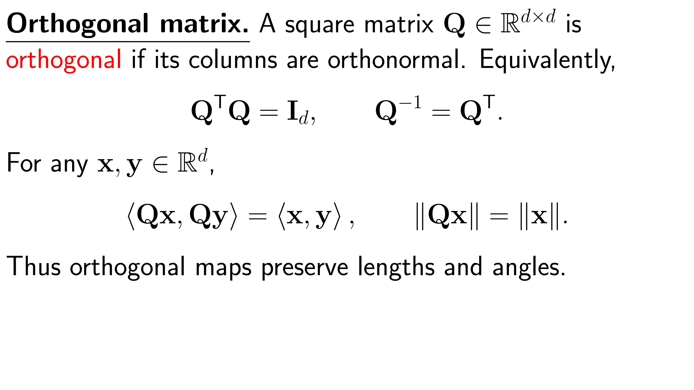

## 第 21 页：保持点积、长度和角度的证明

因为 $Q^TQ=I_d$，

$$
\langle Qx,Qy\rangle=(Qx)^TQy=x^TQ^TQy=x^Ty=\langle x,y\rangle.
$$

令 $y=x$，得到长度平方不变，长度因此不变。非零向量的余弦相似度的分子、分母都不变，故夹角也不变。

展开第 21 页原始 slide，核对图表、标注和公式

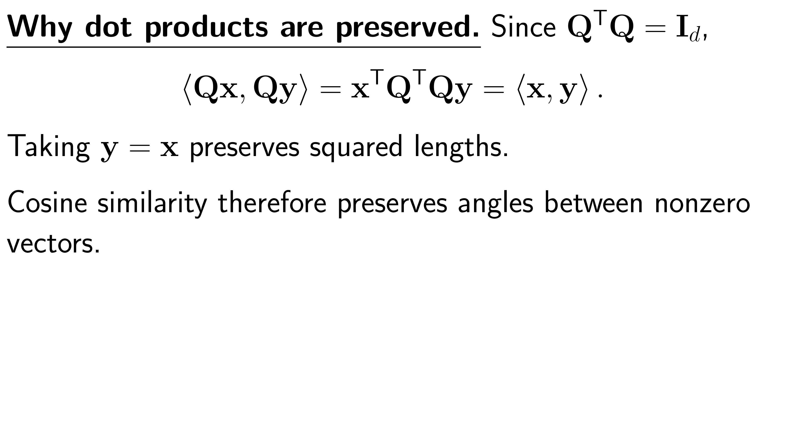

## 第 22 页：章节页：Gram-Schmidt 构造标准正交基

下面从任意一组线性无关向量出发，逐个剔除已有方向的分量，再归一化，得到张成同一空间的标准正交基。

展开第 22 页原始 slide，核对图表、标注和公式

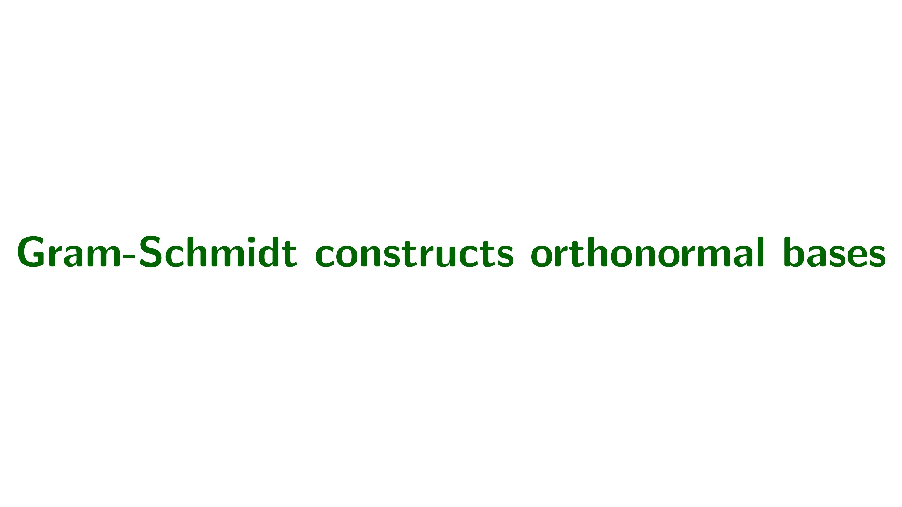

## 第 23 页：Gram-Schmidt 的通用公式

从线性无关的 $v_1,\ldots,v_k$ 开始，先设 $u_1=v_1$、$q_1=u_1/\|u_1\|_2$。对 $j=2,\ldots,k$，计算

$$
u_j=v_j-\sum_{i=1}^{j-1}\langle q_i,v_j\rangle q_i,\qquad
q_j=\frac{u_j}{\|u_j\|_2}.
$$

得到的 $q_i$ 标准正交，且与原 $v_i$ 张成相同子空间。减法去掉已解释的方向，除以范数只调整长度。

**理解补充：**线性无关假设保证精确运算中 $u_j\ne0$；否则归一化会遇到除以零。

展开第 23 页原始 slide，核对图表、标注和公式

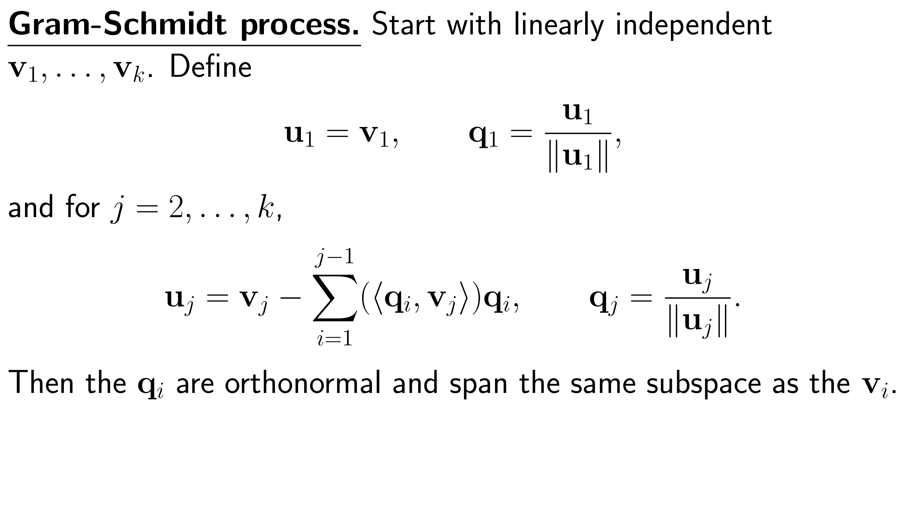

## 第 24 页：例 3：四维空间中构造第一个单位方向

原始三个线性无关向量为 $v_1=(2,4,4,8)^T$、$v_2=(-10,10,-20,20)^T$、$v_3=(-28,-16,-11,58)^T$，都在 $\mathbb R^4$ 中。

第一步 $\|v_1\|_2=10$，所以

$$
q_1=\frac{v_1}{10}=\frac15(1,2,2,4)^T.
$$

这一阶段只归一化第一个向量，不需要先扣除其他方向。

展开第 24 页原始 slide，核对图表、标注和公式

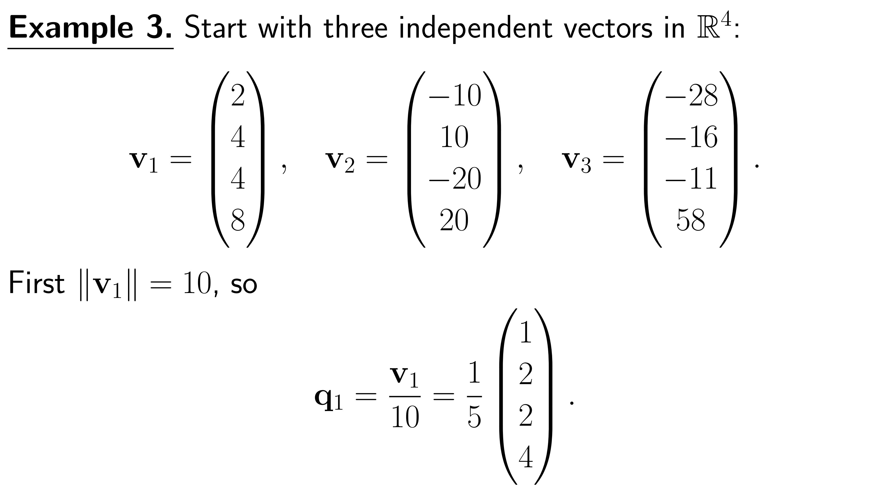

## 第 25 页：例 3 续：从第二个向量减去已有分量

第二个向量在第一单位方向上的系数为 $\langle q_1,v_2\rangle=10$。因此

$$
u_2=v_2-10q_1=(-12,6,-24,12)^T.
$$

**理解补充：**$10q_1=(2,4,4,8)^T$，相减后得到的 $u_2$ 与 $q_1$ 点积为零。还要归一化才能得到新的单位方向。

展开第 25 页原始 slide，核对图表、标注和公式

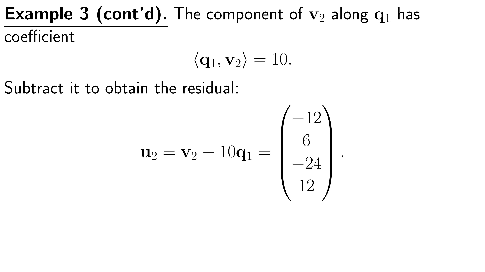

## 第 26 页：例 3 续：归一化第二个残差

计算

$$
\|u_2\|_2^2=(-12)^2+6^2+(-24)^2+12^2=900.
$$

因此 $\|u_2\|_2=30$，第二个单位方向为

$$
q_2=\frac{u_2}{30}=\frac15(-2,1,-4,2)^T.
$$

此时 $q_1,q_2$ 互相垂直且各自长度为 1。

展开第 26 页原始 slide，核对图表、标注和公式

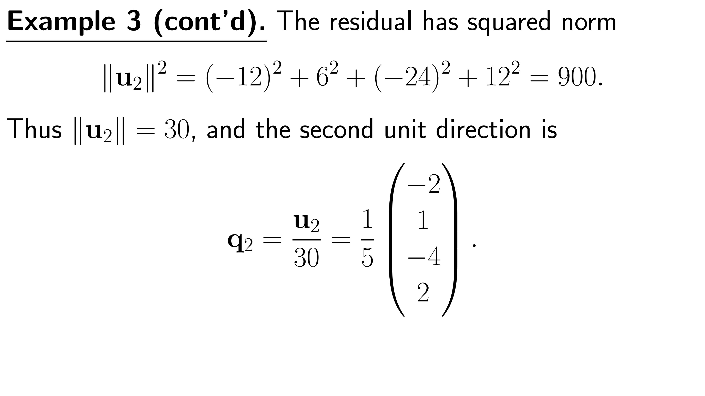

## 第 27 页：例 3 续：第三个向量要减去两个分量

第三个向量在已有两方向上的系数分别为 $\langle q_1,v_3\rangle=30$、$\langle q_2,v_3\rangle=40$。必须同时移除：

$$
u_3=v_3-30q_1-40q_2=(-18,-36,9,18)^T.
$$

只减去一个方向通常不能保证与之前全部基向量正交。

展开第 27 页原始 slide，核对图表、标注和公式

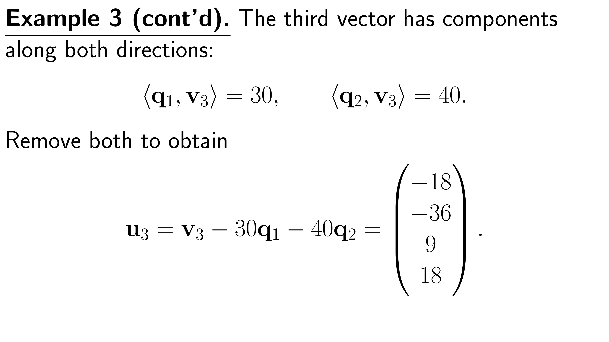

## 第 28 页：例 3 续：得到第三个单位方向

因为 $\|u_3\|_2=45$，

$$
q_3=\frac{u_3}{45}=\frac15(-2,-4,1,2)^T.
$$

三个 $q_i$ 已标准正交，并与原来的三个 $v_i$ 张成相同的三维子空间。它们都在 $\mathbb R^4$ 中，但只张成三维，并不是整个四维空间的一组基。

展开第 28 页原始 slide，核对图表、标注和公式

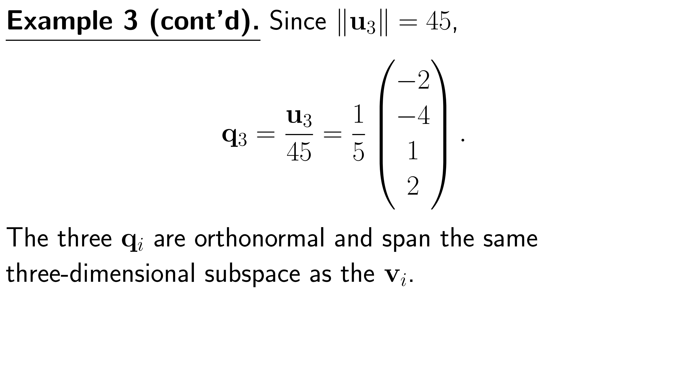

## 第 29 页：章节页：正交投影提取可解释的分量

下面把“对本来就在子空间里的向量求坐标”推广为“对任意向量，保留子空间能够解释的部分”。

展开第 29 页原始 slide，核对图表、标注和公式

## 第 30 页：如果数据点不在低维子空间中怎么办

前面只恢复已经位于子空间中的向量坐标，但一个数据点可能位于选定子空间外。我们希望找子空间中离它最近的点。投影保留可解释分量，剩余 residual（残差）则垂直于子空间中的每个方向。

展开第 30 页原始 slide，核对图表、标注和公式

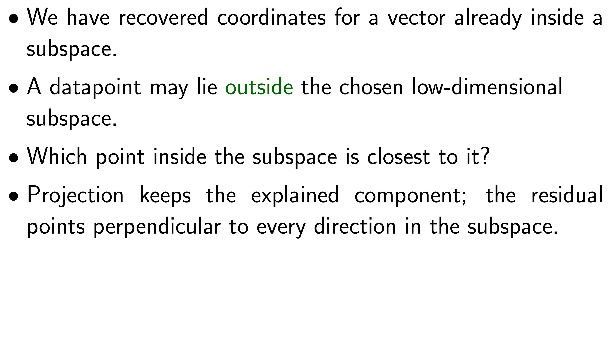

## 第 31 页：正交投影的定义

对 $S\subseteq\mathbb R^d$ 的子空间，如果 $p\in S$ 且对每个 $y\in S$ 都有

$$
(x-p)\perp y,
$$

则称 $p$ 是 $x$ 到 $S$ 的正交投影，$r=x-p$ 是残差。两个要求都要检查：投影点在子空间内，残差与整个子空间正交。

展开第 31 页原始 slide，核对图表、标注和公式

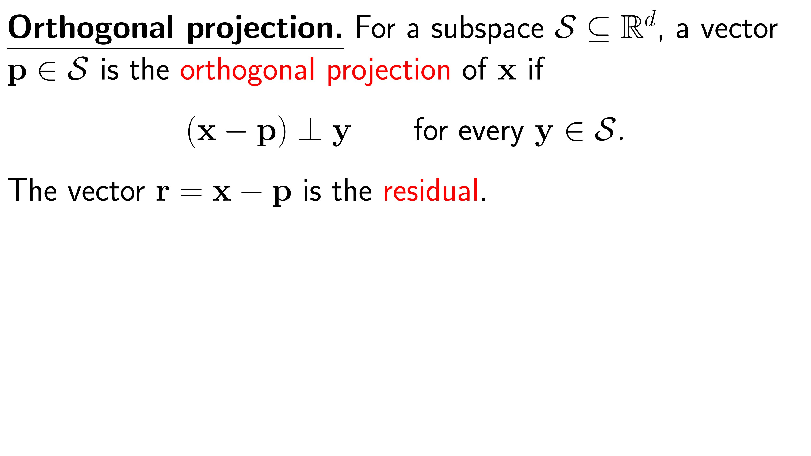

## 第 32 页：投影定理：用标准正交列计算唯一最近点

设 $Q\in\mathbb R^{d\times k}$ 有标准正交列，$S=\operatorname{Col}(Q)$。则

$$
p=QQ^Tx
$$

是 $x$ 在 $S$ 上的唯一正交投影，也是 $S$ 中唯一离 $x$ 最近的点。先算 $Q^Tx$ 得到 $k$ 个投影坐标，再乘 $Q$ 回到原来的 $d$ 维空间。标准正交列是假设，不能对任意矩阵直接套用这个公式。

展开第 32 页原始 slide，核对图表、标注和公式

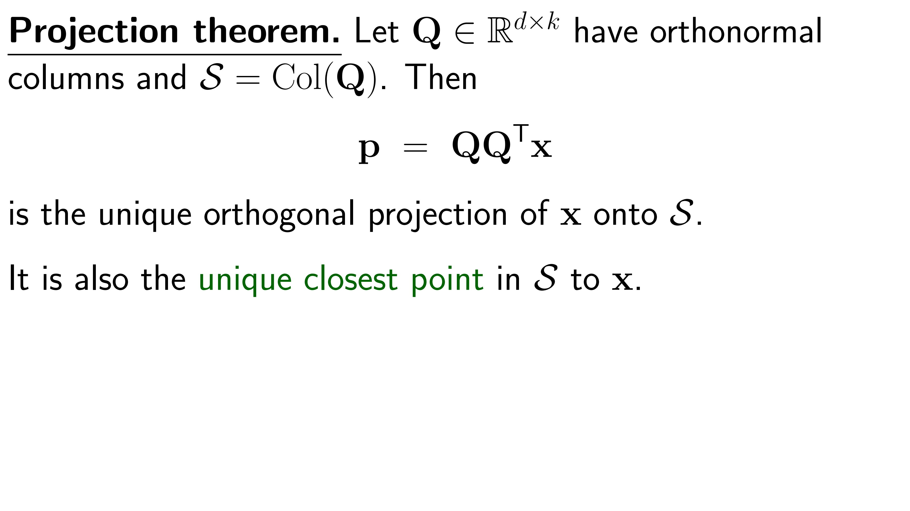

## 第 33 页：为什么残差与整个子空间正交

设 $r=x-QQ^Tx$，因为 $Q^TQ=I_k$，

$$
Q^Tr=Q^Tx-Q^TQQ^Tx=Q^Tx-I_kQ^Tx=0.
$$

$Q^Tr=0$ 表示残差与 $Q$ 的每一列正交。$S$ 中所有向量都是这些列的线性组合，所以残差与整个 $S$ 正交。

展开第 33 页原始 slide，核对图表、标注和公式

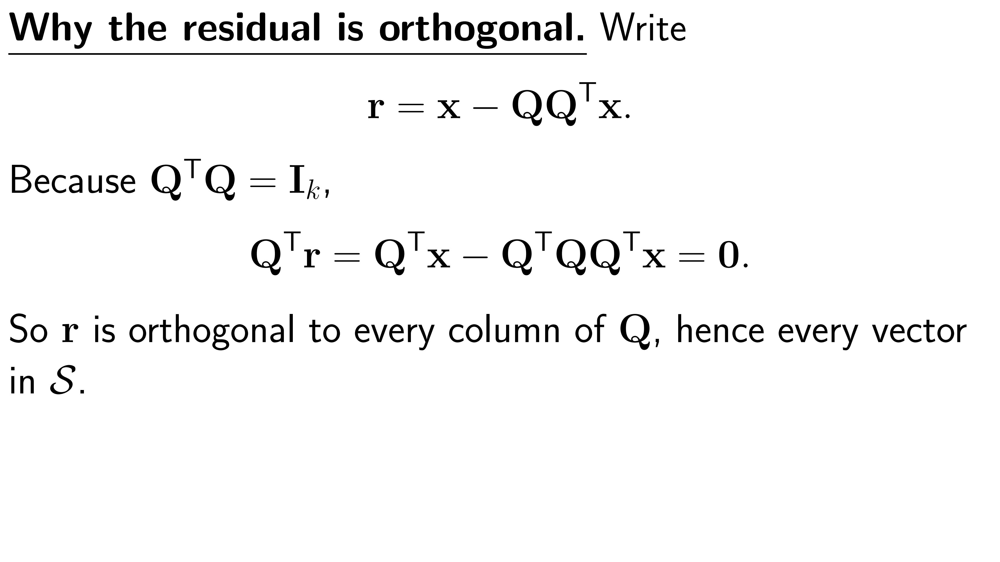

## 第 34 页：为什么正交投影是唯一最近点

对任意 $y\in S$，可分解为 $x-y=r+(p-y)$，而 $p-y\in S$，故 $r\perp(p-y)$。于是根据勾股关系，

$$
\|x-y\|_2^2=\|r\|_2^2+\|p-y\|_2^2\ge\|r\|_2^2.
$$

等号仅在 $y=p$ 时成立。任何其他子空间内的点都多出一项严格正的平方距离，因此投影点既最近又唯一。

展开第 34 页原始 slide，核对图表、标注和公式

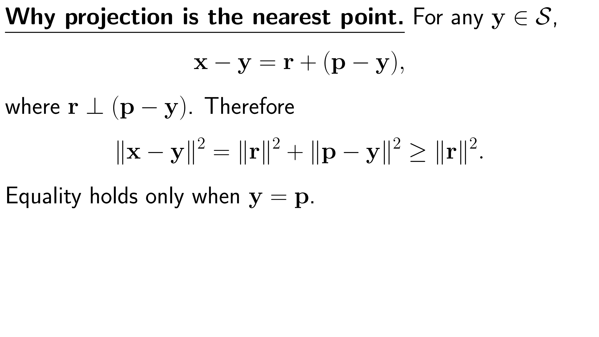

## 第 35 页：例 4：把四维点投到三维子空间

给出

$$
Q=\frac15\begin{pmatrix}4&-2&-2\\2&4&-1\\2&1&4\\1&-2&2\end{pmatrix},\qquad
x=\begin{pmatrix}-8\\9\\3\\-4\end{pmatrix}.
$$

$Q$ 的三列标准正交。原页要求找它们的张成空间中离 $x$ 最近的点。这里 $Q$ 是 $4\times3$，目标子空间是四维环境空间中的三维子空间。

展开第 35 页原始 slide，核对图表、标注和公式

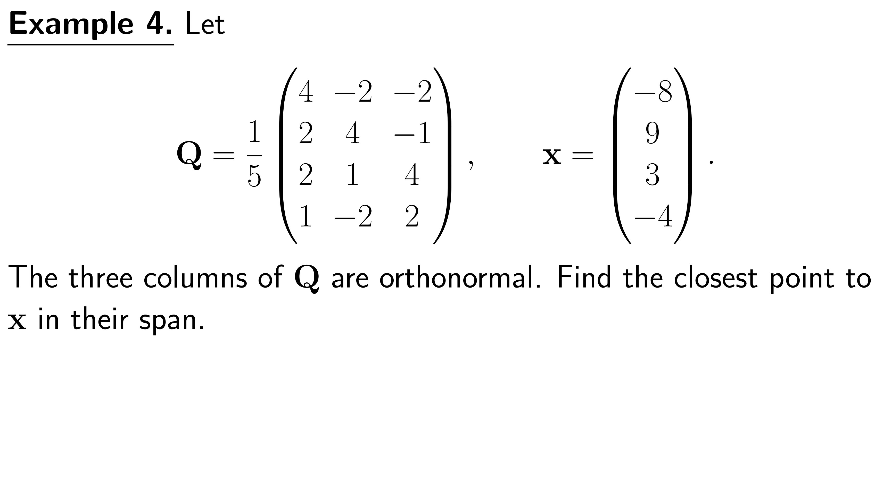

## 第 36 页：例 4 续：先取投影坐标，再重构

先计算

$$
Q^Tx=\frac15\begin{pmatrix}-12\\63\\11\end{pmatrix}.
$$

再乘回 $Q$，得

$$
p=QQ^Tx=\frac1{25}\begin{pmatrix}-196\\217\\83\\-116\end{pmatrix}.
$$

**理解补充：**前三个数是投影在基下的坐标，后四个数是原空间中的点。$x$ 本来可能不在子空间内，所以 $Q^Tx$ 是投影的坐标，不是一个能无误差重构 $x$ 的坐标。

展开第 36 页原始 slide，核对图表、标注和公式

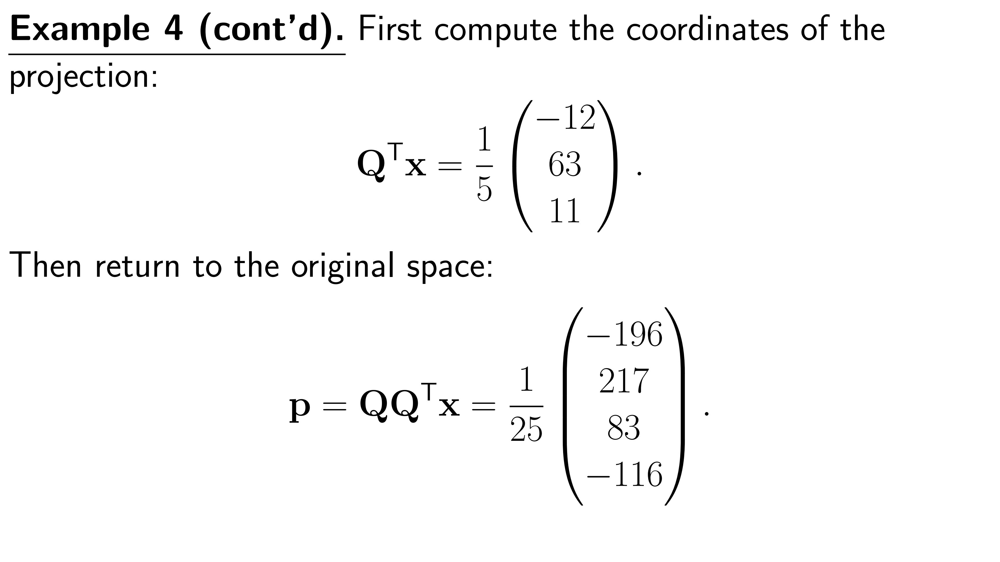

## 第 37 页：例 4 续：检查残差正交

相减得到

$$
r=x-p=\frac1{25}\begin{pmatrix}-4\\8\\-8\\16\end{pmatrix},\qquad
Q^Tr=\begin{pmatrix}0\\0\\0\end{pmatrix}.
$$

因此 $p$ 确实是 $\operatorname{Col}(Q)$ 中的唯一最近点。**理解补充：**最小距离是 $\|r\|_2=\sqrt{16+64+64+256}/25=20/25=4/5$。残差的四个分量不全为零，但与三条子空间基方向的点积全为零。

展开第 37 页原始 slide，核对图表、标注和公式

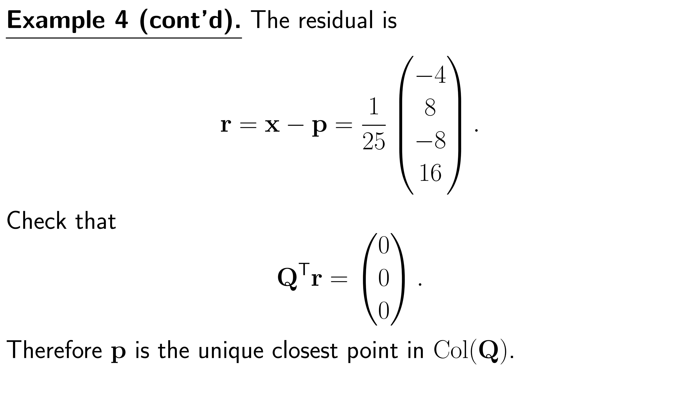

## 第 38 页：本讲总结

点积衡量方向配合，余弦相似度通过归一化比较方向。标准正交基下的坐标直接为 $[x]_{\mathcal Q}=Q^Tx$。正交矩阵保持点积、长度与夹角。Gram-Schmidt 把线性无关向量变为张成同一空间的标准正交方向。对标准正交列矩阵 $Q$，$QQ^Tx$ 是 $\operatorname{Col}(Q)$ 中离 $x$ 最近的点。

展开第 38 页原始 slide，核对图表、标注和公式

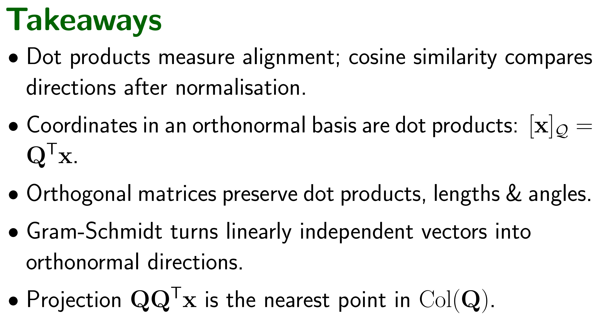

