# Lecture 08B：超平面与支持向量机，按幻灯片逐页复述

来源：[lecture08b.pdf](../../comp3670_lectures/lecture08b.pdf)，共 36 个 PDF 页面。严格按 PDF 页序组织，章节页、例题续页和证明留白页也单独保留。默认向量为列向量；数据矩阵中的每一行通常是一个数据点的转置。正文用中文讲解概念、公式和图表；原页未写出的解答或推导明确标为“理解补充”。每节末尾可展开完整原始 slide 核对颜色、标注和排版。图片和 PDF 均使用仓库相对路径，适合本地预览与 GitHub。

## 第 1 页：课程与主题：超平面和支持向量机

这是 COMP3670/6670《Introduction to Machine Learning》第 8b 周，英文主题为 Hyperplanes & Support Vector Machines。讲师为 ANU School of Computing 的 Senior Lecturer Yun Kuen Cheung（Marco）。本讲从带偏置的分类评分出发，把评分转为几何距离，再建立硬间隔、软间隔 SVM 和数值求解方法。

展开第 1 页原始 slide，核对图表、标注和公式

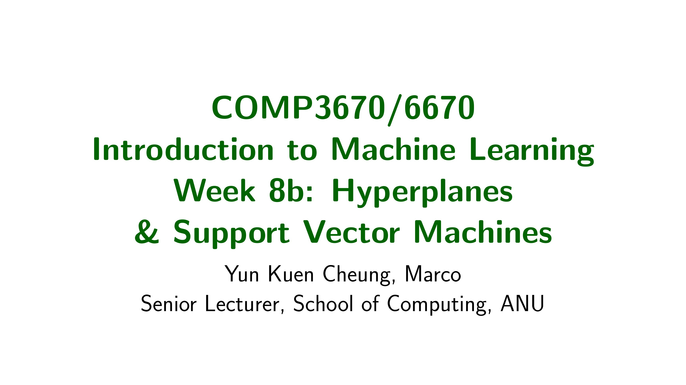

## 第 2 页：学习目标

五个目标是：使用仿射评分分类；把评分转换成点到超平面的距离；理解 SVM 为什么追求大间隔；通过松弛变量和 hinge loss（合页损失）允许违反间隔要求；认识如何用数值方法计算模型参数。

展开第 2 页原始 slide，核对图表、标注和公式

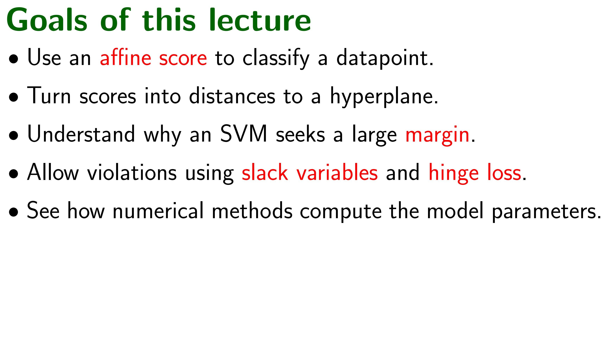

## 第 3 页：章节页：仿射评分为数据分类

首先给每个数据点一个实数评分，以分数的正负区分两个类别，再找出分数为零的分界面。

展开第 3 页原始 slide，核对图表、标注和公式

## 第 4 页：从垃圾邮件分类理解训练数据

邮件过滤器可以根据词频等特征预测垃圾邮件与非垃圾邮件。训练数据是 $x_1,\ldots,x_n\in\mathbb R^d$，标签为 $y_i\in\{-1,+1\}$。目标是让一类得到正分，另一类得到负分，用同一种数学规则处理两类。

展开第 4 页原始 slide，核对图表、标注和公式

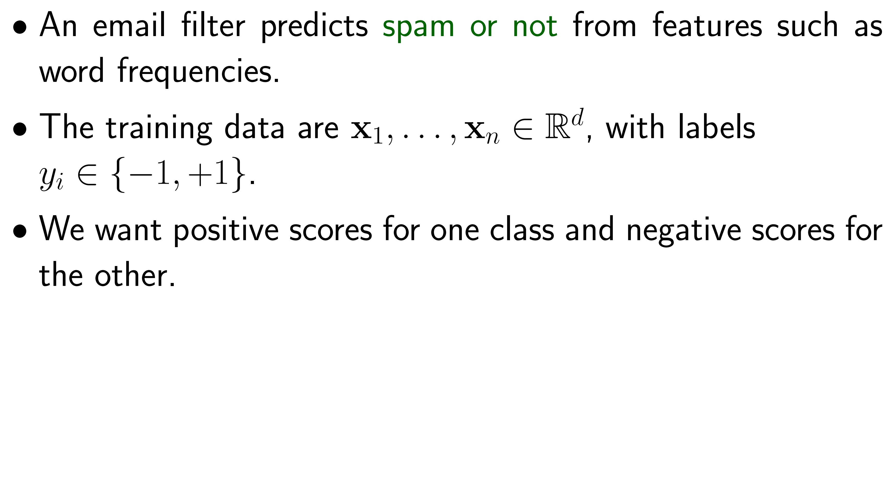

## 第 5 页：仿射评分与零分时的预测约定

权重 $w\in\mathbb R^d$ 和偏置 $b\in\mathbb R$ 定义

$$
f_{w,b}(x)=\langle w,x\rangle+b,\qquad
\hat y(x)=\begin{cases}+1,&f_{w,b}(x)\ge0,\\-1,&f_{w,b}(x)<0.\end{cases}
$$

偏置允许边界移离原点。注意本讲规定零分预测为 $+1$，不能把等号随意放到另一类。

展开第 5 页原始 slide，核对图表、标注和公式

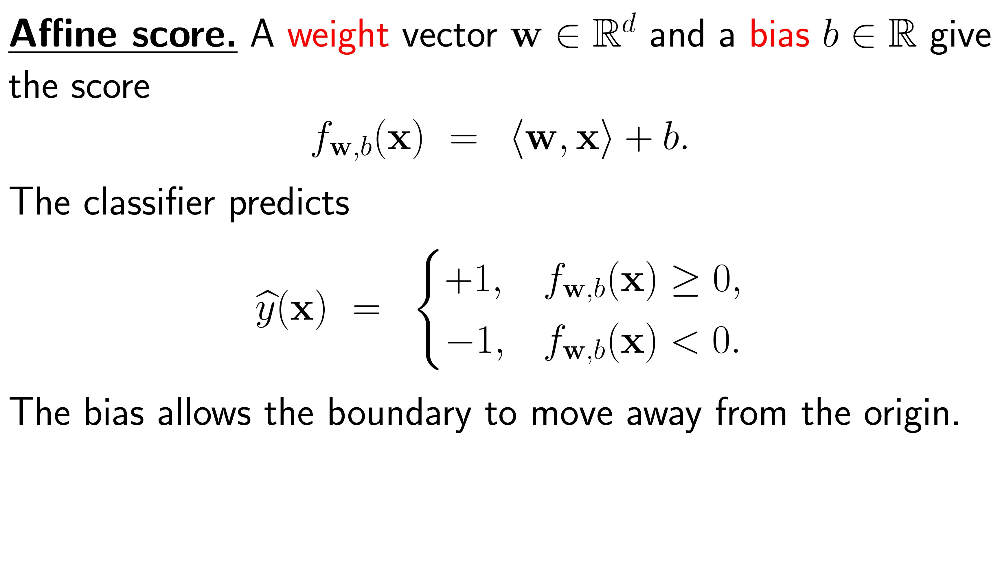

## 第 6 页：决策边界是仿射超平面，w 是法向量

当 $w\ne0$ 时，决策边界为

$$
H=\{x\in\mathbb R^d:\langle w,x\rangle+b=0\}.
$$

若 $u,v\in H$，则 $\langle w,u-v\rangle=-b-(-b)=0$。因此沿边界的任意位移都与 $w$ 垂直，$w$ 就是 normal vector（法向量）。这里垂直的是边界方向，并不是说每个边界点的位置向量都与 $w$ 垂直。

展开第 6 页原始 slide，核对图表、标注和公式

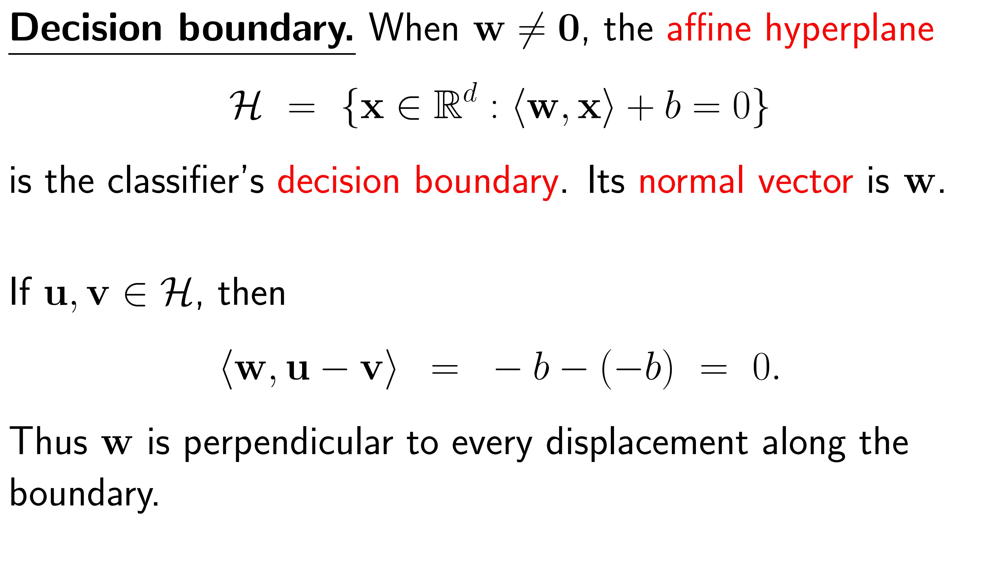

## 第 7 页：例 1：三个点的评分与位置

设 $w=(3,4)^T,b=-30$，则 $f_{w,b}(x)=3x_1+4x_2-30$。

| 点 | 评分 | 位置 |
| --- | ---: | --- |
| $(6,8)^T$ | 20 | 正侧 |
| $(3,4)^T$ | $-5$ | 负侧 |
| $(2,6)^T$ | 0 | 边界上 |

零分点按约定预测为 $+1$。评分的正负决定类别，数值本身还没有除以法向量长度，因此暂时不是距离。

展开第 7 页原始 slide，核对图表、标注和公式

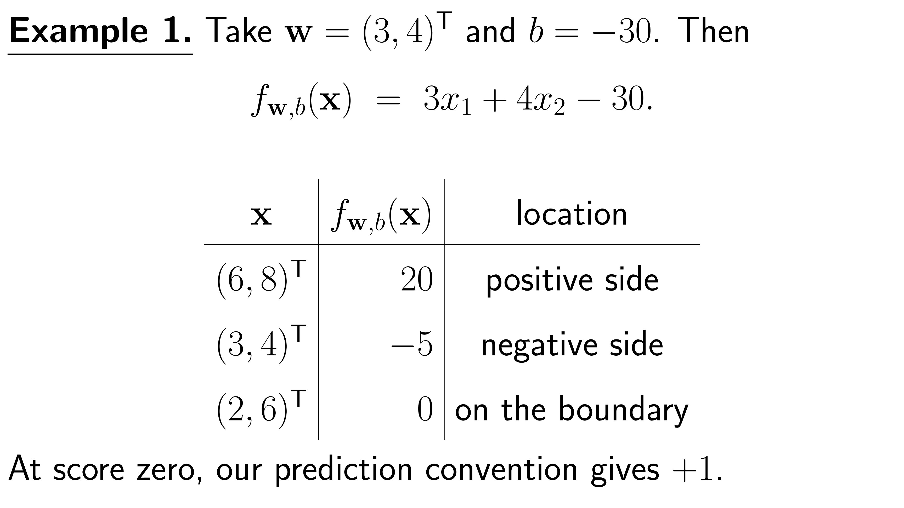

## 第 8 页：例 1 续：二维超平面就是一条直线

原图横轴为第一坐标 $x_1$，纵轴为第二坐标 $x_2$，刻度从 0 到 10。绿色直线为 $3x_1+4x_2=30$，经过 $(0,7.5)$ 与 $(10,0)$。红色叉号 $(6,8)$ 位于正侧，蓝色点 $(3,4)$ 位于负侧，橙色点 $(2,6)$ 在边界上。黑色 $w=(3,4)^T$ 箭头从边界点朝右上，垂直于边界。

正侧预测 $+1$，负侧预测 $-1$。如果 $b=0$，边界会经过原点；当前 $b=-30$ 使边界产生平移。

展开第 8 页原始 slide，核对图表、标注和公式

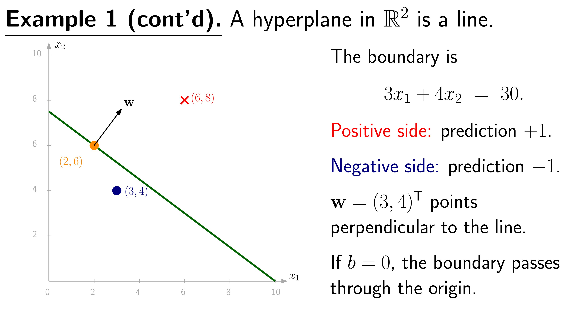

## 第 9 页：章节页：距离赋予评分几何意义

接下来消除评分尺度的任意性，用真正的几何距离描述一个点离分类边界有多远。

展开第 9 页原始 slide，核对图表、标注和公式

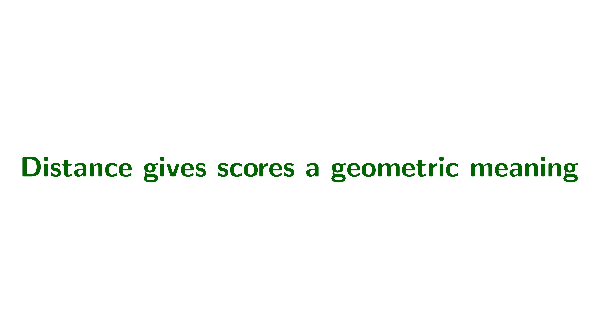

## 第 10 页：为什么不能只比较原始分数

多个超平面可能把全部训练点都分对；靠近边界的点可能因很小的特征扰动而改变预测。同时把 $w,b$ 乘以同一正数，只会缩放评分，不改变边界，也不改变预测。这说明不能单凭分数更大就宣称分类几何更稳健。

展开第 10 页原始 slide，核对图表、标注和公式

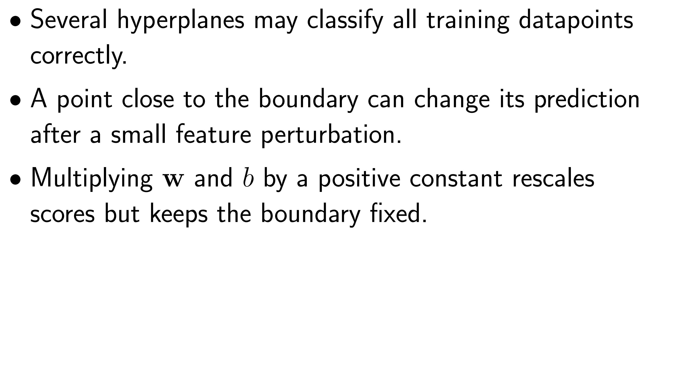

## 第 11 页：命题 1：最近点、距离与有符号距离

对 $H=\{z:\langle w,z\rangle+b=0\}$ 且 $w\ne0$，离 $x$ 最近的点为

$$
p=x-\frac{\langle w,x\rangle+b}{\|w\|_2^2}w.
$$

普通距离与 signed distance（有符号距离）分别为

$$
d(x,H)=\frac{|f_{w,b}(x)|}{\|w\|_2},\qquad
s(x,H)=\frac{f_{w,b}(x)}{\|w\|_2}.
$$

有符号距离在 $w$ 指向的那一侧为正。最近点公式的分母是**范数平方**，距离公式的分母是**范数**。

展开第 11 页原始 slide，核对图表、标注和公式

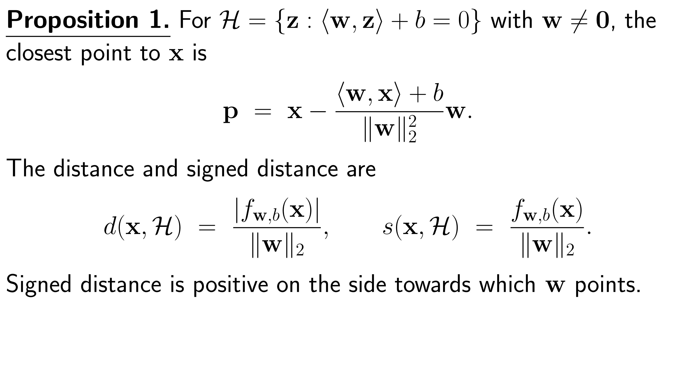

## 第 12 页：点到超平面距离公式的证明

先验证 $p\in H$，再验证 $x-p$ 平行于法向量 $w$。对任意 $z\in H$，位移 $p-z$ 沿边界，所以 $(x-p)\perp(p-z)$。于是

$$
\|x-z\|_2^2=\|x-p\|_2^2+\|p-z\|_2^2\ge\|x-p\|_2^2.
$$

仅在 $z=p$ 时等号成立，所以 $p$ 是唯一最近点。最后取 $x-p$ 的范数，得 $\|x-p\|_2=|f_{w,b}(x)|/\|w\|_2$。

**理解补充：**直接代回可得 $\langle w,p\rangle+b=f_{w,b}(x)-f_{w,b}(x)\|w\|_2^2/\|w\|_2^2=0$，完成第一步核对。

展开第 12 页原始 slide，核对图表、标注和公式

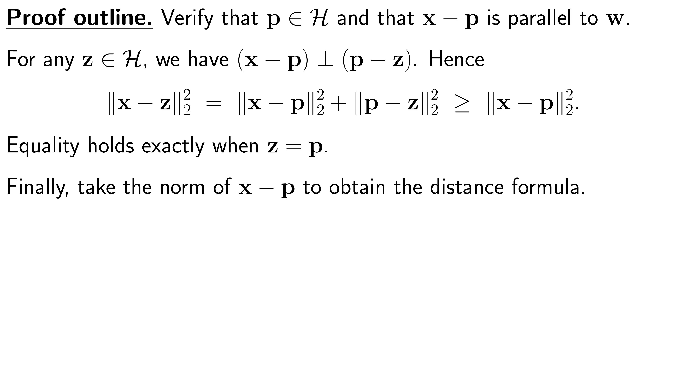

## 第 13 页：例 2：放大评分不改变几何距离

设 $w=(3,4)^T,b=-30,x=(6,8)^T$。评分为 20，$\|w\|_2=5$，有符号距离是 4。最近点为

$$
p=\begin{pmatrix}6\\8\end{pmatrix}-\frac{20}{25}\begin{pmatrix}3\\4\end{pmatrix}
=\begin{pmatrix}18/5\\24/5\end{pmatrix}.
$$

若整体放大七倍，$w'=(21,28)^T,b'=-210$，评分变成 140，但范数变成 35，因此有符号距离仍为 $140/35=4$。

展开第 13 页原始 slide，核对图表、标注和公式

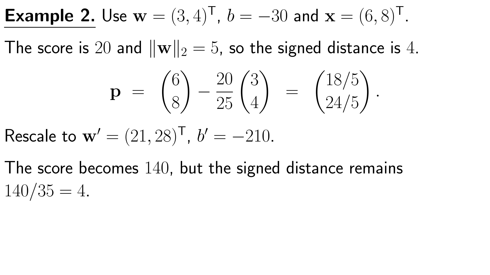

## 第 14 页：例 2 续：图中垂线段才表示距离

图仍在第一、第二坐标均为 0 到 10 的坐标系内，绿色线为 $3x_1+4x_2=30$。红叉标出 $x=(6,8)^T$，橙点标出投影 $p=(18/5,24/5)^T$，从 $p$ 到 $x$ 的虚线段标记长度 4，并在边界处标出直角。黑箭头标示法向量 $w$。

图强调 $x-p$ 与 $w$ 平行、$\|x-p\|_2=4$。把参数换成 $w'=(21,28)^T,b'=-210$ 后，同一张几何图仍然适用，因为线与投影位置都未变。

展开第 14 页原始 slide，核对图表、标注和公式

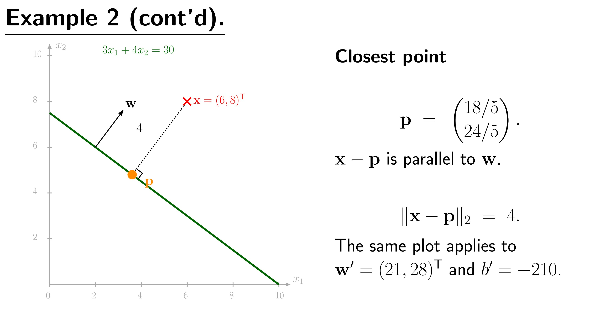

## 第 15 页：函数间隔与几何间隔

对带标签数据点 $(x_i,y_i)$，定义

$$
m_i=y_if_{w,b}(x_i),\qquad \gamma_i=\frac{m_i}{\|w\|_2}.
$$

$m_i$ 是 functional margin（函数间隔），$\gamma_i$ 是 geometric margin（几何间隔）。若 $m_i>0$，点严格位于正确侧；若 $m_i<0$，严格位于错误侧。乘上标签统一了两个类别的判断：正类希望分数大于零，负类希望分数小于零。

**理解补充：**$m_i=0$ 表示点在边界；是否按零分约定分对，还与标签有关，不能归入“严格正确侧”。

展开第 15 页原始 slide，核对图表、标注和公式

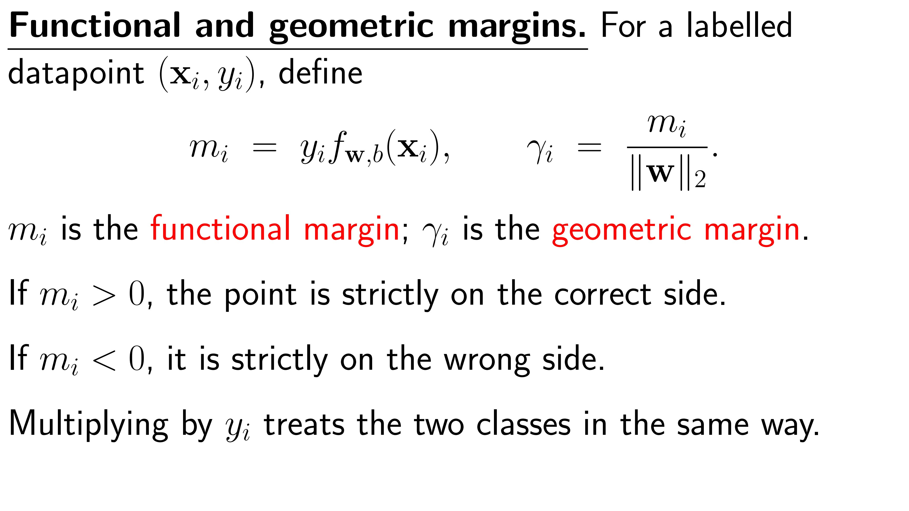

## 第 16 页：线性可分、数据集间隔与扰动

若存在某组 $w,b$ 使每个点的 $m_i>0$，则数据线性可分。一个分离分类器对整个数据集的间隔为

$$
\gamma=\min_{i=1,\ldots,n}\gamma_i.
$$

对一个被严格正确分开的点，若扰动 $\delta$ 满足 $\|\delta\|_2<\gamma_i$，就不能改变它的预测。**理解补充：**由 Cauchy-Schwarz，$|\langle w,\delta\rangle|\le\|w\|_2\|\delta\|_2<m_i$，评分不足以越过零。

较大的训练间隔本身不能保证对未见数据一定预测正确，课件明确保留了这个限制。

展开第 16 页原始 slide，核对图表、标注和公式

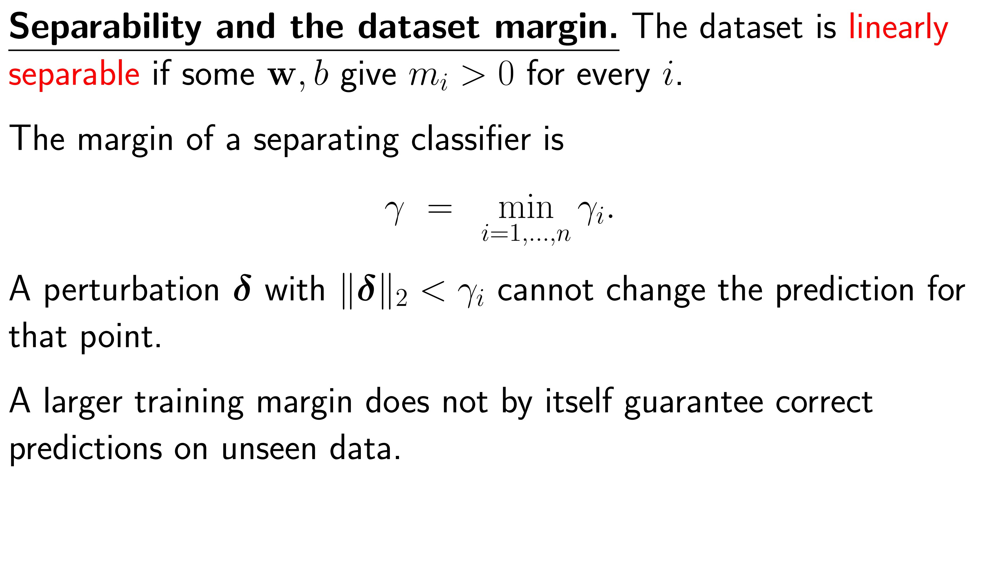

## 第 17 页：章节页：支持向量机最大化间隔

下面在能分开训练数据的边界之间做选择，寻找最宽的分离间隔。

展开第 17 页原始 slide，核对图表、标注和公式

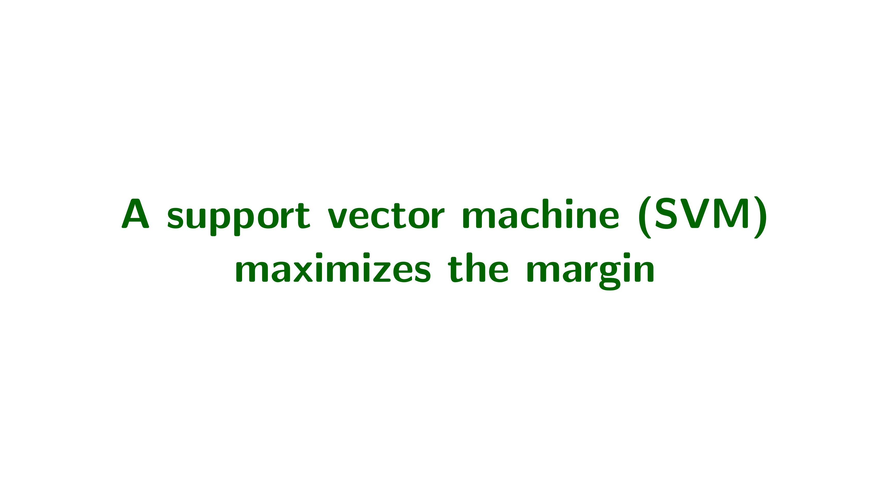

## 第 18 页：硬间隔 SVM 的约束优化形式

假设两个类别都存在，且数据线性可分。Hard-margin SVM 要求每个函数间隔至少为 1：

$$
\begin{aligned}
\text{minimize}_{w,b}\quad&\frac12\|w\|_2^2\\
\text{subject to}\quad&y_i(\langle w,x_i\rangle+b)\ge1,\quad i=1,\ldots,n.
\end{aligned}
$$

这些约束保证每个点的几何间隔至少为 $1/\|w\|_2$。先固定函数间隔的尺度，再最小化权重范数，才能把几何间隔最大化。

展开第 18 页原始 slide，核对图表、标注和公式

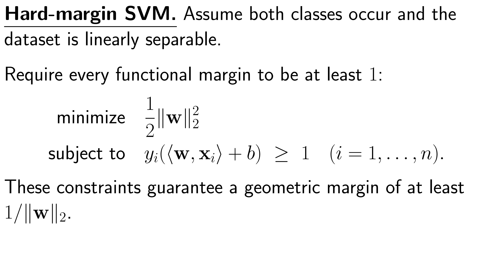

## 第 19 页：命题 2：支持向量与完整间隔带宽

硬间隔 SVM 最大化几何间隔，在最优解处

$$
\min_i y_if_{w,b}(x_i)=1,\qquad \gamma=\frac1{\|w\|_2}.
$$

支持向量满足 $y_if_{w,b}(x_i)=1$，位于 $f_{w,b}(x)=1$ 或 $f_{w,b}(x)=-1$ 两个间隔边界上。两边界之间的完整宽度为 $2/\|w\|_2$。注意 $\gamma$ 是到中间决策边界的单侧距离，而完整宽度是它的两倍。

展开第 19 页原始 slide，核对图表、标注和公式

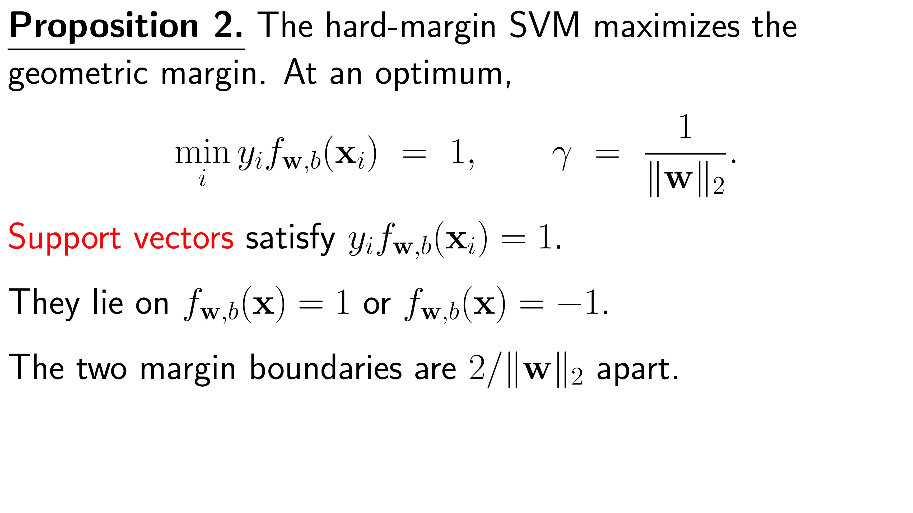

## 第 20 页：为什么最小化范数就等于最大化间隔

对任意严格分离的分类器，令 $t=\min_i y_if_{w,b}(x_i)>0$，再缩放为 $\widetilde w=w/t,\widetilde b=b/t$。最小函数间隔变为 1，而几何间隔保持

$$
\gamma=\frac{t}{\|w\|_2}=\frac1{\|\widetilde w\|_2}.
$$

在最优可行解处不可能有 $t>1$，否则再除以 $t$ 仍满足所有约束，却让平方范数目标更小。两个类别都存在，也排除了可行的 $w=0$，因此范数分母不会为零。

展开第 20 页原始 slide，核对图表、标注和公式

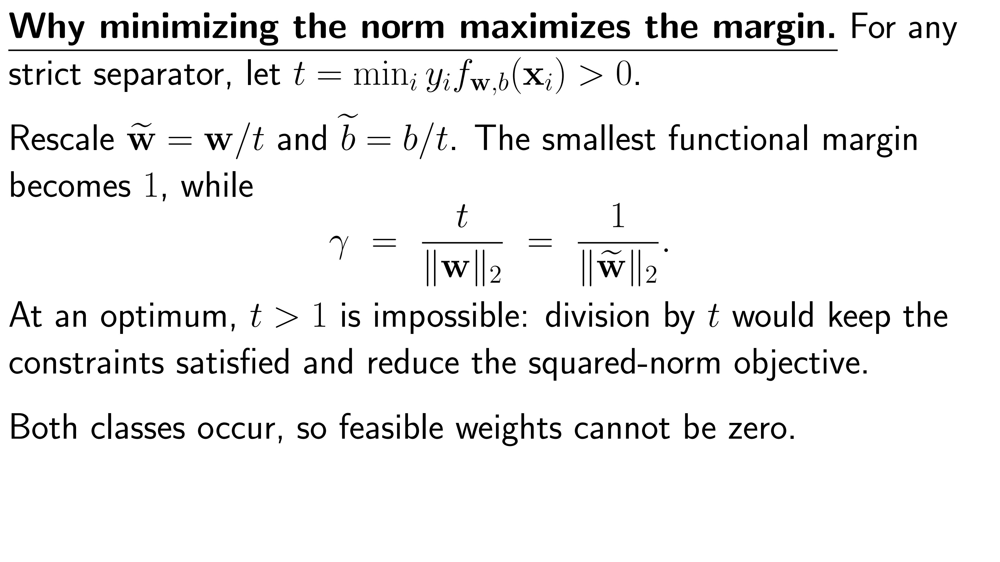

## 第 21 页：例 3：四点硬间隔分类

给定训练点：

| 编号 | $x_i$ | $y_i$ |
| --- | --- | ---: |
| 1 | $(9,12)^T$ | $+1$ |
| 2 | $(16,13)^T$ | $+1$ |
| 3 | $(3,4)^T$ | $-1$ |
| 4 | $(4,-3)^T$ | $-1$ |

取 $w=(3,4)^T/25,b=-2$。原页要求算评分、函数间隔和几何间隔。

**理解补充（解题）：**四个评分依次为 $1,2,-1,-2$，函数间隔依次为 $1,2,1,2$。由于 $\|w\|_2=1/5$，逐点几何间隔依次为 $5,10,5,10$，数据集间隔为 5。

展开第 21 页原始 slide，核对图表、标注和公式

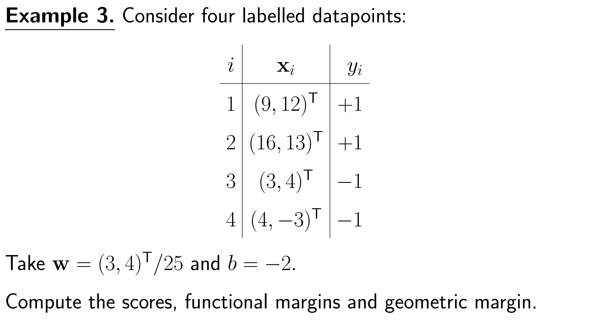

## 第 22 页：例 3 续：画出决策线与两条间隔边界

原图用红叉画正类 $x_1,x_2$，蓝点画负类 $x_3,x_4$，其中 $x_1,x_3$ 被圈出，表示支持向量。横纵坐标是两个特征，图上有 0、5、10、15、20 等刻度，$x_4$ 位于横轴下方。

绿色实线决策边界为 $3x_1+4x_2=50$；两条平行虚线间隔边界为 $3x_1+4x_2=25$ 与 $3x_1+4x_2=75$。$\|w\|_2=1/5$，所以到中线的间隔是 5，完整带宽是 10。图中垂直于边界的线段也标出单侧距离 5。

展开第 22 页原始 slide，核对图表、标注和公式

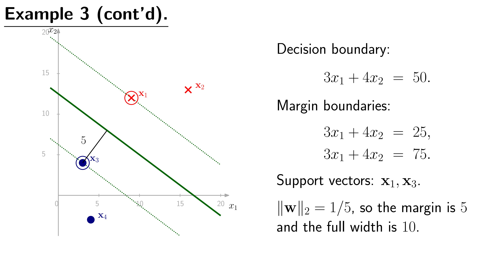

## 第 23 页：例 3 续：证明这组参数确实最优

任意可行参数 $w',b'$ 都必须满足支持点的要求：$\langle w',x_1\rangle+b'\ge1$，$\langle w',x_3\rangle+b'\le-1$。相减消去偏置，再用 Cauchy-Schwarz：

$$
2\le\langle w',x_1-x_3\rangle\le\|w'\|_2\|x_1-x_3\|_2=10\|w'\|_2.
$$

所以所有可行权重都满足 $\|w'\|_2\ge1/5$。例 3 的权重恰好达到这个下界，因此是最优的。证明不只是展示“能分对”，还排除了所有范数更小的可行模型。

展开第 23 页原始 slide，核对图表、标注和公式

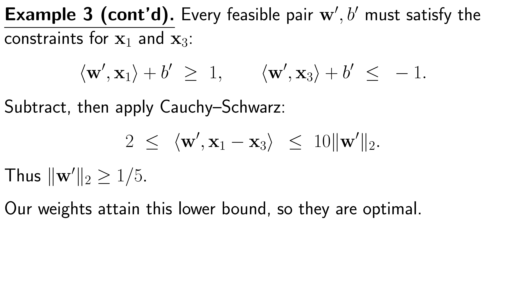

## 第 24 页：章节页：软间隔允许违反要求

现实数据可能重叠或标签不完美。接下来允许某些点达不到单位间隔，并为违反程度付出代价。

展开第 24 页原始 slide，核对图表、标注和公式

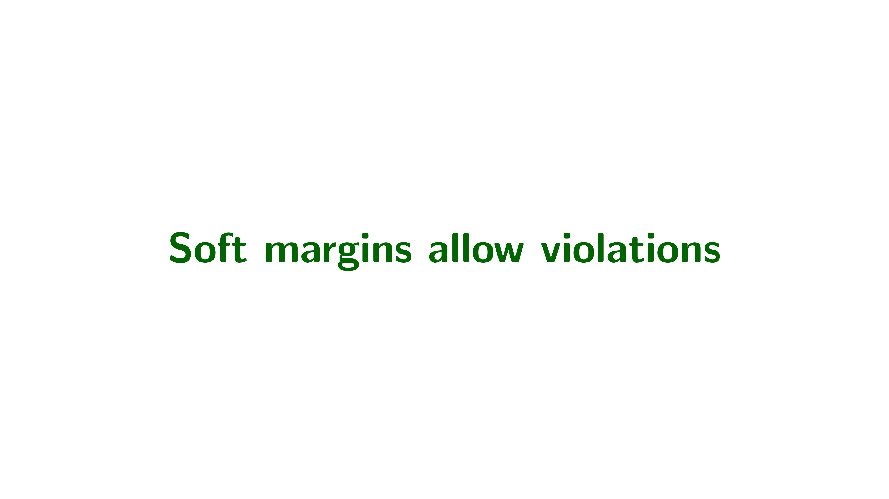

## 第 25 页：软间隔 SVM 与松弛变量

类别重叠或错误标签可能使硬间隔约束无可行解。对 $C>0$，soft-margin SVM 改为

$$
\begin{aligned}
\text{minimize}_{w,b,\xi}\quad&\frac12\|w\|_2^2+C\sum_{i=1}^n\xi_i\\
\text{subject to}\quad&y_i(\langle w,x_i\rangle+b)\ge1-\xi_i,\\
&\xi_i\ge0,\qquad i=1,\ldots,n.
\end{aligned}
$$

Slack variables（松弛变量）$\xi_i$ 允许违反“函数间隔至少为 1”的要求，但目标函数会处罚这种放宽。它不等于仅允许误分类，正确但太近的点也可能需要松弛。

展开第 25 页原始 slide，核对图表、标注和公式

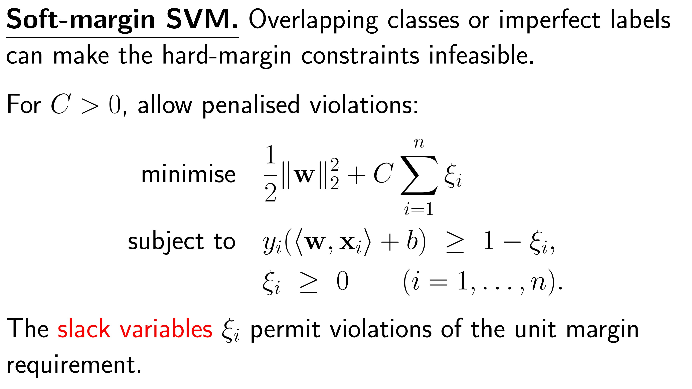

## 第 26 页：Hinge loss 等于最小可行松弛

对函数间隔 $m$，定义合页损失 $\ell(m)=\max\{0,1-m\}$。固定 $w,b$ 后，约束要求 $\xi_i\ge0$ 且 $\xi_i\ge1-m_i$。因为 $C>0$，最优选择是最小允许值：

$$
\xi_i=\max\{0,1-m_i\}=\ell(m_i).
$$

这样可以把额外引入的松弛变量消去，直接写成权重与偏置的损失优化。

展开第 26 页原始 slide，核对图表、标注和公式

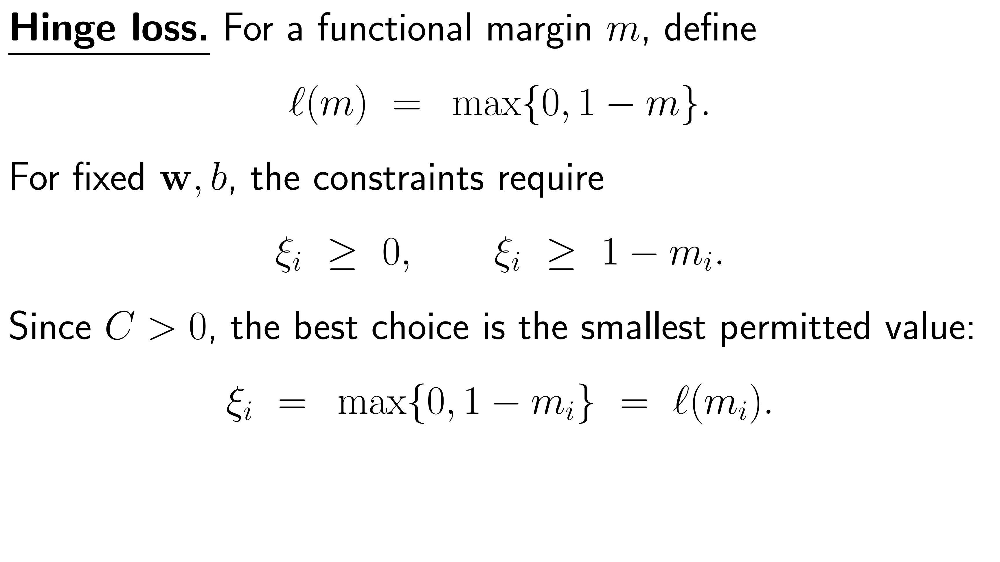

## 第 27 页：命题 3：软间隔的无约束等价形式

软间隔 SVM 等价于无约束最小化

$$
F(w,b)=\frac12\|w\|_2^2+C\sum_{i=1}^n\ell\bigl(y_i(\langle w,x_i\rangle+b)\bigr).
$$

第一项偏好小权重，第二项惩罚函数间隔低于 1 的点。一个点即使分类正确，也可能产生合页损失，例如 $0<m_i<1$。本讲的正则项只包含 $w$，没有把 $b^2$ 加进去。

展开第 27 页原始 slide，核对图表、标注和公式

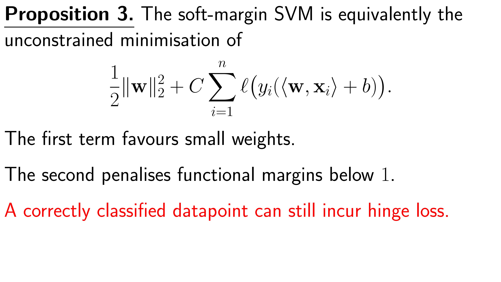

## 第 28 页：最小松弛值的几何解释

使用最小松弛 $\xi_i=\ell(m_i)$，并假设 $w\ne0$：

| 松弛值 | 点的位置 |
| --- | --- |
| $\xi_i=0$ | 满足单位间隔要求，$m_i\ge1$ |
| $0<\xi_i<1$ | 在正确侧，但位于间隔带内，$0<m_i<1$ |
| $\xi_i=1$ | 在决策边界上，$m_i=0$ |
| $\xi_i>1$ | 严格位于错误侧，$m_i<0$ |

松弛度量的是间隔违反，而不只是分类是否错误。这个表依赖采用最小可行松弛；任意人为取更大的可行 $\xi_i$，不能再按表反推位置。

展开第 28 页原始 slide，核对图表、标注和公式

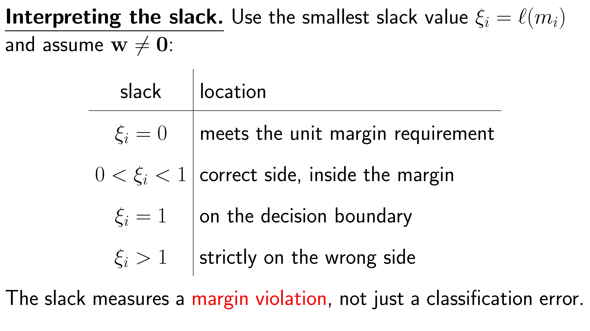

## 第 29 页：例 4：分对也可能有损失

设 $w=(3,4)^T/25,b=-2$，原页给出：

| $x_i$ | $y_i$ | $f_{w,b}(x_i)$ | $m_i$ | $\xi_i=\ell(m_i)$ |
| --- | ---: | ---: | ---: | ---: |
| $(12,16)^T$ | $+1$ | 2 | 2 | 0 |
| $(8,9)^T$ | $+1$ | $2/5$ | $2/5$ | $3/5$ |
| $(6,8)^T$ | $-1$ | 0 | 0 | 1 |
| $(0,0)^T$ | $+1$ | $-2$ | $-2$ | 3 |

第二点分对却有 $3/5$ 的损失，第四点分错且损失为 3。**理解补充：**第三点在边界，按本讲零分预测 $+1$ 的约定，它与标签 $-1$ 不符；几何上仍归为“边界上”，与严格位于错误侧区分。

展开第 29 页原始 slide，核对图表、标注和公式

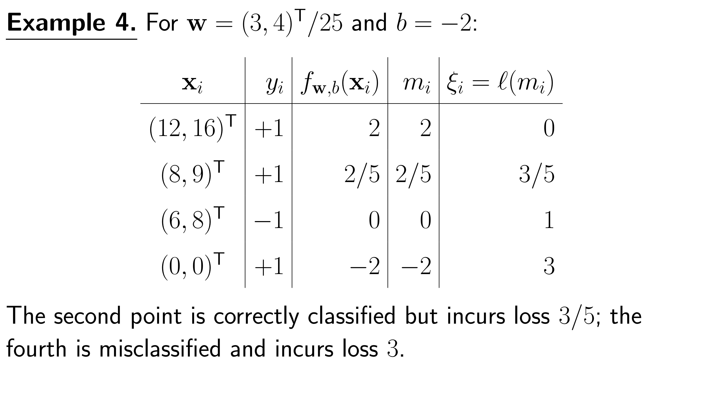

## 第 30 页：C、特征尺度与零权重情形

较大的 $C$ 更重视减少间隔违反，较小的 $C$ 更重视保持权重小。改变特征单位会改变几何关系，因此应一起考虑特征缩放与 $C$。软间隔允许 $w=0$，此时评分是常数 $b$。

**理解补充：**允许 $w=0$ 不代表它一定最优；同时，前面的除以 $\|w\|_2$ 的距离与几何间隔公式要求 $w\ne0$，不能机械套在常数评分上。

展开第 30 页原始 slide，核对图表、标注和公式

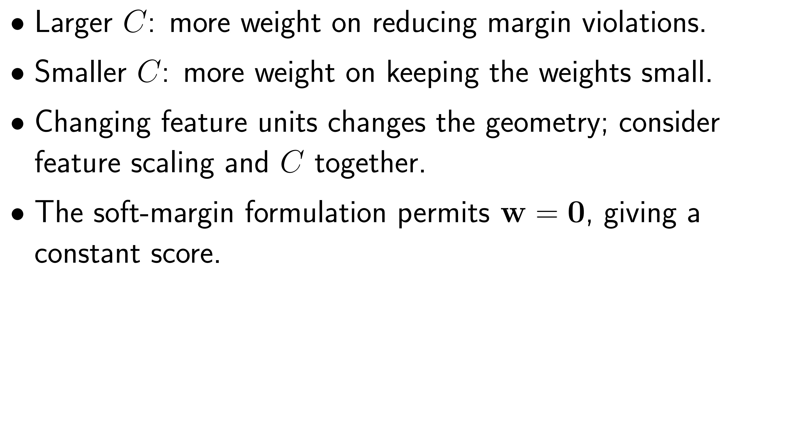

## 第 31 页：章节页：计算 SVM 参数

模型的优化目标和约束已经明确，最后介绍标准数值求解器与直接迭代更新两条计算路线。

展开第 31 页原始 slide，核对图表、标注和公式

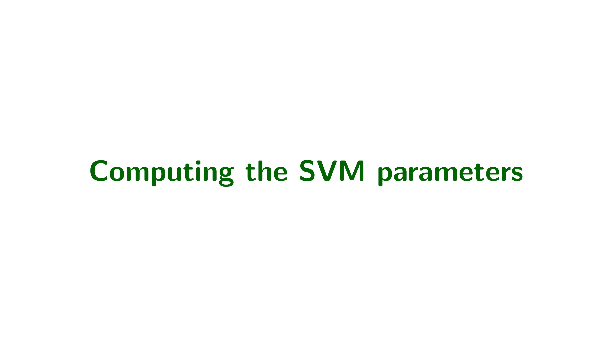

## 第 32 页：二次规划与直接优化合页损失

带约束的 SVM 形式可以交给标准 quadratic-programming（QP，二次规划）求解器。这些问题是凸的，因此每个局部极小点也都是全局极小点。软间隔还可以直接优化合页损失目标。迭代更新一方面让权重变小，另一方面修正违反间隔要求的点，在两者之间平衡。

展开第 32 页原始 slide，核对图表、标注和公式

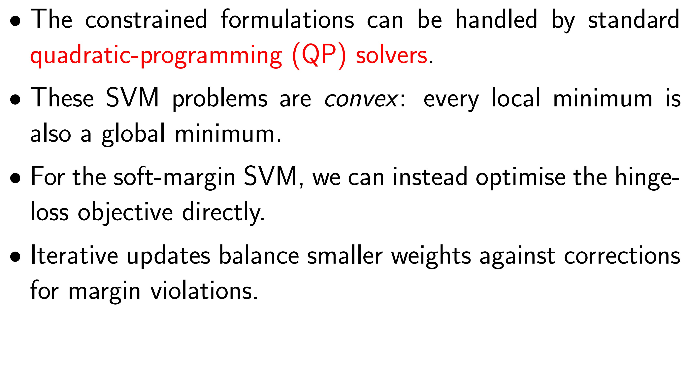

## 第 33 页：例 5：先收集违反点，再同步更新

在当前 $w,b$ 下，先收集

$$
I=\{i:y_i(\langle w,x_i\rangle+b)<1\}.
$$

取小步长 $0<\eta<1$，一种可能的更新是

$$
w_{\mathrm{new}}=(1-\eta)w+\eta C\sum_{i\in I}y_ix_i,\qquad
b_{\mathrm{new}}=b+\eta C\sum_{i\in I}y_i.
$$

两条更新使用相同的 $I$，而且 $I$ 必须在任意参数变化之前计算。不能先更新 $w$，重新判断一遍违反点，再拿新集合更新 $b$，那就不是原页给出的同一次更新。

**理解补充：**在 $m_i=1$ 的拐点选择零作为该损失项的一个次梯度，就可以得到这里使用严格小于 1 的集合规则。

展开第 33 页原始 slide，核对图表、标注和公式

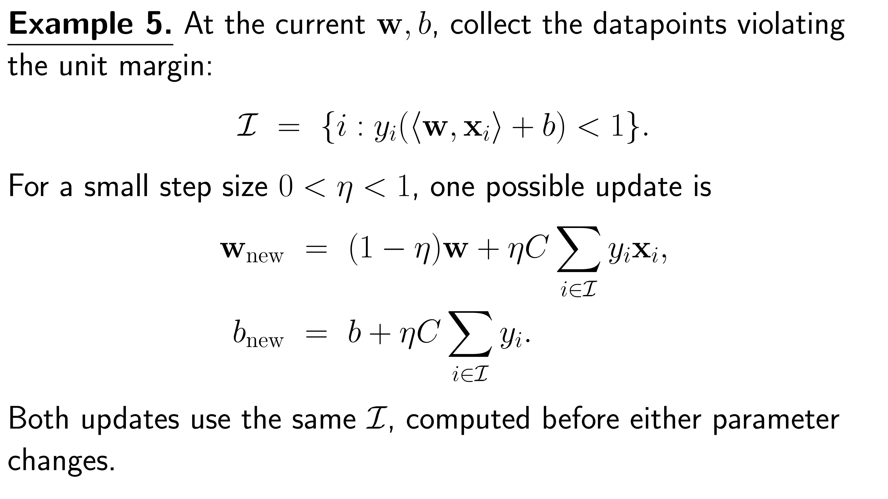

## 第 34 页：更新中每一部分起什么作用

$(1-\eta)w$ 缩小权重。一个违反点贡献的修正是权重增加 $\eta Cy_ix_i$，偏置增加 $\eta Cy_i$。单独看这一点带来的修正，它使该点函数间隔增加

$$
\eta C(\|x_i\|_2^2+1).
$$

**理解补充：**将两项修正代入 $y_i(\langle w,x_i\rangle+b)$，用 $y_i^2=1$ 即得该式。但其他点的修正与权重收缩可能抵消这个增量，因此不能保证总更新后该点的间隔一定增加这么多。

展开第 34 页原始 slide，核对图表、标注和公式

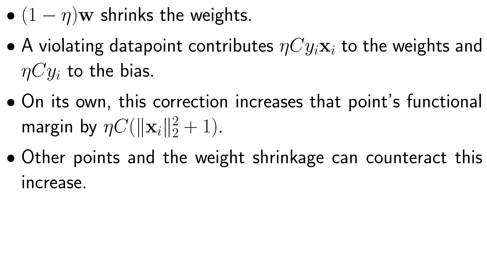

## 第 35 页：次梯度方法与收敛限制

这是一种 subgradient method（次梯度方法），用于处理合页损失在间隔 1 处的拐角。需要重新计算各点间隔、反复更新，并选择合适的步长和停止条件。

单独一步不一定让目标下降，任意固定步长也不一定收敛。详细收敛条件超出本课程范围。问题是凸的，不代表随意设定的迭代规则就自动收敛。

展开第 35 页原始 slide，核对图表、标注和公式

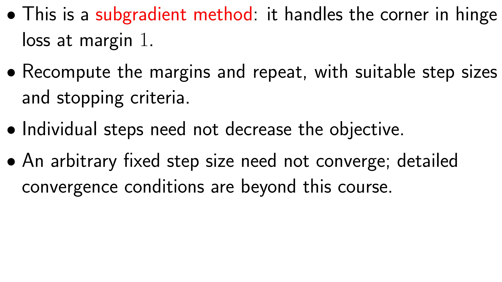

## 第 36 页：本讲总结

仿射评分 $\langle w,x\rangle+b$ 给出二分类预测；当 $w\ne0$ 时，评分除以 $\|w\|_2$ 得到有符号距离。硬间隔 SVM 寻找最宽的分离间隔。松弛变量与合页损失允许违反间隔要求，使软间隔适应更现实的数据。模型参数可以通过数值求解器或次梯度方法计算。

展开第 36 页原始 slide，核对图表、标注和公式

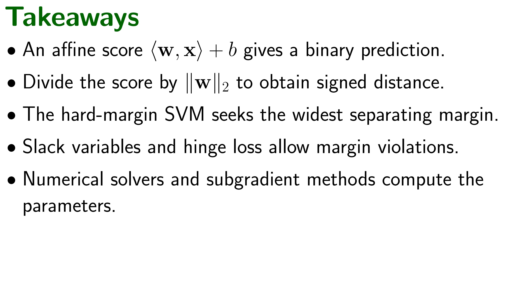

